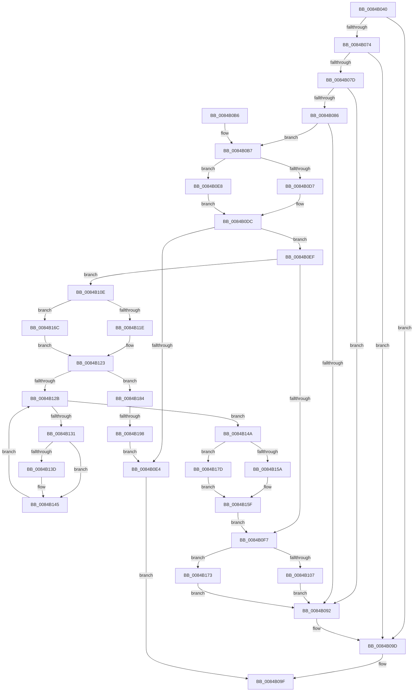

# CmpFreeValueData

- RVA: `0x0084B040`–`0x0084B1A2` (길이 `354` bytes)
- VA: `0x000000014084B040`
- 실행 섹션: `PAGE`
- PDB 이름 있음: `예`; PDB Function 태그: `예`
- unwind 정보 RVA: `0x000695EC`
- 디코드: `103`개 명령, `354/354` bytes 표시
- 미해석 바이트: `0` (있으면 어셈블리에 `.byte`로 보존)

> 이 문서는 커널 이미지의 기계어와 PDB 기호를 분석해 생성했습니다. 4번과 5번은 함수 원형과 자료형을 바이너리 사용 방식에서 추정한 C 해석이며 원본 소스 복구 결과는 아닙니다.

## 1. Dependencies

- 직접 호출 지점: **12**; 고유 호출 대상: **5**
- 직접 호출자로 확인된 함수: **4**
- RIP 상대 이미지 참조: **0**

### Outgoing calls
- `0x0084B098` → [HvFreeCell](../85/HvFreeCell_function_0085A72C.md) (function, `0x0085A72C`)
- `0x0084B0D7` → [HvpGetCellFlat](../85/HvpGetCellFlat_function_00854C60.md) (function, `0x00854C60`)
- `0x0084B0E8` → [HvpGetCellPaged](../85/HvpGetCellPaged_function_00854CB0.md) (function, `0x00854CB0`)
- `0x0084B107` → [HvpReleaseCellPaged](../85/HvpReleaseCellPaged_function_00855F40.md) (function, `0x00855F40`)
- `0x0084B11E` → [HvpGetCellFlat](../85/HvpGetCellFlat_function_00854C60.md) (function, `0x00854C60`)
- `0x0084B140` → [HvFreeCell](../85/HvFreeCell_function_0085A72C.md) (function, `0x0085A72C`)
- `0x0084B15A` → [HvpReleaseCellPaged](../85/HvpReleaseCellPaged_function_00855F40.md) (function, `0x00855F40`)
- `0x0084B165` → [HvFreeCell](../85/HvFreeCell_function_0085A72C.md) (function, `0x0085A72C`)
- `0x0084B16C` → [HvpGetCellPaged](../85/HvpGetCellPaged_function_00854CB0.md) (function, `0x00854CB0`)
- `0x0084B173` → [HvpReleaseCellFlat](../85/HvpReleaseCellFlat_function_0085CC20.md) (function, `0x0085CC20`)
- `0x0084B17D` → [HvpReleaseCellFlat](../85/HvpReleaseCellFlat_function_0085CC20.md) (function, `0x0085CC20`)
- `0x0084B198` → [HvpReleaseCellFlat](../85/HvpReleaseCellFlat_function_0085CC20.md) (function, `0x0085CC20`)

### Direct callers
- [CmDeleteValueKey](CmDeleteValueKey_function_008476E8.md) at `0x008481F2`
- [CmpFreeValue](CmpFreeValue_function_0084AF98.md) at `0x0084AFD7`
- [CmpSetValueKeyExisting](CmpSetValueKeyExisting_function_0084B53C.md) at `0x0084B88C`
- [CmpSetValueKeyExisting](CmpSetValueKeyExisting_function_0084B53C.md) at `0x0084B8BB`
- [CmpCopyValue](../85/CmpCopyValue_function_0085B798.md) at `0x0085BB22`

### Static image references
- 디코드된 RIP-relative 메모리 참조가 없습니다.

## 2. Other-region calls and transfers

- 다른 실행 섹션으로 향하는 call: **0**
- call이 아닌 외부 분기/꼬리 이동: **1**
  - `0x0084B192` → [sub_00B1684C](../B1/Unknown_function_00B1684C.md) (`tail-transfer`)

## 3. Assembly (complete function range)

```asm
0084B040  48 89 5C 24 08                  mov qword ptr [rsp + 8], rbx
0084B045  48 89 74 24 10                  mov qword ptr [rsp + 0x10], rsi
0084B04A  55                              push rbp
0084B04B  57                              push rdi
0084B04C  41 55                           push r13
0084B04E  41 56                           push r14
0084B050  41 57                           push r15
0084B052  48 8B EC                        mov rbp, rsp
0084B055  48 83 EC 30                     sub rsp, 0x30
0084B059  48 8B D9                        mov rbx, rcx
0084B05C  41 8D 80 00 00 00 80            lea eax, [r8 - 0x80000000]
0084B063  B9 00 00 00 80                  mov ecx, 0x80000000
0084B068  44 8B F2                        mov r14d, edx
0084B06B  44 3B C1                        cmp r8d, ecx
0084B06E  41 0F 42 C0                     cmovb eax, r8d
0084B072  73 29                           jae 0x14084b09d
0084B074  41 83 CD FF                     or r13d, 0xffffffff
0084B078  41 3B D5                        cmp edx, r13d
0084B07B  74 20                           je 0x14084b09d
0084B07D  83 BB DC 00 00 00 04            cmp dword ptr [rbx + 0xdc], 4
0084B084  72 0C                           jb 0x14084b092
0084B086  05 27 C0 FF FF                  add eax, 0xffffc027
0084B08B  3D 26 C0 FF 7F                  cmp eax, 0x7fffc026
0084B090  76 25                           jbe 0x14084b0b7
0084B092  41 8B D6                        mov edx, r14d
0084B095  48 8B CB                        mov rcx, rbx
0084B098  E8 8F F6 00 00                  call 0x14085a72c
0084B09D  B0 01                           mov al, 1
0084B09F  48 8B 5C 24 60                  mov rbx, qword ptr [rsp + 0x60]
0084B0A4  48 8B 74 24 68                  mov rsi, qword ptr [rsp + 0x68]
0084B0A9  48 83 C4 30                     add rsp, 0x30
0084B0AD  41 5F                           pop r15
0084B0AF  41 5E                           pop r14
0084B0B1  41 5D                           pop r13
0084B0B3  5F                              pop rdi
0084B0B4  5D                              pop rbp
0084B0B5  C3                              ret
0084B0B6  CC                              int3
0084B0B7  33 FF                           xor edi, edi
0084B0B9  44 89 6D 48                     mov dword ptr [rbp + 0x48], r13d
0084B0BD  F6 83 8C 00 00 00 01            test byte ptr [rbx + 0x8c], 1
0084B0C4  4C 8D 45 48                     lea r8, [rbp + 0x48]
0084B0C8  89 7D 4C                        mov dword ptr [rbp + 0x4c], edi
0084B0CB  48 8B CB                        mov rcx, rbx
0084B0CE  44 89 6D F0                     mov dword ptr [rbp - 0x10], r13d
0084B0D2  89 7D F4                        mov dword ptr [rbp - 0xc], edi
0084B0D5  74 11                           je 0x14084b0e8
0084B0D7  E8 84 9B 00 00                  call 0x140854c60
0084B0DC  48 8B F0                        mov rsi, rax
0084B0DF  48 85 C0                        test rax, rax
0084B0E2  75 0B                           jne 0x14084b0ef
0084B0E4  32 C0                           xor al, al
0084B0E6  EB B7                           jmp 0x14084b09f
0084B0E8  E8 C3 9B 00 00                  call 0x140854cb0
0084B0ED  EB ED                           jmp 0x14084b0dc
0084B0EF  8B 56 04                        mov edx, dword ptr [rsi + 4]
0084B0F2  41 3B D5                        cmp edx, r13d
0084B0F5  75 17                           jne 0x14084b10e
0084B0F7  F6 83 8C 00 00 00 01            test byte ptr [rbx + 0x8c], 1
0084B0FE  48 8D 55 48                     lea rdx, [rbp + 0x48]
0084B102  48 8B CB                        mov rcx, rbx
0084B105  75 6C                           jne 0x14084b173
0084B107  E8 34 AE 00 00                  call 0x140855f40
0084B10C  EB 84                           jmp 0x14084b092
0084B10E  F6 83 8C 00 00 00 01            test byte ptr [rbx + 0x8c], 1
0084B115  4C 8D 45 F0                     lea r8, [rbp - 0x10]
0084B119  48 8B CB                        mov rcx, rbx
0084B11C  74 4E                           je 0x14084b16c
0084B11E  E8 3D 9B 00 00                  call 0x140854c60
0084B123  4C 8B F8                        mov r15, rax
0084B126  48 85 C0                        test rax, rax
0084B129  74 59                           je 0x14084b184
0084B12B  66 3B 7E 02                     cmp di, word ptr [rsi + 2]
0084B12F  73 19                           jae 0x14084b14a
0084B131  0F B7 C7                        movzx eax, di
0084B134  41 8B 14 87                     mov edx, dword ptr [r15 + rax*4]
0084B138  41 3B D5                        cmp edx, r13d
0084B13B  74 08                           je 0x14084b145
0084B13D  48 8B CB                        mov rcx, rbx
0084B140  E8 E7 F5 00 00                  call 0x14085a72c
0084B145  66 FF C7                        inc di
0084B148  EB E1                           jmp 0x14084b12b
0084B14A  F6 83 8C 00 00 00 01            test byte ptr [rbx + 0x8c], 1
0084B151  48 8D 55 F0                     lea rdx, [rbp - 0x10]
0084B155  48 8B CB                        mov rcx, rbx
0084B158  75 23                           jne 0x14084b17d
0084B15A  E8 E1 AD 00 00                  call 0x140855f40
0084B15F  8B 56 04                        mov edx, dword ptr [rsi + 4]
0084B162  48 8B CB                        mov rcx, rbx
0084B165  E8 C2 F5 00 00                  call 0x14085a72c
0084B16A  EB 8B                           jmp 0x14084b0f7
0084B16C  E8 3F 9B 00 00                  call 0x140854cb0
0084B171  EB B0                           jmp 0x14084b123
0084B173  E8 A8 1A 01 00                  call 0x14085cc20
0084B178  E9 15 FF FF FF                  jmp 0x14084b092
0084B17D  E8 9E 1A 01 00                  call 0x14085cc20
0084B182  EB DB                           jmp 0x14084b15f
0084B184  F6 83 8C 00 00 00 01            test byte ptr [rbx + 0x8c], 1
0084B18B  48 8D 55 48                     lea rdx, [rbp + 0x48]
0084B18F  48 8B CB                        mov rcx, rbx
0084B192  0F 84 B4 B6 2C 00               je 0x140b1684c
0084B198  E8 83 1A 01 00                  call 0x14085cc20
0084B19D  E9 42 FF FF FF                  jmp 0x14084b0e4
```

## 4. C-style interpretation (structured pseudocode)

```c
__int64 __fastcall CmpFreeValueData(__int64 a1, int a2, __int64 a3)
{
    __int64 result;
    __int64 v_r13;
    __int64 v_rdi;
    __int64 v_rsp;
    unsigned int v_stack_m34;
    unsigned int v_stack_m38;
    unsigned __int64 v_stack_p10;
    unsigned int v_stack_p20;
    unsigned int v_stack_p24;
    unsigned __int64 v_stack_p8;

    v_stack_p8 = v_rbx;
    v_stack_p10 = v_rsi;
    v_rsp = (v_rsp) - (48);
    result = a3 - 2147483648;
    if (((unsigned int)(a3)) < ((unsigned int)((unsigned int)(0x80000000ULL)))) { result = (unsigned int)(a3); }
    if (((unsigned int)(a3)) >= ((unsigned int)((unsigned int)(0x80000000ULL)))) goto loc_0084B09D;
    v_r13 = (unsigned int)((v_r13) | (0xFFFFFFFFULL));
    if (a2 == ((unsigned int)(v_r13))) goto loc_0084B09D;
    if ((*(unsigned int *)(a1 + 220)) < 4) goto loc_0084B092;
    result = (unsigned int)((result) + (0xFFFFC027ULL));
    if (((unsigned int)(result)) <= 0x7FFFC026ULL) goto loc_0084B0B7;
loc_0084B092:
    result = HvFreeCell(a1, (unsigned int)((unsigned int)((unsigned int)(a2))), a3, a4);
loc_0084B09D:
loc_0084B09F:
    v_rsp = (v_rsp) + (48);
    return 1;
loc_0084B0B7:
    v_rdi = 0;
    v_stack_p20 = (unsigned int)(v_r13);
    v_stack_p24 = 0;
    v_stack_m38 = (unsigned int)(v_r13);
    v_stack_m34 = 0;
    if (((*(unsigned __int8 *)(v_stack_p8 + 140)) & (1)) == 0) goto loc_0084B0E8;
    result = HvpGetCellFlat(v_stack_p8, (unsigned int)((unsigned int)((unsigned int)(a2))), v_stack_p20, a4);
loc_0084B0DC:
    if (result != 0) goto loc_0084B0EF;
loc_0084B0E4:
    result = 0;
    goto loc_0084B09F;
loc_0084B0E8:
    result = HvpGetCellPaged(v_stack_p8, (unsigned int)((unsigned int)((unsigned int)(a2))), v_stack_p20, a4);
    goto loc_0084B0DC;
loc_0084B0EF:
    if (((unsigned int)((unsigned int)(*(unsigned int *)(result + 4)))) != ((unsigned int)(v_r13))) goto loc_0084B10E;
loc_0084B0F7:
    if (((*(unsigned __int8 *)(v_stack_p8 + 140)) & (1)) != 0) goto loc_0084B173;
    result = HvpReleaseCellPaged(v_stack_p8, v_stack_p20, v_stack_p20, a4);
    goto loc_0084B092;
loc_0084B10E:
    if (((*(unsigned __int8 *)(v_stack_p8 + 140)) & (1)) == 0) goto loc_0084B16C;
    result = HvpGetCellFlat(v_stack_p8, v_stack_p20, v_stack_m38, a4);
loc_0084B123:
    if (result == 0) goto loc_0084B184;
loc_0084B12B:
    if (0 >= (*(unsigned __int16 *)(result + 2))) goto loc_0084B14A;
    result = 0;
    if (((unsigned int)((unsigned int)(*(unsigned int *)(result + 0 * 4)))) != ((unsigned int)(v_r13))) {
        a1 = v_stack_p8;
        result = HvFreeCell(a1, (unsigned int)(*(unsigned int *)(result + 0 * 4)), v_stack_m38, a4);
    }
    v_rdi = (unsigned __int16)((v_rdi) + 1);
    goto loc_0084B12B;
loc_0084B14A:
    if (((*(unsigned __int8 *)(v_stack_p8 + 140)) & (1)) != 0) goto loc_0084B17D;
    result = HvpReleaseCellPaged(v_stack_p8, v_stack_m38, v_stack_m38, a4);
loc_0084B15F:
    result = HvFreeCell(v_stack_p8, (unsigned int)(*(unsigned int *)(result + 4)), v_stack_m38, a4);
    goto loc_0084B0F7;
loc_0084B16C:
    result = HvpGetCellPaged(v_stack_p8, (unsigned int)(*(unsigned int *)(result + 4)), v_stack_m38, a4);
    goto loc_0084B123;
loc_0084B173:
    result = HvpReleaseCellFlat(v_stack_p8, (unsigned int)(*(unsigned int *)(result + 4)), v_stack_m38, a4);
    goto loc_0084B092;
loc_0084B17D:
    result = HvpReleaseCellFlat(v_stack_p8, (unsigned int)(*(unsigned int *)(result + 4)), v_stack_m38, a4);
    goto loc_0084B15F;
loc_0084B184:
    result = HvpReleaseCellFlat(v_stack_p8, v_stack_p20, v_stack_m38, a4);
    goto loc_0084B0E4;
}
```

## 5. (Beta) C Style

```c
int64_t CmpFreeValueData(void *Arg1, int32_t Arg2, void *Arg3)
{
    uint8_t *arg1 = (uint8_t *)Arg1;
    uint8_t *arg3 = (uint8_t *)Arg3;

    int64_t result;
    int64_t local_r13;
    int64_t local_rdi;
    int64_t local_rsp;
    uint32_t v_stack_m34;
    uint32_t v_stack_m38;
    uint64_t v_stack_p10;
    uint32_t v_stack_p20;
    uint32_t v_stack_p24;
    uint64_t v_stack_p8;

    v_stack_p8 = local_rbx;
    v_stack_p10 = local_rsi;
    local_rsp = (local_rsp) - (48);
    result = Arg3 - 2147483648;
    if (((uint32_t)(Arg3)) < ((uint32_t)((uint32_t)(0x80000000ULL)))) { result = (uint32_t)(Arg3); }
    if (((uint32_t)(Arg3)) >= ((uint32_t)((uint32_t)(0x80000000ULL)))) goto loc_0084B09D;
    local_r13 = (uint32_t)((local_r13) | (0xFFFFFFFFULL));
    if (Arg2 == ((uint32_t)(local_r13))) goto loc_0084B09D;
    if ((*(uint32_t *)(arg1 + 0xDC)) < 4) goto loc_0084B092;
    result = (uint32_t)((result) + (0xFFFFC027ULL));
    if (((uint32_t)(result)) <= 0x7FFFC026ULL) goto loc_0084B0B7;
loc_0084B092:
    result = HvFreeCell(Arg1, (uint32_t)((uint32_t)((uint32_t)(Arg2))), Arg3, a4);
loc_0084B09D:
loc_0084B09F:
    local_rsp = (local_rsp) + (48);
    return 1;
loc_0084B0B7:
    local_rdi = 0;
    v_stack_p20 = (uint32_t)(local_r13);
    v_stack_p24 = 0;
    v_stack_m38 = (uint32_t)(local_r13);
    v_stack_m34 = 0;
    if (((*(uint8_t *)(v_stack_p8 + 0x8C)) & (1)) == 0) goto loc_0084B0E8;
    result = HvpGetCellFlat(v_stack_p8, (uint32_t)((uint32_t)((uint32_t)(Arg2))), v_stack_p20, a4);
loc_0084B0DC:
    if (result != 0) goto loc_0084B0EF;
loc_0084B0E4:
    result = 0;
    goto loc_0084B09F;
loc_0084B0E8:
    result = HvpGetCellPaged(v_stack_p8, (uint32_t)((uint32_t)((uint32_t)(Arg2))), v_stack_p20, a4);
    goto loc_0084B0DC;
loc_0084B0EF:
    if (((uint32_t)((uint32_t)(*(uint32_t *)(result + 0x4)))) != ((uint32_t)(local_r13))) goto loc_0084B10E;
loc_0084B0F7:
    if (((*(uint8_t *)(v_stack_p8 + 0x8C)) & (1)) != 0) goto loc_0084B173;
    result = HvpReleaseCellPaged(v_stack_p8, v_stack_p20, v_stack_p20, a4);
    goto loc_0084B092;
loc_0084B10E:
    if (((*(uint8_t *)(v_stack_p8 + 0x8C)) & (1)) == 0) goto loc_0084B16C;
    result = HvpGetCellFlat(v_stack_p8, v_stack_p20, v_stack_m38, a4);
loc_0084B123:
    if (result == 0) goto loc_0084B184;
loc_0084B12B:
    if (0 >= (*(uint16_t *)(result + 0x2))) goto loc_0084B14A;
    result = 0;
    if (((uint32_t)((uint32_t)(*(uint32_t *)(result + 0x0 * 4)))) != ((uint32_t)(local_r13))) {
        Arg1 = v_stack_p8;
        result = HvFreeCell(Arg1, (uint32_t)(*(uint32_t *)(result + 0x0 * 4)), v_stack_m38, a4);
    }
    local_rdi = (uint16_t)((local_rdi) + 1);
    goto loc_0084B12B;
loc_0084B14A:
    if (((*(uint8_t *)(v_stack_p8 + 0x8C)) & (1)) != 0) goto loc_0084B17D;
    result = HvpReleaseCellPaged(v_stack_p8, v_stack_m38, v_stack_m38, a4);
loc_0084B15F:
    result = HvFreeCell(v_stack_p8, (uint32_t)(*(uint32_t *)(result + 0x4)), v_stack_m38, a4);
    goto loc_0084B0F7;
loc_0084B16C:
    result = HvpGetCellPaged(v_stack_p8, (uint32_t)(*(uint32_t *)(result + 0x4)), v_stack_m38, a4);
    goto loc_0084B123;
loc_0084B173:
    result = HvpReleaseCellFlat(v_stack_p8, (uint32_t)(*(uint32_t *)(result + 0x4)), v_stack_m38, a4);
    goto loc_0084B092;
loc_0084B17D:
    result = HvpReleaseCellFlat(v_stack_p8, (uint32_t)(*(uint32_t *)(result + 0x4)), v_stack_m38, a4);
    goto loc_0084B15F;
loc_0084B184:
    result = HvpReleaseCellFlat(v_stack_p8, v_stack_p20, v_stack_m38, a4);
    goto loc_0084B0E4;
}
```

### 관측된 메모리 오프셋

구조체 형식이 확인되지 않은 접근은 인자 기준의 오프셋으로만 기록했습니다.

| 기준 인자 | 오프셋 표현 | 폭 (bit) | 접근 |
|---|---:|---:|---|
| `Arg1` | `+ 0x8C` | `8` | `R` |
| `Arg1` | `+ 0xDC` | `32` | `R` |
| `Arg3` | `- 0x80000000` | `32` | `R` |

## 6. Execution-region graph

[열기: 2D/3D 그래프와 함수 탐색 컨트롤 패널](../../../control-panel.html?section=page&rva=0x0084B040&view=graph)

- 2D 그래프는 위에서 아래로 흐르고, 3D 그래프는 빈 공간을 드래그해 회전합니다. Shift+드래그는 이동, 휠은 확대·축소, 함수 노드 선택은 대상 보고서 이동입니다.

### Static fallback


