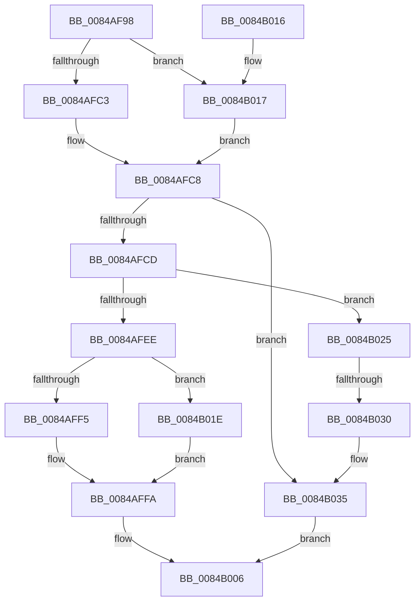

# CmpFreeValue

- RVA: `0x0084AF98`–`0x0084B039` (길이 `161` bytes)
- VA: `0x000000014084AF98`
- 실행 섹션: `PAGE`
- PDB 이름 있음: `예`; PDB Function 태그: `예`
- unwind 정보 RVA: `0x000695C8`
- 디코드: `49`개 명령, `161/161` bytes 표시
- 미해석 바이트: `0` (있으면 어셈블리에 `.byte`로 보존)

> 이 문서는 커널 이미지의 기계어와 PDB 기호를 분석해 생성했습니다. 4번과 5번은 함수 원형과 자료형을 바이너리 사용 방식에서 추정한 C 해석이며 원본 소스 복구 결과는 아닙니다.

## 1. Dependencies

- 직접 호출 지점: **7**; 고유 호출 대상: **6**
- 직접 호출자로 확인된 함수: **13**
- RIP 상대 이미지 참조: **0**

### Outgoing calls
- `0x0084AFC3` → [HvpGetCellFlat](../85/HvpGetCellFlat_function_00854C60.md) (function, `0x00854C60`)
- `0x0084AFD7` → [CmpFreeValueData](CmpFreeValueData_function_0084B040.md) (function, `0x0084B040`)
- `0x0084AFF5` → [HvpReleaseCellPaged](../85/HvpReleaseCellPaged_function_00855F40.md) (function, `0x00855F40`)
- `0x0084AFFF` → [HvFreeCell](../85/HvFreeCell_function_0085A72C.md) (function, `0x0085A72C`)
- `0x0084B017` → [HvpGetCellPaged](../85/HvpGetCellPaged_function_00854CB0.md) (function, `0x00854CB0`)
- `0x0084B01E` → [HvpReleaseCellFlat](../85/HvpReleaseCellFlat_function_0085CC20.md) (function, `0x0085CC20`)
- `0x0084B030` → [HvpReleaseCellFlat](../85/HvpReleaseCellFlat_function_0085CC20.md) (function, `0x0085CC20`)

### Direct callers
- [CmpFreeKeyValueList](../7F/CmpFreeKeyValueList_function_007F2250.md) at `0x007F22AE`
- [CmpSyncKeyValues](../7F/CmpSyncKeyValues_function_007F2DF4.md) at `0x007F3064`
- [CmSetValueKey](CmSetValueKey_function_008457C0.md) at `0x0084679E`
- [CmDeleteValueKey](CmDeleteValueKey_function_008476E8.md) at `0x00847B57`
- [CmpFreeKeyByCell](CmpFreeKeyByCell_function_0084AD70.md) at `0x0084AF0F`
- [CmpSetValueKeyNew](../85/CmpSetValueKeyNew_function_0085BB44.md) at `0x0085BC1F`
- [CmpTransMgrFreeVolatileData](../87/CmpTransMgrFreeVolatileData_function_00874BDC.md) at `0x00874C54`
- [CmpCleanupLightWeightUoWData](../9B/CmpCleanupLightWeightUoWData_function_009B0A68.md) at `0x009B0AFE`
- [CmpLightWeightPrepareSetValueKeyUoW](../A0/CmpLightWeightPrepareSetValueKeyUoW_function_00A0EF28.md) at `0x00A0F3C5`
- [CmpLightWeightCommitDeleteValueKeyUoW](../A3/CmpLightWeightCommitDeleteValueKeyUoW_function_00A39E54.md) at `0x00A39EB5`
- [CmpLightWeightCommitSetValueKeyUoW](../A3/CmpLightWeightCommitSetValueKeyUoW_function_00A39FA0.md) at `0x00A3A057`
- [CmpFreeKeyValues](../A8/CmpFreeKeyValues_function_00A8B3E4.md) at `0x00A8B455`
- [CmpSetValueKeyTombstone](../AC/CmpSetValueKeyTombstone_function_00AC5D64.md) at `0x00AC5DFA`

### Static image references
- 디코드된 RIP-relative 메모리 참조가 없습니다.

## 2. Other-region calls and transfers

- 다른 실행 섹션으로 향하는 call: **0**
- call이 아닌 외부 분기/꼬리 이동: **1**
  - `0x0084B02A` → [sub_00B16840](../B1/Unknown_function_00B16840.md) (`tail-transfer`)

## 3. Assembly (complete function range)

```asm
0084AF98  48 8B C4                        mov rax, rsp
0084AF9B  48 89 58 10                     mov qword ptr [rax + 0x10], rbx
0084AF9F  48 89 70 18                     mov qword ptr [rax + 0x18], rsi
0084AFA3  57                              push rdi
0084AFA4  48 83 EC 20                     sub rsp, 0x20
0084AFA8  83 48 08 FF                     or dword ptr [rax + 8], 0xffffffff
0084AFAC  4C 8D 40 08                     lea r8, [rax + 8]
0084AFB0  33 F6                           xor esi, esi
0084AFB2  8B FA                           mov edi, edx
0084AFB4  F6 81 8C 00 00 00 01            test byte ptr [rcx + 0x8c], 1
0084AFBB  48 8B D9                        mov rbx, rcx
0084AFBE  89 70 0C                        mov dword ptr [rax + 0xc], esi
0084AFC1  74 54                           je 0x14084b017
0084AFC3  E8 98 9C 00 00                  call 0x140854c60
0084AFC8  48 85 C0                        test rax, rax
0084AFCB  74 68                           je 0x14084b035
0084AFCD  44 8B 40 04                     mov r8d, dword ptr [rax + 4]
0084AFD1  48 8B CB                        mov rcx, rbx
0084AFD4  8B 50 08                        mov edx, dword ptr [rax + 8]
0084AFD7  E8 64 00 00 00                  call 0x14084b040
0084AFDC  8A 8B 8C 00 00 00               mov cl, byte ptr [rbx + 0x8c]
0084AFE2  48 8D 54 24 30                  lea rdx, [rsp + 0x30]
0084AFE7  80 E1 01                        and cl, 1
0084AFEA  84 C0                           test al, al
0084AFEC  74 37                           je 0x14084b025
0084AFEE  84 C9                           test cl, cl
0084AFF0  48 8B CB                        mov rcx, rbx
0084AFF3  75 29                           jne 0x14084b01e
0084AFF5  E8 46 AF 00 00                  call 0x140855f40
0084AFFA  8B D7                           mov edx, edi
0084AFFC  48 8B CB                        mov rcx, rbx
0084AFFF  E8 28 F7 00 00                  call 0x14085a72c
0084B004  B0 01                           mov al, 1
0084B006  48 8B 5C 24 38                  mov rbx, qword ptr [rsp + 0x38]
0084B00B  48 8B 74 24 40                  mov rsi, qword ptr [rsp + 0x40]
0084B010  48 83 C4 20                     add rsp, 0x20
0084B014  5F                              pop rdi
0084B015  C3                              ret
0084B016  CC                              int3
0084B017  E8 94 9C 00 00                  call 0x140854cb0
0084B01C  EB AA                           jmp 0x14084afc8
0084B01E  E8 FD 1B 01 00                  call 0x14085cc20
0084B023  EB D5                           jmp 0x14084affa
0084B025  84 C9                           test cl, cl
0084B027  48 8B CB                        mov rcx, rbx
0084B02A  0F 84 10 B8 2C 00               je 0x140b16840
0084B030  E8 EB 1B 01 00                  call 0x14085cc20
0084B035  32 C0                           xor al, al
0084B037  EB CD                           jmp 0x14084b006
```

## 4. C-style interpretation (structured pseudocode)

```c
__int64 __fastcall CmpFreeValue(__int64 a1, int a2)
{
    __int64 result;
    __int64 v_rsi;
    __int64 v_rsp;
    unsigned __int64 v_stack_p10;
    unsigned __int64 v_stack_p18;
    unsigned __int64 v_stack_p8;

    *(unsigned __int64 *)(v_rsp + 16) = v_rbx;
    *(unsigned __int64 *)(v_rsp + 24) = v_rsi;
    v_rsp = (v_rsp) - (32);
    v_rsi = 0;
    *(unsigned int *)(v_rsp + 12) = 0;
    if (((*(unsigned __int8 *)(a1 + 140)) & (1)) == 0) goto loc_0084B017;
    result = HvpGetCellFlat(a1, a2, v_rsp + 8, a4);
loc_0084AFC8:
    if (result == 0) goto loc_0084B035;
    result = CmpFreeValueData(a1, (unsigned int)(*(unsigned int *)(result + 8)), (unsigned int)(*(unsigned int *)(result + 4)), a4);
    a1 = (unsigned __int8)((*(unsigned __int8 *)(a1 + 140)) & (1));
    if ((unsigned __int8)(result) == 0) goto loc_0084B025;
    if ((unsigned __int8)(a1) != 0) goto loc_0084B01E;
    result = HvpReleaseCellPaged(a1, v_stack_p8, (unsigned int)(*(unsigned int *)(result + 4)), a4);
loc_0084AFFA:
    result = HvFreeCell(a1, (unsigned int)((unsigned int)((unsigned int)(a2))), (unsigned int)(*(unsigned int *)(result + 4)), a4);
loc_0084B006:
    v_rsp = (v_rsp) + (32);
    return 1;
loc_0084B017:
    result = HvpGetCellPaged(a1, (unsigned int)((unsigned int)((unsigned int)(a2))), (unsigned int)(*(unsigned int *)(result + 4)), a4);
    goto loc_0084AFC8;
loc_0084B01E:
    result = HvpReleaseCellFlat(a1, (unsigned int)((unsigned int)((unsigned int)(a2))), (unsigned int)(*(unsigned int *)(result + 4)), a4);
    goto loc_0084AFFA;
loc_0084B025:
    result = HvpReleaseCellFlat(v_stack_p10, (unsigned int)((unsigned int)((unsigned int)(a2))), (unsigned int)(*(unsigned int *)(result + 4)), a4);
loc_0084B035:
    result = 0;
    goto loc_0084B006;
}
```

## 5. (Beta) C Style

```c
int64_t CmpFreeValue(void *Arg1, int32_t Arg2)
{
    uint8_t *arg1 = (uint8_t *)Arg1;

    int64_t result;
    int64_t local_rsi;
    int64_t local_rsp;
    uint64_t v_stack_p10;
    uint64_t v_stack_p18;
    uint64_t v_stack_p8;

    *(uint64_t *)(local_rsp + 0x10) = local_rbx;
    *(uint64_t *)(local_rsp + 0x18) = local_rsi;
    local_rsp = (local_rsp) - (32);
    local_rsi = 0;
    *(uint32_t *)(local_rsp + 0xC) = 0;
    if (((*(uint8_t *)(arg1 + 0x8C)) & (1)) == 0) goto loc_0084B017;
    result = HvpGetCellFlat(Arg1, Arg2, local_rsp + 8, a4);
loc_0084AFC8:
    if (result == 0) goto loc_0084B035;
    result = CmpFreeValueData(Arg1, (uint32_t)(*(uint32_t *)(result + 0x8)), (uint32_t)(*(uint32_t *)(result + 0x4)), a4);
    Arg1 = (uint8_t)((*(uint8_t *)(arg1 + 0x8C)) & (1));
    if ((uint8_t)(result) == 0) goto loc_0084B025;
    if ((uint8_t)(Arg1) != 0) goto loc_0084B01E;
    result = HvpReleaseCellPaged(Arg1, v_stack_p8, (uint32_t)(*(uint32_t *)(result + 0x4)), a4);
loc_0084AFFA:
    result = HvFreeCell(Arg1, (uint32_t)((uint32_t)((uint32_t)(Arg2))), (uint32_t)(*(uint32_t *)(result + 0x4)), a4);
loc_0084B006:
    local_rsp = (local_rsp) + (32);
    return 1;
loc_0084B017:
    result = HvpGetCellPaged(Arg1, (uint32_t)((uint32_t)((uint32_t)(Arg2))), (uint32_t)(*(uint32_t *)(result + 0x4)), a4);
    goto loc_0084AFC8;
loc_0084B01E:
    result = HvpReleaseCellFlat(Arg1, (uint32_t)((uint32_t)((uint32_t)(Arg2))), (uint32_t)(*(uint32_t *)(result + 0x4)), a4);
    goto loc_0084AFFA;
loc_0084B025:
    result = HvpReleaseCellFlat(v_stack_p10, (uint32_t)((uint32_t)((uint32_t)(Arg2))), (uint32_t)(*(uint32_t *)(result + 0x4)), a4);
loc_0084B035:
    result = 0;
    goto loc_0084B006;
}
```

### 관측된 메모리 오프셋

구조체 형식이 확인되지 않은 접근은 인자 기준의 오프셋으로만 기록했습니다.

| 기준 인자 | 오프셋 표현 | 폭 (bit) | 접근 |
|---|---:|---:|---|
| `Arg1` | `+ 0x8C` | `8` | `R` |

## 6. Execution-region graph

[열기: 2D/3D 그래프와 함수 탐색 컨트롤 패널](../../../control-panel.html?section=page&rva=0x0084AF98&view=graph)

- 2D 그래프는 위에서 아래로 흐르고, 3D 그래프는 빈 공간을 드래그해 회전합니다. Shift+드래그는 이동, 휠은 확대·축소, 함수 노드 선택은 대상 보고서 이동입니다.

### Static fallback


