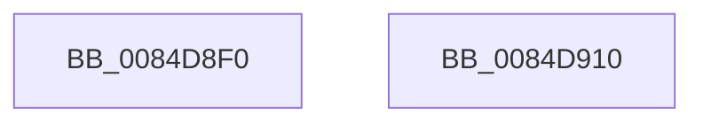

# CmpFree

- RVA: `0x0084D8F0`–`0x0084D911` (길이 `33` bytes)
- VA: `0x000000014084D8F0`
- 실행 섹션: `PAGE`
- PDB 이름 있음: `예`; PDB Function 태그: `아니요`
- unwind 정보 RVA: `0x0005CF00`
- 디코드: `12`개 명령, `33/33` bytes 표시
- 미해석 바이트: `0` (있으면 어셈블리에 `.byte`로 보존)

> 이 문서는 커널 이미지의 기계어와 PDB 기호를 분석해 생성했습니다. 4번과 5번은 함수 원형과 자료형을 바이너리 사용 방식에서 추정한 C 해석이며 원본 소스 복구 결과는 아닙니다.

## 1. Dependencies

- 직접 호출 지점: **2**; 고유 호출 대상: **2**
- 직접 호출자로 확인된 함수: **4**
- RIP 상대 이미지 참조: **0**

### Outgoing calls
- `0x0084D8FB` → [CmpReleaseGlobalQuota](CmpReleaseGlobalQuota_function_0084DB40.md) (function, `0x0084DB40`)
- `0x0084D905` → [ExFreePoolWithTag](../../poolcode/B8/ExFreePoolWithTag_function_00B82870.md) (function, `0x00B82870`)

### Direct callers
- [HvpFreeHiveFreeDisplay](HvpFreeHiveFreeDisplay_function_0084C4C0.md) at `0x0084C53E`
- [CmpAddSubKeyToList](CmpAddSubKeyToList_function_0084D644.md) at `0x0084D7B9`
- [HvHiveCleanup](HvHiveCleanup_function_0084D918.md) at `0x0084D9E5`
- [HvHiveCleanup](HvHiveCleanup_function_0084D918.md) at `0x0084DA9B`
- [HvHiveCleanup](HvHiveCleanup_function_0084D918.md) at `0x0084DAB0`
- [HvHiveCleanup](HvHiveCleanup_function_0084D918.md) at `0x0084DB06`
- [CmpDeleteHive](../86/CmpDeleteHive_function_0086450C.md) at `0x008645B5`

### Static image references
- 디코드된 RIP-relative 메모리 참조가 없습니다.

## 2. Other-region calls and transfers

- 다른 실행 섹션으로 향하는 call: **1**
  - `0x0084D905` → [ExFreePoolWithTag](../../poolcode/B8/ExFreePoolWithTag_function_00B82870.md) (`PAGE` → `POOLCODE`)
- 별도 외부 분기/꼬리 이동을 확인하지 못했습니다.

## 3. Assembly (complete function range)

```asm
0084D8F0  40 53                           push rbx
0084D8F2  48 83 EC 20                     sub rsp, 0x20
0084D8F6  48 8B D9                        mov rbx, rcx
0084D8F9  8B CA                           mov ecx, edx
0084D8FB  E8 40 02 00 00                  call 0x14084db40
0084D900  33 D2                           xor edx, edx
0084D902  48 8B CB                        mov rcx, rbx
0084D905  E8 66 4F 33 00                  call 0x140b82870
0084D90A  48 83 C4 20                     add rsp, 0x20
0084D90E  5B                              pop rbx
0084D90F  C3                              ret
0084D910  CC                              int3
```

## 4. C-style interpretation (structured pseudocode)

```c
__int64 __fastcall CmpFree(__int64 a1, int a2)
{
    __int64 result;
    __int64 v_rsp;

    v_rsp = (v_rsp) - (32);
    result = CmpReleaseGlobalQuota((unsigned int)(a2), a2, a3, a4);
    a2 = 0;
    result = ExFreePoolWithTag(a1, a2, a3, a4);
    v_rsp = (v_rsp) + (32);
    return result;
}
```

## 5. (Beta) C Style

```c
int64_t CmpFree(int64_t Arg1, int32_t Arg2)
{
    int64_t result;
    int64_t local_rsp;

    local_rsp = (local_rsp) - (32);
    result = CmpReleaseGlobalQuota((uint32_t)(Arg2), Arg2, a3, a4);
    Arg2 = 0;
    result = ExFreePoolWithTag(Arg1, Arg2, a3, a4);
    local_rsp = (local_rsp) + (32);
    return result;
}
```

## 6. Execution-region graph

[열기: 2D/3D 그래프와 함수 탐색 컨트롤 패널](../../../control-panel.html?section=page&rva=0x0084D8F0&view=graph)

- 2D 그래프는 위에서 아래로 흐르고, 3D 그래프는 빈 공간을 드래그해 회전합니다. Shift+드래그는 이동, 휠은 확대·축소, 함수 노드 선택은 대상 보고서 이동입니다.

### Static fallback


