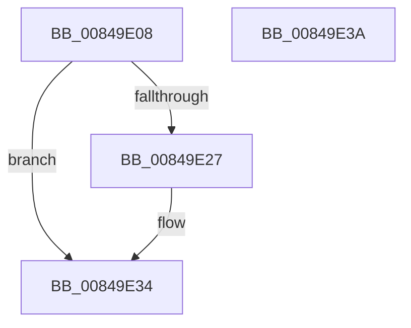

# CmpGetCmHiveFromVirtualPath

- RVA: `0x00849E08`–`0x00849E3B` (길이 `51` bytes)
- VA: `0x0000000140849E08`
- 실행 섹션: `PAGE`
- PDB 이름 있음: `예`; PDB Function 태그: `아니요`
- unwind 정보 RVA: `0x00064C80`
- 디코드: `16`개 명령, `51/51` bytes 표시
- 미해석 바이트: `0` (있으면 어셈블리에 `.byte`로 보존)

> 이 문서는 커널 이미지의 기계어와 PDB 기호를 분석해 생성했습니다. 4번과 5번은 함수 원형과 자료형을 바이너리 사용 방식에서 추정한 C 해석이며 원본 소스 복구 결과는 아닙니다.

## 1. Dependencies

- 직접 호출 지점: **2**; 고유 호출 대상: **2**
- 직접 호출자로 확인된 함수: **1**
- RIP 상대 이미지 참조: **0**

### Outgoing calls
- `0x00849E1E` → [CmpGetVirtualizationIDFromFullVirtualPath](CmpGetVirtualizationIDFromFullVirtualPath_function_0084ACA8.md) (function, `0x0084ACA8`)
- `0x00849E2F` → [CmpGetMappingHiveForString](CmpGetMappingHiveForString_function_0084A5C8.md) (function, `0x0084A5C8`)

### Direct callers
- [CmpVirtualPathPresent](../7E/CmpVirtualPathPresent_function_007EBDB4.md) at `0x007EBDEF`

### Static image references
- 디코드된 RIP-relative 메모리 참조가 없습니다.

## 2. Other-region calls and transfers

- 다른 실행 섹션으로 향하는 call: **0**
- 별도 외부 분기/꼬리 이동을 확인하지 못했습니다.

## 3. Assembly (complete function range)

```asm
00849E08  40 53                           push rbx
00849E0A  48 83 EC 30                     sub rsp, 0x30
00849E0E  0F 57 C0                        xorps xmm0, xmm0
00849E11  48 8B DA                        mov rbx, rdx
00849E14  48 8D 54 24 20                  lea rdx, [rsp + 0x20]
00849E19  0F 11 44 24 20                  movups xmmword ptr [rsp + 0x20], xmm0
00849E1E  E8 85 0E 00 00                  call 0x14084aca8
00849E23  85 C0                           test eax, eax
00849E25  78 0D                           js 0x140849e34
00849E27  48 8B D3                        mov rdx, rbx
00849E2A  48 8D 4C 24 20                  lea rcx, [rsp + 0x20]
00849E2F  E8 94 07 00 00                  call 0x14084a5c8
00849E34  48 83 C4 30                     add rsp, 0x30
00849E38  5B                              pop rbx
00849E39  C3                              ret
00849E3A  CC                              int3
```

## 4. C-style interpretation (structured pseudocode)

```c
__int64 __fastcall CmpGetCmHiveFromVirtualPath(__int64 a1, __int64 a2)
{
    __int64 result;
    __int64 v_rsp;
    unsigned __int64 v_stack_m18;

    v_rsp = (v_rsp) - (48);
    v_stack_m18 = v_xmm0;
    result = CmpGetVirtualizationIDFromFullVirtualPath(a1, v_stack_m18, a3, a4);
    if (!(sign_flag)) {
        a2 = a2;
        a1 = v_stack_m18;
        result = CmpGetMappingHiveForString(a1, a2, a3, a4);
    }
    v_rsp = (v_rsp) + (48);
    return result;
}
```

## 5. (Beta) C Style

```c
int64_t CmpGetCmHiveFromVirtualPath(int64_t Arg1, int64_t Arg2)
{
    int64_t result;
    int64_t local_rsp;
    uint64_t v_stack_m18;

    local_rsp = (local_rsp) - (48);
    v_stack_m18 = v_xmm0;
    result = CmpGetVirtualizationIDFromFullVirtualPath(Arg1, v_stack_m18, a3, a4);
    if (!(sign_flag)) {
        Arg2 = Arg2;
        Arg1 = v_stack_m18;
        result = CmpGetMappingHiveForString(Arg1, Arg2, a3, a4);
    }
    local_rsp = (local_rsp) + (48);
    return result;
}
```

## 6. Execution-region graph

[열기: 2D/3D 그래프와 함수 탐색 컨트롤 패널](../../../control-panel.html?section=page&rva=0x00849E08&view=graph)

- 2D 그래프는 위에서 아래로 흐르고, 3D 그래프는 빈 공간을 드래그해 회전합니다. Shift+드래그는 이동, 휠은 확대·축소, 함수 노드 선택은 대상 보고서 이동입니다.

### Static fallback


