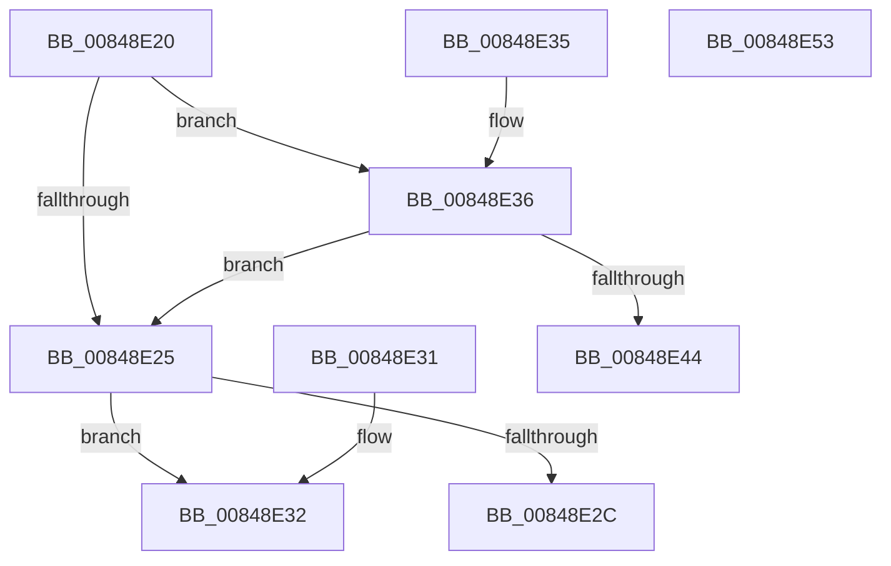

# CmpGetEffectiveKcbSemantics

- RVA: `0x00848E20`–`0x00848E54` (길이 `52` bytes)
- VA: `0x0000000140848E20`
- 실행 섹션: `PAGE`
- PDB 이름 있음: `예`; PDB Function 태그: `아니요`
- unwind 정보 RVA: `0x000DB714`
- 디코드: `20`개 명령, `52/52` bytes 표시
- 미해석 바이트: `0` (있으면 어셈블리에 `.byte`로 보존)

> 이 문서는 커널 이미지의 기계어와 PDB 기호를 분석해 생성했습니다. 4번과 5번은 함수 원형과 자료형을 바이너리 사용 방식에서 추정한 C 해석이며 원본 소스 복구 결과는 아닙니다.

## 1. Dependencies

- 직접 호출 지점: **0**; 고유 호출 대상: **0**
- 직접 호출자로 확인된 함수: **6**
- RIP 상대 이미지 참조: **0**

### Outgoing calls
- 직접 디코드된 call 명령이 없습니다.

### Direct callers
- [CmRenameKey](../7E/CmRenameKey_function_007E8F48.md) at `0x007E9318`
- [CmRenameKey](../7E/CmRenameKey_function_007E8F48.md) at `0x007E9425`
- [CmRenameKey](../7E/CmRenameKey_function_007E8F48.md) at `0x007E94A8`
- [CmDeleteValueKey](CmDeleteValueKey_function_008476E8.md) at `0x008478C4`
- [CmDeleteValueKey](CmDeleteValueKey_function_008476E8.md) at `0x00847965`
- [CmpPopulateKeyNodeStackFromKcbStack](../94/CmpPopulateKeyNodeStackFromKcbStack_function_009453CC.md) at `0x00945467`
- [CmpSetKeySecurity](../94/CmpSetKeySecurity_function_0094A124.md) at `0x0094A60C`
- [CmpSetKeySecurity](../94/CmpSetKeySecurity_function_0094A124.md) at `0x0094A6A4`
- [CmSetKeyFlags](../9A/CmSetKeyFlags_function_009AEEA4.md) at `0x009AF000`
- [CmQueryMultipleValueForLayeredKey](../A8/CmQueryMultipleValueForLayeredKey_function_00A8DE80.md) at `0x00A8E1C2`
- [CmQueryMultipleValueForLayeredKey](../A8/CmQueryMultipleValueForLayeredKey_function_00A8DE80.md) at `0x00A8E29D`

### Static image references
- 디코드된 RIP-relative 메모리 참조가 없습니다.

## 2. Other-region calls and transfers

- 다른 실행 섹션으로 향하는 call: **0**
- 별도 외부 분기/꼬리 이동을 확인하지 못했습니다.

## 3. Assembly (complete function range)

```asm
00848E20  48 85 D2                        test rdx, rdx
00848E23  75 11                           jne 0x140848e36
00848E25  66 83 79 42 00                  cmp word ptr [rcx + 0x42], 0
00848E2A  74 06                           je 0x140848e32
00848E2C  0F B6 41 41                     movzx eax, byte ptr [rcx + 0x41]
00848E30  C3                              ret
00848E31  CC                              int3
00848E32  33 C0                           xor eax, eax
00848E34  C3                              ret
00848E35  CC                              int3
00848E36  44 0F B7 42 04                  movzx r8d, word ptr [rdx + 4]
00848E3B  0F BF 51 42                     movsx edx, word ptr [rcx + 0x42]
00848E3F  41 3B D0                        cmp edx, r8d
00848E42  75 E1                           jne 0x140848e25
00848E44  0F B6 49 41                     movzx ecx, byte ptr [rcx + 0x41]
00848E48  B8 02 00 00 00                  mov eax, 2
00848E4D  84 C9                           test cl, cl
00848E4F  0F 45 C1                        cmovne eax, ecx
00848E52  C3                              ret
00848E53  CC                              int3
```

## 4. C-style interpretation (structured pseudocode)

```c
__int64 __fastcall CmpGetEffectiveKcbSemantics(__int64 a1, __int64 a2)
{
    __int64 result;

    if (a2 != 0) goto loc_00848E36;
loc_00848E25:
    if ((*(unsigned __int16 *)(a1 + 66)) == 0) goto loc_00848E32;
    return *(unsigned __int8 *)(a1 + 65);
loc_00848E32:
    result = 0;
    return result;
loc_00848E36:
    if (((unsigned int)((__int16)(*(unsigned __int16 *)(a1 + 66)))) != ((unsigned int)(*(unsigned __int16 *)(a2 + 4)))) goto loc_00848E25;
    result = 2;
    if ((unsigned __int8)(*(unsigned __int8 *)(a1 + 65)) != 0) { result = (unsigned int)(*(unsigned __int8 *)(a1 + 65)); }
    return result;
}
```

## 5. (Beta) C Style

```c
int64_t CmpGetEffectiveKcbSemantics(void *Arg1, int64_t Arg2)
{
    uint8_t *arg1 = (uint8_t *)Arg1;

    int64_t result;

    if (Arg2 != 0) goto loc_00848E36;
loc_00848E25:
    if ((*(uint16_t *)(arg1 + 0x42)) == 0) goto loc_00848E32;
    return *(uint8_t *)(arg1 + 0x41);
loc_00848E32:
    result = 0;
    return result;
loc_00848E36:
    if (((uint32_t)((int16_t)(*(uint16_t *)(arg1 + 0x42)))) != ((uint32_t)(*(uint16_t *)(Arg2 + 0x4)))) goto loc_00848E25;
    result = 2;
    if ((uint8_t)(*(uint8_t *)(arg1 + 0x41)) != 0) { result = (uint32_t)(*(uint8_t *)(arg1 + 0x41)); }
    return result;
}
```

### 관측된 메모리 오프셋

구조체 형식이 확인되지 않은 접근은 인자 기준의 오프셋으로만 기록했습니다.

| 기준 인자 | 오프셋 표현 | 폭 (bit) | 접근 |
|---|---:|---:|---|
| `Arg1` | `+ 0x41` | `8` | `R` |
| `Arg1` | `+ 0x42` | `16` | `R` |

## 6. Execution-region graph

[열기: 2D/3D 그래프와 함수 탐색 컨트롤 패널](../../../control-panel.html?section=page&rva=0x00848E20&view=graph)

- 2D 그래프는 위에서 아래로 흐르고, 3D 그래프는 빈 공간을 드래그해 회전합니다. Shift+드래그는 이동, 휠은 확대·축소, 함수 노드 선택은 대상 보고서 이동입니다.

### Static fallback


