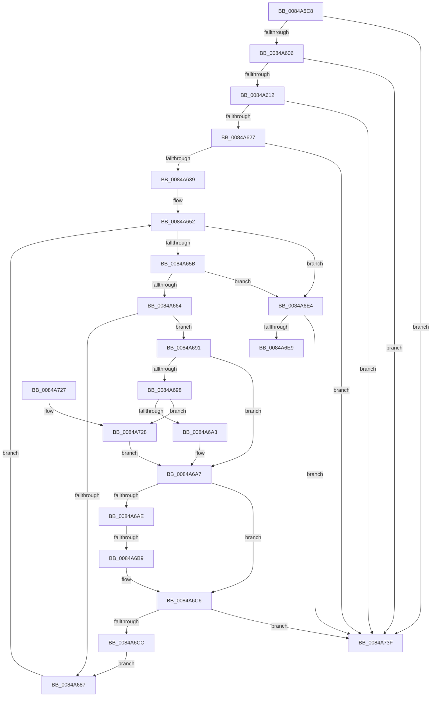

# CmpGetMappingHiveForString

- RVA: `0x0084A5C8`–`0x0084A746` (길이 `382` bytes)
- VA: `0x000000014084A5C8`
- 실행 섹션: `PAGE`
- PDB 이름 있음: `예`; PDB Function 태그: `예`
- unwind 정보 RVA: `0x00069528`
- 디코드: `97`개 명령, `382/382` bytes 표시
- 미해석 바이트: `0` (있으면 어셈블리에 `.byte`로 보존)

> 이 문서는 커널 이미지의 기계어와 PDB 기호를 분석해 생성했습니다. 4번과 5번은 함수 원형과 자료형을 바이너리 사용 방식에서 추정한 C 해석이며 원본 소스 복구 결과는 아닙니다.

## 1. Dependencies

- 직접 호출 지점: **5**; 고유 호출 대상: **4**
- 직접 호출자로 확인된 함수: **3**
- RIP 상대 이미지 참조: **4**

### Outgoing calls
- `0x0084A5E4` → [CmpHashUnicodeComponent](CmpHashUnicodeComponent_function_0084AC24.md) (function, `0x0084AC24`)
- `0x0084A5F2` → [ExAcquireFastMutex](../../text/20/ExAcquireFastMutex_function_0020E5A0.md) (function, `0x0020E5A0`)
- `0x0084A6BD` → [RtlUpcaseUnicodeChar](../85/RtlUpcaseUnicodeChar_function_0085F0F0.md) (function, `0x0085F0F0`)
- `0x0084A70B` → [ExReleaseFastMutex](../../text/25/ExReleaseFastMutex_function_002519C0.md) (function, `0x002519C0`)
- `0x0084A72C` → [RtlUpcaseUnicodeChar](../85/RtlUpcaseUnicodeChar_function_0085F0F0.md) (function, `0x0085F0F0`)

### Direct callers
- [CmpGetVirtualStoreRoot](../7E/CmpGetVirtualStoreRoot_function_007EB974.md) at `0x007EB9C6`
- [CmpGetCmHiveFromVirtualPath](CmpGetCmHiveFromVirtualPath_function_00849E08.md) at `0x00849E2F`
- [CmpVirtualBranchIsReplicated](CmpVirtualBranchIsReplicated_function_0084A3E0.md) at `0x0084A44D`

### Static image references
- `0x0084A5E9` → RVA `0x00EF5900` (`.data`; read)
- `0x0084A5F7` → RVA `0x00E0EC9C` (`.data`; read)
- `0x0084A606` → RVA `0x00EEFC08` (`.data`; read)
- `0x0084A612` → RVA `0x00EEFC10` (`.data`; read)

## 2. Other-region calls and transfers

- 다른 실행 섹션으로 향하는 call: **2**
  - `0x0084A5F2` → [ExAcquireFastMutex](../../text/20/ExAcquireFastMutex_function_0020E5A0.md) (`PAGE` → `.text`)
  - `0x0084A70B` → [ExReleaseFastMutex](../../text/25/ExReleaseFastMutex_function_002519C0.md) (`PAGE` → `.text`)
- call이 아닌 외부 분기/꼬리 이동: **2**
  - `0x0084A6B3` → [sub_00B167CA](../B1/Unknown_function_00B167CA.md) (`tail-transfer`)
  - `0x0084A741` → [sub_00B167CA + 0x9](../B1/Unknown_function_00B167CA.md) (`tail-transfer`)

## 3. Assembly (complete function range)

```asm
0084A5C8  48 89 5C 24 08                  mov qword ptr [rsp + 8], rbx
0084A5CD  55                              push rbp
0084A5CE  56                              push rsi
0084A5CF  57                              push rdi
0084A5D0  41 54                           push r12
0084A5D2  41 55                           push r13
0084A5D4  41 56                           push r14
0084A5D6  41 57                           push r15
0084A5D8  48 83 EC 30                     sub rsp, 0x30
0084A5DC  4C 8B EA                        mov r13, rdx
0084A5DF  4C 8B E1                        mov r12, rcx
0084A5E2  33 F6                           xor esi, esi
0084A5E4  E8 3B 06 00 00                  call 0x14084ac24
0084A5E9  48 8D 0D 10 B3 6A 00            lea rcx, [rip + 0x6ab310]
0084A5F0  8B D8                           mov ebx, eax
0084A5F2  E8 A9 3F 9C FF                  call 0x14020e5a0
0084A5F7  48 63 05 9E 46 5C 00            movsxd rax, dword ptr [rip + 0x5c469e]
0084A5FE  85 C0                           test eax, eax
0084A600  0F 88 39 01 00 00               js 0x14084a73f
0084A606  3B 05 FC 55 6A 00               cmp eax, dword ptr [rip + 0x6a55fc]
0084A60C  0F 8D 2D 01 00 00               jge 0x14084a73f
0084A612  48 8B 0D F7 55 6A 00            mov rcx, qword ptr [rip + 0x6a55f7]
0084A619  48 C1 E0 05                     shl rax, 5
0084A61D  39 5C 08 10                     cmp dword ptr [rax + rcx + 0x10], ebx
0084A621  0F 85 18 01 00 00               jne 0x14084a73f
0084A627  0F B7 3C 08                     movzx edi, word ptr [rax + rcx]
0084A62B  41 0F B7 2C 24                  movzx ebp, word ptr [r12]
0084A630  66 3B FD                        cmp di, bp
0084A633  0F 85 06 01 00 00               jne 0x14084a73f
0084A639  48 8B 44 08 08                  mov rax, qword ptr [rax + rcx + 8]
0084A63E  BA E0 FF 00 00                  mov edx, 0xffe0
0084A643  49 8B 4C 24 08                  mov rcx, qword ptr [r12 + 8]
0084A648  66 D1 EF                        shr di, 1
0084A64B  66 D1 ED                        shr bp, 1
0084A64E  44 8D 42 1F                     lea r8d, [rdx + 0x1f]
0084A652  66 85 FF                        test di, di
0084A655  0F 84 89 00 00 00               je 0x14084a6e4
0084A65B  66 85 ED                        test bp, bp
0084A65E  0F 84 80 00 00 00               je 0x14084a6e4
0084A664  44 0F B7 30                     movzx r14d, word ptr [rax]
0084A668  48 83 C0 02                     add rax, 2
0084A66C  44 0F B7 39                     movzx r15d, word ptr [rcx]
0084A670  48 83 C1 02                     add rcx, 2
0084A674  48 89 84 24 88 00 00 00         mov qword ptr [rsp + 0x88], rax
0084A67C  48 89 4C 24 20                  mov qword ptr [rsp + 0x20], rcx
0084A681  66 45 3B F7                     cmp r14w, r15w
0084A685  75 0A                           jne 0x14084a691
0084A687  66 41 03 F8                     add di, r8w
0084A68B  66 41 03 E8                     add bp, r8w
0084A68F  EB C1                           jmp 0x14084a652
0084A691  66 41 83 FE 61                  cmp r14w, 0x61
0084A696  72 0F                           jb 0x14084a6a7
0084A698  66 41 83 FE 7A                  cmp r14w, 0x7a
0084A69D  0F 87 85 00 00 00               ja 0x14084a728
0084A6A3  66 44 03 F2                     add r14w, dx
0084A6A7  66 41 83 FF 61                  cmp r15w, 0x61
0084A6AC  72 18                           jb 0x14084a6c6
0084A6AE  66 41 83 FF 7A                  cmp r15w, 0x7a
0084A6B3  0F 86 11 C1 2C 00               jbe 0x140b167ca
0084A6B9  41 0F B7 CF                     movzx ecx, r15w
0084A6BD  E8 2E 4A 01 00                  call 0x14085f0f0
0084A6C2  44 0F B7 F8                     movzx r15d, ax
0084A6C6  66 45 3B F7                     cmp r14w, r15w
0084A6CA  75 73                           jne 0x14084a73f
0084A6CC  48 8B 84 24 88 00 00 00         mov rax, qword ptr [rsp + 0x88]
0084A6D4  BA E0 FF 00 00                  mov edx, 0xffe0
0084A6D9  48 8B 4C 24 20                  mov rcx, qword ptr [rsp + 0x20]
0084A6DE  44 8D 42 1F                     lea r8d, [rdx + 0x1f]
0084A6E2  EB A3                           jmp 0x14084a687
0084A6E4  66 3B FD                        cmp di, bp
0084A6E7  75 56                           jne 0x14084a73f
0084A6E9  48 63 0D AC 45 5C 00            movsxd rcx, dword ptr [rip + 0x5c45ac]
0084A6F0  48 8B 05 19 55 6A 00            mov rax, qword ptr [rip + 0x6a5519]
0084A6F7  48 C1 E1 05                     shl rcx, 5
0084A6FB  48 8B 4C 01 18                  mov rcx, qword ptr [rcx + rax + 0x18]
0084A700  49 89 4D 00                     mov qword ptr [r13], rcx
0084A704  48 8D 0D F5 B1 6A 00            lea rcx, [rip + 0x6ab1f5]
0084A70B  E8 B0 72 A0 FF                  call 0x1402519c0
0084A710  48 8B 5C 24 70                  mov rbx, qword ptr [rsp + 0x70]
0084A715  8B C6                           mov eax, esi
0084A717  48 83 C4 30                     add rsp, 0x30
0084A71B  41 5F                           pop r15
0084A71D  41 5E                           pop r14
0084A71F  41 5D                           pop r13
0084A721  41 5C                           pop r12
0084A723  5F                              pop rdi
0084A724  5E                              pop rsi
0084A725  5D                              pop rbp
0084A726  C3                              ret
0084A727  CC                              int3
0084A728  41 0F B7 CE                     movzx ecx, r14w
0084A72C  E8 BF 49 01 00                  call 0x14085f0f0
0084A731  44 0F B7 F0                     movzx r14d, ax
0084A735  BA E0 FF 00 00                  mov edx, 0xffe0
0084A73A  E9 68 FF FF FF                  jmp 0x14084a6a7
0084A73F  8B FE                           mov edi, esi
0084A741  E9 8D C0 2C 00                  jmp 0x140b167d3
```

## 4. C-style interpretation (structured pseudocode)

```c
__int64 __fastcall CmpGetMappingHiveForString(__int64 a1, __int64 a2)
{
    __int64 result;
    __int64 v_r14;
    __int64 v_rbp;
    __int64 v_rdi;
    __int64 v_rsi;
    __int64 v_rsp;
    unsigned __int64 v_stack_m48;
    unsigned __int64 v_stack_p20;
    unsigned __int64 v_stack_p8;

    v_stack_p8 = v_rbx;
    v_rsp = (v_rsp) - (48);
    v_rsi = 0;
    result = CmpHashUnicodeComponent(a1, a2, a3, a4);
    result = ExAcquireFastMutex(v_rip + 6992656, a2, a3, a4);
    if (sign_flag) goto loc_0084A73F;
    if (((unsigned int)((int)(*(unsigned int *)(v_rip + 6047390)))) >= (*(unsigned int *)(v_rip + 6968828))) goto loc_0084A73F;
    result = ((int)(*(unsigned int *)(v_rip + 6047390))) << (5);
    if ((*(unsigned int *)(result + *(unsigned __int64 *)(v_rip + 6968823) * 1 + 16)) != ((unsigned int)((unsigned int)((unsigned int)(result))))) goto loc_0084A73F;
    if (((unsigned __int16)(*(unsigned __int16 *)(result + *(unsigned __int64 *)(v_rip + 6968823) * 1))) != ((unsigned __int16)(*(unsigned __int16 *)(a1)))) goto loc_0084A73F;
    v_rdi = (unsigned __int16)((*(unsigned __int16 *)(result + *(unsigned __int64 *)(v_rip + 6968823) * 1)) >> (1));
    v_rbp = (unsigned __int16)((*(unsigned __int16 *)(a1)) >> (1));
loc_0084A652:
    if ((unsigned __int16)(v_rdi) == 0) goto loc_0084A6E4;
    if ((unsigned __int16)(v_rbp) == 0) goto loc_0084A6E4;
    result = (*(unsigned __int64 *)(result + *(unsigned __int64 *)(v_rip + 6968823) * 1 + 8)) + (2);
    a1 = (*(unsigned __int64 *)(a1 + 8)) + (2);
    v_stack_p20 = result;
    v_stack_m48 = a1;
    if (((unsigned __int16)(*(unsigned __int16 *)(*(unsigned __int64 *)(result + *(unsigned __int64 *)(v_rip + 6968823) * 1 + 8)))) != ((unsigned __int16)(*(unsigned __int16 *)(*(unsigned __int64 *)(a1 + 8))))) goto loc_0084A691;
loc_0084A687:
    v_rdi = (unsigned __int16)((v_rdi) + ((unsigned __int16)((unsigned int)(0xFFE0ULL) + 31)));
    v_rbp = (unsigned __int16)((v_rbp) + ((unsigned __int16)((unsigned int)(0xFFE0ULL) + 31)));
    goto loc_0084A652;
loc_0084A691:
    if (((unsigned __int16)(*(unsigned __int16 *)(*(unsigned __int64 *)(result + *(unsigned __int64 *)(v_rip + 6968823) * 1 + 8)))) < 97) goto loc_0084A6A7;
    if (((unsigned __int16)(*(unsigned __int16 *)(*(unsigned __int64 *)(result + *(unsigned __int64 *)(v_rip + 6968823) * 1 + 8)))) > 122) goto loc_0084A728;
    v_r14 = (unsigned __int16)((*(unsigned __int16 *)(*(unsigned __int64 *)(result + *(unsigned __int64 *)(v_rip + 6968823) * 1 + 8))) + ((unsigned __int16)((unsigned int)(0xFFE0ULL))));
loc_0084A6A7:
    if (((unsigned __int16)(*(unsigned __int16 *)(*(unsigned __int64 *)(a1 + 8)))) < 97) goto loc_0084A6C6;
    result = RtlUpcaseUnicodeChar((unsigned __int16)(*(unsigned __int16 *)(*(unsigned __int64 *)(a1 + 8))), (unsigned int)(0xFFE0ULL), (unsigned int)(0xFFE0ULL) + 31, a4);
loc_0084A6C6:
    if (((unsigned __int16)(v_r14)) != ((unsigned __int16)((unsigned __int16)(result)))) goto loc_0084A73F;
    goto loc_0084A687;
loc_0084A6E4:
    if (((unsigned __int16)(v_rdi)) != ((unsigned __int16)(v_rbp))) goto loc_0084A73F;
    a1 = ((int)(*(unsigned int *)(v_rip + 6047148))) << (5);
    *(unsigned __int64 *)(a2) = *(unsigned __int64 *)(a1 + *(unsigned __int64 *)(v_rip + 6968601) * 1 + 24);
    result = ExReleaseFastMutex(v_rip + 6992373, (unsigned int)(0xFFE0ULL), (unsigned int)(0xFFE0ULL) + 31, a4);
    v_rsp = (v_rsp) + (48);
    return 0;
loc_0084A728:
    result = RtlUpcaseUnicodeChar((unsigned __int16)(v_r14), (unsigned int)(0xFFE0ULL), (unsigned int)(0xFFE0ULL) + 31, a4);
    goto loc_0084A6A7;
loc_0084A73F:
}
```

## 5. (Beta) C Style

```c
int64_t CmpGetMappingHiveForString(void *Arg1, void *Arg2)
{
    uint8_t *arg1 = (uint8_t *)Arg1;
    uint8_t *arg2 = (uint8_t *)Arg2;

    int64_t result;
    int64_t local_r14;
    int64_t local_rbp;
    int64_t local_rdi;
    int64_t local_rsi;
    int64_t local_rsp;
    uint64_t v_stack_m48;
    uint64_t v_stack_p20;
    uint64_t v_stack_p8;

    v_stack_p8 = local_rbx;
    local_rsp = (local_rsp) - (48);
    local_rsi = 0;
    result = CmpHashUnicodeComponent(Arg1, Arg2, a3, a4);
    result = ExAcquireFastMutex(v_rip + 6992656, Arg2, a3, a4);
    if (sign_flag) goto loc_0084A73F;
    if (((uint32_t)((int32_t)(*(uint32_t *)(v_rip + 0x5C469E)))) >= (*(uint32_t *)(v_rip + 0x6A55FC))) goto loc_0084A73F;
    result = ((int32_t)(*(uint32_t *)(v_rip + 0x5C469E))) << (5);
    if ((*(uint32_t *)(result + *(uint64_t *)(v_rip + 0x6A55F7) * 1 + 0x10)) != ((uint32_t)((uint32_t)((uint32_t)(result))))) goto loc_0084A73F;
    if (((uint16_t)(*(uint16_t *)(result + *(uint64_t *)(v_rip + 0x6A55F7) * 1))) != ((uint16_t)(*(uint16_t *)(arg1)))) goto loc_0084A73F;
    local_rdi = (uint16_t)((*(uint16_t *)(result + *(uint64_t *)(v_rip + 0x6A55F7) * 1)) >> (1));
    local_rbp = (uint16_t)((*(uint16_t *)(arg1)) >> (1));
loc_0084A652:
    if ((uint16_t)(local_rdi) == 0) goto loc_0084A6E4;
    if ((uint16_t)(local_rbp) == 0) goto loc_0084A6E4;
    result = (*(uint64_t *)(result + *(uint64_t *)(v_rip + 0x6A55F7) * 1 + 0x8)) + (2);
    Arg1 = (*(uint64_t *)(arg1 + 0x8)) + (2);
    v_stack_p20 = result;
    v_stack_m48 = Arg1;
    if (((uint16_t)(*(uint16_t *)(*(uint64_t *)(result + *(uint64_t *)(v_rip + 0x6A55F7) * 1 + 0x8)))) != ((uint16_t)(*(uint16_t *)(*(uint64_t *)(arg1 + 0x8))))) goto loc_0084A691;
loc_0084A687:
    local_rdi = (uint16_t)((local_rdi) + ((uint16_t)((uint32_t)(0xFFE0ULL) + 31)));
    local_rbp = (uint16_t)((local_rbp) + ((uint16_t)((uint32_t)(0xFFE0ULL) + 31)));
    goto loc_0084A652;
loc_0084A691:
    if (((uint16_t)(*(uint16_t *)(*(uint64_t *)(result + *(uint64_t *)(v_rip + 0x6A55F7) * 1 + 0x8)))) < 97) goto loc_0084A6A7;
    if (((uint16_t)(*(uint16_t *)(*(uint64_t *)(result + *(uint64_t *)(v_rip + 0x6A55F7) * 1 + 0x8)))) > 122) goto loc_0084A728;
    local_r14 = (uint16_t)((*(uint16_t *)(*(uint64_t *)(result + *(uint64_t *)(v_rip + 0x6A55F7) * 1 + 0x8))) + ((uint16_t)((uint32_t)(0xFFE0ULL))));
loc_0084A6A7:
    if (((uint16_t)(*(uint16_t *)(*(uint64_t *)(arg1 + 0x8)))) < 97) goto loc_0084A6C6;
    result = RtlUpcaseUnicodeChar((uint16_t)(*(uint16_t *)(*(uint64_t *)(arg1 + 0x8))), (uint32_t)(0xFFE0ULL), (uint32_t)(0xFFE0ULL) + 31, a4);
loc_0084A6C6:
    if (((uint16_t)(local_r14)) != ((uint16_t)((uint16_t)(result)))) goto loc_0084A73F;
    goto loc_0084A687;
loc_0084A6E4:
    if (((uint16_t)(local_rdi)) != ((uint16_t)(local_rbp))) goto loc_0084A73F;
    Arg1 = ((int32_t)(*(uint32_t *)(v_rip + 0x5C45AC))) << (5);
    *(uint64_t *)(arg2) = *(uint64_t *)(arg1 + *(uint64_t *)(v_rip + 0x6A5519) * 1 + 0x18);
    result = ExReleaseFastMutex(v_rip + 6992373, (uint32_t)(0xFFE0ULL), (uint32_t)(0xFFE0ULL) + 31, a4);
    local_rsp = (local_rsp) + (48);
    return 0;
loc_0084A728:
    result = RtlUpcaseUnicodeChar((uint16_t)(local_r14), (uint32_t)(0xFFE0ULL), (uint32_t)(0xFFE0ULL) + 31, a4);
    goto loc_0084A6A7;
loc_0084A73F:
}
```

### 관측된 메모리 오프셋

구조체 형식이 확인되지 않은 접근은 인자 기준의 오프셋으로만 기록했습니다.

| 기준 인자 | 오프셋 표현 | 폭 (bit) | 접근 |
|---|---:|---:|---|
| `Arg1` | `+ 0x0` | `16` | `R` |
| `Arg1` | `+ 0x8` | `64` | `R` |
| `Arg2` | `+ 0x0` | `64` | `W` |

## 6. Execution-region graph

[열기: 2D/3D 그래프와 함수 탐색 컨트롤 패널](../../../control-panel.html?section=page&rva=0x0084A5C8&view=graph)

- 2D 그래프는 위에서 아래로 흐르고, 3D 그래프는 빈 공간을 드래그해 회전합니다. Shift+드래그는 이동, 휠은 확대·축소, 함수 노드 선택은 대상 보고서 이동입니다.

### Static fallback


