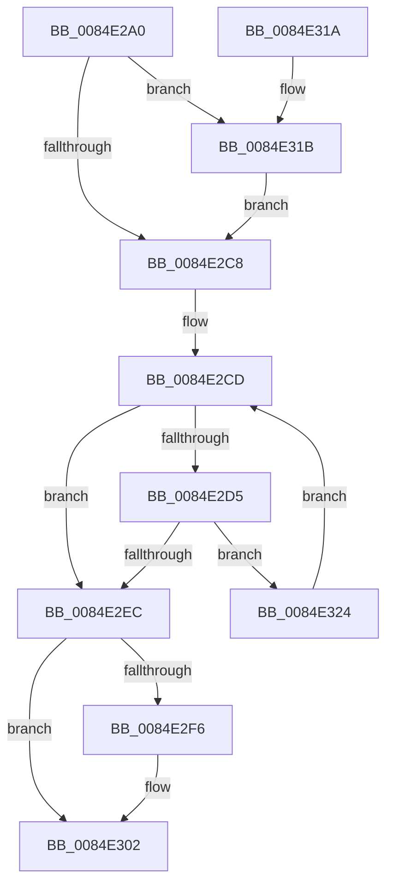

# CmpGetNextActiveHive

- RVA: `0x0084E2A0`–`0x0084E328` (길이 `136` bytes)
- VA: `0x000000014084E2A0`
- 실행 섹션: `PAGE`
- PDB 이름 있음: `예`; PDB Function 태그: `아니요`
- unwind 정보 RVA: `0x00069BF8`
- 디코드: `37`개 명령, `136/136` bytes 표시
- 미해석 바이트: `0` (있으면 어셈블리에 `.byte`로 보존)

> 이 문서는 커널 이미지의 기계어와 PDB 기호를 분석해 생성했습니다. 4번과 5번은 함수 원형과 자료형을 바이너리 사용 방식에서 추정한 C 해석이며 원본 소스 복구 결과는 아닙니다.

## 1. Dependencies

- 직접 호출 지점: **4**; 고유 호출 대상: **4**
- 직접 호출자로 확인된 함수: **15**
- RIP 상대 이미지 참조: **1**

### Outgoing calls
- `0x0084E2C8` → [CmpLockHiveListShared](CmpLockHiveListShared_function_0084E3C8.md) (function, `0x0084E3C8`)
- `0x0084E2E3` → [ExAcquireRundownProtection](../../text/21/ExAcquireRundownProtection_function_00216620.md) (function, `0x00216620`)
- `0x0084E2EC` → [CmpUnlockHiveList](CmpUnlockHiveList_function_0084E424.md) (function, `0x0084E424`)
- `0x0084E2FD` → [ExReleaseRundownProtection](../../text/34/ExReleaseRundownProtection_function_00349E80.md) (function, `0x00349E80`)

### Direct callers
- [CmShutdownSystem1](../../text/66/CmShutdownSystem1_function_0066A5B0.md) at `0x0066A644`
- [CmShutdownSystem1](../../text/66/CmShutdownSystem1_function_0066A5B0.md) at `0x0066A65E`
- [CmShutdownSystem1](../../text/66/CmShutdownSystem1_function_0066A5B0.md) at `0x0066A6A0`
- [CmShutdownSystem1](../../text/66/CmShutdownSystem1_function_0066A5B0.md) at `0x0066A6F7`
- [CmShutdownSystem1](../../text/66/CmShutdownSystem1_function_0066A5B0.md) at `0x0066A744`
- [CmShutdownSystem1](../../text/66/CmShutdownSystem1_function_0066A5B0.md) at `0x0066A7B9`
- [CmShutdownSystem2](../../text/66/CmShutdownSystem2_function_0066A7FC.md) at `0x0066A8F2`
- [CmpLockKcbStackFlusherLocksExclusive](../../text/66/CmpLockKcbStackFlusherLocksExclusive_function_0066AC00.md) at `0x0066AC1F`
- [CmpLockKcbStackFlusherLocksExclusive](../../text/66/CmpLockKcbStackFlusherLocksExclusive_function_0066AC00.md) at `0x0066AC5B`
- [CmpAcceptBoot](../7D/CmpAcceptBoot_function_007DF574.md) at `0x007DF613`
- [CmpHandlePageFileOpenNotification](../7D/CmpHandlePageFileOpenNotification_function_007DF640.md) at `0x007DF6E3`
- [CmpFreeAllMemory](../7E/CmpFreeAllMemory_function_007E51D0.md) at `0x007E520E`
- [CmpFreeAllMemory](../7E/CmpFreeAllMemory_function_007E51D0.md) at `0x007E528B`
- [CmFreezeRegistry](../7E/CmFreezeRegistry_function_007E834C.md) at `0x007E8437`
- [CmFreezeRegistry](../7E/CmFreezeRegistry_function_007E834C.md) at `0x007E84A6`
- [CmThawRegistry](../7E/CmThawRegistry_function_007E8510.md) at `0x007E85DA`
- [CmpIsHiveAlreadyLoaded](../7E/CmpIsHiveAlreadyLoaded_function_007EA594.md) at `0x007EA648`
- [CmpDoFlushNextHive](CmpDoFlushNextHive_function_0084C7C0.md) at `0x0084C7F4`
- [CmpDoFlushNextHive](CmpDoFlushNextHive_function_0084C7C0.md) at `0x0084C886`
- [CmpBlockTwoHiveWrites](CmpBlockTwoHiveWrites_function_0084DE64.md) at `0x0084DE8D`
- [CmpTransMgrPrepare](../9B/CmpTransMgrPrepare_function_009B175C.md) at `0x009B1818`
- [CmpDoReconcileNextHive](../9B/CmpDoReconcileNextHive_function_009B6BE0.md) at `0x009B6C25`
- [CmpDoReconcileNextHive](../9B/CmpDoReconcileNextHive_function_009B6BE0.md) at `0x009B6C83`
- [CmpDoLocalizeNextHive](../9B/CmpDoLocalizeNextHive_function_009B7400.md) at `0x009B7493`
- [CmEtwRunDown](../A8/CmEtwRunDown_function_00A85AC0.md) at `0x00A85B9D`

### Static image references
- `0x0084E2B6` → RVA `0x00FD9D18` (`PAGEDATA`; read)

## 2. Other-region calls and transfers

- 다른 실행 섹션으로 향하는 call: **2**
  - `0x0084E2E3` → [ExAcquireRundownProtection](../../text/21/ExAcquireRundownProtection_function_00216620.md) (`PAGE` → `.text`)
  - `0x0084E2FD` → [ExReleaseRundownProtection](../../text/34/ExReleaseRundownProtection_function_00349E80.md) (`PAGE` → `.text`)
- 별도 외부 분기/꼬리 이동을 확인하지 못했습니다.

## 3. Assembly (complete function range)

```asm
0084E2A0  48 89 5C 24 08                  mov qword ptr [rsp + 8], rbx
0084E2A5  48 89 6C 24 10                  mov qword ptr [rsp + 0x10], rbp
0084E2AA  48 89 74 24 18                  mov qword ptr [rsp + 0x18], rsi
0084E2AF  57                              push rdi
0084E2B0  48 83 EC 20                     sub rsp, 0x20
0084E2B4  33 F6                           xor esi, esi
0084E2B6  48 8D 2D 5B BA 78 00            lea rbp, [rip + 0x78ba5b]
0084E2BD  48 8B D9                        mov rbx, rcx
0084E2C0  48 8B FD                        mov rdi, rbp
0084E2C3  48 85 C9                        test rcx, rcx
0084E2C6  75 53                           jne 0x14084e31b
0084E2C8  E8 FB 00 00 00                  call 0x14084e3c8
0084E2CD  48 8B 3F                        mov rdi, qword ptr [rdi]
0084E2D0  48 3B FD                        cmp rdi, rbp
0084E2D3  74 17                           je 0x14084e2ec
0084E2D5  48 8D B7 B8 F9 FF FF            lea rsi, [rdi - 0x648]
0084E2DC  48 8D 8E 68 06 00 00            lea rcx, [rsi + 0x668]
0084E2E3  E8 38 83 9C FF                  call 0x140216620
0084E2E8  84 C0                           test al, al
0084E2EA  74 38                           je 0x14084e324
0084E2EC  E8 33 01 00 00                  call 0x14084e424
0084E2F1  48 85 DB                        test rbx, rbx
0084E2F4  74 0C                           je 0x14084e302
0084E2F6  48 8D 8B 68 06 00 00            lea rcx, [rbx + 0x668]
0084E2FD  E8 7E BB AF FF                  call 0x140349e80
0084E302  48 8B 5C 24 30                  mov rbx, qword ptr [rsp + 0x30]
0084E307  48 8B C6                        mov rax, rsi
0084E30A  48 8B 74 24 40                  mov rsi, qword ptr [rsp + 0x40]
0084E30F  48 8B 6C 24 38                  mov rbp, qword ptr [rsp + 0x38]
0084E314  48 83 C4 20                     add rsp, 0x20
0084E318  5F                              pop rdi
0084E319  C3                              ret
0084E31A  CC                              int3
0084E31B  48 8D B9 48 06 00 00            lea rdi, [rcx + 0x648]
0084E322  EB A4                           jmp 0x14084e2c8
0084E324  33 F6                           xor esi, esi
0084E326  EB A5                           jmp 0x14084e2cd
```

## 4. C-style interpretation (structured pseudocode)

```c
__int64 __fastcall CmpGetNextActiveHive(__int64 a1)
{
    __int64 result;
    __int64 v_rsi;
    __int64 v_rsp;
    unsigned __int64 v_stack_p10;
    unsigned __int64 v_stack_p18;
    unsigned __int64 v_stack_p8;

    v_stack_p8 = v_rbx;
    v_stack_p10 = v_rbp;
    v_stack_p18 = v_rsi;
    v_rsp = (v_rsp) - (32);
    v_rsi = 0;
    if (a1 != 0) goto loc_0084E31B;
loc_0084E2C8:
    result = CmpLockHiveListShared(a1, a2, a3, a4);
loc_0084E2CD:
    if ((*(unsigned __int64 *)(v_rip + 7912027)) == (v_rip + 7912027)) goto loc_0084E2EC;
    result = ExAcquireRundownProtection(*(unsigned __int64 *)(v_rip + 7912027) - 1608 + 1640, a2, a3, a4);
    if ((unsigned __int8)(result) == 0) goto loc_0084E324;
loc_0084E2EC:
    result = CmpUnlockHiveList(*(unsigned __int64 *)(v_rip + 7912027) - 1608 + 1640, a2, a3, a4);
    if (a1 != 0) {
        a1 = a1 + 1640;
        result = ExReleaseRundownProtection(a1, a2, a3, a4);
    }
    v_rsp = (v_rsp) + (32);
    return *(unsigned __int64 *)(v_rip + 7912027) - 1608;
loc_0084E31B:
    goto loc_0084E2C8;
loc_0084E324:
    v_rsi = 0;
    goto loc_0084E2CD;
}
```

## 5. (Beta) C Style

```c
int64_t CmpGetNextActiveHive(int64_t Arg1)
{
    int64_t result;
    int64_t local_rsi;
    int64_t local_rsp;
    uint64_t v_stack_p10;
    uint64_t v_stack_p18;
    uint64_t v_stack_p8;

    v_stack_p8 = local_rbx;
    v_stack_p10 = local_rbp;
    v_stack_p18 = local_rsi;
    local_rsp = (local_rsp) - (32);
    local_rsi = 0;
    if (Arg1 != 0) goto loc_0084E31B;
loc_0084E2C8:
    result = CmpLockHiveListShared(Arg1, a2, a3, a4);
loc_0084E2CD:
    if ((*(uint64_t *)(v_rip + 0x78BA5B)) == (v_rip + 7912027)) goto loc_0084E2EC;
    result = ExAcquireRundownProtection(*(uint64_t *)(v_rip + 0x78BA5B) - 1608 + 1640, a2, a3, a4);
    if ((uint8_t)(result) == 0) goto loc_0084E324;
loc_0084E2EC:
    result = CmpUnlockHiveList(*(uint64_t *)(v_rip + 0x78BA5B) - 1608 + 1640, a2, a3, a4);
    if (Arg1 != 0) {
        Arg1 = Arg1 + 1640;
        result = ExReleaseRundownProtection(Arg1, a2, a3, a4);
    }
    local_rsp = (local_rsp) + (32);
    return *(uint64_t *)(v_rip + 0x78BA5B) - 1608;
loc_0084E31B:
    goto loc_0084E2C8;
loc_0084E324:
    local_rsi = 0;
    goto loc_0084E2CD;
}
```

## 6. Execution-region graph

[열기: 2D/3D 그래프와 함수 탐색 컨트롤 패널](../../../control-panel.html?section=page&rva=0x0084E2A0&view=graph)

- 2D 그래프는 위에서 아래로 흐르고, 3D 그래프는 빈 공간을 드래그해 회전합니다. Shift+드래그는 이동, 휠은 확대·축소, 함수 노드 선택은 대상 보고서 이동입니다.

### Static fallback


