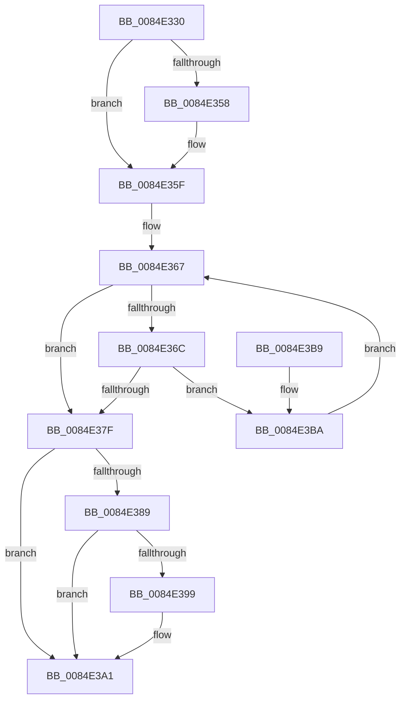

# CmpGetNextHive

- RVA: `0x0084E330`–`0x0084E3C1` (길이 `145` bytes)
- VA: `0x000000014084E330`
- 실행 섹션: `PAGE`
- PDB 이름 있음: `예`; PDB Function 태그: `아니요`
- unwind 정보 RVA: `0x00069AD0`
- 디코드: `41`개 명령, `145/145` bytes 표시
- 미해석 바이트: `0` (있으면 어셈블리에 `.byte`로 보존)

> 이 문서는 커널 이미지의 기계어와 PDB 기호를 분석해 생성했습니다. 4번과 5번은 함수 원형과 자료형을 바이너리 사용 방식에서 추정한 C 해석이며 원본 소스 복구 결과는 아닙니다.

## 1. Dependencies

- 직접 호출 지점: **4**; 고유 호출 대상: **4**
- 직접 호출자로 확인된 함수: **6**
- RIP 상대 이미지 참조: **1**

### Outgoing calls
- `0x0084E35F` → [CmpLockHiveListShared](CmpLockHiveListShared_function_0084E3C8.md) (function, `0x0084E3C8`)
- `0x0084E376` → [CmpReferenceHive](CmpReferenceHive_function_0084FCF0.md) (function, `0x0084FCF0`)
- `0x0084E37F` → [CmpUnlockHiveList](CmpUnlockHiveList_function_0084E424.md) (function, `0x0084E424`)
- `0x0084E39C` → [CmpDeleteHive](../86/CmpDeleteHive_function_0086450C.md) (function, `0x0086450C`)

### Direct callers
- [CmpDoFlushAll](../../text/34/CmpDoFlushAll_function_00349A9C.md) at `0x00349B04`
- [CmpVEExecuteRealStoreParseLogic](CmpVEExecuteRealStoreParseLogic_function_0084CCD4.md) at `0x0084CD8E`
- [CmpBlockHiveWrites](CmpBlockHiveWrites_function_0084CF94.md) at `0x0084CFF4`
- [CmLoadAppKey](../87/CmLoadAppKey_function_00876FFC.md) at `0x00877779`
- [sub_00B168BC](../B1/Unknown_function_00B168BC.md) at `0x00B168BC`
- [sub_00B3DFC6](../B3/Unknown_function_00B3DFC6.md) at `0x00B3DFC6`

### Static image references
- `0x0084E346` → RVA `0x00FD9D18` (`PAGEDATA`; read)

## 2. Other-region calls and transfers

- 다른 실행 섹션으로 향하는 call: **0**
- 별도 외부 분기/꼬리 이동을 확인하지 못했습니다.

## 3. Assembly (complete function range)

```asm
0084E330  48 89 5C 24 08                  mov qword ptr [rsp + 8], rbx
0084E335  48 89 6C 24 10                  mov qword ptr [rsp + 0x10], rbp
0084E33A  48 89 74 24 18                  mov qword ptr [rsp + 0x18], rsi
0084E33F  57                              push rdi
0084E340  48 83 EC 20                     sub rsp, 0x20
0084E344  33 FF                           xor edi, edi
0084E346  48 8D 2D CB B9 78 00            lea rbp, [rip + 0x78b9cb]
0084E34D  48 8B D9                        mov rbx, rcx
0084E350  48 8B F5                        mov rsi, rbp
0084E353  48 85 C9                        test rcx, rcx
0084E356  74 07                           je 0x14084e35f
0084E358  48 8D B1 48 06 00 00            lea rsi, [rcx + 0x648]
0084E35F  E8 64 00 00 00                  call 0x14084e3c8
0084E364  4C 8B 06                        mov r8, qword ptr [rsi]
0084E367  4C 3B C5                        cmp r8, rbp
0084E36A  74 13                           je 0x14084e37f
0084E36C  49 8D B8 B8 F9 FF FF            lea rdi, [r8 - 0x648]
0084E373  48 8B CF                        mov rcx, rdi
0084E376  E8 75 19 00 00                  call 0x14084fcf0
0084E37B  84 C0                           test al, al
0084E37D  74 3B                           je 0x14084e3ba
0084E37F  E8 A0 00 00 00                  call 0x14084e424
0084E384  48 85 DB                        test rbx, rbx
0084E387  74 18                           je 0x14084e3a1
0084E389  83 C9 FF                        or ecx, 0xffffffff
0084E38C  F0 0F C1 8B 88 10 00 00         lock xadd dword ptr [rbx + 0x1088], ecx
0084E394  83 F9 01                        cmp ecx, 1
0084E397  75 08                           jne 0x14084e3a1
0084E399  48 8B CB                        mov rcx, rbx
0084E39C  E8 6B 61 01 00                  call 0x14086450c
0084E3A1  48 8B 5C 24 30                  mov rbx, qword ptr [rsp + 0x30]
0084E3A6  48 8B C7                        mov rax, rdi
0084E3A9  48 8B 6C 24 38                  mov rbp, qword ptr [rsp + 0x38]
0084E3AE  48 8B 74 24 40                  mov rsi, qword ptr [rsp + 0x40]
0084E3B3  48 83 C4 20                     add rsp, 0x20
0084E3B7  5F                              pop rdi
0084E3B8  C3                              ret
0084E3B9  CC                              int3
0084E3BA  4D 8B 00                        mov r8, qword ptr [r8]
0084E3BD  33 FF                           xor edi, edi
0084E3BF  EB A6                           jmp 0x14084e367
```

## 4. C-style interpretation (structured pseudocode)

```c
__int64 __fastcall CmpGetNextHive(__int64 a1)
{
    __int64 result;
    __int64 v_rdi;
    __int64 v_rsi;
    __int64 v_rsp;
    unsigned __int64 v_stack_p10;
    unsigned __int64 v_stack_p18;
    unsigned __int64 v_stack_p8;

    v_stack_p8 = v_rbx;
    v_stack_p10 = v_rbp;
    v_stack_p18 = v_rsi;
    v_rsp = (v_rsp) - (32);
    v_rdi = 0;
    v_rsi = v_rip + 7911883;
    if (a1 != 0) {
        v_rsi = a1 + 1608;
    }
    result = CmpLockHiveListShared(a1, a2, a3, a4);
loc_0084E367:
    if ((*(unsigned __int64 *)(v_rsi)) == (v_rip + 7911883)) goto loc_0084E37F;
    result = CmpReferenceHive(*(unsigned __int64 *)(v_rsi) - 1608, a2, *(unsigned __int64 *)(v_rsi), a4);
    if ((unsigned __int8)(result) == 0) goto loc_0084E3BA;
loc_0084E37F:
    result = CmpUnlockHiveList(*(unsigned __int64 *)(v_rsi) - 1608, a2, *(unsigned __int64 *)(v_rsi), a4);
    if (a1 == 0) goto loc_0084E3A1;
    a1 = (unsigned int)((*(unsigned __int64 *)(v_rsi) - 1608) | (0xFFFFFFFFULL));
    if (((unsigned int)(a1)) == 1) {
        a1 = a1;
        result = CmpDeleteHive(a1, a2, *(unsigned __int64 *)(v_rsi), a4);
    }
    v_rsp = (v_rsp) + (32);
    return *(unsigned __int64 *)(v_rsi) - 1608;
loc_0084E3BA:
    v_rdi = 0;
    goto loc_0084E367;
}
```

## 5. (Beta) C Style

```c
int64_t CmpGetNextHive(int64_t Arg1)
{
    int64_t result;
    int64_t local_rdi;
    int64_t local_rsi;
    int64_t local_rsp;
    uint64_t v_stack_p10;
    uint64_t v_stack_p18;
    uint64_t v_stack_p8;

    v_stack_p8 = local_rbx;
    v_stack_p10 = local_rbp;
    v_stack_p18 = local_rsi;
    local_rsp = (local_rsp) - (32);
    local_rdi = 0;
    local_rsi = v_rip + 7911883;
    if (Arg1 != 0) {
        local_rsi = Arg1 + 1608;
    }
    result = CmpLockHiveListShared(Arg1, a2, a3, a4);
loc_0084E367:
    if ((*(uint64_t *)(local_rsi)) == (v_rip + 7911883)) goto loc_0084E37F;
    result = CmpReferenceHive(*(uint64_t *)(local_rsi) - 1608, a2, *(uint64_t *)(local_rsi), a4);
    if ((uint8_t)(result) == 0) goto loc_0084E3BA;
loc_0084E37F:
    result = CmpUnlockHiveList(*(uint64_t *)(local_rsi) - 1608, a2, *(uint64_t *)(local_rsi), a4);
    if (Arg1 == 0) goto loc_0084E3A1;
    Arg1 = (uint32_t)((*(uint64_t *)(local_rsi) - 1608) | (0xFFFFFFFFULL));
    if (((uint32_t)(Arg1)) == 1) {
        Arg1 = Arg1;
        result = CmpDeleteHive(Arg1, a2, *(uint64_t *)(local_rsi), a4);
    }
    local_rsp = (local_rsp) + (32);
    return *(uint64_t *)(local_rsi) - 1608;
loc_0084E3BA:
    local_rdi = 0;
    goto loc_0084E367;
}
```

## 6. Execution-region graph

[열기: 2D/3D 그래프와 함수 탐색 컨트롤 패널](../../../control-panel.html?section=page&rva=0x0084E330&view=graph)

- 2D 그래프는 위에서 아래로 흐르고, 3D 그래프는 빈 공간을 드래그해 회전합니다. Shift+드래그는 이동, 휠은 확대·축소, 함수 노드 선택은 대상 보고서 이동입니다.

### Static fallback


