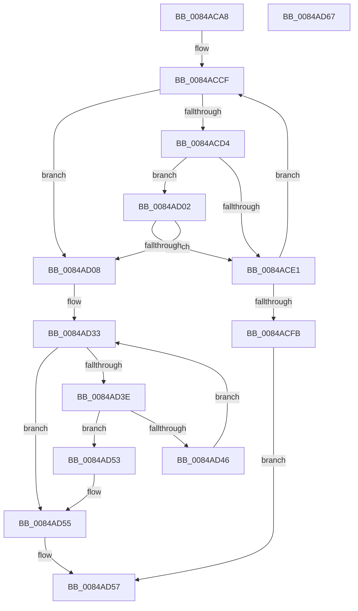

# CmpGetVirtualizationIDFromFullVirtualPath

- RVA: `0x0084ACA8`–`0x0084AD68` (길이 `192` bytes)
- VA: `0x000000014084ACA8`
- 실행 섹션: `PAGE`
- PDB 이름 있음: `예`; PDB Function 태그: `아니요`
- unwind 정보 RVA: `0x00069588`
- 디코드: `57`개 명령, `192/192` bytes 표시
- 미해석 바이트: `0` (있으면 어셈블리에 `.byte`로 보존)

> 이 문서는 커널 이미지의 기계어와 PDB 기호를 분석해 생성했습니다. 4번과 5번은 함수 원형과 자료형을 바이너리 사용 방식에서 추정한 C 해석이며 원본 소스 복구 결과는 아닙니다.

## 1. Dependencies

- 직접 호출 지점: **0**; 고유 호출 대상: **0**
- 직접 호출자로 확인된 함수: **2**
- RIP 상대 이미지 참조: **0**

### Outgoing calls
- 직접 디코드된 call 명령이 없습니다.

### Direct callers
- [CmpGetCmHiveFromVirtualPath](CmpGetCmHiveFromVirtualPath_function_00849E08.md) at `0x00849E1E`
- [CmpVirtualBranchIsReplicated](CmpVirtualBranchIsReplicated_function_0084A3E0.md) at `0x0084A438`

### Static image references
- 디코드된 RIP-relative 메모리 참조가 없습니다.

## 2. Other-region calls and transfers

- 다른 실행 섹션으로 향하는 call: **0**
- 별도 외부 분기/꼬리 이동을 확인하지 못했습니다.

## 3. Assembly (complete function range)

```asm
0084ACA8  48 89 5C 24 08                  mov qword ptr [rsp + 8], rbx
0084ACAD  48 89 74 24 10                  mov qword ptr [rsp + 0x10], rsi
0084ACB2  48 89 7C 24 18                  mov qword ptr [rsp + 0x18], rdi
0084ACB7  0F 10 01                        movups xmm0, xmmword ptr [rcx]
0084ACBA  33 DB                           xor ebx, ebx
0084ACBC  4C 8D 42 08                     lea r8, [rdx + 8]
0084ACC0  44 0F B7 CB                     movzx r9d, bx
0084ACC4  F3 0F 7F 02                     movdqu xmmword ptr [rdx], xmm0
0084ACC8  44 8D 53 03                     lea r10d, [rbx + 3]
0084ACCC  8D 7B 01                        lea edi, [rbx + 1]
0084ACCF  45 85 D2                        test r10d, r10d
0084ACD2  74 34                           je 0x14084ad08
0084ACD4  4C 8D 42 08                     lea r8, [rdx + 8]
0084ACD8  49 8B 00                        mov rax, qword ptr [r8]
0084ACDB  66 83 38 5C                     cmp word ptr [rax], 0x5c
0084ACDF  74 21                           je 0x14084ad02
0084ACE1  48 83 C0 02                     add rax, 2
0084ACE5  66 44 03 CF                     add r9w, di
0084ACE9  41 0F B7 C9                     movzx ecx, r9w
0084ACED  49 89 00                        mov qword ptr [r8], rax
0084ACF0  48 03 C9                        add rcx, rcx
0084ACF3  0F B7 02                        movzx eax, word ptr [rdx]
0084ACF6  48 3B C8                        cmp rcx, rax
0084ACF9  72 D4                           jb 0x14084accf
0084ACFB  B8 0D 00 00 C0                  mov eax, 0xc000000d
0084AD00  EB 55                           jmp 0x14084ad57
0084AD02  41 83 C2 FF                     add r10d, -1
0084AD06  75 D9                           jne 0x14084ace1
0084AD08  0F B7 02                        movzx eax, word ptr [rdx]
0084AD0B  66 45 03 C9                     add r9w, r9w
0084AD0F  BE 02 00 00 00                  mov esi, 2
0084AD14  89 1A                           mov dword ptr [rdx], ebx
0084AD16  49 01 30                        add qword ptr [r8], rsi
0084AD19  66 41 2B C1                     sub ax, r9w
0084AD1D  4D 8B 18                        mov r11, qword ptr [r8]
0084AD20  66 2B C6                        sub ax, si
0084AD23  44 0F B7 C8                     movzx r9d, ax
0084AD27  44 8B D3                        mov r10d, ebx
0084AD2A  B9 0D 00 00 C0                  mov ecx, 0xc000000d
0084AD2F  44 0F B7 C3                     movzx r8d, bx
0084AD33  41 8B C2                        mov eax, r10d
0084AD36  48 03 C0                        add rax, rax
0084AD39  49 3B C1                        cmp rax, r9
0084AD3C  73 17                           jae 0x14084ad55
0084AD3E  66 42 83 3C 18 5C               cmp word ptr [rax + r11], 0x5c
0084AD44  74 0D                           je 0x14084ad53
0084AD46  44 03 D7                        add r10d, edi
0084AD49  66 44 03 C6                     add r8w, si
0084AD4D  66 44 89 02                     mov word ptr [rdx], r8w
0084AD51  EB E0                           jmp 0x14084ad33
0084AD53  8B CB                           mov ecx, ebx
0084AD55  8B C1                           mov eax, ecx
0084AD57  48 8B 5C 24 08                  mov rbx, qword ptr [rsp + 8]
0084AD5C  48 8B 74 24 10                  mov rsi, qword ptr [rsp + 0x10]
0084AD61  48 8B 7C 24 18                  mov rdi, qword ptr [rsp + 0x18]
0084AD66  C3                              ret
0084AD67  CC                              int3
```

## 4. C-style interpretation (structured pseudocode)

```c
__int64 __fastcall CmpGetVirtualizationIDFromFullVirtualPath(__int64 a1, __int64 a2)
{
    __int64 result;
    __int64 v_r10;
    __int64 v_rbx;
    unsigned __int64 v_stack_p10;
    unsigned __int64 v_stack_p18;
    unsigned __int64 v_stack_p8;

    v_stack_p8 = v_rbx;
    v_stack_p10 = v_rsi;
    v_stack_p18 = v_rdi;
    v_rbx = 0;
    *(unsigned __int64 *)(a2) = v_xmm0;
loc_0084ACCF:
    if ((unsigned int)(v_rbx + 3) == 0) goto loc_0084AD08;
    if ((*(unsigned __int16 *)(*(unsigned __int64 *)(a2 + 8))) == 92) goto loc_0084AD02;
loc_0084ACE1:
    result = (*(unsigned __int64 *)(a2 + 8)) + (2);
    a4 = (unsigned __int16)((0) + ((unsigned __int16)(v_rbx + 1)));
    *(unsigned __int64 *)(a2 + 8) = result;
    a1 = ((unsigned __int16)(a4)) + ((unsigned __int16)(a4));
    if (a1 < (*(unsigned __int16 *)(a2))) goto loc_0084ACCF;
    goto loc_0084AD57;
loc_0084AD02:
    v_r10 = (unsigned int)((v_rbx + 3) + (-1));
    if (condition_is_not_equal) goto loc_0084ACE1;
loc_0084AD08:
    a4 = (unsigned __int16)((a4) + ((unsigned __int16)(a4)));
    *(unsigned int *)(a2) = 0;
    result = (unsigned __int16)((*(unsigned __int16 *)(a2)) - ((unsigned __int16)(a4)));
    result = (unsigned __int16)((result) - (2));
loc_0084AD33:
    result = (0) + (0);
    if (result >= ((unsigned __int16)(result))) goto loc_0084AD55;
    if ((*(unsigned __int16 *)(result + *(unsigned __int64 *)(a2 + 8) * 1)) == 92) goto loc_0084AD53;
    v_r10 = (unsigned int)((0) + ((unsigned int)(v_rbx + 1)));
    a3 = (unsigned __int16)((0) + (2));
    *(unsigned __int16 *)(a2) = (unsigned __int16)(a3);
    goto loc_0084AD33;
loc_0084AD53:
loc_0084AD55:
loc_0084AD57:
    return 0;
}
```

## 5. (Beta) C Style

```c
int64_t CmpGetVirtualizationIDFromFullVirtualPath(void *Arg1, void *Arg2)
{
    uint8_t *arg1 = (uint8_t *)Arg1;
    uint8_t *arg2 = (uint8_t *)Arg2;

    int64_t result;
    int64_t local_r10;
    int64_t local_rbx;
    uint64_t v_stack_p10;
    uint64_t v_stack_p18;
    uint64_t v_stack_p8;

    v_stack_p8 = local_rbx;
    v_stack_p10 = local_rsi;
    v_stack_p18 = local_rdi;
    local_rbx = 0;
    *(uint64_t *)(arg2) = v_xmm0;
loc_0084ACCF:
    if ((uint32_t)(local_rbx + 3) == 0) goto loc_0084AD08;
    if ((*(uint16_t *)(*(uint64_t *)(arg2 + 0x8))) == 92) goto loc_0084AD02;
loc_0084ACE1:
    result = (*(uint64_t *)(arg2 + 0x8)) + (2);
    a4 = (uint16_t)((0) + ((uint16_t)(local_rbx + 1)));
    *(uint64_t *)(arg2 + 0x8) = result;
    Arg1 = ((uint16_t)(a4)) + ((uint16_t)(a4));
    if (Arg1 < (*(uint16_t *)(arg2))) goto loc_0084ACCF;
    goto loc_0084AD57;
loc_0084AD02:
    local_r10 = (uint32_t)((local_rbx + 3) + (-1));
    if (condition_is_not_equal) goto loc_0084ACE1;
loc_0084AD08:
    a4 = (uint16_t)((a4) + ((uint16_t)(a4)));
    *(uint32_t *)(arg2) = 0;
    result = (uint16_t)((*(uint16_t *)(arg2)) - ((uint16_t)(a4)));
    result = (uint16_t)((result) - (2));
loc_0084AD33:
    result = (0) + (0);
    if (result >= ((uint16_t)(result))) goto loc_0084AD55;
    if ((*(uint16_t *)(result + *(uint64_t *)(arg2 + 0x8) * 1)) == 92) goto loc_0084AD53;
    local_r10 = (uint32_t)((0) + ((uint32_t)(local_rbx + 1)));
    a3 = (uint16_t)((0) + (2));
    *(uint16_t *)(arg2) = (uint16_t)(a3);
    goto loc_0084AD33;
loc_0084AD53:
loc_0084AD55:
loc_0084AD57:
    return 0;
}
```

### 관측된 메모리 오프셋

구조체 형식이 확인되지 않은 접근은 인자 기준의 오프셋으로만 기록했습니다.

| 기준 인자 | 오프셋 표현 | 폭 (bit) | 접근 |
|---|---:|---:|---|
| `Arg1` | `+ 0x0` | `128` | `R` |
| `Arg2` | `+ 0x0` | `16` | `R` |
| `Arg2` | `+ 0x0` | `16` | `W` |
| `Arg2` | `+ 0x0` | `32` | `W` |
| `Arg2` | `+ 0x0` | `64` | `R` |
| `Arg2` | `+ 0x0` | `64` | `R/W` |
| `Arg2` | `+ 0x0` | `64` | `W` |
| `Arg2` | `+ 0x0` | `128` | `W` |
| `Arg2` | `+ 0x8` | `64` | `R` |

## 6. Execution-region graph

[열기: 2D/3D 그래프와 함수 탐색 컨트롤 패널](../../../control-panel.html?section=page&rva=0x0084ACA8&view=graph)

- 2D 그래프는 위에서 아래로 흐르고, 3D 그래프는 빈 공간을 드래그해 회전합니다. Shift+드래그는 이동, 휠은 확대·축소, 함수 노드 선택은 대상 보고서 이동입니다.

### Static fallback


