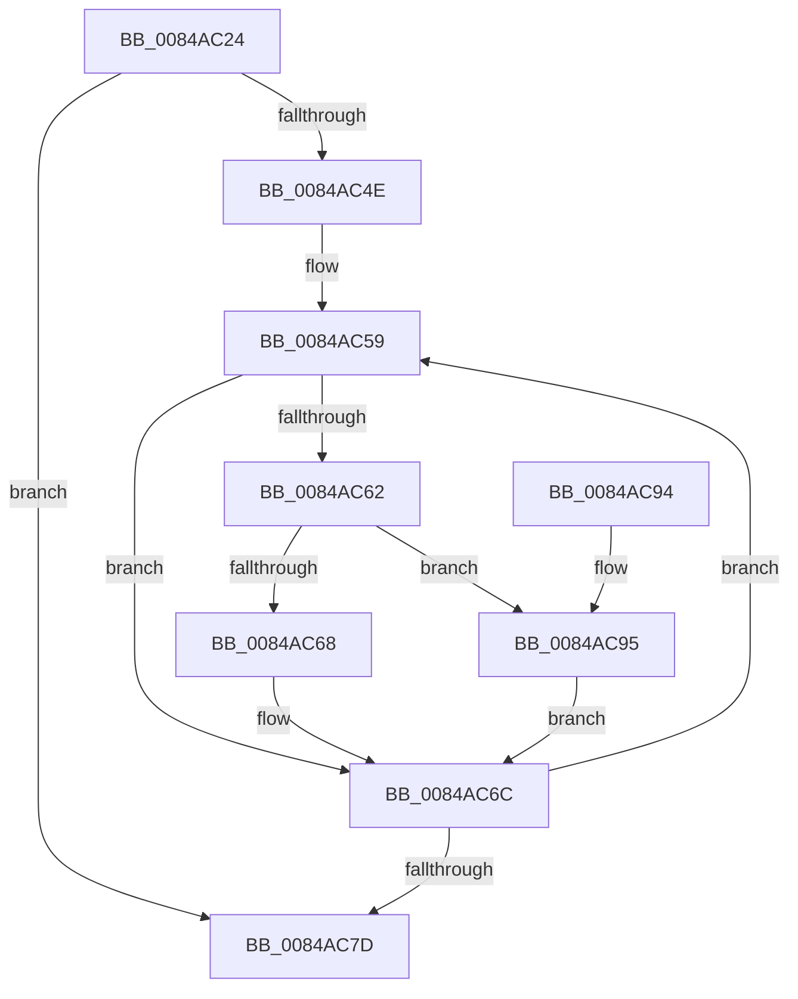

# CmpHashUnicodeComponent

- RVA: `0x0084AC24`–`0x0084AC9F` (길이 `123` bytes)
- VA: `0x000000014084AC24`
- 실행 섹션: `PAGE`
- PDB 이름 있음: `예`; PDB Function 태그: `아니요`
- unwind 정보 RVA: `0x00069570`
- 디코드: `38`개 명령, `123/123` bytes 표시
- 미해석 바이트: `0` (있으면 어셈블리에 `.byte`로 보존)

> 이 문서는 커널 이미지의 기계어와 PDB 기호를 분석해 생성했습니다. 4번과 5번은 함수 원형과 자료형을 바이너리 사용 방식에서 추정한 C 해석이며 원본 소스 복구 결과는 아닙니다.

## 1. Dependencies

- 직접 호출 지점: **1**; 고유 호출 대상: **1**
- 직접 호출자로 확인된 함수: **14**
- RIP 상대 이미지 참조: **0**

### Outgoing calls
- `0x0084AC98` → [RtlUpcaseUnicodeChar](../85/RtlUpcaseUnicodeChar_function_0085F0F0.md) (function, `0x0085F0F0`)

### Direct callers
- [sub_006ED542](../../text/6E/Unknown_function_006ED542.md) at `0x006ED691`
- [CmRenameKey](../7E/CmRenameKey_function_007E8F48.md) at `0x007E927C`
- [CmpDoBuildVirtualStack](../7E/CmpDoBuildVirtualStack_function_007EB4C4.md) at `0x007EB649`
- [CmpPartialPromoteSubkeys](../7F/CmpPartialPromoteSubkeys_function_007F4070.md) at `0x007F41B3`
- [CmpGetMappingHiveForString](CmpGetMappingHiveForString_function_0084A5C8.md) at `0x0084A5E4`
- [CmpGetNameControlBlock](CmpGetNameControlBlock_function_0084A750.md) at `0x0084AAD4`
- [CmpAddToLeaf](../85/CmpAddToLeaf_function_0085BC2C.md) at `0x0085BD90`
- [sub_0085E9FA](../85/Unknown_function_0085E9FA.md) at `0x0085EA19`
- [CmpCheckLeaf](../96/CmpCheckLeaf_function_0096E5BC.md) at `0x0096E793`
- [CmpAddStringToMapping](../AA/CmpAddStringToMapping_function_00AA222C.md) at `0x00AA234F`
- [CmpWaitForHiveMount](../AC/CmpWaitForHiveMount_function_00ACB524.md) at `0x00ACB5AD`
- [sub_00B255E8](../B2/Unknown_function_00B255E8.md) at `0x00B25655`
- [CmInitSystem1](../../init/C5/CmInitSystem1_function_00C559CC.md) at `0x00C55C90`
- [CmpCreateRegistryRoot](../../init/C5/CmpCreateRegistryRoot_function_00C57880.md) at `0x00C5794A`

### Static image references
- 디코드된 RIP-relative 메모리 참조가 없습니다.

## 2. Other-region calls and transfers

- 다른 실행 섹션으로 향하는 call: **0**
- 별도 외부 분기/꼬리 이동을 확인하지 못했습니다.

## 3. Assembly (complete function range)

```asm
0084AC24  48 89 5C 24 08                  mov qword ptr [rsp + 8], rbx
0084AC29  48 89 6C 24 10                  mov qword ptr [rsp + 0x10], rbp
0084AC2E  48 89 74 24 18                  mov qword ptr [rsp + 0x18], rsi
0084AC33  57                              push rdi
0084AC34  48 83 EC 30                     sub rsp, 0x30
0084AC38  0F 10 01                        movups xmm0, xmmword ptr [rcx]
0084AC3B  33 DB                           xor ebx, ebx
0084AC3D  66 0F 7E C0                     movd eax, xmm0
0084AC41  0F 11 44 24 20                  movups xmmword ptr [rsp + 0x20], xmm0
0084AC46  8D 6B 02                        lea ebp, [rbx + 2]
0084AC49  66 3B C5                        cmp ax, bp
0084AC4C  72 2F                           jb 0x14084ac7d
0084AC4E  48 8B 74 24 28                  mov rsi, qword ptr [rsp + 0x28]
0084AC53  0F B7 F8                        movzx edi, ax
0084AC56  48 D1 EF                        shr rdi, 1
0084AC59  0F B7 06                        movzx eax, word ptr [rsi]
0084AC5C  66 83 F8 61                     cmp ax, 0x61
0084AC60  72 0A                           jb 0x14084ac6c
0084AC62  66 83 F8 7A                     cmp ax, 0x7a
0084AC66  77 2D                           ja 0x14084ac95
0084AC68  66 83 E8 20                     sub ax, 0x20
0084AC6C  6B DB 25                        imul ebx, ebx, 0x25
0084AC6F  48 03 F5                        add rsi, rbp
0084AC72  0F B7 C8                        movzx ecx, ax
0084AC75  03 D9                           add ebx, ecx
0084AC77  48 83 EF 01                     sub rdi, 1
0084AC7B  75 DC                           jne 0x14084ac59
0084AC7D  48 8B 6C 24 48                  mov rbp, qword ptr [rsp + 0x48]
0084AC82  8B C3                           mov eax, ebx
0084AC84  48 8B 5C 24 40                  mov rbx, qword ptr [rsp + 0x40]
0084AC89  48 8B 74 24 50                  mov rsi, qword ptr [rsp + 0x50]
0084AC8E  48 83 C4 30                     add rsp, 0x30
0084AC92  5F                              pop rdi
0084AC93  C3                              ret
0084AC94  CC                              int3
0084AC95  0F B7 C8                        movzx ecx, ax
0084AC98  E8 53 44 01 00                  call 0x14085f0f0
0084AC9D  EB CD                           jmp 0x14084ac6c
```

## 4. C-style interpretation (structured pseudocode)

```c
__int64 __fastcall CmpHashUnicodeComponent(__int64 a1)
{
    __int64 result;
    __int64 v_rbx;
    __int64 v_rdi;
    __int64 v_rsi;
    __int64 v_rsp;
    unsigned __int64 v_stack_m10;
    unsigned __int64 v_stack_m18;
    unsigned __int64 v_stack_p10;
    unsigned __int64 v_stack_p18;
    unsigned __int64 v_stack_p8;

    v_stack_p8 = v_rbx;
    v_stack_p10 = v_rbp;
    v_stack_p18 = v_rsi;
    v_rsp = (v_rsp) - (48);
    v_rbx = 0;
    v_stack_m18 = v_xmm0;
    if (((unsigned __int16)(result)) < ((unsigned __int16)(v_rbx + 2))) goto loc_0084AC7D;
    v_rdi = ((unsigned __int16)(result)) >> (1);
loc_0084AC59:
    if (((unsigned __int16)(*(unsigned __int16 *)(v_stack_m10))) < 97) goto loc_0084AC6C;
    if (((unsigned __int16)(*(unsigned __int16 *)(v_stack_m10))) > 122) goto loc_0084AC95;
    result = (unsigned __int16)((*(unsigned __int16 *)(v_stack_m10)) - (32));
loc_0084AC6C:
    v_rbx = (unsigned int)((v_rbx) * (0));
    v_rsi = (v_stack_m10) + (v_rbx + 2);
    v_rbx = (unsigned int)((v_rbx) + ((unsigned int)((unsigned __int16)(result))));
    v_rdi = (v_rdi) - (1);
    if (condition_is_not_equal) goto loc_0084AC59;
loc_0084AC7D:
    v_rsp = (v_rsp) + (48);
    return (unsigned int)((unsigned int)(v_rbx));
loc_0084AC95:
    result = RtlUpcaseUnicodeChar((unsigned __int16)((unsigned int)((unsigned int)(v_rbx))), a2, a3, a4);
    goto loc_0084AC6C;
}
```

## 5. (Beta) C Style

```c
int64_t CmpHashUnicodeComponent(void *Arg1)
{
    uint8_t *arg1 = (uint8_t *)Arg1;

    int64_t result;
    int64_t local_rbx;
    int64_t local_rdi;
    int64_t local_rsi;
    int64_t local_rsp;
    uint64_t v_stack_m10;
    uint64_t v_stack_m18;
    uint64_t v_stack_p10;
    uint64_t v_stack_p18;
    uint64_t v_stack_p8;

    v_stack_p8 = local_rbx;
    v_stack_p10 = local_rbp;
    v_stack_p18 = local_rsi;
    local_rsp = (local_rsp) - (48);
    local_rbx = 0;
    v_stack_m18 = v_xmm0;
    if (((uint16_t)(result)) < ((uint16_t)(local_rbx + 2))) goto loc_0084AC7D;
    local_rdi = ((uint16_t)(result)) >> (1);
loc_0084AC59:
    if (((uint16_t)(*(uint16_t *)(v_stack_m10))) < 97) goto loc_0084AC6C;
    if (((uint16_t)(*(uint16_t *)(v_stack_m10))) > 122) goto loc_0084AC95;
    result = (uint16_t)((*(uint16_t *)(v_stack_m10)) - (32));
loc_0084AC6C:
    local_rbx = (uint32_t)((local_rbx) * (0));
    local_rsi = (v_stack_m10) + (local_rbx + 2);
    local_rbx = (uint32_t)((local_rbx) + ((uint32_t)((uint16_t)(result))));
    local_rdi = (local_rdi) - (1);
    if (condition_is_not_equal) goto loc_0084AC59;
loc_0084AC7D:
    local_rsp = (local_rsp) + (48);
    return (uint32_t)((uint32_t)(local_rbx));
loc_0084AC95:
    result = RtlUpcaseUnicodeChar((uint16_t)((uint32_t)((uint32_t)(local_rbx))), a2, a3, a4);
    goto loc_0084AC6C;
}
```

### 관측된 메모리 오프셋

구조체 형식이 확인되지 않은 접근은 인자 기준의 오프셋으로만 기록했습니다.

| 기준 인자 | 오프셋 표현 | 폭 (bit) | 접근 |
|---|---:|---:|---|
| `Arg1` | `+ 0x0` | `128` | `R` |

## 6. Execution-region graph

[열기: 2D/3D 그래프와 함수 탐색 컨트롤 패널](../../../control-panel.html?section=page&rva=0x0084AC24&view=graph)

- 2D 그래프는 위에서 아래로 흐르고, 3D 그래프는 빈 공간을 드래그해 회전합니다. Shift+드래그는 이동, 휠은 확대·축소, 함수 노드 선택은 대상 보고서 이동입니다.

### Static fallback


