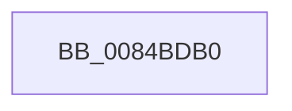

# CmpIsKeyDeleted

- RVA: `0x0084BDB0`–`0x0084BDCD` (길이 `29` bytes)
- VA: `0x000000014084BDB0`
- 실행 섹션: `PAGE`
- PDB 이름 있음: `예`; PDB Function 태그: `아니요`
- unwind 정보 RVA: `0x000696AC`
- 디코드: `7`개 명령, `29/29` bytes 표시
- 미해석 바이트: `0` (있으면 어셈블리에 `.byte`로 보존)

> 이 문서는 커널 이미지의 기계어와 PDB 기호를 분석해 생성했습니다. 4번과 5번은 함수 원형과 자료형을 바이너리 사용 방식에서 추정한 C 해석이며 원본 소스 복구 결과는 아닙니다.

## 1. Dependencies

- 직접 호출 지점: **0**; 고유 호출 대상: **0**
- 직접 호출자로 확인된 함수: **7**
- RIP 상대 이미지 참조: **0**

### Outgoing calls
- 직접 디코드된 call 명령이 없습니다.

### Direct callers
- [CmpSyncKcbCacheForHive](../7E/CmpSyncKcbCacheForHive_function_007EBD50.md) at `0x007EBD72`
- [CmpVEExecuteRealStoreParseLogic](CmpVEExecuteRealStoreParseLogic_function_0084CCD4.md) at `0x0084CD32`
- [CmpQueryKeyDataFromNode](CmpQueryKeyDataFromNode_function_0084EAE0.md) at `0x0084EFB4`
- [CmpFindSubKeyByNumberEx](CmpFindSubKeyByNumberEx_function_0084F1A0.md) at `0x0084F773`
- [CmpFindSubKeyByNumberEx](CmpFindSubKeyByNumberEx_function_0084F1A0.md) at `0x0084F919`
- [CmpQueryKeyDataFromCache](../85/CmpQueryKeyDataFromCache_function_00858F70.md) at `0x00859286`
- [CmpDoParseKey](../85/CmpDoParseKey_function_0085F750.md) at `0x0085FDCB`
- [sub_00B169F2](../B1/Unknown_function_00B169F2.md) at `0x00B16B14`

### Static image references
- 디코드된 RIP-relative 메모리 참조가 없습니다.

## 2. Other-region calls and transfers

- 다른 실행 섹션으로 향하는 call: **0**
- call이 아닌 외부 분기/꼬리 이동: **1**
  - `0x0084BDC7` → [sub_0084BF4C](Unknown_function_0084BF4C.md) (`tail-transfer`)

## 3. Assembly (complete function range)

```asm
0084BDB0  48 89 5C 24 20                  mov qword ptr [rsp + 0x20], rbx
0084BDB5  55                              push rbp
0084BDB6  48 83 EC 40                     sub rsp, 0x40
0084BDBA  F7 41 08 00 00 02 00            test dword ptr [rcx + 8], 0x20000
0084BDC1  48 8B EA                        mov rbp, rdx
0084BDC4  48 8B D9                        mov rbx, rcx
0084BDC7  0F 85 7F 01 00 00               jne 0x14084bf4c
```

## 4. C-style interpretation (structured pseudocode)

```c
void __fastcall CmpIsKeyDeleted(__int64 a1, __int64 a2)
{
    __int64 v_rsp;
    unsigned __int64 v_stack_p20;

    v_stack_p20 = v_rbx;
    v_rsp = (v_rsp) - (64);
}
```

## 5. (Beta) C Style

```c
void CmpIsKeyDeleted(void *Arg1, int64_t Arg2)
{
    uint8_t *arg1 = (uint8_t *)Arg1;

    int64_t local_rsp;
    uint64_t v_stack_p20;

    v_stack_p20 = local_rbx;
    local_rsp = (local_rsp) - (64);
}
```

### 관측된 메모리 오프셋

구조체 형식이 확인되지 않은 접근은 인자 기준의 오프셋으로만 기록했습니다.

| 기준 인자 | 오프셋 표현 | 폭 (bit) | 접근 |
|---|---:|---:|---|
| `Arg1` | `+ 0x8` | `32` | `R` |

## 6. Execution-region graph

[열기: 2D/3D 그래프와 함수 탐색 컨트롤 패널](../../../control-panel.html?section=page&rva=0x0084BDB0&view=graph)

- 2D 그래프는 위에서 아래로 흐르고, 3D 그래프는 빈 공간을 드래그해 회전합니다. Shift+드래그는 이동, 휠은 확대·축소, 함수 노드 선택은 대상 보고서 이동입니다.

### Static fallback


