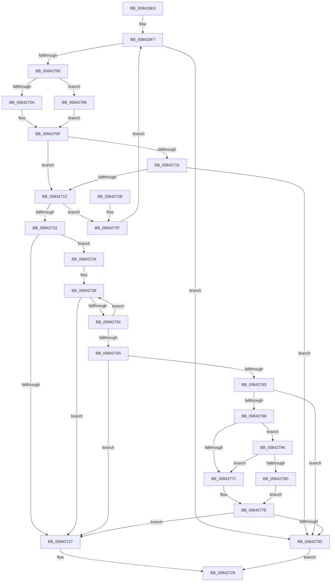

# CmpIsKeyStackDeleted

- RVA: `0x008426E0`–`0x008427A5` (길이 `197` bytes)
- VA: `0x00000001408426E0`
- 실행 섹션: `PAGE`
- PDB 이름 있음: `예`; PDB Function 태그: `아니요`
- unwind 정보 RVA: `0x00068F7C`
- 디코드: `58`개 명령, `197/197` bytes 표시
- 미해석 바이트: `0` (있으면 어셈블리에 `.byte`로 보존)

> 이 문서는 커널 이미지의 기계어와 PDB 기호를 분석해 생성했습니다. 4번과 5번은 함수 원형과 자료형을 바이너리 사용 방식에서 추정한 C 해석이며 원본 소스 복구 결과는 아닙니다.

## 1. Dependencies

- 직접 호출 지점: **2**; 고유 호출 대상: **2**
- 직접 호출자로 확인된 함수: **7**
- RIP 상대 이미지 참조: **0**

### Outgoing calls
- `0x0084274A` → [CmListGetNextElement](../../pagecmrc/BC/CmListGetNextElement_function_00BC9940.md) (function, `0x00BC9940`)
- `0x00842779` → [CmpTransUowIsEqual](../70/CmpTransUowIsEqual_function_007049CC.md) (function, `0x007049CC`)

### Direct callers
- [CmRenameKey](../7E/CmRenameKey_function_007E8F48.md) at `0x007E92E4`
- [CmpEnlistKeyBody](CmpEnlistKeyBody_function_008425C0.md) at `0x008426BB`
- [CmpPromoteKey](CmpPromoteKey_function_00844388.md) at `0x0084449B`
- [sub_00857A33](../85/Unknown_function_00857A33.md) at `0x00857B50`
- [CmpDoParseKey](../85/CmpDoParseKey_function_0085F750.md) at `0x008607F3`
- [CmpDoParseKey](../85/CmpDoParseKey_function_0085F750.md) at `0x00860C08`
- [CmpDoParseKey](../85/CmpDoParseKey_function_0085F750.md) at `0x00860CAF`
- [CmpDoParseKey](../85/CmpDoParseKey_function_0085F750.md) at `0x00860F8C`
- [CmpDoParseKey](../85/CmpDoParseKey_function_0085F750.md) at `0x008612A3`
- [CmpDoParseKey](../85/CmpDoParseKey_function_0085F750.md) at `0x008612B7`
- [CmpDoParseKey](../85/CmpDoParseKey_function_0085F750.md) at `0x008614E2`
- [CmpDoParseKey](../85/CmpDoParseKey_function_0085F750.md) at `0x008614F6`
- [sub_008C405D](../8C/Unknown_function_008C405D.md) at `0x008C4160`
- [CmpCreateChild](../94/CmpCreateChild_function_0094817C.md) at `0x00948F39`

### Static image references
- 디코드된 RIP-relative 메모리 참조가 없습니다.

## 2. Other-region calls and transfers

- 다른 실행 섹션으로 향하는 call: **1**
  - `0x0084274A` → [CmListGetNextElement](../../pagecmrc/BC/CmListGetNextElement_function_00BC9940.md) (`PAGE` → `PAGECMRC`)
- 별도 외부 분기/꼬리 이동을 확인하지 못했습니다.

## 3. Assembly (complete function range)

```asm
008426E0  48 83 EC 28                     sub rsp, 0x28
008426E4  0F B7 41 02                     movzx eax, word ptr [rcx + 2]
008426E8  4C 8B D2                        mov r10, rdx
008426EB  4C 8B C1                        mov r8, rcx
008426EE  48 C7 44 24 30 00 00 00 00      mov qword ptr [rsp + 0x30], 0
008426F7  66 85 C0                        test ax, ax
008426FA  0F 88 82 00 00 00               js 0x140842782
00842700  48 0F BF D0                     movsx rdx, ax
00842704  66 83 F8 02                     cmp ax, 2
00842708  7D 7C                           jge 0x140842786
0084270A  49 8B 54 D0 08                  mov rdx, qword ptr [r8 + rdx*8 + 8]
0084270F  66 83 7A 42 00                  cmp word ptr [rdx + 0x42], 0
00842714  74 06                           je 0x14084271c
00842716  80 7A 41 01                     cmp byte ptr [rdx + 0x41], 1
0084271A  74 66                           je 0x140842782
0084271C  83 7A 28 FF                     cmp dword ptr [rdx + 0x28], -1
00842720  74 0D                           je 0x14084272f
00842722  4D 85 D2                        test r10, r10
00842725  75 0D                           jne 0x140842734
00842727  32 C0                           xor al, al
00842729  48 83 C4 28                     add rsp, 0x28
0084272D  C3                              ret
0084272E  CC                              int3
0084272F  66 FF C8                        dec ax
00842732  EB C3                           jmp 0x1408426f7
00842734  4D 8B 48 08                     mov r9, qword ptr [r8 + 8]
00842738  41 B8 20 00 00 00               mov r8d, 0x20
0084273E  48 8D 54 24 30                  lea rdx, [rsp + 0x30]
00842743  49 8D 89 D0 00 00 00            lea rcx, [r9 + 0xd0]
0084274A  E8 F1 71 38 00                  call 0x140bc9940
0084274F  48 85 C0                        test rax, rax
00842752  74 D3                           je 0x140842727
00842754  83 78 44 02                     cmp dword ptr [rax + 0x44], 2
00842758  75 DE                           jne 0x140842738
0084275A  48 8B 48 38                     mov rcx, qword ptr [rax + 0x38]
0084275E  48 85 C9                        test rcx, rcx
00842761  74 C4                           je 0x140842727
00842763  49 3B CA                        cmp rcx, r10
00842766  74 1A                           je 0x140842782
00842768  48 8B 41 38                     mov rax, qword ptr [rcx + 0x38]
0084276C  48 85 C0                        test rax, rax
0084276F  75 23                           jne 0x140842794
00842771  49 8D 52 58                     lea rdx, [r10 + 0x58]
00842775  48 83 C1 58                     add rcx, 0x58
00842779  E8 4E 22 EC FF                  call 0x1407049cc
0084277E  84 C0                           test al, al
00842780  74 A5                           je 0x140842727
00842782  B0 01                           mov al, 1
00842784  EB A3                           jmp 0x140842729
00842786  49 8B 48 18                     mov rcx, qword ptr [r8 + 0x18]
0084278A  48 8B 54 D1 F0                  mov rdx, qword ptr [rcx + rdx*8 - 0x10]
0084278F  E9 7B FF FF FF                  jmp 0x14084270f
00842794  49 8B 52 38                     mov rdx, qword ptr [r10 + 0x38]
00842798  48 85 D2                        test rdx, rdx
0084279B  74 D4                           je 0x140842771
0084279D  48 3B C2                        cmp rax, rdx
008427A0  0F 94 C0                        sete al
008427A3  EB D9                           jmp 0x14084277e
```

## 4. C-style interpretation (structured pseudocode)

```c
__int64 __fastcall CmpIsKeyStackDeleted(__int64 a1, __int64 a2)
{
    __int64 result;
    __int64 v_rsp;
    unsigned __int64 v_stack_p30;
    unsigned __int64 v_stack_p8;

    v_rsp = (v_rsp) - (40);
    v_stack_p8 = 0;
loc_008426F7:
    if (sign_flag) goto loc_00842782;
    if (((unsigned __int16)(*(unsigned __int16 *)(a1 + 2))) >= 2) goto loc_00842786;
loc_0084270F:
    if ((*(unsigned __int16 *)(*(unsigned __int64 *)(a1 + (__int16)((unsigned __int16)(*(unsigned __int16 *)(a1 + 2))) * 8 + 8) + 66)) == 0) goto loc_0084271C;
    if ((*(unsigned __int8 *)(*(unsigned __int64 *)(a1 + (__int16)((unsigned __int16)(*(unsigned __int16 *)(a1 + 2))) * 8 + 8) + 65)) == 1) goto loc_00842782;
loc_0084271C:
    if ((*(unsigned int *)(*(unsigned __int64 *)(a1 + (__int16)((unsigned __int16)(*(unsigned __int16 *)(a1 + 2))) * 8 + 8) + 40)) == -1) goto loc_0084272F;
    if (a2 != 0) goto loc_00842734;
loc_00842727:
    result = 0;
loc_00842729:
    v_rsp = (v_rsp) + (40);
    return result;
loc_0084272F:
    result = (unsigned __int16)((result) - 1);
    goto loc_008426F7;
loc_00842734:
loc_00842738:
    result = CmListGetNextElement(*(unsigned __int64 *)(a1 + 8) + 208, v_stack_p30, 32, *(unsigned __int64 *)(a1 + 8));
    if (result == 0) goto loc_00842727;
    if ((*(unsigned int *)(result + 68)) != 2) goto loc_00842738;
    if (*(unsigned __int64 *)(result + 56) == 0) goto loc_00842727;
    if ((*(unsigned __int64 *)(result + 56)) == a2) goto loc_00842782;
    if (*(unsigned __int64 *)(*(unsigned __int64 *)(result + 56) + 56) != 0) goto loc_00842794;
loc_00842771:
    a1 = (*(unsigned __int64 *)(result + 56)) + (88);
    result = CmpTransUowIsEqual(a1, a2 + 88, 32, *(unsigned __int64 *)(a1 + 8));
loc_0084277E:
    if ((unsigned __int8)(result) == 0) goto loc_00842727;
loc_00842782:
    goto loc_00842729;
loc_00842786:
    goto loc_0084270F;
loc_00842794:
    if (*(unsigned __int64 *)(a2 + 56) == 0) goto loc_00842771;
    result = (1 == (*(unsigned __int64 *)(a2 + 56))) ? 1 : 0;
    goto loc_0084277E;
}
```

## 5. (Beta) C Style

```c
int64_t CmpIsKeyStackDeleted(void *Arg1, int64_t Arg2)
{
    uint8_t *arg1 = (uint8_t *)Arg1;

    int64_t result;
    int64_t local_rsp;
    uint64_t v_stack_p30;
    uint64_t v_stack_p8;

    local_rsp = (local_rsp) - (40);
    v_stack_p8 = 0;
loc_008426F7:
    if (sign_flag) goto loc_00842782;
    if (((uint16_t)(*(uint16_t *)(arg1 + 0x2))) >= 2) goto loc_00842786;
loc_0084270F:
    if ((*(uint16_t *)(*(uint64_t *)(arg1 + (int16_t)((uint16_t)(*(uint16_t *)(arg1 + 0x2))) * 8 + 0x8) + 0x42)) == 0) goto loc_0084271C;
    if ((*(uint8_t *)(*(uint64_t *)(arg1 + (int16_t)((uint16_t)(*(uint16_t *)(arg1 + 0x2))) * 8 + 0x8) + 0x41)) == 1) goto loc_00842782;
loc_0084271C:
    if ((*(uint32_t *)(*(uint64_t *)(arg1 + (int16_t)((uint16_t)(*(uint16_t *)(arg1 + 0x2))) * 8 + 0x8) + 0x28)) == -1) goto loc_0084272F;
    if (Arg2 != 0) goto loc_00842734;
loc_00842727:
    result = 0;
loc_00842729:
    local_rsp = (local_rsp) + (40);
    return result;
loc_0084272F:
    result = (uint16_t)((result) - 1);
    goto loc_008426F7;
loc_00842734:
loc_00842738:
    result = CmListGetNextElement(*(uint64_t *)(arg1 + 0x8) + 208, v_stack_p30, 32, *(uint64_t *)(arg1 + 0x8));
    if (result == 0) goto loc_00842727;
    if ((*(uint32_t *)(result + 0x44)) != 2) goto loc_00842738;
    if (*(uint64_t *)(result + 0x38) == 0) goto loc_00842727;
    if ((*(uint64_t *)(result + 0x38)) == Arg2) goto loc_00842782;
    if (*(uint64_t *)(*(uint64_t *)(result + 0x38) + 0x38) != 0) goto loc_00842794;
loc_00842771:
    Arg1 = (*(uint64_t *)(result + 0x38)) + (88);
    result = CmpTransUowIsEqual(Arg1, Arg2 + 88, 32, *(uint64_t *)(arg1 + 0x8));
loc_0084277E:
    if ((uint8_t)(result) == 0) goto loc_00842727;
loc_00842782:
    goto loc_00842729;
loc_00842786:
    goto loc_0084270F;
loc_00842794:
    if (*(uint64_t *)(Arg2 + 0x38) == 0) goto loc_00842771;
    result = (1 == (*(uint64_t *)(Arg2 + 0x38))) ? 1 : 0;
    goto loc_0084277E;
}
```

### 관측된 메모리 오프셋

구조체 형식이 확인되지 않은 접근은 인자 기준의 오프셋으로만 기록했습니다.

| 기준 인자 | 오프셋 표현 | 폭 (bit) | 접근 |
|---|---:|---:|---|
| `Arg1` | `+ 0x2` | `16` | `R` |
| `Arg1` | `+ 0x8` | `64` | `R` |
| `Arg1` | `+ 0x8 + rdx*8` | `64` | `R` |
| `Arg1` | `+ 0x18` | `64` | `R` |

## 6. Execution-region graph

[열기: 2D/3D 그래프와 함수 탐색 컨트롤 패널](../../../control-panel.html?section=page&rva=0x008426E0&view=graph)

- 2D 그래프는 위에서 아래로 흐르고, 3D 그래프는 빈 공간을 드래그해 회전합니다. Shift+드래그는 이동, 휠은 확대·축소, 함수 노드 선택은 대상 보고서 이동입니다.

### Static fallback


