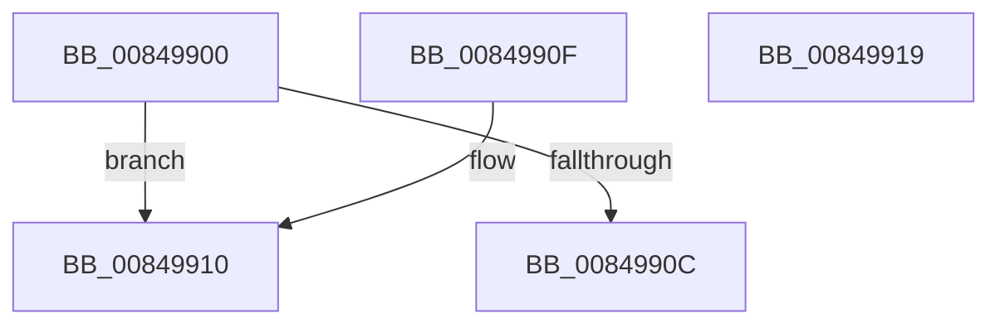

# CmpIsValueTombstone

- RVA: `0x00849900`–`0x0084991A` (길이 `26` bytes)
- VA: `0x0000000140849900`
- 실행 섹션: `PAGE`
- PDB 이름 있음: `예`; PDB Function 태그: `아니요`
- unwind 정보 RVA: `0x000DB714`
- 디코드: `10`개 명령, `26/26` bytes 표시
- 미해석 바이트: `0` (있으면 어셈블리에 `.byte`로 보존)

> 이 문서는 커널 이미지의 기계어와 PDB 기호를 분석해 생성했습니다. 4번과 5번은 함수 원형과 자료형을 바이너리 사용 방식에서 추정한 C 해석이며 원본 소스 복구 결과는 아닙니다.

## 1. Dependencies

- 직접 호출 지점: **0**; 고유 호출 대상: **0**
- 직접 호출자로 확인된 함수: **3**
- RIP 상대 이미지 참조: **0**

### Outgoing calls
- 직접 디코드된 call 명령이 없습니다.

### Direct callers
- [CmDeleteValueKey](CmDeleteValueKey_function_008476E8.md) at `0x008479B9`
- [CmQueryMultipleValueForLayeredKey](../A8/CmQueryMultipleValueForLayeredKey_function_00A8DE80.md) at `0x00A8E034`
- [sub_00B160F4](../B1/Unknown_function_00B160F4.md) at `0x00B1621E`

### Static image references
- 디코드된 RIP-relative 메모리 참조가 없습니다.

## 2. Other-region calls and transfers

- 다른 실행 섹션으로 향하는 call: **0**
- 별도 외부 분기/꼬리 이동을 확인하지 못했습니다.

## 3. Assembly (complete function range)

```asm
00849900  F7 81 A0 00 00 00 00 00 08 00   test dword ptr [rcx + 0xa0], 0x80000
0084990A  75 04                           jne 0x140849910
0084990C  32 C0                           xor al, al
0084990E  C3                              ret
0084990F  CC                              int3
00849910  0F B6 42 10                     movzx eax, byte ptr [rdx + 0x10]
00849914  D0 E8                           shr al, 1
00849916  24 01                           and al, 1
00849918  C3                              ret
00849919  CC                              int3
```

## 4. C-style interpretation (structured pseudocode)

```c
__int64 __fastcall CmpIsValueTombstone(__int64 a1, __int64 a2)
{
    __int64 result;

    if (((*(unsigned int *)(a1 + 160)) & (0x80000ULL)) != 0) goto loc_00849910;
    result = 0;
    return result;
loc_00849910:
    result = (unsigned __int8)((*(unsigned __int8 *)(a2 + 16)) >> (1));
    result = (unsigned __int8)((result) & (1));
    return result;
}
```

## 5. (Beta) C Style

```c
int64_t CmpIsValueTombstone(void *Arg1, void *Arg2)
{
    uint8_t *arg1 = (uint8_t *)Arg1;
    uint8_t *arg2 = (uint8_t *)Arg2;

    int64_t result;

    if (((*(uint32_t *)(arg1 + 0xA0)) & (0x80000ULL)) != 0) goto loc_00849910;
    result = 0;
    return result;
loc_00849910:
    result = (uint8_t)((*(uint8_t *)(arg2 + 0x10)) >> (1));
    result = (uint8_t)((result) & (1));
    return result;
}
```

### 관측된 메모리 오프셋

구조체 형식이 확인되지 않은 접근은 인자 기준의 오프셋으로만 기록했습니다.

| 기준 인자 | 오프셋 표현 | 폭 (bit) | 접근 |
|---|---:|---:|---|
| `Arg1` | `+ 0xA0` | `32` | `R` |
| `Arg2` | `+ 0x10` | `8` | `R` |

## 6. Execution-region graph

[열기: 2D/3D 그래프와 함수 탐색 컨트롤 패널](../../../control-panel.html?section=page&rva=0x00849900&view=graph)

- 2D 그래프는 위에서 아래로 흐르고, 3D 그래프는 빈 공간을 드래그해 회전합니다. Shift+드래그는 이동, 휠은 확대·축소, 함수 노드 선택은 대상 보고서 이동입니다.

### Static fallback


