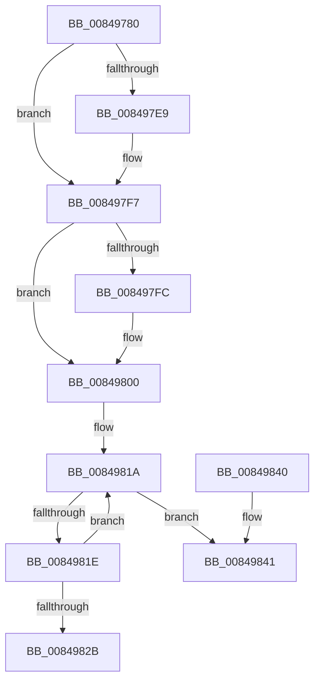

# CmpLockHashEntryExclusiveByKcb

- RVA: `0x00849780`–`0x0084985C` (길이 `220` bytes)
- VA: `0x0000000140849780`
- 실행 섹션: `PAGE`
- PDB 이름 있음: `예`; PDB Function 태그: `아니요`
- unwind 정보 RVA: `0x00069420`
- 디코드: `59`개 명령, `220/220` bytes 표시
- 미해석 바이트: `0` (있으면 어셈블리에 `.byte`로 보존)

> 이 문서는 커널 이미지의 기계어와 PDB 기호를 분석해 생성했습니다. 4번과 5번은 함수 원형과 자료형을 바이너리 사용 방식에서 추정한 C 해석이며 원본 소스 복구 결과는 아닙니다.

## 1. Dependencies

- 직접 호출 지점: **3**; 고유 호출 대상: **3**
- 직접 호출자로 확인된 함수: **4**
- RIP 상대 이미지 참조: **0**

### Outgoing calls
- `0x008497D9` → [KeAbPreAcquire](../../text/21/KeAbPreAcquire_function_00210230.md) (function, `0x00210230`)
- `0x008497F2` → [ExfAcquirePushLockExclusiveEx](../../text/20/ExfAcquirePushLockExclusiveEx_function_0020FC90.md) (function, `0x0020FC90`)
- `0x00849856` → [KeBugCheckEx](../../text/4F/KeBugCheckEx_function_004FD660.md) (function, `0x004FD660`)

### Direct callers
- [CmDeleteLayeredKey](../../text/41/CmDeleteLayeredKey_function_0041B598.md) at `0x0041B66B`
- [sub_0041B9B6](../../text/41/Unknown_function_0041B9B6.md) at `0x0041BA10`
- [CmpRemoveHiveFromNamespace](../../text/49/CmpRemoveHiveFromNamespace_function_0049C4CC.md) at `0x0049C4F1`
- [CmDeleteKey](CmDeleteKey_function_00848E5C.md) at `0x00848FF5`

### Static image references
- 디코드된 RIP-relative 메모리 참조가 없습니다.

## 2. Other-region calls and transfers

- 다른 실행 섹션으로 향하는 call: **3**
  - `0x008497D9` → [KeAbPreAcquire](../../text/21/KeAbPreAcquire_function_00210230.md) (`PAGE` → `.text`)
  - `0x008497F2` → [ExfAcquirePushLockExclusiveEx](../../text/20/ExfAcquirePushLockExclusiveEx_function_0020FC90.md) (`PAGE` → `.text`)
  - `0x00849856` → [KeBugCheckEx](../../text/4F/KeBugCheckEx_function_004FD660.md) (`PAGE` → `.text`)
- 별도 외부 분기/꼬리 이동을 확인하지 못했습니다.

## 3. Assembly (complete function range)

```asm
00849780  48 89 5C 24 08                  mov qword ptr [rsp + 8], rbx
00849785  48 89 6C 24 10                  mov qword ptr [rsp + 0x10], rbp
0084978A  48 89 74 24 18                  mov qword ptr [rsp + 0x18], rsi
0084978F  57                              push rdi
00849790  48 83 EC 30                     sub rsp, 0x30
00849794  8B 41 10                        mov eax, dword ptr [rcx + 0x10]
00849797  48 8B E9                        mov rbp, rcx
0084979A  48 8B 59 20                     mov rbx, qword ptr [rcx + 0x20]
0084979E  8B D0                           mov edx, eax
008497A0  C1 EA 09                        shr edx, 9
008497A3  33 D0                           xor edx, eax
008497A5  69 C2 A3 8A 01 00               imul eax, edx, 0x18aa3
008497AB  8B 8B 78 06 00 00               mov ecx, dword ptr [rbx + 0x678]
008497B1  FF C9                           dec ecx
008497B3  8B D0                           mov edx, eax
008497B5  44 8B C0                        mov r8d, eax
008497B8  48 8B 83 70 06 00 00            mov rax, qword ptr [rbx + 0x670]
008497BF  49 C1 E8 09                     shr r8, 9
008497C3  4C 33 C2                        xor r8, rdx
008497C6  33 D2                           xor edx, edx
008497C8  4C 23 C1                        and r8, rcx
008497CB  4B 8D 0C 40                     lea rcx, [r8 + r8*2]
008497CF  45 33 C0                        xor r8d, r8d
008497D2  48 8D 3C C8                     lea rdi, [rax + rcx*8]
008497D6  48 8B CF                        mov rcx, rdi
008497D9  E8 52 6A 9C FF                  call 0x140210230
008497DE  F0 48 0F BA 2F 00               lock bts qword ptr [rdi], 0
008497E4  48 8B F0                        mov rsi, rax
008497E7  73 0E                           jae 0x1408497f7
008497E9  4C 8B C7                        mov r8, rdi
008497EC  48 8B D0                        mov rdx, rax
008497EF  48 8B CF                        mov rcx, rdi
008497F2  E8 99 64 9C FF                  call 0x14020fc90
008497F7  48 85 F6                        test rsi, rsi
008497FA  74 04                           je 0x140849800
008497FC  C6 46 0A 01                     mov byte ptr [rsi + 0xa], 1
00849800  65 48 8B 04 25 88 01 00 00      mov rax, qword ptr gs:[0x188]
00849809  48 89 47 08                     mov qword ptr [rdi + 8], rax
0084980D  0F 0D 8B 88 10 00 00            prefetchw byte ptr [rbx + 0x1088]
00849814  8B 83 88 10 00 00               mov eax, dword ptr [rbx + 0x1088]
0084981A  85 C0                           test eax, eax
0084981C  74 23                           je 0x140849841
0084981E  8D 48 01                        lea ecx, [rax + 1]
00849821  F0 0F B1 8B 88 10 00 00         lock cmpxchg dword ptr [rbx + 0x1088], ecx
00849829  75 EF                           jne 0x14084981a
0084982B  48 8B 5C 24 40                  mov rbx, qword ptr [rsp + 0x40]
00849830  48 8B 6C 24 48                  mov rbp, qword ptr [rsp + 0x48]
00849835  48 8B 74 24 50                  mov rsi, qword ptr [rsp + 0x50]
0084983A  48 83 C4 30                     add rsp, 0x30
0084983E  5F                              pop rdi
0084983F  C3                              ret
00849840  CC                              int3
00849841  41 B9 08 00 00 00               mov r9d, 8
00849847  48 89 6C 24 20                  mov qword ptr [rsp + 0x20], rbp
0084984C  4C 8B C3                        mov r8, rbx
0084984F  41 8D 51 0F                     lea edx, [r9 + 0xf]
00849853  8D 4A 3A                        lea ecx, [rdx + 0x3a]
00849856  E8 05 3E CB FF                  call 0x1404fd660
0084985B  CC                              int3
```

## 4. C-style interpretation (structured pseudocode)

```c
__int64 __fastcall CmpLockHashEntryExclusiveByKcb(__int64 a1)
{
    __int64 result;
    __int64 v_rsp;
    unsigned __int64 v_stack_p10;
    unsigned __int64 v_stack_p18;
    unsigned __int64 v_stack_p20;
    unsigned __int64 v_stack_p8;

    v_stack_p8 = v_rbx;
    v_stack_p10 = v_rbp;
    v_stack_p18 = v_rsi;
    v_rsp = (v_rsp) - (48);
    a2 = (unsigned int)(((unsigned int)((unsigned int)((unsigned int)(*(unsigned int *)(a1 + 16))))) >> (9));
    a2 = (unsigned int)((a2) ^ ((unsigned int)((unsigned int)(*(unsigned int *)(a1 + 16)))));
    result = (unsigned int)(((unsigned int)(*(unsigned int *)(a1 + 16))) * ((unsigned int)(a2)));
    a1 = (unsigned int)(((unsigned int)(*(unsigned int *)(*(unsigned __int64 *)(a1 + 32) + 1656))) - 1);
    a3 = ((unsigned int)((unsigned int)(result))) >> (9);
    a3 = (a3) ^ ((unsigned int)((unsigned int)(result)));
    a2 = 0;
    a3 = (a3) & (a1);
    a3 = 0;
    result = KeAbPreAcquire(*(unsigned __int64 *)(*(unsigned __int64 *)(a1 + 32) + 1648) + a3 + a3 * 2 * 8, a2, a3, a4);
    if (!(condition_is_above_or_equal)) {
        a3 = *(unsigned __int64 *)(*(unsigned __int64 *)(a1 + 32) + 1648) + a3 + a3 * 2 * 8;
        a2 = result;
        a1 = *(unsigned __int64 *)(*(unsigned __int64 *)(a1 + 32) + 1648) + a3 + a3 * 2 * 8;
        result = ExfAcquirePushLockExclusiveEx(a1, a2, a3, a4);
    }
    if (result != 0) {
        *(unsigned __int8 *)(result + 10) = 1;
    }
    *(unsigned __int64 *)(*(unsigned __int64 *)(*(unsigned __int64 *)(a1 + 32) + 1648) + a3 + a3 * 2 * 8 + 8) = *(unsigned __int64 *)(gs_base + (0 + 392));
loc_0084981A:
    if ((unsigned int)((unsigned int)(*(unsigned int *)(*(unsigned __int64 *)(a1 + 32) + 4232))) == 0) goto loc_00849841;
    if ((unsigned int)((unsigned int)(*(unsigned int *)(*(unsigned __int64 *)(a1 + 32) + 4232))) != 0) goto loc_0084981A;
    v_rsp = (v_rsp) + (48);
    return (unsigned int)(*(unsigned int *)(*(unsigned __int64 *)(a1 + 32) + 4232));
loc_00849841:
    v_stack_p20 = v_stack_p10;
    result = KeBugCheckEx(8 + 15 + 58, 8 + 15, v_stack_p8, 8);
    return result;
}
```

## 5. (Beta) C Style

```c
int64_t CmpLockHashEntryExclusiveByKcb(void *Arg1)
{
    uint8_t *arg1 = (uint8_t *)Arg1;

    int64_t result;
    int64_t local_rsp;
    uint64_t v_stack_p10;
    uint64_t v_stack_p18;
    uint64_t v_stack_p20;
    uint64_t v_stack_p8;

    v_stack_p8 = local_rbx;
    v_stack_p10 = local_rbp;
    v_stack_p18 = local_rsi;
    local_rsp = (local_rsp) - (48);
    a2 = (uint32_t)(((uint32_t)((uint32_t)((uint32_t)(*(uint32_t *)(arg1 + 0x10))))) >> (9));
    a2 = (uint32_t)((a2) ^ ((uint32_t)((uint32_t)(*(uint32_t *)(arg1 + 0x10)))));
    result = (uint32_t)(((uint32_t)(*(uint32_t *)(arg1 + 0x10))) * ((uint32_t)(a2)));
    Arg1 = (uint32_t)(((uint32_t)(*(uint32_t *)(*(uint64_t *)(arg1 + 0x20) + 0x678))) - 1);
    a3 = ((uint32_t)((uint32_t)(result))) >> (9);
    a3 = (a3) ^ ((uint32_t)((uint32_t)(result)));
    a2 = 0;
    a3 = (a3) & (Arg1);
    a3 = 0;
    result = KeAbPreAcquire(*(uint64_t *)(*(uint64_t *)(arg1 + 0x20) + 0x670) + a3 + a3 * 2 * 8, a2, a3, a4);
    if (!(condition_is_above_or_equal)) {
        a3 = *(uint64_t *)(*(uint64_t *)(arg1 + 0x20) + 0x670) + a3 + a3 * 2 * 8;
        a2 = result;
        Arg1 = *(uint64_t *)(*(uint64_t *)(arg1 + 0x20) + 0x670) + a3 + a3 * 2 * 8;
        result = ExfAcquirePushLockExclusiveEx(Arg1, a2, a3, a4);
    }
    if (result != 0) {
        *(uint8_t *)(result + 0xA) = 1;
    }
    *(uint64_t *)(*(uint64_t *)(*(uint64_t *)(arg1 + 0x20) + 0x670) + a3 + a3 * 2 * 8 + 0x8) = *(uint64_t *)(gs_base + (0 + 0x188));
loc_0084981A:
    if ((uint32_t)((uint32_t)(*(uint32_t *)(*(uint64_t *)(arg1 + 0x20) + 0x1088))) == 0) goto loc_00849841;
    if ((uint32_t)((uint32_t)(*(uint32_t *)(*(uint64_t *)(arg1 + 0x20) + 0x1088))) != 0) goto loc_0084981A;
    local_rsp = (local_rsp) + (48);
    return (uint32_t)(*(uint32_t *)(*(uint64_t *)(arg1 + 0x20) + 0x1088));
loc_00849841:
    v_stack_p20 = v_stack_p10;
    result = KeBugCheckEx(8 + 15 + 58, 8 + 15, v_stack_p8, 8);
    return result;
}
```

### 관측된 메모리 오프셋

구조체 형식이 확인되지 않은 접근은 인자 기준의 오프셋으로만 기록했습니다.

| 기준 인자 | 오프셋 표현 | 폭 (bit) | 접근 |
|---|---:|---:|---|
| `Arg1` | `+ 0x10` | `32` | `R` |
| `Arg1` | `+ 0x20` | `64` | `R` |

## 6. Execution-region graph

[열기: 2D/3D 그래프와 함수 탐색 컨트롤 패널](../../../control-panel.html?section=page&rva=0x00849780&view=graph)

- 2D 그래프는 위에서 아래로 흐르고, 3D 그래프는 빈 공간을 드래그해 회전합니다. Shift+드래그는 이동, 휠은 확대·축소, 함수 노드 선택은 대상 보고서 이동입니다.

### Static fallback


