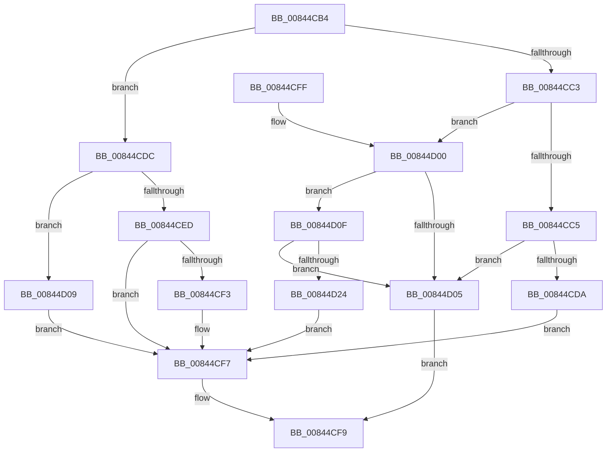

# CmpLockIXLockExclusive

- RVA: `0x00844CB4`–`0x00844D2A` (길이 `118` bytes)
- VA: `0x0000000140844CB4`
- 실행 섹션: `PAGE`
- PDB 이름 있음: `예`; PDB Function 태그: `아니요`
- unwind 정보 RVA: `0x000691A8`
- 디코드: `42`개 명령, `118/118` bytes 표시
- 미해석 바이트: `0` (있으면 어셈블리에 `.byte`로 보존)

> 이 문서는 커널 이미지의 기계어와 PDB 기호를 분석해 생성했습니다. 4번과 5번은 함수 원형과 자료형을 바이너리 사용 방식에서 추정한 C 해석이며 원본 소스 복구 결과는 아닙니다.

## 1. Dependencies

- 직접 호출 지점: **2**; 고유 호출 대상: **1**
- 직접 호출자로 확인된 함수: **8**
- RIP 상대 이미지 참조: **0**

### Outgoing calls
- `0x00844CD1` → [CmEqualTrans](CmEqualTrans_function_0084BF60.md) (function, `0x0084BF60`)
- `0x00844D1B` → [CmEqualTrans](CmEqualTrans_function_0084BF60.md) (function, `0x0084BF60`)

### Direct callers
- [CmSetLastWriteTimeKey](CmSetLastWriteTimeKey_function_00843368.md) at `0x0084364D`
- [CmSetValueKey](CmSetValueKey_function_008457C0.md) at `0x0084613F`
- [CmDeleteValueKey](CmDeleteValueKey_function_008476E8.md) at `0x00847E5E`
- [CmDeleteKey](CmDeleteKey_function_00848E5C.md) at `0x00849518`
- [CmDeleteKey](CmDeleteKey_function_00848E5C.md) at `0x0084952F`
- [CmpUndoDeleteKeyForTrans](../94/CmpUndoDeleteKeyForTrans_function_0094A728.md) at `0x0094A8C8`
- [CmpUndoDeleteKeyForTrans](../94/CmpUndoDeleteKeyForTrans_function_0094A728.md) at `0x0094A961`
- [CmpUndoDeleteKeyForTrans](../94/CmpUndoDeleteKeyForTrans_function_0094A728.md) at `0x0094A97E`
- [sub_00B258D8](../B2/Unknown_function_00B258D8.md) at `0x00B25A52`
- [sub_00B258D8](../B2/Unknown_function_00B258D8.md) at `0x00B25A78`
- [sub_00B25E36](../B2/Unknown_function_00B25E36.md) at `0x00B25EC9`
- [sub_00B25E36](../B2/Unknown_function_00B25E36.md) at `0x00B25EE2`
- [sub_00B2D804](../B2/Unknown_function_00B2D804.md) at `0x00B2D8B4`

### Static image references
- 디코드된 RIP-relative 메모리 참조가 없습니다.

## 2. Other-region calls and transfers

- 다른 실행 섹션으로 향하는 call: **0**
- 별도 외부 분기/꼬리 이동을 확인하지 못했습니다.

## 3. Assembly (complete function range)

```asm
00844CB4  40 53                           push rbx
00844CB6  48 83 EC 20                     sub rsp, 0x20
00844CBA  8B 01                           mov eax, dword ptr [rcx]
00844CBC  48 8B D9                        mov rbx, rcx
00844CBF  85 C0                           test eax, eax
00844CC1  74 19                           je 0x140844cdc
00844CC3  79 3B                           jns 0x140844d00
00844CC5  48 8B 49 08                     mov rcx, qword ptr [rcx + 8]
00844CC9  48 8B 52 38                     mov rdx, qword ptr [rdx + 0x38]
00844CCD  48 8B 49 38                     mov rcx, qword ptr [rcx + 0x38]
00844CD1  E8 8A 72 00 00                  call 0x14084bf60
00844CD6  84 C0                           test al, al
00844CD8  74 2B                           je 0x140844d05
00844CDA  EB 1B                           jmp 0x140844cf7
00844CDC  FF C0                           inc eax
00844CDE  48 89 51 08                     mov qword ptr [rcx + 8], rdx
00844CE2  0F BA E8 1F                     bts eax, 0x1f
00844CE6  89 01                           mov dword ptr [rcx], eax
00844CE8  45 85 C0                        test r8d, r8d
00844CEB  74 1C                           je 0x140844d09
00844CED  41 83 F8 01                     cmp r8d, 1
00844CF1  75 04                           jne 0x140844cf7
00844CF3  48 89 5A 18                     mov qword ptr [rdx + 0x18], rbx
00844CF7  B0 01                           mov al, 1
00844CF9  48 83 C4 20                     add rsp, 0x20
00844CFD  5B                              pop rbx
00844CFE  C3                              ret
00844CFF  CC                              int3
00844D00  83 F8 01                        cmp eax, 1
00844D03  74 0A                           je 0x140844d0f
00844D05  32 C0                           xor al, al
00844D07  EB F0                           jmp 0x140844cf9
00844D09  48 89 5A 10                     mov qword ptr [rdx + 0x10], rbx
00844D0D  EB E8                           jmp 0x140844cf7
00844D0F  48 8B 49 08                     mov rcx, qword ptr [rcx + 8]
00844D13  48 8B 52 38                     mov rdx, qword ptr [rdx + 0x38]
00844D17  48 8B 49 38                     mov rcx, qword ptr [rcx + 0x38]
00844D1B  E8 40 72 00 00                  call 0x14084bf60
00844D20  84 C0                           test al, al
00844D22  74 E1                           je 0x140844d05
00844D24  0F BA 2B 1F                     bts dword ptr [rbx], 0x1f
00844D28  EB CD                           jmp 0x140844cf7
```

## 4. C-style interpretation (structured pseudocode)

```c
__int64 __fastcall CmpLockIXLockExclusive(__int64 a1, __int64 a2, int a3)
{
    __int64 result;
    __int64 v_rsp;

    v_rsp = (v_rsp) - (32);
    if ((unsigned int)((unsigned int)(*(unsigned int *)(a1))) == 0) goto loc_00844CDC;
    if (!sign_flag) goto loc_00844D00;
    result = CmEqualTrans(*(unsigned __int64 *)(*(unsigned __int64 *)(a1 + 8) + 56), *(unsigned __int64 *)(a2 + 56), a3, a4);
    if ((unsigned __int8)(result) == 0) goto loc_00844D05;
    goto loc_00844CF7;
loc_00844CDC:
    result = (unsigned int)((result) + 1);
    *(unsigned __int64 *)(*(unsigned __int64 *)(*(unsigned __int64 *)(a1 + 8) + 56) + 8) = *(unsigned __int64 *)(a2 + 56);
    *(unsigned int *)(*(unsigned __int64 *)(*(unsigned __int64 *)(a1 + 8) + 56)) = (unsigned int)(result);
    if (a3 == 0) goto loc_00844D09;
    if (a3 == 1) {
        *(unsigned __int64 *)(*(unsigned __int64 *)(a2 + 56) + 24) = a1;
    }
loc_00844CF9:
    v_rsp = (v_rsp) + (32);
    return 1;
loc_00844D00:
    if (1 == 1) goto loc_00844D0F;
loc_00844D05:
    result = 0;
    goto loc_00844CF9;
loc_00844D09:
    *(unsigned __int64 *)(*(unsigned __int64 *)(a2 + 56) + 16) = a1;
    goto loc_00844CF7;
loc_00844D0F:
    result = CmEqualTrans(*(unsigned __int64 *)(*(unsigned __int64 *)(*(unsigned __int64 *)(*(unsigned __int64 *)(a1 + 8) + 56) + 8) + 56), *(unsigned __int64 *)(*(unsigned __int64 *)(a2 + 56) + 56), a3, a4);
    if ((unsigned __int8)(result) == 0) goto loc_00844D05;
    goto loc_00844CF7;
}
```

## 5. (Beta) C Style

```c
int64_t CmpLockIXLockExclusive(void *Arg1, void *Arg2, int32_t Arg3)
{
    uint8_t *arg1 = (uint8_t *)Arg1;
    uint8_t *arg2 = (uint8_t *)Arg2;

    int64_t result;
    int64_t local_rsp;

    local_rsp = (local_rsp) - (32);
    if ((uint32_t)((uint32_t)(*(uint32_t *)(arg1))) == 0) goto loc_00844CDC;
    if (!sign_flag) goto loc_00844D00;
    result = CmEqualTrans(*(uint64_t *)(*(uint64_t *)(arg1 + 0x8) + 0x38), *(uint64_t *)(arg2 + 0x38), Arg3, a4);
    if ((uint8_t)(result) == 0) goto loc_00844D05;
    goto loc_00844CF7;
loc_00844CDC:
    result = (uint32_t)((result) + 1);
    *(uint64_t *)(*(uint64_t *)(*(uint64_t *)(arg1 + 0x8) + 0x38) + 0x8) = *(uint64_t *)(arg2 + 0x38);
    *(uint32_t *)(*(uint64_t *)(*(uint64_t *)(arg1 + 0x8) + 0x38)) = (uint32_t)(result);
    if (Arg3 == 0) goto loc_00844D09;
    if (Arg3 == 1) {
        *(void **)(*(uint64_t *)(arg2 + 0x38) + 0x18) = Arg1;
    }
loc_00844CF9:
    local_rsp = (local_rsp) + (32);
    return 1;
loc_00844D00:
    if (1 == 1) goto loc_00844D0F;
loc_00844D05:
    result = 0;
    goto loc_00844CF9;
loc_00844D09:
    *(void **)(*(uint64_t *)(arg2 + 0x38) + 0x10) = Arg1;
    goto loc_00844CF7;
loc_00844D0F:
    result = CmEqualTrans(*(uint64_t *)(*(uint64_t *)(*(uint64_t *)(*(uint64_t *)(arg1 + 0x8) + 0x38) + 0x8) + 0x38), *(uint64_t *)(*(uint64_t *)(arg2 + 0x38) + 0x38), Arg3, a4);
    if ((uint8_t)(result) == 0) goto loc_00844D05;
    goto loc_00844CF7;
}
```

### 관측된 메모리 오프셋

구조체 형식이 확인되지 않은 접근은 인자 기준의 오프셋으로만 기록했습니다.

| 기준 인자 | 오프셋 표현 | 폭 (bit) | 접근 |
|---|---:|---:|---|
| `Arg1` | `+ 0x0` | `32` | `R` |
| `Arg1` | `+ 0x0` | `32` | `R/W` |
| `Arg1` | `+ 0x0` | `32` | `W` |
| `Arg1` | `+ 0x8` | `64` | `R` |
| `Arg1` | `+ 0x8` | `64` | `W` |
| `Arg2` | `+ 0x10` | `64` | `W` |
| `Arg2` | `+ 0x18` | `64` | `W` |
| `Arg2` | `+ 0x38` | `64` | `R` |

## 6. Execution-region graph

[열기: 2D/3D 그래프와 함수 탐색 컨트롤 패널](../../../control-panel.html?section=page&rva=0x00844CB4&view=graph)

- 2D 그래프는 위에서 아래로 흐르고, 3D 그래프는 빈 공간을 드래그해 회전합니다. Shift+드래그는 이동, 휠은 확대·축소, 함수 노드 선택은 대상 보고서 이동입니다.

### Static fallback


