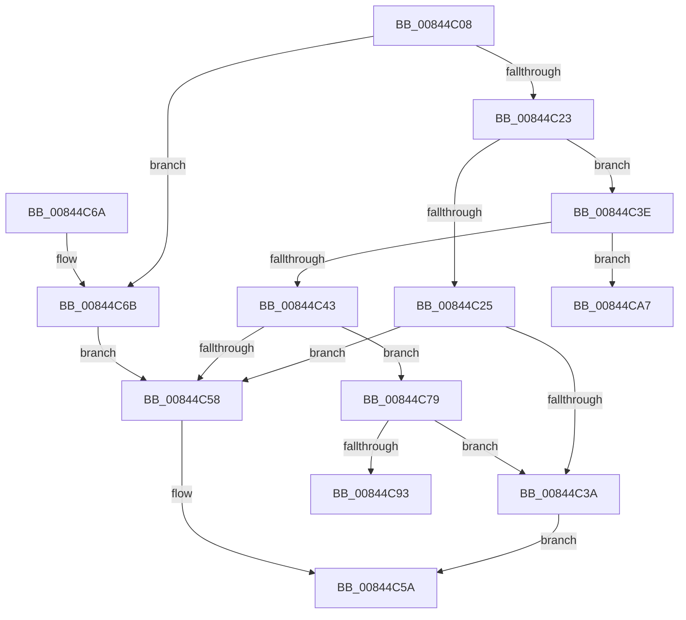

# CmpLockIXLockIntent

- RVA: `0x00844C08`–`0x00844CAE` (길이 `166` bytes)
- VA: `0x0000000140844C08`
- 실행 섹션: `PAGE`
- PDB 이름 있음: `예`; PDB Function 태그: `예`
- unwind 정보 RVA: `0x00069184`
- 디코드: `51`개 명령, `166/166` bytes 표시
- 미해석 바이트: `0` (있으면 어셈블리에 `.byte`로 보존)

> 이 문서는 커널 이미지의 기계어와 PDB 기호를 분석해 생성했습니다. 4번과 5번은 함수 원형과 자료형을 바이너리 사용 방식에서 추정한 C 해석이며 원본 소스 복구 결과는 아닙니다.

## 1. Dependencies

- 직접 호출 지점: **3**; 고유 호출 대상: **2**
- 직접 호출자로 확인된 함수: **7**
- RIP 상대 이미지 참조: **0**

### Outgoing calls
- `0x00844C31` → [CmEqualTrans](CmEqualTrans_function_0084BF60.md) (function, `0x0084BF60`)
- `0x00844C4F` → [CmEqualTrans](CmEqualTrans_function_0084BF60.md) (function, `0x0084BF60`)
- `0x00844C89` → [ExAllocatePool2](../../poolcode/B8/ExAllocatePool2_function_00B820F0.md) (function, `0x00B820F0`)

### Direct callers
- [CmSetLastWriteTimeKey](CmSetLastWriteTimeKey_function_00843368.md) at `0x00843634`
- [CmSetValueKey](CmSetValueKey_function_008457C0.md) at `0x00846121`
- [CmDeleteValueKey](CmDeleteValueKey_function_008476E8.md) at `0x00847E41`
- [CmDeleteKey](CmDeleteKey_function_00848E5C.md) at `0x00849500`
- [CmpUndoDeleteKeyForTrans](../94/CmpUndoDeleteKeyForTrans_function_0094A728.md) at `0x0094A8AA`
- [sub_00B258D8](../B2/Unknown_function_00B258D8.md) at `0x00B25A27`
- [sub_00B2D804](../B2/Unknown_function_00B2D804.md) at `0x00B2D89D`

### Static image references
- 디코드된 RIP-relative 메모리 참조가 없습니다.

## 2. Other-region calls and transfers

- 다른 실행 섹션으로 향하는 call: **1**
  - `0x00844C89` → [ExAllocatePool2](../../poolcode/B8/ExAllocatePool2_function_00B820F0.md) (`PAGE` → `POOLCODE`)
- call이 아닌 외부 분기/꼬리 이동: **2**
  - `0x00844CA2` → [sub_00B16078 + 0x75](../B1/Unknown_function_00B16078.md) (`tail-transfer`)
  - `0x00844CA9` → [sub_00B16078](../B1/Unknown_function_00B16078.md) (`tail-transfer`)

## 3. Assembly (complete function range)

```asm
00844C08  48 89 5C 24 08                  mov qword ptr [rsp + 8], rbx
00844C0D  48 89 74 24 10                  mov qword ptr [rsp + 0x10], rsi
00844C12  57                              push rdi
00844C13  48 83 EC 20                     sub rsp, 0x20
00844C17  8B 01                           mov eax, dword ptr [rcx]
00844C19  48 8B FA                        mov rdi, rdx
00844C1C  48 8B D9                        mov rbx, rcx
00844C1F  85 C0                           test eax, eax
00844C21  74 48                           je 0x140844c6b
00844C23  79 19                           jns 0x140844c3e
00844C25  48 8B 49 08                     mov rcx, qword ptr [rcx + 8]
00844C29  48 8B 52 38                     mov rdx, qword ptr [rdx + 0x38]
00844C2D  48 8B 49 38                     mov rcx, qword ptr [rcx + 0x38]
00844C31  E8 2A 73 00 00                  call 0x14084bf60
00844C36  84 C0                           test al, al
00844C38  75 1E                           jne 0x140844c58
00844C3A  32 C0                           xor al, al
00844C3C  EB 1C                           jmp 0x140844c5a
00844C3E  83 F8 01                        cmp eax, 1
00844C41  75 64                           jne 0x140844ca7
00844C43  48 8B 71 08                     mov rsi, qword ptr [rcx + 8]
00844C47  48 8B 52 38                     mov rdx, qword ptr [rdx + 0x38]
00844C4B  48 8B 4E 38                     mov rcx, qword ptr [rsi + 0x38]
00844C4F  E8 0C 73 00 00                  call 0x14084bf60
00844C54  84 C0                           test al, al
00844C56  74 21                           je 0x140844c79
00844C58  B0 01                           mov al, 1
00844C5A  48 8B 5C 24 30                  mov rbx, qword ptr [rsp + 0x30]
00844C5F  48 8B 74 24 38                  mov rsi, qword ptr [rsp + 0x38]
00844C64  48 83 C4 20                     add rsp, 0x20
00844C68  5F                              pop rdi
00844C69  C3                              ret
00844C6A  CC                              int3
00844C6B  FF C0                           inc eax
00844C6D  48 89 79 08                     mov qword ptr [rcx + 8], rdi
00844C71  89 01                           mov dword ptr [rcx], eax
00844C73  48 89 5F 10                     mov qword ptr [rdi + 0x10], rbx
00844C77  EB DF                           jmp 0x140844c58
00844C79  BA 10 00 00 00                  mov edx, 0x10
00844C7E  B9 00 01 00 00                  mov ecx, 0x100
00844C83  41 B8 43 4D 49 78               mov r8d, 0x78494d43
00844C89  E8 62 D4 33 00                  call 0x140b820f0
00844C8E  48 85 C0                        test rax, rax
00844C91  74 A7                           je 0x140844c3a
00844C93  48 89 43 08                     mov qword ptr [rbx + 8], rax
00844C97  48 89 30                        mov qword ptr [rax], rsi
00844C9A  48 8B 43 08                     mov rax, qword ptr [rbx + 8]
00844C9E  48 89 78 08                     mov qword ptr [rax + 8], rdi
00844CA2  E9 46 14 2D 00                  jmp 0x140b160ed
00844CA7  33 F6                           xor esi, esi
00844CA9  E9 CA 13 2D 00                  jmp 0x140b16078
```

## 4. C-style interpretation (structured pseudocode)

```c
__int64 __fastcall CmpLockIXLockIntent(__int64 a1, __int64 a2)
{
    __int64 result;
    __int64 v_rsi;
    __int64 v_rsp;
    unsigned __int64 v_stack_p10;
    unsigned __int64 v_stack_p8;

    v_stack_p8 = v_rbx;
    v_stack_p10 = v_rsi;
    v_rsp = (v_rsp) - (32);
    if ((unsigned int)((unsigned int)(*(unsigned int *)(a1))) == 0) goto loc_00844C6B;
    if (!sign_flag) goto loc_00844C3E;
    result = CmEqualTrans(*(unsigned __int64 *)(*(unsigned __int64 *)(a1 + 8) + 56), *(unsigned __int64 *)(a2 + 56), a3, a4);
    if ((unsigned __int8)(result) != 0) goto loc_00844C58;
loc_00844C3A:
    result = 0;
    goto loc_00844C5A;
loc_00844C3E:
    if (0 != 1) goto loc_00844CA7;
    result = CmEqualTrans(*(unsigned __int64 *)(*(unsigned __int64 *)(*(unsigned __int64 *)(*(unsigned __int64 *)(a1 + 8) + 56) + 8) + 56), *(unsigned __int64 *)(*(unsigned __int64 *)(a2 + 56) + 56), a3, a4);
    if ((unsigned __int8)(result) == 0) goto loc_00844C79;
loc_00844C58:
loc_00844C5A:
    v_rsp = (v_rsp) + (32);
    return 1;
loc_00844C6B:
    result = (unsigned int)((1) + 1);
    *(unsigned __int64 *)(*(unsigned __int64 *)(*(unsigned __int64 *)(*(unsigned __int64 *)(*(unsigned __int64 *)(a1 + 8) + 56) + 8) + 56) + 8) = a2;
    *(unsigned int *)(*(unsigned __int64 *)(*(unsigned __int64 *)(*(unsigned __int64 *)(*(unsigned __int64 *)(a1 + 8) + 56) + 8) + 56)) = (unsigned int)(result);
    *(unsigned __int64 *)(a2 + 16) = v_stack_p8;
    goto loc_00844C58;
loc_00844C79:
    result = ExAllocatePool2(256, 16, (unsigned int)(0x78494D43ULL), a4);
    if (result == 0) goto loc_00844C3A;
    *(unsigned __int64 *)(v_stack_p8 + 8) = result;
    *(unsigned __int64 *)(result) = v_stack_p10;
    *(unsigned __int64 *)(*(unsigned __int64 *)(v_stack_p8 + 8) + 8) = a2;
loc_00844CA7:
    v_rsi = 0;
}
```

## 5. (Beta) C Style

```c
int64_t CmpLockIXLockIntent(void *Arg1, void *Arg2)
{
    uint8_t *arg1 = (uint8_t *)Arg1;
    uint8_t *arg2 = (uint8_t *)Arg2;

    int64_t result;
    int64_t local_rsi;
    int64_t local_rsp;
    uint64_t v_stack_p10;
    uint64_t v_stack_p8;

    v_stack_p8 = local_rbx;
    v_stack_p10 = local_rsi;
    local_rsp = (local_rsp) - (32);
    if ((uint32_t)((uint32_t)(*(uint32_t *)(arg1))) == 0) goto loc_00844C6B;
    if (!sign_flag) goto loc_00844C3E;
    result = CmEqualTrans(*(uint64_t *)(*(uint64_t *)(arg1 + 0x8) + 0x38), *(uint64_t *)(arg2 + 0x38), a3, a4);
    if ((uint8_t)(result) != 0) goto loc_00844C58;
loc_00844C3A:
    result = 0;
    goto loc_00844C5A;
loc_00844C3E:
    if (0 != 1) goto loc_00844CA7;
    result = CmEqualTrans(*(uint64_t *)(*(uint64_t *)(*(uint64_t *)(*(uint64_t *)(arg1 + 0x8) + 0x38) + 0x8) + 0x38), *(uint64_t *)(*(uint64_t *)(arg2 + 0x38) + 0x38), a3, a4);
    if ((uint8_t)(result) == 0) goto loc_00844C79;
loc_00844C58:
loc_00844C5A:
    local_rsp = (local_rsp) + (32);
    return 1;
loc_00844C6B:
    result = (uint32_t)((1) + 1);
    *(void **)(*(uint64_t *)(*(uint64_t *)(*(uint64_t *)(*(uint64_t *)(arg1 + 0x8) + 0x38) + 0x8) + 0x38) + 0x8) = Arg2;
    *(uint32_t *)(*(uint64_t *)(*(uint64_t *)(*(uint64_t *)(*(uint64_t *)(arg1 + 0x8) + 0x38) + 0x8) + 0x38)) = (uint32_t)(result);
    *(uint64_t *)(arg2 + 0x10) = v_stack_p8;
    goto loc_00844C58;
loc_00844C79:
    result = ExAllocatePool2(256, 16, (uint32_t)(0x78494D43ULL), a4);
    if (result == 0) goto loc_00844C3A;
    *(uint64_t *)(v_stack_p8 + 0x8) = result;
    *(uint64_t *)(result) = v_stack_p10;
    *(void **)(*(uint64_t *)(v_stack_p8 + 0x8) + 0x8) = Arg2;
loc_00844CA7:
    local_rsi = 0;
}
```

### 관측된 메모리 오프셋

구조체 형식이 확인되지 않은 접근은 인자 기준의 오프셋으로만 기록했습니다.

| 기준 인자 | 오프셋 표현 | 폭 (bit) | 접근 |
|---|---:|---:|---|
| `Arg1` | `+ 0x0` | `32` | `R` |
| `Arg1` | `+ 0x0` | `32` | `W` |
| `Arg1` | `+ 0x8` | `64` | `R` |
| `Arg1` | `+ 0x8` | `64` | `W` |
| `Arg2` | `+ 0x10` | `64` | `W` |
| `Arg2` | `+ 0x38` | `64` | `R` |

## 6. Execution-region graph

[열기: 2D/3D 그래프와 함수 탐색 컨트롤 패널](../../../control-panel.html?section=page&rva=0x00844C08&view=graph)

- 2D 그래프는 위에서 아래로 흐르고, 3D 그래프는 빈 공간을 드래그해 회전합니다. Shift+드래그는 이동, 휠은 확대·축소, 함수 노드 선택은 대상 보고서 이동입니다.

### Static fallback


