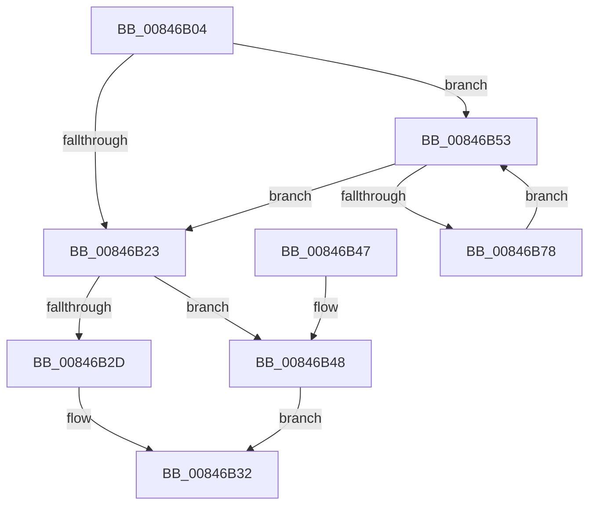

# CmpLockKcbStackTopExclusiveRestShared

- RVA: `0x00846B04`–`0x00846B7A` (길이 `118` bytes)
- VA: `0x0000000140846B04`
- 실행 섹션: `PAGE`
- PDB 이름 있음: `예`; PDB Function 태그: `아니요`
- unwind 정보 RVA: `0x00069264`
- 디코드: `37`개 명령, `118/118` bytes 표시
- 미해석 바이트: `0` (있으면 어셈블리에 `.byte`로 보존)

> 이 문서는 커널 이미지의 기계어와 PDB 기호를 분석해 생성했습니다. 4번과 5번은 함수 원형과 자료형을 바이너리 사용 방식에서 추정한 C 해석이며 원본 소스 복구 결과는 아닙니다.

## 1. Dependencies

- 직접 호출 지점: **3**; 고유 호출 대상: **3**
- 직접 호출자로 확인된 함수: **13**
- RIP 상대 이미지 참조: **0**

### Outgoing calls
- `0x00846B32` → [CmpLockKcbExclusive](../86/CmpLockKcbExclusive_function_00861EB0.md) (function, `0x00861EB0`)
- `0x00846B59` → [CmpGetKcbAtLayerHeight](../94/CmpGetKcbAtLayerHeight_function_00949210.md) (function, `0x00949210`)
- `0x00846B61` → [CmpLockKcbShared](../../pagecmrc/BC/CmpLockKcbShared_function_00BC9A1C.md) (function, `0x00BC9A1C`)

### Direct callers
- [CmDeleteLayeredKey](../../text/41/CmDeleteLayeredKey_function_0041B598.md) at `0x0041B674`
- [sub_006ED542](../../text/6E/Unknown_function_006ED542.md) at `0x006ED5D9`
- [CmOpenKeyForBugCheckRecovery](../7D/CmOpenKeyForBugCheckRecovery_function_007DF3C0.md) at `0x007DF4B5`
- [CmpDoBuildVirtualStack](../7E/CmpDoBuildVirtualStack_function_007EB4C4.md) at `0x007EB6C8`
- [CmpDoBuildVirtualStack](../7E/CmpDoBuildVirtualStack_function_007EB4C4.md) at `0x007EB6D1`
- [CmSetLastWriteTimeKey](CmSetLastWriteTimeKey_function_00843368.md) at `0x00843425`
- [CmpPromoteKey](CmpPromoteKey_function_00844388.md) at `0x00844468`
- [CmpPromoteKey](CmpPromoteKey_function_00844388.md) at `0x00844491`
- [CmSetValueKey](CmSetValueKey_function_008457C0.md) at `0x00845982`
- [CmDeleteValueKey](CmDeleteValueKey_function_008476E8.md) at `0x00847830`
- [CmDeleteKey](CmDeleteKey_function_00848E5C.md) at `0x00849004`
- [sub_00857A33](../85/Unknown_function_00857A33.md) at `0x00857B40`
- [CmpDoParseKey](../85/CmpDoParseKey_function_0085F750.md) at `0x00860BF4`
- [CmpDoParseKey](../85/CmpDoParseKey_function_0085F750.md) at `0x00860BFC`
- [CmpDoParseKey](../85/CmpDoParseKey_function_0085F750.md) at `0x0086126A`
- [CmpDoParseKey](../85/CmpDoParseKey_function_0085F750.md) at `0x00861275`
- [CmpDoParseKey](../85/CmpDoParseKey_function_0085F750.md) at `0x0086149A`
- [CmpDoParseKey](../85/CmpDoParseKey_function_0085F750.md) at `0x008614A2`
- [CmpDoParseKey](../85/CmpDoParseKey_function_0085F750.md) at `0x00861623`
- [CmpSetKeySecurity](../94/CmpSetKeySecurity_function_0094A124.md) at `0x0094A242`
- [CmSetKeyFlags](../9A/CmSetKeyFlags_function_009AEEA4.md) at `0x009AEF5E`

### Static image references
- 디코드된 RIP-relative 메모리 참조가 없습니다.

## 2. Other-region calls and transfers

- 다른 실행 섹션으로 향하는 call: **1**
  - `0x00846B61` → [CmpLockKcbShared](../../pagecmrc/BC/CmpLockKcbShared_function_00BC9A1C.md) (`PAGE` → `PAGECMRC`)
- 별도 외부 분기/꼬리 이동을 확인하지 못했습니다.

## 3. Assembly (complete function range)

```asm
00846B04  48 89 5C 24 08                  mov qword ptr [rsp + 8], rbx
00846B09  48 89 74 24 10                  mov qword ptr [rsp + 0x10], rsi
00846B0E  57                              push rdi
00846B0F  48 83 EC 20                     sub rsp, 0x20
00846B13  0F BF 51 02                     movsx edx, word ptr [rcx + 2]
00846B17  33 FF                           xor edi, edi
00846B19  48 8B D9                        mov rbx, rcx
00846B1C  8D 77 01                        lea esi, [rdi + 1]
00846B1F  3B D6                           cmp edx, esi
00846B21  79 30                           jns 0x140846b53
00846B23  48 0F BF CA                     movsx rcx, dx
00846B27  66 83 FA 02                     cmp dx, 2
00846B2B  7D 1B                           jge 0x140846b48
00846B2D  48 8B 4C CB 08                  mov rcx, qword ptr [rbx + rcx*8 + 8]
00846B32  E8 79 B3 01 00                  call 0x140861eb0
00846B37  48 8B 5C 24 30                  mov rbx, qword ptr [rsp + 0x30]
00846B3C  48 8B 74 24 38                  mov rsi, qword ptr [rsp + 0x38]
00846B41  48 83 C4 20                     add rsp, 0x20
00846B45  5F                              pop rdi
00846B46  C3                              ret
00846B47  CC                              int3
00846B48  48 8B 43 18                     mov rax, qword ptr [rbx + 0x18]
00846B4C  48 8B 4C C8 F0                  mov rcx, qword ptr [rax + rcx*8 - 0x10]
00846B51  EB DF                           jmp 0x140846b32
00846B53  0F B7 D7                        movzx edx, di
00846B56  48 8B CB                        mov rcx, rbx
00846B59  E8 B2 26 10 00                  call 0x140949210
00846B5E  48 8B C8                        mov rcx, rax
00846B61  E8 B6 2E 38 00                  call 0x140bc9a1c
00846B66  0F BF 53 02                     movsx edx, word ptr [rbx + 2]
00846B6A  66 03 FE                        add di, si
00846B6D  8B CA                           mov ecx, edx
00846B6F  0F BF C7                        movsx eax, di
00846B72  2B CE                           sub ecx, esi
00846B74  3B C1                           cmp eax, ecx
00846B76  7F AB                           jg 0x140846b23
00846B78  EB D9                           jmp 0x140846b53
```

## 4. C-style interpretation (structured pseudocode)

```c
__int64 __fastcall CmpLockKcbStackTopExclusiveRestShared(__int64 a1)
{
    __int64 result;
    __int64 v_rdi;
    __int64 v_rsp;
    unsigned __int64 v_stack_p10;
    unsigned __int64 v_stack_p8;

    v_stack_p8 = v_rbx;
    v_stack_p10 = v_rsi;
    v_rsp = (v_rsp) - (32);
    v_rdi = 0;
    if (!sign_flag) goto loc_00846B53;
loc_00846B23:
    if (((unsigned __int16)((__int16)(*(unsigned __int16 *)(a1 + 2)))) >= 2) goto loc_00846B48;
loc_00846B32:
    result = CmpLockKcbExclusive(*(unsigned __int64 *)(a1 + (__int16)((unsigned __int16)((__int16)(*(unsigned __int16 *)(a1 + 2)))) * 8 + 8), (__int16)(*(unsigned __int16 *)(a1 + 2)), a3, a4);
    v_rsp = (v_rsp) + (32);
    return result;
loc_00846B48:
    goto loc_00846B32;
loc_00846B53:
    result = CmpGetKcbAtLayerHeight(v_stack_p8, 0, a3, a4);
    result = CmpLockKcbShared(result, 0, a3, a4);
    v_rdi = (unsigned __int16)((v_rdi) + ((unsigned __int16)(v_stack_p10)));
    a1 = (unsigned int)(((unsigned int)((unsigned int)((__int16)(*(unsigned __int16 *)(v_stack_p8 + 2))))) - ((unsigned int)(v_stack_p10)));
    if (((unsigned int)((__int16)((unsigned __int16)(v_rdi)))) > ((unsigned int)(a1))) goto loc_00846B23;
    goto loc_00846B53;
}
```

## 5. (Beta) C Style

```c
int64_t CmpLockKcbStackTopExclusiveRestShared(void *Arg1)
{
    uint8_t *arg1 = (uint8_t *)Arg1;

    int64_t result;
    int64_t local_rdi;
    int64_t local_rsp;
    uint64_t v_stack_p10;
    uint64_t v_stack_p8;

    v_stack_p8 = local_rbx;
    v_stack_p10 = local_rsi;
    local_rsp = (local_rsp) - (32);
    local_rdi = 0;
    if (!sign_flag) goto loc_00846B53;
loc_00846B23:
    if (((uint16_t)((int16_t)(*(uint16_t *)(arg1 + 0x2)))) >= 2) goto loc_00846B48;
loc_00846B32:
    result = CmpLockKcbExclusive(*(uint64_t *)(arg1 + (int16_t)((uint16_t)((int16_t)(*(uint16_t *)(arg1 + 0x2)))) * 8 + 0x8), (int16_t)(*(uint16_t *)(arg1 + 0x2)), a3, a4);
    local_rsp = (local_rsp) + (32);
    return result;
loc_00846B48:
    goto loc_00846B32;
loc_00846B53:
    result = CmpGetKcbAtLayerHeight(v_stack_p8, 0, a3, a4);
    result = CmpLockKcbShared(result, 0, a3, a4);
    local_rdi = (uint16_t)((local_rdi) + ((uint16_t)(v_stack_p10)));
    Arg1 = (uint32_t)(((uint32_t)((uint32_t)((int16_t)(*(uint16_t *)(v_stack_p8 + 0x2))))) - ((uint32_t)(v_stack_p10)));
    if (((uint32_t)((int16_t)((uint16_t)(local_rdi)))) > ((uint32_t)(Arg1))) goto loc_00846B23;
    goto loc_00846B53;
}
```

### 관측된 메모리 오프셋

구조체 형식이 확인되지 않은 접근은 인자 기준의 오프셋으로만 기록했습니다.

| 기준 인자 | 오프셋 표현 | 폭 (bit) | 접근 |
|---|---:|---:|---|
| `Arg1` | `+ 0x2` | `16` | `R` |
| `Arg1` | `+ 0x8 + rcx*8` | `64` | `R` |
| `Arg1` | `+ 0x18` | `64` | `R` |

## 6. Execution-region graph

[열기: 2D/3D 그래프와 함수 탐색 컨트롤 패널](../../../control-panel.html?section=page&rva=0x00846B04&view=graph)

- 2D 그래프는 위에서 아래로 흐르고, 3D 그래프는 빈 공간을 드래그해 회전합니다. Shift+드래그는 이동, 휠은 확대·축소, 함수 노드 선택은 대상 보고서 이동입니다.

### Static fallback


