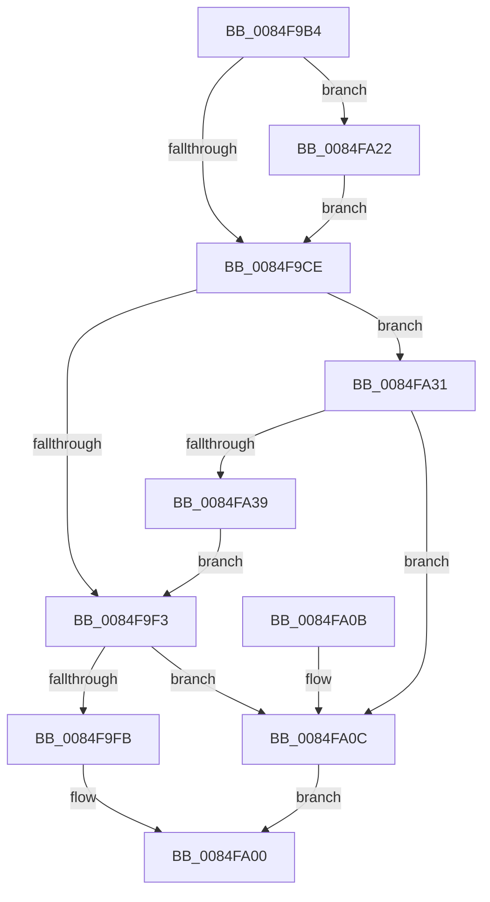

# CmpLockRegistryExclusive

- RVA: `0x0084F9B4`–`0x0084FA47` (길이 `147` bytes)
- VA: `0x000000014084F9B4`
- 실행 섹션: `PAGE`
- PDB 이름 있음: `예`; PDB Function 태그: `아니요`
- unwind 정보 RVA: `0x00069D3C`
- 디코드: `38`개 명령, `147/147` bytes 표시
- 미해석 바이트: `0` (있으면 어셈블리에 `.byte`로 보존)

> 이 문서는 커널 이미지의 기계어와 PDB 기호를 분석해 생성했습니다. 4번과 5번은 함수 원형과 자료형을 바이너리 사용 방식에서 추정한 C 해석이며 원본 소스 복구 결과는 아닙니다.

## 1. Dependencies

- 직접 호출 지점: **6**; 고유 호출 대상: **6**
- 직접 호출자로 확인된 함수: **34**
- RIP 상대 이미지 참조: **2**

### Outgoing calls
- `0x0084F9D9` → [PsBoostThreadIo](../../text/39/PsBoostThreadIo_function_003927C0.md) (function, `0x003927C0`)
- `0x0084F9FB` → [CmpRecordRegistryLockExclusiveAcquire](../../text/4F/CmpRecordRegistryLockExclusiveAcquire_function_004FCF1C.md) (function, `0x004FCF1C`)
- `0x0084FA0C` → [CmpRecordRegistryLockAcquire](../../text/45/CmpRecordRegistryLockAcquire_function_004565F4.md) (function, `0x004565F4`)
- `0x0084FA1B` → [ExAcquireResourceExclusiveLite](../../text/21/ExAcquireResourceExclusiveLite_function_00214E20.md) (function, `0x00214E20`)
- `0x0084FA22` → [CmpTestRegistryLock](../../text/66/CmpTestRegistryLock_function_0066AC84.md) (function, `0x0066AC84`)
- `0x0084FA40` → [ExAcquireCacheAwarePushLockExclusive](../../text/45/ExAcquireCacheAwarePushLockExclusive_function_00457550.md) (function, `0x00457550`)

### Direct callers
- [CmDeleteLayeredKey](../../text/41/CmDeleteLayeredKey_function_0041B598.md) at `0x0041B912`
- [CmShutdownSystem1](../../text/66/CmShutdownSystem1_function_0066A5B0.md) at `0x0066A5FD`
- [CmShutdownSystem1](../../text/66/CmShutdownSystem1_function_0066A5B0.md) at `0x0066A656`
- [CmShutdownSystem2](../../text/66/CmShutdownSystem2_function_0066A7FC.md) at `0x0066A85B`
- [CmpFinishSystemHivesLoad](../7D/CmpFinishSystemHivesLoad_function_007DA210.md) at `0x007DA4AD`
- [CmpFinishSystemHivesLoad](../7D/CmpFinishSystemHivesLoad_function_007DA210.md) at `0x007DA5AD`
- [CmpFinishSystemHivesLoad](../7D/CmpFinishSystemHivesLoad_function_007DA210.md) at `0x007DA63A`
- [CmpFinishSystemHivesLoad](../7D/CmpFinishSystemHivesLoad_function_007DA210.md) at `0x007DAA47`
- [CmpFinishSystemHivesLoad](../7D/CmpFinishSystemHivesLoad_function_007DA210.md) at `0x007DAAD8`
- [CmpLoadHiveThread](../7D/CmpLoadHiveThread_function_007DB040.md) at `0x007DB8C7`
- [CmpMarkCurrentProfileDirty](../7D/CmpMarkCurrentProfileDirty_function_007DBBAC.md) at `0x007DBC70`
- [CmpMountPreloadedHives](../7D/CmpMountPreloadedHives_function_007DBE18.md) at `0x007DBEED`
- [CmpMountPreloadedHives](../7D/CmpMountPreloadedHives_function_007DBE18.md) at `0x007DC384`
- [CmpSaveBootControlSet](../7D/CmpSaveBootControlSet_function_007DC744.md) at `0x007DC988`
- [CmpSaveBootControlSet](../7D/CmpSaveBootControlSet_function_007DC744.md) at `0x007DCA8E`
- [CmpLoadHiveVolatile](../7D/CmpLoadHiveVolatile_function_007DE5F0.md) at `0x007DE7A0`
- [CmpRefreshHive](../7D/CmpRefreshHive_function_007DEAD0.md) at `0x007DED19`
- [CmCompleteRegistryInitialization](../7D/CmCompleteRegistryInitialization_function_007DF1EC.md) at `0x007DF25F`
- [NtCompactKeys](../7D/NtCompactKeys_function_007DF730.md) at `0x007DF89C`
- [NtCompressKey](../7D/NtCompressKey_function_007DF9D0.md) at `0x007DFAA5`
- [NtQueryOpenSubKeys](../7D/NtQueryOpenSubKeys_function_007DFF80.md) at `0x007E0093`
- [NtQueryOpenSubKeysEx](../7E/NtQueryOpenSubKeysEx_function_007E0190.md) at `0x007E0333`
- [CmpCloneHwProfile](../7E/CmpCloneHwProfile_function_007E303C.md) at `0x007E369E`
- [CmFreezeRegistry](../7E/CmFreezeRegistry_function_007E834C.md) at `0x007E8372`
- [CmThawRegistry](../7E/CmThawRegistry_function_007E8510.md) at `0x007E8540`
- [CmRenameKey](../7E/CmRenameKey_function_007E8F48.md) at `0x007E9096`
- [CmpCleanupTransactionState](CmpCleanupTransactionState_function_008428E0.md) at `0x00842923`
- [CmKeyBodyReplicateToVirtual](CmKeyBodyReplicateToVirtual_function_00843FE4.md) at `0x008441A1`
- [CmDeleteKey](CmDeleteKey_function_00848E5C.md) at `0x008493D5`
- [sub_0084E7D5](Unknown_function_0084E7D5.md) at `0x0084E7D5`
- [CmpDoParseKey](../85/CmpDoParseKey_function_0085F750.md) at `0x00860BB2`
- [CmpDoParseKey](../85/CmpDoParseKey_function_0085F750.md) at `0x00860DD3`
- [CmpTransMgrFreeVolatileData](../87/CmpTransMgrFreeVolatileData_function_00874BDC.md) at `0x00874C2B`
- [CmpTransMgrFreeVolatileData](../87/CmpTransMgrFreeVolatileData_function_00874BDC.md) at `0x00874C5E`
- [CmpEnumerateLayeredKey](../94/CmpEnumerateLayeredKey_function_00945E58.md) at `0x00946354`
- [CmpSetKeySecurity](../94/CmpSetKeySecurity_function_0094A124.md) at `0x0094A296`
- [CmpCommitLightWeightTransaction](../9B/CmpCommitLightWeightTransaction_function_009B0868.md) at `0x009B09CA`
- [CmpCleanupLightWeightTransaction](../9B/CmpCleanupLightWeightTransaction_function_009B1340.md) at `0x009B137A`
- [CmpLockRegistryFreezeAware](../9B/CmpLockRegistryFreezeAware_function_009B4AE4.md) at `0x009B4B34`
- [CmpLockRegistryFreezeAware](../9B/CmpLockRegistryFreezeAware_function_009B4AE4.md) at `0x009B4BA8`
- [CmEtwRunDown](../A8/CmEtwRunDown_function_00A85AC0.md) at `0x00A85BB3`
- [CmpDelayFreeRMWorker](../AB/CmpDelayFreeRMWorker_function_00AB65B0.md) at `0x00AB6618`
- [CmInitSystem1](../../init/C5/CmInitSystem1_function_00C559CC.md) at `0x00C55D12`
- [CmGetSystemDriverList](../../init/C7/CmGetSystemDriverList_function_00C7380C.md) at `0x00C73ABB`

### Static image references
- `0x0084F9C5` → RVA `0x00EF7108` (`.data`; read)
- `0x0084FA11` → RVA `0x00EF7110` (`.data`; read)

## 2. Other-region calls and transfers

- 다른 실행 섹션으로 향하는 call: **6**
  - `0x0084F9D9` → [PsBoostThreadIo](../../text/39/PsBoostThreadIo_function_003927C0.md) (`PAGE` → `.text`)
  - `0x0084F9FB` → [CmpRecordRegistryLockExclusiveAcquire](../../text/4F/CmpRecordRegistryLockExclusiveAcquire_function_004FCF1C.md) (`PAGE` → `.text`)
  - `0x0084FA0C` → [CmpRecordRegistryLockAcquire](../../text/45/CmpRecordRegistryLockAcquire_function_004565F4.md) (`PAGE` → `.text`)
  - `0x0084FA1B` → [ExAcquireResourceExclusiveLite](../../text/21/ExAcquireResourceExclusiveLite_function_00214E20.md) (`PAGE` → `.text`)
  - `0x0084FA22` → [CmpTestRegistryLock](../../text/66/CmpTestRegistryLock_function_0066AC84.md) (`PAGE` → `.text`)
  - `0x0084FA40` → [ExAcquireCacheAwarePushLockExclusive](../../text/45/ExAcquireCacheAwarePushLockExclusive_function_00457550.md) (`PAGE` → `.text`)
- 별도 외부 분기/꼬리 이동을 확인하지 못했습니다.

## 3. Assembly (complete function range)

```asm
0084F9B4  48 89 5C 24 08                  mov qword ptr [rsp + 8], rbx
0084F9B9  57                              push rdi
0084F9BA  48 83 EC 20                     sub rsp, 0x20
0084F9BE  32 DB                           xor bl, bl
0084F9C0  BF 01 00 00 00                  mov edi, 1
0084F9C5  83 3D 3C 77 6A 00 00            cmp dword ptr [rip + 0x6a773c], 0
0084F9CC  75 54                           jne 0x14084fa22
0084F9CE  65 48 8B 0C 25 88 01 00 00      mov rcx, qword ptr gs:[0x188]
0084F9D7  33 D2                           xor edx, edx
0084F9D9  E8 E2 2D B4 FF                  call 0x1403927c0
0084F9DE  65 48 8B 04 25 88 01 00 00      mov rax, qword ptr gs:[0x188]
0084F9E7  66 FF 88 E4 01 00 00            dec word ptr [rax + 0x1e4]
0084F9EE  90                              nop
0084F9EF  84 DB                           test bl, bl
0084F9F1  74 3E                           je 0x14084fa31
0084F9F3  39 3D 0F 77 6A 00               cmp dword ptr [rip + 0x6a770f], edi
0084F9F9  75 11                           jne 0x14084fa0c
0084F9FB  E8 1C D5 CA FF                  call 0x1404fcf1c
0084FA00  48 8B 5C 24 30                  mov rbx, qword ptr [rsp + 0x30]
0084FA05  48 83 C4 20                     add rsp, 0x20
0084FA09  5F                              pop rdi
0084FA0A  C3                              ret
0084FA0B  CC                              int3
0084FA0C  E8 E3 6B C0 FF                  call 0x1404565f4
0084FA11  48 8B 0D F8 76 6A 00            mov rcx, qword ptr [rip + 0x6a76f8]
0084FA18  40 8A D7                        mov dl, dil
0084FA1B  E8 00 54 9C FF                  call 0x140214e20
0084FA20  EB DE                           jmp 0x14084fa00
0084FA22  E8 5D B2 E1 FF                  call 0x14066ac84
0084FA27  84 C0                           test al, al
0084FA29  0F B6 DB                        movzx ebx, bl
0084FA2C  0F 45 DF                        cmovne ebx, edi
0084FA2F  EB 9D                           jmp 0x14084f9ce
0084FA31  39 3D D1 76 6A 00               cmp dword ptr [rip + 0x6a76d1], edi
0084FA37  75 D3                           jne 0x14084fa0c
0084FA39  48 8B 0D D0 76 6A 00            mov rcx, qword ptr [rip + 0x6a76d0]
0084FA40  E8 0B 7B C0 FF                  call 0x140457550
0084FA45  EB AC                           jmp 0x14084f9f3
```

## 4. C-style interpretation (structured pseudocode)

```c
__int64 __fastcall CmpLockRegistryExclusive(__int64 a1, int a2)
{
    __int64 result;
    __int64 v_rbx;
    __int64 v_rsp;
    unsigned __int64 v_stack_p8;

    v_stack_p8 = v_rbx;
    v_rsp = (v_rsp) - (32);
    v_rbx = 0;
    if ((*(unsigned int *)(v_rip + 6977340)) != 0) goto loc_0084FA22;
loc_0084F9CE:
    a2 = 0;
    result = PsBoostThreadIo(*(unsigned __int64 *)(gs_base + (0 + 392)), a2, a3, a4);
    if (0 == 0) goto loc_0084FA31;
loc_0084F9F3:
    if ((*(unsigned int *)(v_rip + 6977295)) != 1) goto loc_0084FA0C;
    result = CmpRecordRegistryLockExclusiveAcquire(*(unsigned __int64 *)(gs_base + (0 + 392)), a2, a3, a4);
loc_0084FA00:
    v_rsp = (v_rsp) + (32);
    return result;
loc_0084FA0C:
    result = CmpRecordRegistryLockAcquire(*(unsigned __int64 *)(gs_base + (0 + 392)), a2, a3, a4);
    result = ExAcquireResourceExclusiveLite(*(unsigned __int64 *)(v_rip + 6977272), 1, a3, a4);
    goto loc_0084FA00;
loc_0084FA22:
    result = CmpTestRegistryLock(*(unsigned __int64 *)(v_rip + 6977272), 1, a3, a4);
    v_rbx = (unsigned __int8)(v_stack_p8);
    if ((unsigned __int8)(result) != 0) { v_rbx = 1; }
    goto loc_0084F9CE;
loc_0084FA31:
    if ((*(unsigned int *)(v_rip + 6977233)) != 1) goto loc_0084FA0C;
    result = ExAcquireCacheAwarePushLockExclusive(*(unsigned __int64 *)(v_rip + 6977232), 1, a3, a4);
    goto loc_0084F9F3;
}
```

## 5. (Beta) C Style

```c
int64_t CmpLockRegistryExclusive(int64_t Arg1, int32_t Arg2)
{
    int64_t result;
    int64_t local_rbx;
    int64_t local_rsp;
    uint64_t v_stack_p8;

    v_stack_p8 = local_rbx;
    local_rsp = (local_rsp) - (32);
    local_rbx = 0;
    if ((*(uint32_t *)(v_rip + 0x6A773C)) != 0) goto loc_0084FA22;
loc_0084F9CE:
    Arg2 = 0;
    result = PsBoostThreadIo(*(uint64_t *)(gs_base + (0 + 0x188)), Arg2, a3, a4);
    if (0 == 0) goto loc_0084FA31;
loc_0084F9F3:
    if ((*(uint32_t *)(v_rip + 0x6A770F)) != 1) goto loc_0084FA0C;
    result = CmpRecordRegistryLockExclusiveAcquire(*(uint64_t *)(gs_base + (0 + 0x188)), Arg2, a3, a4);
loc_0084FA00:
    local_rsp = (local_rsp) + (32);
    return result;
loc_0084FA0C:
    result = CmpRecordRegistryLockAcquire(*(uint64_t *)(gs_base + (0 + 0x188)), Arg2, a3, a4);
    result = ExAcquireResourceExclusiveLite(*(uint64_t *)(v_rip + 0x6A76F8), 1, a3, a4);
    goto loc_0084FA00;
loc_0084FA22:
    result = CmpTestRegistryLock(*(uint64_t *)(v_rip + 0x6A76F8), 1, a3, a4);
    local_rbx = (uint8_t)(v_stack_p8);
    if ((uint8_t)(result) != 0) { local_rbx = 1; }
    goto loc_0084F9CE;
loc_0084FA31:
    if ((*(uint32_t *)(v_rip + 0x6A76D1)) != 1) goto loc_0084FA0C;
    result = ExAcquireCacheAwarePushLockExclusive(*(uint64_t *)(v_rip + 0x6A76D0), 1, a3, a4);
    goto loc_0084F9F3;
}
```

## 6. Execution-region graph

[열기: 2D/3D 그래프와 함수 탐색 컨트롤 패널](../../../control-panel.html?section=page&rva=0x0084F9B4&view=graph)

- 2D 그래프는 위에서 아래로 흐르고, 3D 그래프는 빈 공간을 드래그해 회전합니다. Shift+드래그는 이동, 휠은 확대·축소, 함수 노드 선택은 대상 보고서 이동입니다.

### Static fallback


