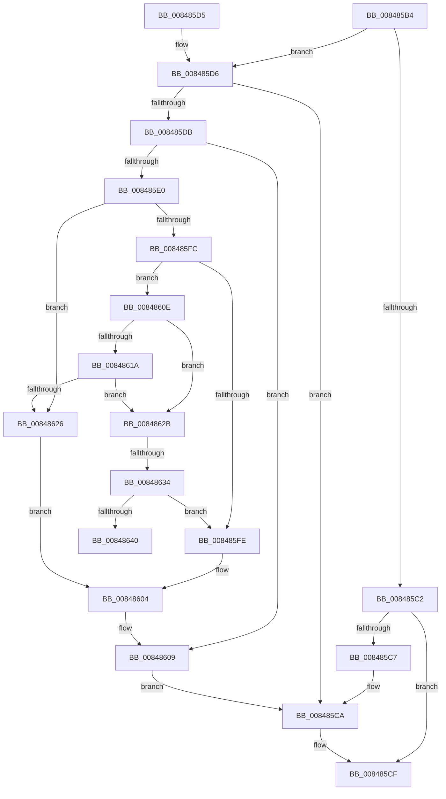

# CmpLockTwoKcbsShared

- RVA: `0x008485B4`–`0x00848645` (길이 `145` bytes)
- VA: `0x00000001408485B4`
- 실행 섹션: `PAGE`
- PDB 이름 있음: `예`; PDB Function 태그: `예`
- unwind 정보 RVA: `0x00069354`
- 디코드: `44`개 명령, `145/145` bytes 표시
- 미해석 바이트: `0` (있으면 어셈블리에 `.byte`로 보존)

> 이 문서는 커널 이미지의 기계어와 PDB 기호를 분석해 생성했습니다. 4번과 5번은 함수 원형과 자료형을 바이너리 사용 방식에서 추정한 C 해석이며 원본 소스 복구 결과는 아닙니다.

## 1. Dependencies

- 직접 호출 지점: **2**; 고유 호출 대상: **1**
- 직접 호출자로 확인된 함수: **5**
- RIP 상대 이미지 참조: **0**

### Outgoing calls
- `0x008485CA` → [CmpLockKcbShared](../../pagecmrc/BC/CmpLockKcbShared_function_00BC9A1C.md) (function, `0x00BC9A1C`)
- `0x00848604` → [CmpLockKcbShared](../../pagecmrc/BC/CmpLockKcbShared_function_00BC9A1C.md) (function, `0x00BC9A1C`)

### Direct callers
- [CmSaveMergedKeys](../7D/CmSaveMergedKeys_function_007DE040.md) at `0x007DE11F`
- [CmQueryMultipleValueKey](CmQueryMultipleValueKey_function_00846EC0.md) at `0x00846F96`
- [CmQueryKey](../85/CmQueryKey_function_00858240.md) at `0x00858E4B`
- [NtNotifyChangeMultipleKeys](../9D/NtNotifyChangeMultipleKeys_function_009DC6B0.md) at `0x009DCBAC`
- [CmEnumerateValueKeyFromMergedView](../A7/CmEnumerateValueKeyFromMergedView_function_00A7D650.md) at `0x00A7D9A0`

### Static image references
- 디코드된 RIP-relative 메모리 참조가 없습니다.

## 2. Other-region calls and transfers

- 다른 실행 섹션으로 향하는 call: **2**
  - `0x008485CA` → [CmpLockKcbShared](../../pagecmrc/BC/CmpLockKcbShared_function_00BC9A1C.md) (`PAGE` → `PAGECMRC`)
  - `0x00848604` → [CmpLockKcbShared](../../pagecmrc/BC/CmpLockKcbShared_function_00BC9A1C.md) (`PAGE` → `PAGECMRC`)
- call이 아닌 외부 분기/꼬리 이동: **2**
  - `0x0084862E` → [sub_00B163E8](../B1/Unknown_function_00B163E8.md) (`tail-transfer`)
  - `0x00848640` → [sub_00B163E8](../B1/Unknown_function_00B163E8.md) (`tail-transfer`)

## 3. Assembly (complete function range)

```asm
008485B4  40 53                           push rbx
008485B6  48 83 EC 20                     sub rsp, 0x20
008485BA  48 8B D9                        mov rbx, rcx
008485BD  48 85 C9                        test rcx, rcx
008485C0  75 14                           jne 0x1408485d6
008485C2  48 85 D2                        test rdx, rdx
008485C5  74 08                           je 0x1408485cf
008485C7  48 8B CA                        mov rcx, rdx
008485CA  E8 4D 14 38 00                  call 0x140bc9a1c
008485CF  48 83 C4 20                     add rsp, 0x20
008485D3  5B                              pop rbx
008485D4  C3                              ret
008485D5  CC                              int3
008485D6  48 85 D2                        test rdx, rdx
008485D9  74 EF                           je 0x1408485ca
008485DB  48 3B DA                        cmp rbx, rdx
008485DE  74 29                           je 0x140848609
008485E0  8B 41 08                        mov eax, dword ptr [rcx + 8]
008485E3  41 B8 FF 03 00 00               mov r8d, 0x3ff
008485E9  8B 4A 08                        mov ecx, dword ptr [rdx + 8]
008485EC  C1 E9 15                        shr ecx, 0x15
008485EF  C1 E8 15                        shr eax, 0x15
008485F2  41 23 C8                        and ecx, r8d
008485F5  41 23 C0                        and eax, r8d
008485F8  3B C1                           cmp eax, ecx
008485FA  77 2A                           ja 0x140848626
008485FC  73 10                           jae 0x14084860e
008485FE  48 8B CB                        mov rcx, rbx
00848601  48 8B DA                        mov rbx, rdx
00848604  E8 13 14 38 00                  call 0x140bc9a1c
00848609  48 8B CB                        mov rcx, rbx
0084860C  EB BC                           jmp 0x1408485ca
0084860E  0F B7 8B BA 00 00 00            movzx ecx, word ptr [rbx + 0xba]
00848615  F6 C1 04                        test cl, 4
00848618  74 11                           je 0x14084862b
0084861A  F7 82 B8 00 00 00 00 00 02 00   test dword ptr [rdx + 0xb8], 0x20000
00848624  74 05                           je 0x14084862b
00848626  48 8B CA                        mov rcx, rdx
00848629  EB D9                           jmp 0x140848604
0084862B  F6 C1 02                        test cl, 2
0084862E  0F 84 B4 DD 2C 00               je 0x140b163e8
00848634  F7 82 B8 00 00 00 00 00 04 00   test dword ptr [rdx + 0xb8], 0x40000
0084863E  75 BE                           jne 0x1408485fe
00848640  E9 A3 DD 2C 00                  jmp 0x140b163e8
```

## 4. C-style interpretation (structured pseudocode)

```c
__int64 __fastcall CmpLockTwoKcbsShared(__int64 a1, __int64 a2)
{
    __int64 result;
    __int64 v_rsp;

    v_rsp = (v_rsp) - (32);
    if (a1 != 0) goto loc_008485D6;
    if (a2 == 0) goto loc_008485CF;
loc_008485CA:
    result = CmpLockKcbShared(a2, a2, a3, a4);
loc_008485CF:
    v_rsp = (v_rsp) + (32);
    return result;
loc_008485D6:
    if (a2 == 0) goto loc_008485CA;
    if (a1 == a2) goto loc_00848609;
    a1 = (unsigned int)(((unsigned int)(*(unsigned int *)(a2 + 8))) >> (21));
    result = (unsigned int)(((unsigned int)(*(unsigned int *)(a2 + 8))) >> (21));
    a1 = (unsigned int)((a1) & ((unsigned int)((unsigned int)(0x3FFULL))));
    result = (unsigned int)((result) & ((unsigned int)((unsigned int)(0x3FFULL))));
    if (((unsigned int)(result)) > ((unsigned int)(a1))) goto loc_00848626;
    if (((unsigned int)(result)) >= ((unsigned int)(a1))) goto loc_0084860E;
loc_008485FE:
loc_00848604:
    result = CmpLockKcbShared(a1, a2, (unsigned int)(0x3FFULL), a4);
loc_00848609:
    goto loc_008485CA;
loc_0084860E:
    if ((((unsigned __int8)(*(unsigned __int16 *)(a2 + 186))) & (4)) == 0) goto loc_0084862B;
    if (((*(unsigned int *)(a2 + 184)) & (0x20000ULL)) == 0) goto loc_0084862B;
loc_00848626:
    goto loc_00848604;
loc_0084862B:
    if (((*(unsigned int *)(a2 + 184)) & (0x40000ULL)) != 0) goto loc_008485FE;
}
```

## 5. (Beta) C Style

```c
int64_t CmpLockTwoKcbsShared(int64_t Arg1, int64_t Arg2)
{
    int64_t result;
    int64_t local_rsp;

    local_rsp = (local_rsp) - (32);
    if (Arg1 != 0) goto loc_008485D6;
    if (Arg2 == 0) goto loc_008485CF;
loc_008485CA:
    result = CmpLockKcbShared(Arg2, Arg2, a3, a4);
loc_008485CF:
    local_rsp = (local_rsp) + (32);
    return result;
loc_008485D6:
    if (Arg2 == 0) goto loc_008485CA;
    if (Arg1 == Arg2) goto loc_00848609;
    Arg1 = (uint32_t)(((uint32_t)(*(uint32_t *)(Arg2 + 0x8))) >> (21));
    result = (uint32_t)(((uint32_t)(*(uint32_t *)(Arg2 + 0x8))) >> (21));
    Arg1 = (uint32_t)((Arg1) & ((uint32_t)((uint32_t)(0x3FFULL))));
    result = (uint32_t)((result) & ((uint32_t)((uint32_t)(0x3FFULL))));
    if (((uint32_t)(result)) > ((uint32_t)(Arg1))) goto loc_00848626;
    if (((uint32_t)(result)) >= ((uint32_t)(Arg1))) goto loc_0084860E;
loc_008485FE:
loc_00848604:
    result = CmpLockKcbShared(Arg1, Arg2, (uint32_t)(0x3FFULL), a4);
loc_00848609:
    goto loc_008485CA;
loc_0084860E:
    if ((((uint8_t)(*(uint16_t *)(Arg2 + 0xBA))) & (4)) == 0) goto loc_0084862B;
    if (((*(uint32_t *)(Arg2 + 0xB8)) & (0x20000ULL)) == 0) goto loc_0084862B;
loc_00848626:
    goto loc_00848604;
loc_0084862B:
    if (((*(uint32_t *)(Arg2 + 0xB8)) & (0x40000ULL)) != 0) goto loc_008485FE;
}
```

## 6. Execution-region graph

[열기: 2D/3D 그래프와 함수 탐색 컨트롤 패널](../../../control-panel.html?section=page&rva=0x008485B4&view=graph)

- 2D 그래프는 위에서 아래로 흐르고, 3D 그래프는 빈 공간을 드래그해 회전합니다. Shift+드래그는 이동, 휠은 확대·축소, 함수 노드 선택은 대상 보고서 이동입니다.

### Static fallback


