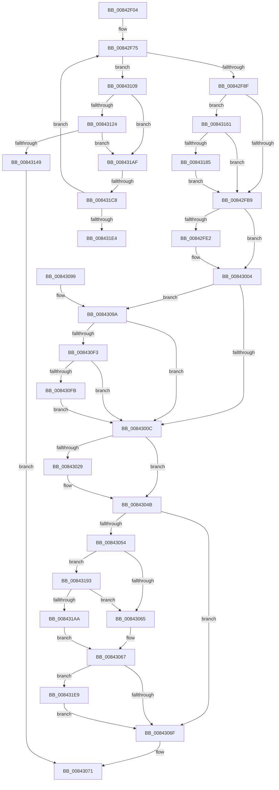

# CmpLogCheckpoint

- RVA: `0x00842F04`–`0x00843230` (길이 `812` bytes)
- VA: `0x0000000140842F04`
- 실행 섹션: `PAGE`
- PDB 이름 있음: `예`; PDB Function 태그: `예`
- unwind 정보 RVA: `0x00069040`
- 디코드: `188`개 명령, `812/812` bytes 표시
- 미해석 바이트: `0` (있으면 어셈블리에 `.byte`로 보존)

> 이 문서는 커널 이미지의 기계어와 PDB 기호를 분석해 생성했습니다. 4번과 5번은 함수 원형과 자료형을 바이너리 사용 방식에서 추정한 C 해석이며 원본 소스 복구 결과는 아닙니다.

## 1. Dependencies

- 직접 호출 지점: **23**; 고유 호출 대상: **14**
- 직접 호출자로 확인된 함수: **4**
- RIP 상대 이미지 참조: **13**

### Outgoing calls
- `0x00842F6B` → [memset](../../text/6C/memset_function_006C6C40.md) (function, `0x006C6C40`)
- `0x00842F70` → [LOCK_TRANSACTION_LIST](../87/LOCK_TRANSACTION_LIST_function_00874AD4.md) (function, `0x00874AD4`)
- `0x00842F81` → [CmListGetNextElement](../../pagecmrc/BC/CmListGetNextElement_function_00BC9940.md) (function, `0x00BC9940`)
- `0x00842F96` → [ExReleaseFastMutexUnsafe](../../text/25/ExReleaseFastMutexUnsafe_function_002503A0.md) (function, `0x002503A0`)
- `0x00842F9B` → [KeLeaveCriticalRegion](../../text/25/KeLeaveCriticalRegion_function_0025D8B0.md) (function, `0x0025D8B0`)
- `0x00842FA5` → `ext-ms-win-fs-clfs-l1-1-0.dll!ClfsLsnInvalid` (import, 간접 대상; import `ext-ms-win-fs-clfs-l1-1-0.dll!ClfsLsnInvalid`)
- `0x00842FD5` → [ExAllocatePool2](../../poolcode/B8/ExAllocatePool2_function_00B820F0.md) (function, `0x00B820F0`)
- `0x00842FEE` → `ext-ms-win-fs-clfs-l1-1-0.dll!ClfsGetLogFileInformation` (import, 간접 대상; import `ext-ms-win-fs-clfs-l1-1-0.dll!ClfsGetLogFileInformation`)
- `0x00842FFF` → [ExFreePoolWithTag](../../poolcode/B8/ExFreePoolWithTag_function_00B82870.md) (function, `0x00B82870`)
- `0x0084301C` → [ExAllocatePool2](../../poolcode/B8/ExAllocatePool2_function_00B820F0.md) (function, `0x00B820F0`)
- `0x00843035` → `ext-ms-win-fs-clfs-l1-1-0.dll!ClfsGetLogFileInformation` (import, 간접 대상; import `ext-ms-win-fs-clfs-l1-1-0.dll!ClfsGetLogFileInformation`)
- `0x00843046` → [ExFreePoolWithTag](../../poolcode/B8/ExFreePoolWithTag_function_00B82870.md) (function, `0x00B82870`)
- `0x00843078` → [_security_check_cookie](../../text/6A/_security_check_cookie_function_006AC640.md) (function, `0x006AC640`)
- `0x008430DC` → `ext-ms-win-fs-clfs-l1-1-0.dll!ClfsWriteRestartArea` (import, 간접 대상; import `ext-ms-win-fs-clfs-l1-1-0.dll!ClfsWriteRestartArea`)
- `0x00843110` → `ext-ms-win-fs-clfs-l1-1-0.dll!ClfsLsnInvalid` (import, 간접 대상; import `ext-ms-win-fs-clfs-l1-1-0.dll!ClfsLsnInvalid`)
- `0x00843128` → `ext-ms-win-fs-clfs-l1-1-0.dll!ClfsLsnContainer` (import, 간접 대상; import `ext-ms-win-fs-clfs-l1-1-0.dll!ClfsLsnContainer`)
- `0x00843139` → `ext-ms-win-fs-clfs-l1-1-0.dll!ClfsLsnContainer` (import, 간접 대상; import `ext-ms-win-fs-clfs-l1-1-0.dll!ClfsLsnContainer`)
- `0x00843150` → [ExReleaseFastMutexUnsafe](../../text/25/ExReleaseFastMutexUnsafe_function_002503A0.md) (function, `0x002503A0`)
- `0x00843155` → [KeLeaveCriticalRegion](../../text/25/KeLeaveCriticalRegion_function_0025D8B0.md) (function, `0x0025D8B0`)
- `0x0084316F` → `ext-ms-win-fs-clfs-l1-1-0.dll!ClfsGetLogFileInformation` (import, 간접 대상; import `ext-ms-win-fs-clfs-l1-1-0.dll!ClfsGetLogFileInformation`)
- `0x008431B4` → `ext-ms-win-fs-clfs-l1-1-0.dll!ClfsLsnInvalid` (import, 간접 대상; import `ext-ms-win-fs-clfs-l1-1-0.dll!ClfsLsnInvalid`)
- `0x008431D0` → `ext-ms-win-fs-clfs-l1-1-0.dll!ClfsLsnLess` (import, 간접 대상; import `ext-ms-win-fs-clfs-l1-1-0.dll!ClfsLsnLess`)
- `0x00843226` → [tlgWriteTransfer_EtwWriteTransfer](../../text/42/tlgWriteTransfer_EtwWriteTransfer_function_004260E0.md) (function, `0x004260E0`)

### Direct callers
- [CmpStopRMLog](CmpStopRMLog_function_008427AC.md) at `0x00842813`
- [CmpCleanupTransactionState](CmpCleanupTransactionState_function_008428E0.md) at `0x008429B0`
- [CmpTransWriteLog](CmpTransWriteLog_function_00842A7C.md) at `0x00842B5C`
- [sub_00B15EDA](../B1/Unknown_function_00B15EDA.md) at `0x00B15F65`

### Static image references
- `0x00842F22` → RVA `0x00E0A740` (`.data`; read)
- `0x00842F30` → RVA `0x000108B8` (`.rdata`; read)
- `0x00842F53` → RVA `0x00010880` (`.rdata`; read)
- `0x00842F8F` → RVA `0x00EF5820` (`.data`; read)
- `0x00842FA5` → RVA `0x00151200` (`ext-ms-win-fs-clfs-l1-1-0.dll!ClfsLsnInvalid (IAT)`; read)
- `0x00842FEE` → RVA `0x00151240` (`ext-ms-win-fs-clfs-l1-1-0.dll!ClfsGetLogFileInformation (IAT)`; read)
- `0x0084304B` → RVA `0x00E09F58` (`.data`; read)
- `0x00843059` → RVA `0x00E09F68` (`.data`; reference)
- `0x008430DC` → RVA `0x001511E0` (`ext-ms-win-fs-clfs-l1-1-0.dll!ClfsWriteRestartArea (IAT)`; read)
- `0x00843128` → RVA `0x00151210` (`ext-ms-win-fs-clfs-l1-1-0.dll!ClfsLsnContainer (IAT)`; read)
- `0x00843193` → RVA `0x00E09F70` (`.data`; read)
- `0x008431D0` → RVA `0x00151218` (`ext-ms-win-fs-clfs-l1-1-0.dll!ClfsLsnLess (IAT)`; read)
- `0x008431F6` → RVA `0x00057316` (`.rdata`; read)

## 2. Other-region calls and transfers

- 다른 실행 섹션으로 향하는 call: **12**
  - `0x00842F6B` → [memset](../../text/6C/memset_function_006C6C40.md) (`PAGE` → `.text`)
  - `0x00842F81` → [CmListGetNextElement](../../pagecmrc/BC/CmListGetNextElement_function_00BC9940.md) (`PAGE` → `PAGECMRC`)
  - `0x00842F96` → [ExReleaseFastMutexUnsafe](../../text/25/ExReleaseFastMutexUnsafe_function_002503A0.md) (`PAGE` → `.text`)
  - `0x00842F9B` → [KeLeaveCriticalRegion](../../text/25/KeLeaveCriticalRegion_function_0025D8B0.md) (`PAGE` → `.text`)
  - `0x00842FD5` → [ExAllocatePool2](../../poolcode/B8/ExAllocatePool2_function_00B820F0.md) (`PAGE` → `POOLCODE`)
  - `0x00842FFF` → [ExFreePoolWithTag](../../poolcode/B8/ExFreePoolWithTag_function_00B82870.md) (`PAGE` → `POOLCODE`)
  - `0x0084301C` → [ExAllocatePool2](../../poolcode/B8/ExAllocatePool2_function_00B820F0.md) (`PAGE` → `POOLCODE`)
  - `0x00843046` → [ExFreePoolWithTag](../../poolcode/B8/ExFreePoolWithTag_function_00B82870.md) (`PAGE` → `POOLCODE`)
  - `0x00843078` → [_security_check_cookie](../../text/6A/_security_check_cookie_function_006AC640.md) (`PAGE` → `.text`)
  - `0x00843150` → [ExReleaseFastMutexUnsafe](../../text/25/ExReleaseFastMutexUnsafe_function_002503A0.md) (`PAGE` → `.text`)
  - `0x00843155` → [KeLeaveCriticalRegion](../../text/25/KeLeaveCriticalRegion_function_0025D8B0.md) (`PAGE` → `.text`)
  - `0x00843226` → [tlgWriteTransfer_EtwWriteTransfer](../../text/42/tlgWriteTransfer_EtwWriteTransfer_function_004260E0.md) (`PAGE` → `.text`)
- call이 아닌 외부 분기/꼬리 이동: **2**
  - `0x008431C2` → [sub_00B16002](../B1/Unknown_function_00B16002.md) (`tail-transfer`)
  - `0x008431E4` → [sub_00B16002](../B1/Unknown_function_00B16002.md) (`tail-transfer`)

## 3. Assembly (complete function range)

```asm
00842F04  48 89 5C 24 10                  mov qword ptr [rsp + 0x10], rbx
00842F09  48 89 74 24 18                  mov qword ptr [rsp + 0x18], rsi
00842F0E  55                              push rbp
00842F0F  57                              push rdi
00842F10  41 54                           push r12
00842F12  41 56                           push r14
00842F14  41 57                           push r15
00842F16  48 8D 6C 24 D0                  lea rbp, [rsp - 0x30]
00842F1B  48 81 EC 30 01 00 00            sub rsp, 0x130
00842F22  48 8B 05 17 78 5C 00            mov rax, qword ptr [rip + 0x5c7817]
00842F29  48 33 C4                        xor rax, rsp
00842F2C  48 89 45 20                     mov qword ptr [rbp + 0x20], rax
00842F30  48 8B 05 81 D9 7C FF            mov rax, qword ptr [rip - 0x83267f]
00842F37  33 FF                           xor edi, edi
00842F39  48 21 7C 24 48                  and qword ptr [rsp + 0x48], rdi
00842F3E  45 8A E0                        mov r12b, r8b
00842F41  48 21 7C 24 58                  and qword ptr [rsp + 0x58], rdi
00842F46  48 8B F1                        mov rsi, rcx
00842F49  48 89 44 24 40                  mov qword ptr [rsp + 0x40], rax
00842F4E  48 8D 4C 24 70                  lea rcx, [rsp + 0x70]
00842F53  48 8B 05 26 D9 7C FF            mov rax, qword ptr [rip - 0x8326da]
00842F5A  8D 5F 78                        lea ebx, [rdi + 0x78]
00842F5D  44 8B C3                        mov r8d, ebx
00842F60  48 89 44 24 60                  mov qword ptr [rsp + 0x60], rax
00842F65  33 D2                           xor edx, edx
00842F67  89 5C 24 50                     mov dword ptr [rsp + 0x50], ebx
00842F6B  E8 D0 3C E8 FF                  call 0x1406c6c40
00842F70  E8 5F 1B 03 00                  call 0x140874ad4
00842F75  45 33 C0                        xor r8d, r8d
00842F78  48 8D 54 24 48                  lea rdx, [rsp + 0x48]
00842F7D  48 8D 4E 10                     lea rcx, [rsi + 0x10]
00842F81  E8 BA 69 38 00                  call 0x140bc9940
00842F86  48 85 C0                        test rax, rax
00842F89  0F 85 7A 01 00 00               jne 0x140843109
00842F8F  48 8D 0D 8A 28 6B 00            lea rcx, [rip + 0x6b288a]
00842F96  E8 05 D4 A0 FF                  call 0x1402503a0
00842F9B  E8 10 A9 A1 FF                  call 0x14025d8b0
00842FA0  48 8D 4C 24 40                  lea rcx, [rsp + 0x40]
00842FA5  48 FF 15 54 E2 90 FF            call qword ptr [rip - 0x6f1dac]
00842FAC  0F 1F 44 00 00                  nop dword ptr [rax + rax]
00842FB1  84 C0                           test al, al
00842FB3  0F 85 A8 01 00 00               jne 0x140843161
00842FB9  41 BE 78 00 00 00               mov r14d, 0x78
00842FBF  41 BF 43 4D 20 20               mov r15d, 0x20204d43
00842FC5  45 8B C7                        mov r8d, r15d
00842FC8  44 89 74 24 48                  mov dword ptr [rsp + 0x48], r14d
00842FCD  41 8B D6                        mov edx, r14d
00842FD0  B9 00 01 00 00                  mov ecx, 0x100
00842FD5  E8 16 F1 33 00                  call 0x140b820f0
00842FDA  48 8B D8                        mov rbx, rax
00842FDD  48 85 C0                        test rax, rax
00842FE0  74 22                           je 0x140843004
00842FE2  48 8B 4E 58                     mov rcx, qword ptr [rsi + 0x58]
00842FE6  4C 8D 44 24 48                  lea r8, [rsp + 0x48]
00842FEB  48 8B D0                        mov rdx, rax
00842FEE  48 FF 15 4B E2 90 FF            call qword ptr [rip - 0x6f1db5]
00842FF5  0F 1F 44 00 00                  nop dword ptr [rax + rax]
00842FFA  33 D2                           xor edx, edx
00842FFC  48 8B CB                        mov rcx, rbx
00842FFF  E8 6C F8 33 00                  call 0x140b82870
00843004  85 FF                           test edi, edi
00843006  0F 89 8E 00 00 00               jns 0x14084309a
0084300C  45 8B C7                        mov r8d, r15d
0084300F  44 89 74 24 48                  mov dword ptr [rsp + 0x48], r14d
00843014  49 8B D6                        mov rdx, r14
00843017  B9 00 01 00 00                  mov ecx, 0x100
0084301C  E8 CF F0 33 00                  call 0x140b820f0
00843021  48 8B D8                        mov rbx, rax
00843024  48 85 C0                        test rax, rax
00843027  74 22                           je 0x14084304b
00843029  48 8B 4E 58                     mov rcx, qword ptr [rsi + 0x58]
0084302D  4C 8D 44 24 48                  lea r8, [rsp + 0x48]
00843032  48 8B D0                        mov rdx, rax
00843035  48 FF 15 04 E2 90 FF            call qword ptr [rip - 0x6f1dfc]
0084303C  0F 1F 44 00 00                  nop dword ptr [rax + rax]
00843041  33 D2                           xor edx, edx
00843043  48 8B CB                        mov rcx, rbx
00843046  E8 25 F8 33 00                  call 0x140b82870
0084304B  83 3D 06 6F 5C 00 05            cmp dword ptr [rip + 0x5c6f06], 5
00843052  76 1B                           jbe 0x14084306f
00843054  BA 01 00 00 00                  mov edx, 1
00843059  84 15 09 6F 5C 00               test byte ptr [rip + 0x5c6f09], dl
0084305F  0F 85 2E 01 00 00               jne 0x140843193
00843065  32 D2                           xor dl, dl
00843067  84 D2                           test dl, dl
00843069  0F 85 7A 01 00 00               jne 0x1408431e9
0084306F  8B C7                           mov eax, edi
00843071  48 8B 4D 20                     mov rcx, qword ptr [rbp + 0x20]
00843075  48 33 CC                        xor rcx, rsp
00843078  E8 C3 95 E6 FF                  call 0x1406ac640
0084307D  4C 8D 9C 24 30 01 00 00         lea r11, [rsp + 0x130]
00843085  49 8B 5B 38                     mov rbx, qword ptr [r11 + 0x38]
00843089  49 8B 73 40                     mov rsi, qword ptr [r11 + 0x40]
0084308D  49 8B E3                        mov rsp, r11
00843090  41 5F                           pop r15
00843092  41 5E                           pop r14
00843094  41 5C                           pop r12
00843096  5F                              pop rdi
00843097  5D                              pop rbp
00843098  C3                              ret
00843099  CC                              int3
0084309A  48 8B 44 24 40                  mov rax, qword ptr [rsp + 0x40]
0084309F  48 8D 54 24 58                  lea rdx, [rsp + 0x58]
008430A4  48 8B 4E 60                     mov rcx, qword ptr [rsi + 0x60]
008430A8  41 B8 08 00 00 00               mov r8d, 8
008430AE  48 89 44 24 58                  mov qword ptr [rsp + 0x58], rax
008430B3  41 8A C4                        mov al, r12b
008430B6  F6 D8                           neg al
008430B8  48 8D 44 24 40                  lea rax, [rsp + 0x40]
008430BD  4D 1B C9                        sbb r9, r9
008430C0  4C 23 C8                        and r9, rax
008430C3  48 8D 44 24 60                  lea rax, [rsp + 0x60]
008430C8  48 89 44 24 30                  mov qword ptr [rsp + 0x30], rax
008430CD  48 8D 44 24 50                  lea rax, [rsp + 0x50]
008430D2  48 89 44 24 28                  mov qword ptr [rsp + 0x28], rax
008430D7  83 64 24 20 00                  and dword ptr [rsp + 0x20], 0
008430DC  48 FF 15 FD E0 90 FF            call qword ptr [rip - 0x6f1f03]
008430E3  0F 1F 44 00 00                  nop dword ptr [rax + rax]
008430E8  8B F8                           mov edi, eax
008430EA  45 84 E4                        test r12b, r12b
008430ED  0F 84 19 FF FF FF               je 0x14084300c
008430F3  85 C0                           test eax, eax
008430F5  0F 88 11 FF FF FF               js 0x14084300c
008430FB  48 8B 44 24 40                  mov rax, qword ptr [rsp + 0x40]
00843100  48 89 46 78                     mov qword ptr [rsi + 0x78], rax
00843104  E9 03 FF FF FF                  jmp 0x14084300c
00843109  4C 8D 70 68                     lea r14, [rax + 0x68]
0084310D  49 8B CE                        mov rcx, r14
00843110  48 FF 15 E9 E0 90 FF            call qword ptr [rip - 0x6f1f17]
00843117  0F 1F 44 00 00                  nop dword ptr [rax + rax]
0084311C  84 C0                           test al, al
0084311E  0F 85 8B 00 00 00               jne 0x1408431af
00843124  48 8D 4E 78                     lea rcx, [rsi + 0x78]
00843128  48 FF 15 E1 E0 90 FF            call qword ptr [rip - 0x6f1f1f]
0084312F  0F 1F 44 00 00                  nop dword ptr [rax + rax]
00843134  49 8B CE                        mov rcx, r14
00843137  8B D8                           mov ebx, eax
00843139  48 FF 15 D0 E0 90 FF            call qword ptr [rip - 0x6f1f30]
00843140  0F 1F 44 00 00                  nop dword ptr [rax + rax]
00843145  3B C3                           cmp eax, ebx
00843147  75 66                           jne 0x1408431af
00843149  48 8D 0D D0 26 6B 00            lea rcx, [rip + 0x6b26d0]
00843150  E8 4B D2 A0 FF                  call 0x1402503a0
00843155  E8 56 A7 A1 FF                  call 0x14025d8b0
0084315A  33 C0                           xor eax, eax
0084315C  E9 10 FF FF FF                  jmp 0x140843071
00843161  48 8B 4E 58                     mov rcx, qword ptr [rsi + 0x58]
00843165  4C 8D 44 24 50                  lea r8, [rsp + 0x50]
0084316A  48 8D 54 24 70                  lea rdx, [rsp + 0x70]
0084316F  48 FF 15 CA E0 90 FF            call qword ptr [rip - 0x6f1f36]
00843176  0F 1F 44 00 00                  nop dword ptr [rax + rax]
0084317B  8B F8                           mov edi, eax
0084317D  85 C0                           test eax, eax
0084317F  0F 88 34 FE FF FF               js 0x140842fb9
00843185  48 8B 4D C8                     mov rcx, qword ptr [rbp - 0x38]
00843189  48 89 4C 24 40                  mov qword ptr [rsp + 0x40], rcx
0084318E  E9 26 FE FF FF                  jmp 0x140842fb9
00843193  48 8B 05 D6 6D 5C 00            mov rax, qword ptr [rip + 0x5c6dd6]
0084319A  48 23 C2                        and rax, rdx
0084319D  48 3B 05 CC 6D 5C 00            cmp rax, qword ptr [rip + 0x5c6dcc]
008431A4  0F 85 BB FE FF FF               jne 0x140843065
008431AA  E9 B8 FE FF FF                  jmp 0x140843067
008431AF  48 8D 4C 24 40                  lea rcx, [rsp + 0x40]
008431B4  48 FF 15 45 E0 90 FF            call qword ptr [rip - 0x6f1fbb]
008431BB  0F 1F 44 00 00                  nop dword ptr [rax + rax]
008431C0  84 C0                           test al, al
008431C2  0F 85 3A 2E 2D 00               jne 0x140b16002
008431C8  48 8D 54 24 40                  lea rdx, [rsp + 0x40]
008431CD  49 8B CE                        mov rcx, r14
008431D0  48 FF 15 41 E0 90 FF            call qword ptr [rip - 0x6f1fbf]
008431D7  0F 1F 44 00 00                  nop dword ptr [rax + rax]
008431DC  84 C0                           test al, al
008431DE  0F 84 91 FD FF FF               je 0x140842f75
008431E4  E9 19 2E 2D 00                  jmp 0x140b16002
008431E9  83 65 1C 00                     and dword ptr [rbp + 0x1c], 0
008431ED  48 8D 44 24 48                  lea rax, [rsp + 0x48]
008431F2  48 89 45 10                     mov qword ptr [rbp + 0x10], rax
008431F6  48 8D 15 19 41 81 FF            lea rdx, [rip - 0x7ebee7]
008431FD  48 8D 45 F0                     lea rax, [rbp - 0x10]
00843201  89 7C 24 48                     mov dword ptr [rsp + 0x48], edi
00843205  48 89 44 24 28                  mov qword ptr [rsp + 0x28], rax
0084320A  48 8D 0D 47 6D 5C 00            lea rcx, [rip + 0x5c6d47]
00843211  45 33 C9                        xor r9d, r9d
00843214  C7 44 24 20 03 00 00 00         mov dword ptr [rsp + 0x20], 3
0084321C  45 33 C0                        xor r8d, r8d
0084321F  C7 45 18 04 00 00 00            mov dword ptr [rbp + 0x18], 4
00843226  E8 B5 2E BE FF                  call 0x1404260e0
0084322B  E9 3F FE FF FF                  jmp 0x14084306f
```

## 4. C-style interpretation (structured pseudocode)

```c
__int64 __fastcall CmpLogCheckpoint(__int64 a1, int a2, unsigned __int8 a3, __int64 a4)
{
    __int64 result;
    __int64 v_rdi;
    __int64 v_rsp;
    unsigned __int64 v_stack_m100;
    unsigned int v_stack_m108;
    unsigned __int64 v_stack_m110;
    unsigned __int64 v_stack_m118;
    unsigned __int64 v_stack_m28;
    unsigned __int64 v_stack_m38;
    unsigned int v_stack_m3C;
    unsigned int v_stack_m40;
    unsigned __int64 v_stack_m48;
    unsigned __int64 v_stack_m58;
    unsigned __int64 v_stack_m68;
    unsigned __int64 v_stack_m90;
    unsigned __int64 v_stack_mC0;
    unsigned __int64 v_stack_mD0;
    unsigned __int64 v_stack_mD8;
    unsigned __int64 v_stack_mE0;
    unsigned __int64 v_stack_mE8;
    unsigned __int64 v_stack_mF0;
    unsigned __int64 v_stack_mF8;
    unsigned __int64 v_stack_p10;
    unsigned __int64 v_stack_p18;

    v_stack_p10 = v_rbx;
    v_stack_p18 = v_rsi;
    v_rsp = (v_rsp) - (304);
    result = (*(unsigned __int64 *)(v_rip + 6060055)) ^ (v_rsp);
    v_stack_m38 = result;
    v_rdi = 0;
    v_stack_m118 = *(unsigned __int64 *)(v_rip - 8595071);
    v_stack_mF8 = *(unsigned __int64 *)(v_rip - 8595162);
    a2 = 0;
    v_stack_m108 = (unsigned int)(v_rdi + 120);
    result = memset(v_stack_mE8, a2, (unsigned int)((unsigned int)(v_rdi + 120)), a4);
    result = LOCK_TRANSACTION_LIST(v_stack_mE8, a2, (unsigned int)((unsigned int)(v_rdi + 120)), a4);
loc_00842F75:
    a3 = 0;
    result = CmListGetNextElement(a1 + 16, v_stack_m110, a3, a4);
    if (result != 0) goto loc_00843109;
    result = ExReleaseFastMutexUnsafe(v_rip + 7022730, v_stack_m110, a3, a4);
    result = KeLeaveCriticalRegion(v_rip + 7022730, v_stack_m110, a3, a4);
    result = ext_ms_win_fs_clfs_l1_1_0_dll_ClfsLsnInvalid(v_stack_m118, v_stack_m110, a3, a4);
    if ((unsigned __int8)(result) != 0) goto loc_00843161;
loc_00842FB9:
    v_stack_m110 = 120;
    result = ExAllocatePool2(256, 120, (unsigned int)((unsigned int)((unsigned int)(0x20204D43ULL))), a4);
    if (result != 0) {
        a1 = *(unsigned __int64 *)(a1 + 88);
        a3 = v_stack_m110;
        a2 = result;
        result = ext_ms_win_fs_clfs_l1_1_0_dll_ClfsGetLogFileInformation(a1, a2, a3, a4);
        a2 = 0;
        a1 = result;
        result = ExFreePoolWithTag(a1, a2, a3, a4);
    }
    if (!sign_flag) goto loc_0084309A;
loc_0084300C:
    v_stack_m110 = 120;
    result = ExAllocatePool2(256, 120, (unsigned int)((unsigned int)((unsigned int)(0x20204D43ULL))), a4);
    if (result != 0) {
        a1 = *(unsigned __int64 *)(a1 + 88);
        a3 = v_stack_m110;
        a2 = result;
        result = ext_ms_win_fs_clfs_l1_1_0_dll_ClfsGetLogFileInformation(a1, a2, a3, a4);
        a2 = 0;
        a1 = result;
        result = ExFreePoolWithTag(a1, a2, a3, a4);
    }
    if ((*(unsigned int *)(v_rip + 6057734)) <= 5) goto loc_0084306F;
    if (((*(unsigned __int8 *)(v_rip + 6057737)) & (1)) != 0) goto loc_00843193;
loc_00843065:
    a2 = 0;
loc_00843067:
    if (0 != 0) goto loc_008431E9;
loc_0084306F:
loc_00843071:
    a1 = (v_stack_m38) ^ (v_rsp);
    result = _security_check_cookie(a1, a2, a3, a4);
    return result;
loc_0084309A:
    v_stack_mD8 = v_stack_mF0;
    result = (unsigned __int8)(-(a3));
    a4 = (a4) & (v_stack_mF0);
    v_stack_m100 = v_stack_mD0;
    v_stack_m108 = v_stack_mE0;
    result = ext_ms_win_fs_clfs_l1_1_0_dll_ClfsWriteRestartArea(*(unsigned __int64 *)(*(unsigned __int64 *)(v_stack_m28 + 64) + 96), v_stack_mD8, 8, a4);
    if (a3 == 0) goto loc_0084300C;
    if (sign_flag) goto loc_0084300C;
    *(unsigned __int64 *)(*(unsigned __int64 *)(v_stack_m28 + 64) + 120) = v_stack_mF0;
    goto loc_0084300C;
loc_00843109:
    result = ext_ms_win_fs_clfs_l1_1_0_dll_ClfsLsnInvalid(v_stack_mF0 + 104, v_stack_mD8, 8, a4);
    if ((unsigned __int8)(result) != 0) goto loc_008431AF;
    result = ext_ms_win_fs_clfs_l1_1_0_dll_ClfsLsnContainer(*(unsigned __int64 *)(v_stack_m28 + 64) + 120, v_stack_mD8, 8, a4);
    result = ext_ms_win_fs_clfs_l1_1_0_dll_ClfsLsnContainer(v_stack_mF0 + 104, v_stack_mD8, 8, a4);
    if (((unsigned int)(result)) != ((unsigned int)((unsigned int)((unsigned int)(result))))) goto loc_008431AF;
    result = ExReleaseFastMutexUnsafe(v_rip + 7022288, v_stack_mD8, 8, a4);
    result = KeLeaveCriticalRegion(v_rip + 7022288, v_stack_mD8, 8, a4);
    result = 0;
    goto loc_00843071;
loc_00843161:
    result = ext_ms_win_fs_clfs_l1_1_0_dll_ClfsGetLogFileInformation(*(unsigned __int64 *)(*(unsigned __int64 *)(v_stack_m28 + 64) + 88), v_stack_mC0, v_stack_mE0, a4);
    if (sign_flag) goto loc_00842FB9;
    v_stack_mF0 = v_stack_m90;
    goto loc_00842FB9;
loc_00843193:
    result = (*(unsigned __int64 *)(v_rip + 6057430)) & (v_stack_mC0);
    if (result != (*(unsigned __int64 *)(v_rip + 6057420))) goto loc_00843065;
    goto loc_00843067;
loc_008431AF:
    result = ext_ms_win_fs_clfs_l1_1_0_dll_ClfsLsnInvalid(v_stack_mF0, v_stack_mC0, v_stack_mE0, a4);
    result = ext_ms_win_fs_clfs_l1_1_0_dll_ClfsLsnLess(v_stack_mF0 + 104, v_stack_mF0, v_stack_mE0, a4);
    if ((unsigned __int8)(result) == 0) goto loc_00842F75;
loc_008431E9:
    v_stack_m48 = v_stack_mE8;
    v_stack_mE8 = (unsigned int)((unsigned int)((unsigned int)(result)));
    v_stack_m108 = v_stack_m68;
    a4 = 0;
    v_stack_m110 = 3;
    a3 = 0;
    v_stack_m40 = 4;
    result = tlgWriteTransfer_EtwWriteTransfer(v_rip + 6057287, v_rip - 8306407, a3, a4);
    goto loc_0084306F;
}
```

## 5. (Beta) C Style

```c
int64_t CmpLogCheckpoint(void *Arg1, int32_t Arg2, uint8_t Arg3, int64_t Arg4)
{
    uint8_t *arg1 = (uint8_t *)Arg1;

    int64_t result;
    int64_t local_rdi;
    int64_t local_rsp;
    uint64_t v_stack_m100;
    uint32_t v_stack_m108;
    uint64_t v_stack_m110;
    uint64_t v_stack_m118;
    uint64_t v_stack_m28;
    uint64_t v_stack_m38;
    uint32_t v_stack_m3C;
    uint32_t v_stack_m40;
    uint64_t v_stack_m48;
    uint64_t v_stack_m58;
    uint64_t v_stack_m68;
    uint64_t v_stack_m90;
    uint64_t v_stack_mC0;
    uint64_t v_stack_mD0;
    uint64_t v_stack_mD8;
    uint64_t v_stack_mE0;
    uint64_t v_stack_mE8;
    uint64_t v_stack_mF0;
    uint64_t v_stack_mF8;
    uint64_t v_stack_p10;
    uint64_t v_stack_p18;

    v_stack_p10 = local_rbx;
    v_stack_p18 = local_rsi;
    local_rsp = (local_rsp) - (304);
    result = (*(uint64_t *)(v_rip + 0x5C7817)) ^ (local_rsp);
    v_stack_m38 = result;
    local_rdi = 0;
    v_stack_m118 = *(uint64_t *)(v_rip - 0x83267F);
    v_stack_mF8 = *(uint64_t *)(v_rip - 0x8326DA);
    Arg2 = 0;
    v_stack_m108 = (uint32_t)(local_rdi + 120);
    result = memset(v_stack_mE8, Arg2, (uint32_t)((uint32_t)(local_rdi + 120)), Arg4);
    result = LOCK_TRANSACTION_LIST(v_stack_mE8, Arg2, (uint32_t)((uint32_t)(local_rdi + 120)), Arg4);
loc_00842F75:
    Arg3 = 0;
    result = CmListGetNextElement(Arg1 + 16, v_stack_m110, Arg3, Arg4);
    if (result != 0) goto loc_00843109;
    result = ExReleaseFastMutexUnsafe(v_rip + 7022730, v_stack_m110, Arg3, Arg4);
    result = KeLeaveCriticalRegion(v_rip + 7022730, v_stack_m110, Arg3, Arg4);
    result = kernel_indirect_call(v_stack_m118, v_stack_m110, Arg3, Arg4);
    if ((uint8_t)(result) != 0) goto loc_00843161;
loc_00842FB9:
    v_stack_m110 = 120;
    result = ExAllocatePool2(256, 120, (uint32_t)((uint32_t)((uint32_t)(0x20204D43ULL))), Arg4);
    if (result != 0) {
        Arg1 = *(uint64_t *)(arg1 + 0x58);
        Arg3 = v_stack_m110;
        Arg2 = result;
        result = kernel_indirect_call(Arg1, Arg2, Arg3, Arg4);
        Arg2 = 0;
        Arg1 = result;
        result = ExFreePoolWithTag(Arg1, Arg2, Arg3, Arg4);
    }
    if (!sign_flag) goto loc_0084309A;
loc_0084300C:
    v_stack_m110 = 120;
    result = ExAllocatePool2(256, 120, (uint32_t)((uint32_t)((uint32_t)(0x20204D43ULL))), Arg4);
    if (result != 0) {
        Arg1 = *(uint64_t *)(arg1 + 0x58);
        Arg3 = v_stack_m110;
        Arg2 = result;
        result = kernel_indirect_call(Arg1, Arg2, Arg3, Arg4);
        Arg2 = 0;
        Arg1 = result;
        result = ExFreePoolWithTag(Arg1, Arg2, Arg3, Arg4);
    }
    if ((*(uint32_t *)(v_rip + 0x5C6F06)) <= 5) goto loc_0084306F;
    if (((*(uint8_t *)(v_rip + 0x5C6F09)) & (1)) != 0) goto loc_00843193;
loc_00843065:
    Arg2 = 0;
loc_00843067:
    if (0 != 0) goto loc_008431E9;
loc_0084306F:
loc_00843071:
    Arg1 = (v_stack_m38) ^ (local_rsp);
    result = _security_check_cookie(Arg1, Arg2, Arg3, Arg4);
    return result;
loc_0084309A:
    v_stack_mD8 = v_stack_mF0;
    result = (uint8_t)(-(Arg3));
    Arg4 = (Arg4) & (v_stack_mF0);
    v_stack_m100 = v_stack_mD0;
    v_stack_m108 = v_stack_mE0;
    result = kernel_indirect_call(*(uint64_t *)(*(uint64_t *)(v_stack_m28 + 0x40) + 0x60), v_stack_mD8, 8, Arg4);
    if (Arg3 == 0) goto loc_0084300C;
    if (sign_flag) goto loc_0084300C;
    *(uint64_t *)(*(uint64_t *)(v_stack_m28 + 0x40) + 0x78) = v_stack_mF0;
    goto loc_0084300C;
loc_00843109:
    result = kernel_indirect_call(v_stack_mF0 + 104, v_stack_mD8, 8, Arg4);
    if ((uint8_t)(result) != 0) goto loc_008431AF;
    result = kernel_indirect_call(*(uint64_t *)(v_stack_m28 + 0x40) + 120, v_stack_mD8, 8, Arg4);
    result = kernel_indirect_call(v_stack_mF0 + 104, v_stack_mD8, 8, Arg4);
    if (((uint32_t)(result)) != ((uint32_t)((uint32_t)((uint32_t)(result))))) goto loc_008431AF;
    result = ExReleaseFastMutexUnsafe(v_rip + 7022288, v_stack_mD8, 8, Arg4);
    result = KeLeaveCriticalRegion(v_rip + 7022288, v_stack_mD8, 8, Arg4);
    result = 0;
    goto loc_00843071;
loc_00843161:
    result = kernel_indirect_call(*(uint64_t *)(*(uint64_t *)(v_stack_m28 + 0x40) + 0x58), v_stack_mC0, v_stack_mE0, Arg4);
    if (sign_flag) goto loc_00842FB9;
    v_stack_mF0 = v_stack_m90;
    goto loc_00842FB9;
loc_00843193:
    result = (*(uint64_t *)(v_rip + 0x5C6DD6)) & (v_stack_mC0);
    if (result != (*(uint64_t *)(v_rip + 0x5C6DCC))) goto loc_00843065;
    goto loc_00843067;
loc_008431AF:
    result = kernel_indirect_call(v_stack_mF0, v_stack_mC0, v_stack_mE0, Arg4);
    result = kernel_indirect_call(v_stack_mF0 + 104, v_stack_mF0, v_stack_mE0, Arg4);
    if ((uint8_t)(result) == 0) goto loc_00842F75;
loc_008431E9:
    v_stack_m48 = v_stack_mE8;
    v_stack_mE8 = (uint32_t)((uint32_t)((uint32_t)(result)));
    v_stack_m108 = v_stack_m68;
    Arg4 = 0;
    v_stack_m110 = 3;
    Arg3 = 0;
    v_stack_m40 = 4;
    result = tlgWriteTransfer_EtwWriteTransfer(v_rip + 6057287, v_rip - 8306407, Arg3, Arg4);
    goto loc_0084306F;
}
```

### 관측된 메모리 오프셋

구조체 형식이 확인되지 않은 접근은 인자 기준의 오프셋으로만 기록했습니다.

| 기준 인자 | 오프셋 표현 | 폭 (bit) | 접근 |
|---|---:|---:|---|
| `Arg1` | `+ 0x10` | `64` | `R` |
| `Arg1` | `+ 0x58` | `64` | `R` |
| `Arg1` | `+ 0x60` | `64` | `R` |
| `Arg1` | `+ 0x78` | `64` | `R` |
| `Arg1` | `+ 0x78` | `64` | `W` |

## 6. Execution-region graph

[열기: 2D/3D 그래프와 함수 탐색 컨트롤 패널](../../../control-panel.html?section=page&rva=0x00842F04&view=graph)

- 2D 그래프는 위에서 아래로 흐르고, 3D 그래프는 빈 공간을 드래그해 회전합니다. Shift+드래그는 이동, 휠은 확대·축소, 함수 노드 선택은 대상 보고서 이동입니다.

### Static fallback


