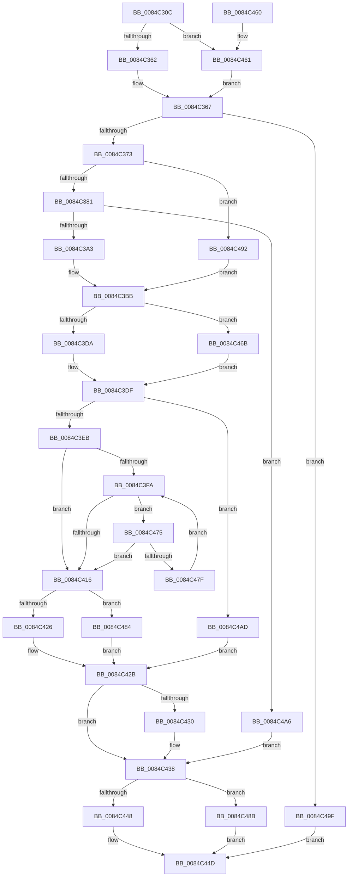

# CmpMarkIndexDirty

- RVA: `0x0084C30C`–`0x0084C4B7` (길이 `427` bytes)
- VA: `0x000000014084C30C`
- 실행 섹션: `PAGE`
- PDB 이름 있음: `예`; PDB Function 태그: `아니요`
- unwind 정보 RVA: `0x00069770`
- 디코드: `113`개 명령, `427/427` bytes 표시
- 미해석 바이트: `0` (있으면 어셈블리에 `.byte`로 보존)

> 이 문서는 커널 이미지의 기계어와 PDB 기호를 분석해 생성했습니다. 4번과 5번은 함수 원형과 자료형을 바이너리 사용 방식에서 추정한 C 해석이며 원본 소스 복구 결과는 아닙니다.

## 1. Dependencies

- 직접 호출 지점: **14**; 고유 호출 대상: **9**
- 직접 호출자로 확인된 함수: **2**
- RIP 상대 이미지 참조: **0**

### Outgoing calls
- `0x0084C33D` → [HvpGetCellContextInitialize](../85/HvpGetCellContextInitialize_function_00855F10.md) (function, `0x00855F10`)
- `0x0084C346` → [HvpGetCellContextInitialize](../85/HvpGetCellContextInitialize_function_00855F10.md) (function, `0x00855F10`)
- `0x0084C362` → [HvpGetCellFlat](../85/HvpGetCellFlat_function_00854C60.md) (function, `0x00854C60`)
- `0x0084C392` → [CmpAllocatePool](../../text/3C/CmpAllocatePool_function_003CD504.md) (function, `0x003CD504`)
- `0x0084C3B2` → [CmpCopyCompressedName](CmpCopyCompressedName_function_0084E0D0.md) (function, `0x0084E0D0`)
- `0x0084C3DA` → [HvpGetCellFlat](../85/HvpGetCellFlat_function_00854C60.md) (function, `0x00854C60`)
- `0x0084C408` → [CmpMarkIndexDirtyInStorageType](../A3/CmpMarkIndexDirtyInStorageType_function_00A325B0.md) (function, `0x00A325B0`)
- `0x0084C426` → [HvpReleaseCellPaged](../85/HvpReleaseCellPaged_function_00855F40.md) (function, `0x00855F40`)
- `0x0084C433` → [CmSiFreeMemory](../../text/47/CmSiFreeMemory_function_00475D80.md) (function, `0x00475D80`)
- `0x0084C448` → [HvpReleaseCellPaged](../85/HvpReleaseCellPaged_function_00855F40.md) (function, `0x00855F40`)
- `0x0084C461` → [HvpGetCellPaged](../85/HvpGetCellPaged_function_00854CB0.md) (function, `0x00854CB0`)
- `0x0084C46B` → [HvpGetCellPaged](../85/HvpGetCellPaged_function_00854CB0.md) (function, `0x00854CB0`)
- `0x0084C484` → [HvpReleaseCellFlat](../85/HvpReleaseCellFlat_function_0085CC20.md) (function, `0x0085CC20`)
- `0x0084C48B` → [HvpReleaseCellFlat](../85/HvpReleaseCellFlat_function_0085CC20.md) (function, `0x0085CC20`)

### Direct callers
- [CmpMarkKeyDirty](CmpMarkKeyDirty_function_0084B1FC.md) at `0x0084B417`
- [CmpMarkKeyParentDirty](../A7/CmpMarkKeyParentDirty_function_00A749E8.md) at `0x00A74A30`

### Static image references
- 디코드된 RIP-relative 메모리 참조가 없습니다.

## 2. Other-region calls and transfers

- 다른 실행 섹션으로 향하는 call: **2**
  - `0x0084C392` → [CmpAllocatePool](../../text/3C/CmpAllocatePool_function_003CD504.md) (`PAGE` → `.text`)
  - `0x0084C433` → [CmSiFreeMemory](../../text/47/CmSiFreeMemory_function_00475D80.md) (`PAGE` → `.text`)
- 별도 외부 분기/꼬리 이동을 확인하지 못했습니다.

## 3. Assembly (complete function range)

```asm
0084C30C  48 89 5C 24 10                  mov qword ptr [rsp + 0x10], rbx
0084C311  55                              push rbp
0084C312  56                              push rsi
0084C313  57                              push rdi
0084C314  41 56                           push r14
0084C316  41 57                           push r15
0084C318  48 8B EC                        mov rbp, rsp
0084C31B  48 83 EC 40                     sub rsp, 0x40
0084C31F  48 83 65 48 00                  and qword ptr [rbp + 0x48], 0
0084C324  48 8B D9                        mov rbx, rcx
0084C327  48 83 65 30 00                  and qword ptr [rbp + 0x30], 0
0084C32C  48 8D 4D 30                     lea rcx, [rbp + 0x30]
0084C330  83 65 F4 00                     and dword ptr [rbp - 0xc], 0
0084C334  45 8B C8                        mov r9d, r8d
0084C337  44 8B FA                        mov r15d, edx
0084C33A  45 33 F6                        xor r14d, r14d
0084C33D  E8 CE 9B 00 00                  call 0x140855f10
0084C342  48 8D 4D 48                     lea rcx, [rbp + 0x48]
0084C346  E8 C5 9B 00 00                  call 0x140855f10
0084C34B  F6 83 8C 00 00 00 01            test byte ptr [rbx + 0x8c], 1
0084C352  4C 8D 45 48                     lea r8, [rbp + 0x48]
0084C356  41 8B D1                        mov edx, r9d
0084C359  48 8B CB                        mov rcx, rbx
0084C35C  0F 84 FF 00 00 00               je 0x14084c461
0084C362  E8 F9 88 00 00                  call 0x140854c60
0084C367  48 8B F8                        mov rdi, rax
0084C36A  48 85 C0                        test rax, rax
0084C36D  0F 84 2C 01 00 00               je 0x14084c49f
0084C373  F6 40 02 20                     test byte ptr [rax + 2], 0x20
0084C377  0F B7 70 48                     movzx esi, word ptr [rax + 0x48]
0084C37B  0F 84 11 01 00 00               je 0x14084c492
0084C381  66 03 F6                        add si, si
0084C384  B9 00 01 00 00                  mov ecx, 0x100
0084C389  0F B7 D6                        movzx edx, si
0084C38C  41 B8 43 4D 39 20               mov r8d, 0x20394d43
0084C392  E8 6D 11 B8 FF                  call 0x1403cd504
0084C397  4C 8B F0                        mov r14, rax
0084C39A  48 85 C0                        test rax, rax
0084C39D  0F 84 03 01 00 00               je 0x14084c4a6
0084C3A3  44 0F B7 4F 48                  movzx r9d, word ptr [rdi + 0x48]
0084C3A8  4C 8D 47 4C                     lea r8, [rdi + 0x4c]
0084C3AC  0F B7 D6                        movzx edx, si
0084C3AF  48 8B C8                        mov rcx, rax
0084C3B2  E8 19 1D 00 00                  call 0x14084e0d0
0084C3B7  4C 89 75 F8                     mov qword ptr [rbp - 8], r14
0084C3BB  F6 83 8C 00 00 00 01            test byte ptr [rbx + 0x8c], 1
0084C3C2  4C 8D 45 30                     lea r8, [rbp + 0x30]
0084C3C6  66 89 75 F2                     mov word ptr [rbp - 0xe], si
0084C3CA  41 8B D7                        mov edx, r15d
0084C3CD  66 89 75 F0                     mov word ptr [rbp - 0x10], si
0084C3D1  48 8B CB                        mov rcx, rbx
0084C3D4  0F 84 91 00 00 00               je 0x14084c46b
0084C3DA  E8 81 88 00 00                  call 0x140854c60
0084C3DF  4C 8B F8                        mov r15, rax
0084C3E2  48 85 C0                        test rax, rax
0084C3E5  0F 84 C2 00 00 00               je 0x14084c4ad
0084C3EB  33 F6                           xor esi, esi
0084C3ED  BF 34 00 00 C0                  mov edi, 0xc0000034
0084C3F2  39 B3 D8 00 00 00               cmp dword ptr [rbx + 0xd8], esi
0084C3F8  7E 1C                           jle 0x14084c416
0084C3FA  4C 8D 4D F0                     lea r9, [rbp - 0x10]
0084C3FE  89 74 24 20                     mov dword ptr [rsp + 0x20], esi
0084C402  49 8B D7                        mov rdx, r15
0084C405  48 8B CB                        mov rcx, rbx
0084C408  E8 A3 61 1E 00                  call 0x140a325b0
0084C40D  8B F8                           mov edi, eax
0084C40F  3D 34 00 00 C0                  cmp eax, 0xc0000034
0084C414  74 5F                           je 0x14084c475
0084C416  F6 83 8C 00 00 00 01            test byte ptr [rbx + 0x8c], 1
0084C41D  48 8D 55 30                     lea rdx, [rbp + 0x30]
0084C421  48 8B CB                        mov rcx, rbx
0084C424  75 5E                           jne 0x14084c484
0084C426  E8 15 9B 00 00                  call 0x140855f40
0084C42B  4D 85 F6                        test r14, r14
0084C42E  74 08                           je 0x14084c438
0084C430  49 8B CE                        mov rcx, r14
0084C433  E8 48 99 C2 FF                  call 0x140475d80
0084C438  F6 83 8C 00 00 00 01            test byte ptr [rbx + 0x8c], 1
0084C43F  48 8D 55 48                     lea rdx, [rbp + 0x48]
0084C443  48 8B CB                        mov rcx, rbx
0084C446  75 43                           jne 0x14084c48b
0084C448  E8 F3 9A 00 00                  call 0x140855f40
0084C44D  48 8B 5C 24 78                  mov rbx, qword ptr [rsp + 0x78]
0084C452  8B C7                           mov eax, edi
0084C454  48 83 C4 40                     add rsp, 0x40
0084C458  41 5F                           pop r15
0084C45A  41 5E                           pop r14
0084C45C  5F                              pop rdi
0084C45D  5E                              pop rsi
0084C45E  5D                              pop rbp
0084C45F  C3                              ret
0084C460  CC                              int3
0084C461  E8 4A 88 00 00                  call 0x140854cb0
0084C466  E9 FC FE FF FF                  jmp 0x14084c367
0084C46B  E8 40 88 00 00                  call 0x140854cb0
0084C470  E9 6A FF FF FF                  jmp 0x14084c3df
0084C475  FF C6                           inc esi
0084C477  3B B3 D8 00 00 00               cmp esi, dword ptr [rbx + 0xd8]
0084C47D  7D 97                           jge 0x14084c416
0084C47F  E9 76 FF FF FF                  jmp 0x14084c3fa
0084C484  E8 97 07 01 00                  call 0x14085cc20
0084C489  EB A0                           jmp 0x14084c42b
0084C48B  E8 90 07 01 00                  call 0x14085cc20
0084C490  EB BB                           jmp 0x14084c44d
0084C492  48 8D 47 4C                     lea rax, [rdi + 0x4c]
0084C496  48 89 45 F8                     mov qword ptr [rbp - 8], rax
0084C49A  E9 1C FF FF FF                  jmp 0x14084c3bb
0084C49F  BF 9A 00 00 C0                  mov edi, 0xc000009a
0084C4A4  EB A7                           jmp 0x14084c44d
0084C4A6  BF 9A 00 00 C0                  mov edi, 0xc000009a
0084C4AB  EB 8B                           jmp 0x14084c438
0084C4AD  BF 9A 00 00 C0                  mov edi, 0xc000009a
0084C4B2  E9 74 FF FF FF                  jmp 0x14084c42b
```

## 4. C-style interpretation (structured pseudocode)

```c
__int64 __fastcall CmpMarkIndexDirty(__int64 a1, int a2, int a3)
{
    __int64 result;
    __int64 v_r14;
    __int64 v_rsi;
    __int64 v_rsp;
    unsigned __int64 v_stack_m30;
    unsigned int v_stack_m34;
    unsigned __int16 v_stack_m36;
    unsigned __int16 v_stack_m38;
    unsigned int v_stack_m48;
    unsigned __int64 v_stack_p10;
    unsigned __int64 v_stack_p20;
    unsigned __int64 v_stack_p8;

    v_stack_p10 = v_rbx;
    v_rsp = (v_rsp) - (64);
    v_r14 = 0;
    result = HvpGetCellContextInitialize(v_stack_p8, a2, a3, (unsigned int)(a3));
    result = HvpGetCellContextInitialize(v_stack_p20, a2, a3, (unsigned int)(a3));
    if (((*(unsigned __int8 *)(a1 + 140)) & (1)) == 0) goto loc_0084C461;
    result = HvpGetCellFlat(a1, (unsigned int)((unsigned int)((unsigned int)(a3))), v_stack_p20, (unsigned int)(a3));
loc_0084C367:
    if (result == 0) goto loc_0084C49F;
    if (((*(unsigned __int8 *)(result + 2)) & (32)) == 0) goto loc_0084C492;
    v_rsi = (unsigned __int16)((*(unsigned __int16 *)(result + 72)) + ((unsigned __int16)(*(unsigned __int16 *)(result + 72))));
    result = CmpAllocatePool(256, (unsigned __int16)(v_rsi), (unsigned int)(0x20394D43ULL), (unsigned int)(a3));
    if (result == 0) goto loc_0084C4A6;
    result = CmpCopyCompressedName(result, (unsigned __int16)(v_rsi), result + 76, *(unsigned __int16 *)(result + 72));
    v_stack_m30 = result;
loc_0084C3BB:
    v_stack_m36 = (unsigned __int16)(v_rsi);
    v_stack_m38 = (unsigned __int16)(v_rsi);
    if (((*(unsigned __int8 *)(a1 + 140)) & (1)) == 0) goto loc_0084C46B;
    result = HvpGetCellFlat(a1, (unsigned int)((unsigned int)((unsigned int)(a2))), v_stack_p8, *(unsigned __int16 *)(result + 72));
loc_0084C3DF:
    if (result == 0) goto loc_0084C4AD;
    v_rsi = 0;
    if ((*(unsigned int *)(a1 + 216)) <= 0) goto loc_0084C416;
loc_0084C3FA:
    v_stack_m48 = 0;
    result = CmpMarkIndexDirtyInStorageType(a1, result, v_stack_p8, v_stack_m38);
    if (((unsigned int)(result)) == 0xC0000034ULL) goto loc_0084C475;
loc_0084C416:
    if (((*(unsigned __int8 *)(a1 + 140)) & (1)) != 0) goto loc_0084C484;
    result = HvpReleaseCellPaged(a1, v_stack_p8, v_stack_p8, v_stack_m38);
loc_0084C42B:
    if (result != 0) {
        a1 = result;
        result = CmSiFreeMemory(a1, v_stack_p8, v_stack_p8, v_stack_m38);
    }
    if (((*(unsigned __int8 *)(a1 + 140)) & (1)) != 0) goto loc_0084C48B;
    result = HvpReleaseCellPaged(a1, v_stack_p20, v_stack_p8, v_stack_m38);
loc_0084C44D:
    v_rsp = (v_rsp) + (64);
    return (unsigned int)((unsigned int)((unsigned int)((unsigned int)(result))));
loc_0084C461:
    result = HvpGetCellPaged(a1, v_stack_p20, v_stack_p8, v_stack_m38);
    goto loc_0084C367;
loc_0084C46B:
    result = HvpGetCellPaged(a1, v_stack_p20, v_stack_p8, v_stack_m38);
    goto loc_0084C3DF;
loc_0084C475:
    v_rsi = (unsigned int)((v_rsi) + 1);
    if (((unsigned int)(v_rsi)) >= (*(unsigned int *)(v_stack_p10 + 216))) goto loc_0084C416;
    goto loc_0084C3FA;
loc_0084C484:
    result = HvpReleaseCellFlat(a1, v_stack_p20, v_stack_p8, v_stack_m38);
    goto loc_0084C42B;
loc_0084C48B:
    result = HvpReleaseCellFlat(a1, v_stack_p20, v_stack_p8, v_stack_m38);
    goto loc_0084C44D;
loc_0084C492:
    v_stack_m30 = (unsigned int)((unsigned int)(result)) + 76;
    goto loc_0084C3BB;
loc_0084C49F:
    goto loc_0084C44D;
loc_0084C4A6:
    goto loc_0084C438;
loc_0084C4AD:
    goto loc_0084C42B;
}
```

## 5. (Beta) C Style

```c
int64_t CmpMarkIndexDirty(void *Arg1, int32_t Arg2, int32_t Arg3)
{
    uint8_t *arg1 = (uint8_t *)Arg1;

    int64_t result;
    int64_t local_r14;
    int64_t local_rsi;
    int64_t local_rsp;
    uint64_t v_stack_m30;
    uint32_t v_stack_m34;
    uint16_t v_stack_m36;
    uint16_t v_stack_m38;
    uint32_t v_stack_m48;
    uint64_t v_stack_p10;
    uint64_t v_stack_p20;
    uint64_t v_stack_p8;

    v_stack_p10 = local_rbx;
    local_rsp = (local_rsp) - (64);
    local_r14 = 0;
    result = HvpGetCellContextInitialize(v_stack_p8, Arg2, Arg3, (uint32_t)(Arg3));
    result = HvpGetCellContextInitialize(v_stack_p20, Arg2, Arg3, (uint32_t)(Arg3));
    if (((*(uint8_t *)(arg1 + 0x8C)) & (1)) == 0) goto loc_0084C461;
    result = HvpGetCellFlat(Arg1, (uint32_t)((uint32_t)((uint32_t)(Arg3))), v_stack_p20, (uint32_t)(Arg3));
loc_0084C367:
    if (result == 0) goto loc_0084C49F;
    if (((*(uint8_t *)(result + 0x2)) & (32)) == 0) goto loc_0084C492;
    local_rsi = (uint16_t)((*(uint16_t *)(result + 0x48)) + ((uint16_t)(*(uint16_t *)(result + 0x48))));
    result = CmpAllocatePool(256, (uint16_t)(local_rsi), (uint32_t)(0x20394D43ULL), (uint32_t)(Arg3));
    if (result == 0) goto loc_0084C4A6;
    result = CmpCopyCompressedName(result, (uint16_t)(local_rsi), result + 76, *(uint16_t *)(result + 0x48));
    v_stack_m30 = result;
loc_0084C3BB:
    v_stack_m36 = (uint16_t)(local_rsi);
    v_stack_m38 = (uint16_t)(local_rsi);
    if (((*(uint8_t *)(arg1 + 0x8C)) & (1)) == 0) goto loc_0084C46B;
    result = HvpGetCellFlat(Arg1, (uint32_t)((uint32_t)((uint32_t)(Arg2))), v_stack_p8, *(uint16_t *)(result + 0x48));
loc_0084C3DF:
    if (result == 0) goto loc_0084C4AD;
    local_rsi = 0;
    if ((*(uint32_t *)(arg1 + 0xD8)) <= 0) goto loc_0084C416;
loc_0084C3FA:
    v_stack_m48 = 0;
    result = CmpMarkIndexDirtyInStorageType(Arg1, result, v_stack_p8, v_stack_m38);
    if (((uint32_t)(result)) == 0xC0000034ULL) goto loc_0084C475;
loc_0084C416:
    if (((*(uint8_t *)(arg1 + 0x8C)) & (1)) != 0) goto loc_0084C484;
    result = HvpReleaseCellPaged(Arg1, v_stack_p8, v_stack_p8, v_stack_m38);
loc_0084C42B:
    if (result != 0) {
        Arg1 = result;
        result = CmSiFreeMemory(Arg1, v_stack_p8, v_stack_p8, v_stack_m38);
    }
    if (((*(uint8_t *)(arg1 + 0x8C)) & (1)) != 0) goto loc_0084C48B;
    result = HvpReleaseCellPaged(Arg1, v_stack_p20, v_stack_p8, v_stack_m38);
loc_0084C44D:
    local_rsp = (local_rsp) + (64);
    return (uint32_t)((uint32_t)((uint32_t)((uint32_t)(result))));
loc_0084C461:
    result = HvpGetCellPaged(Arg1, v_stack_p20, v_stack_p8, v_stack_m38);
    goto loc_0084C367;
loc_0084C46B:
    result = HvpGetCellPaged(Arg1, v_stack_p20, v_stack_p8, v_stack_m38);
    goto loc_0084C3DF;
loc_0084C475:
    local_rsi = (uint32_t)((local_rsi) + 1);
    if (((uint32_t)(local_rsi)) >= (*(uint32_t *)(v_stack_p10 + 0xD8))) goto loc_0084C416;
    goto loc_0084C3FA;
loc_0084C484:
    result = HvpReleaseCellFlat(Arg1, v_stack_p20, v_stack_p8, v_stack_m38);
    goto loc_0084C42B;
loc_0084C48B:
    result = HvpReleaseCellFlat(Arg1, v_stack_p20, v_stack_p8, v_stack_m38);
    goto loc_0084C44D;
loc_0084C492:
    v_stack_m30 = (uint32_t)((uint32_t)(result)) + 76;
    goto loc_0084C3BB;
loc_0084C49F:
    goto loc_0084C44D;
loc_0084C4A6:
    goto loc_0084C438;
loc_0084C4AD:
    goto loc_0084C42B;
}
```

### 관측된 메모리 오프셋

구조체 형식이 확인되지 않은 접근은 인자 기준의 오프셋으로만 기록했습니다.

| 기준 인자 | 오프셋 표현 | 폭 (bit) | 접근 |
|---|---:|---:|---|
| `Arg1` | `+ 0x8C` | `8` | `R` |
| `Arg1` | `+ 0xD8` | `32` | `R` |

## 6. Execution-region graph

[열기: 2D/3D 그래프와 함수 탐색 컨트롤 패널](../../../control-panel.html?section=page&rva=0x0084C30C&view=graph)

- 2D 그래프는 위에서 아래로 흐르고, 3D 그래프는 빈 공간을 드래그해 회전합니다. Shift+드래그는 이동, 휠은 확대·축소, 함수 노드 선택은 대상 보고서 이동입니다.

### Static fallback


