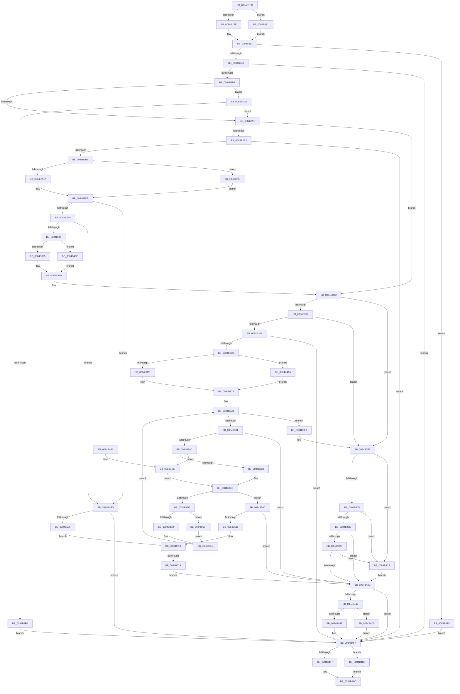

# CmpMarkKeyDirty

- RVA: `0x0084B1FC`–`0x0084B533` (길이 `823` bytes)
- VA: `0x000000014084B1FC`
- 실행 섹션: `PAGE`
- PDB 이름 있음: `예`; PDB Function 태그: `예`
- unwind 정보 RVA: `0x00069618`
- 디코드: `219`개 명령, `823/823` bytes 표시
- 미해석 바이트: `0` (있으면 어셈블리에 `.byte`로 보존)

> 이 문서는 커널 이미지의 기계어와 PDB 기호를 분석해 생성했습니다. 4번과 5번은 함수 원형과 자료형을 바이너리 사용 방식에서 추정한 C 해석이며 원본 소스 복구 결과는 아닙니다.

## 1. Dependencies

- 직접 호출 지점: **27**; 고유 호출 대상: **7**
- 직접 호출자로 확인된 함수: **5**
- RIP 상대 이미지 참조: **0**

### Outgoing calls
- `0x0084B25E` → [HvpGetCellFlat](../85/HvpGetCellFlat_function_00854C60.md) (function, `0x00854C60`)
- `0x0084B27C` → [HvpMarkCellDirty](../85/HvpMarkCellDirty_function_00858080.md) (function, `0x00858080`)
- `0x0084B2AC` → [HvpMarkCellDirty](../85/HvpMarkCellDirty_function_00858080.md) (function, `0x00858080`)
- `0x0084B2D2` → [HvpGetCellFlat](../85/HvpGetCellFlat_function_00854C60.md) (function, `0x00854C60`)
- `0x0084B2E6` → [HvpMarkCellDirty](../85/HvpMarkCellDirty_function_00858080.md) (function, `0x00858080`)
- `0x0084B302` → [HvpMarkCellDirty](../85/HvpMarkCellDirty_function_00858080.md) (function, `0x00858080`)
- `0x0084B325` → [HvpReleaseCellPaged](../85/HvpReleaseCellPaged_function_00855F40.md) (function, `0x00855F40`)
- `0x0084B34D` → [HvpMarkCellDirty](../85/HvpMarkCellDirty_function_00858080.md) (function, `0x00858080`)
- `0x0084B373` → [HvpGetCellFlat](../85/HvpGetCellFlat_function_00854C60.md) (function, `0x00854C60`)
- `0x0084B391` → [HvpMarkCellDirty](../85/HvpMarkCellDirty_function_00858080.md) (function, `0x00858080`)
- `0x0084B3B8` → [HvpGetCellFlat](../85/HvpGetCellFlat_function_00854C60.md) (function, `0x00854C60`)
- `0x0084B3C6` → [CmpMarkValueDataDirty](CmpMarkValueDataDirty_function_0084B910.md) (function, `0x0084B910`)
- `0x0084B3E9` → [HvpReleaseCellPaged](../85/HvpReleaseCellPaged_function_00855F40.md) (function, `0x00855F40`)
- `0x0084B417` → [CmpMarkIndexDirty](CmpMarkIndexDirty_function_0084C30C.md) (function, `0x0084C30C`)
- `0x0084B42E` → [HvpMarkCellDirty](../85/HvpMarkCellDirty_function_00858080.md) (function, `0x00858080`)
- `0x0084B452` → [HvpReleaseCellPaged](../85/HvpReleaseCellPaged_function_00855F40.md) (function, `0x00855F40`)
- `0x0084B467` → [HvpReleaseCellPaged](../85/HvpReleaseCellPaged_function_00855F40.md) (function, `0x00855F40`)
- `0x0084B487` → [HvpGetCellPaged](../85/HvpGetCellPaged_function_00854CB0.md) (function, `0x00854CB0`)
- `0x0084B491` → [HvpGetCellPaged](../85/HvpGetCellPaged_function_00854CB0.md) (function, `0x00854CB0`)
- `0x0084B49B` → [HvpGetCellPaged](../85/HvpGetCellPaged_function_00854CB0.md) (function, `0x00854CB0`)
- `0x0084B4A5` → [HvpGetCellPaged](../85/HvpGetCellPaged_function_00854CB0.md) (function, `0x00854CB0`)
- `0x0084B4AF` → [HvpReleaseCellFlat](../85/HvpReleaseCellFlat_function_0085CC20.md) (function, `0x0085CC20`)
- `0x0084B4B9` → [HvpReleaseCellFlat](../85/HvpReleaseCellFlat_function_0085CC20.md) (function, `0x0085CC20`)
- `0x0084B4C0` → [HvpReleaseCellFlat](../85/HvpReleaseCellFlat_function_0085CC20.md) (function, `0x0085CC20`)
- `0x0084B4CE` → [HvpReleaseCellFlat](../85/HvpReleaseCellFlat_function_0085CC20.md) (function, `0x0085CC20`)
- `0x0084B4E1` → [HvpMarkCellDirty](../85/HvpMarkCellDirty_function_00858080.md) (function, `0x00858080`)
- `0x0084B529` → [HvpReleaseCellFlat](../85/HvpReleaseCellFlat_function_0085CC20.md) (function, `0x0085CC20`)

### Direct callers
- [CmDeleteLayeredKey](../../text/41/CmDeleteLayeredKey_function_0041B598.md) at `0x0041B71D`
- [CmDeleteLayeredKey](../../text/41/CmDeleteLayeredKey_function_0041B598.md) at `0x0041B8A2`
- [CmRenameKey](../7E/CmRenameKey_function_007E8F48.md) at `0x007E99DA`
- [CmpFreeKeyByCell](CmpFreeKeyByCell_function_0084AD70.md) at `0x0084ADB9`
- [CmpCreateChild](../94/CmpCreateChild_function_0094817C.md) at `0x00948C93`
- [CmpLightWeightPrepareDeleteKeyUoW](../A5/CmpLightWeightPrepareDeleteKeyUoW_function_00A54494.md) at `0x00A5452F`

### Static image references
- 디코드된 RIP-relative 메모리 참조가 없습니다.

## 2. Other-region calls and transfers

- 다른 실행 섹션으로 향하는 call: **0**
- call이 아닌 외부 분기/꼬리 이동: **1**
  - `0x0084B523` → [sub_00B16858](../B1/Unknown_function_00B16858.md) (`tail-transfer`)

## 3. Assembly (complete function range)

```asm
0084B1FC  48 89 5C 24 20                  mov qword ptr [rsp + 0x20], rbx
0084B201  44 88 44 24 18                  mov byte ptr [rsp + 0x18], r8b
0084B206  89 54 24 10                     mov dword ptr [rsp + 0x10], edx
0084B20A  55                              push rbp
0084B20B  56                              push rsi
0084B20C  57                              push rdi
0084B20D  41 54                           push r12
0084B20F  41 55                           push r13
0084B211  41 56                           push r14
0084B213  41 57                           push r15
0084B215  48 8B EC                        mov rbp, rsp
0084B218  48 83 EC 40                     sub rsp, 0x40
0084B21C  45 33 FF                        xor r15d, r15d
0084B21F  48 8B D9                        mov rbx, rcx
0084B222  83 C9 FF                        or ecx, 0xffffffff
0084B225  44 89 7D F4                     mov dword ptr [rbp - 0xc], r15d
0084B229  45 8A E8                        mov r13b, r8b
0084B22C  89 4D F0                        mov dword ptr [rbp - 0x10], ecx
0084B22F  89 4D E8                        mov dword ptr [rbp - 0x18], ecx
0084B232  4C 8D 45 F0                     lea r8, [rbp - 0x10]
0084B236  F6 83 8C 00 00 00 01            test byte ptr [rbx + 0x8c], 1
0084B23D  44 8B E2                        mov r12d, edx
0084B240  89 4D 40                        mov dword ptr [rbp + 0x40], ecx
0084B243  45 8B F7                        mov r14d, r15d
0084B246  89 4D E0                        mov dword ptr [rbp - 0x20], ecx
0084B249  48 8B CB                        mov rcx, rbx
0084B24C  44 89 7D EC                     mov dword ptr [rbp - 0x14], r15d
0084B250  44 89 7D 44                     mov dword ptr [rbp + 0x44], r15d
0084B254  44 89 7D E4                     mov dword ptr [rbp - 0x1c], r15d
0084B258  0F 84 33 02 00 00               je 0x14084b491
0084B25E  E8 FD 99 00 00                  call 0x140854c60
0084B263  F6 40 02 02                     test byte ptr [rax + 2], 2
0084B267  48 8B F0                        mov rsi, rax
0084B26A  0F 85 85 02 00 00               jne 0x14084b4f5
0084B270  45 33 C9                        xor r9d, r9d
0084B273  45 33 C0                        xor r8d, r8d
0084B276  41 8B D4                        mov edx, r12d
0084B279  48 8B CB                        mov rcx, rbx
0084B27C  E8 FF CD 00 00                  call 0x140858080
0084B281  8B F8                           mov edi, eax
0084B283  85 C0                           test eax, eax
0084B285  0F 88 CC 01 00 00               js 0x14084b457
0084B28B  8B 56 30                        mov edx, dword ptr [rsi + 0x30]
0084B28E  83 FA FF                        cmp edx, -1
0084B291  0F 85 41 02 00 00               jne 0x14084b4d8
0084B297  8B 56 2C                        mov edx, dword ptr [rsi + 0x2c]
0084B29A  83 FA FF                        cmp edx, -1
0084B29D  0F 84 8A 00 00 00               je 0x14084b32d
0084B2A3  45 33 C9                        xor r9d, r9d
0084B2A6  45 33 C0                        xor r8d, r8d
0084B2A9  48 8B CB                        mov rcx, rbx
0084B2AC  E8 CF CD 00 00                  call 0x140858080
0084B2B1  8B F8                           mov edi, eax
0084B2B3  85 C0                           test eax, eax
0084B2B5  0F 88 9C 01 00 00               js 0x14084b457
0084B2BB  F6 83 8C 00 00 00 01            test byte ptr [rbx + 0x8c], 1
0084B2C2  4C 8D 45 40                     lea r8, [rbp + 0x40]
0084B2C6  8B 56 2C                        mov edx, dword ptr [rsi + 0x2c]
0084B2C9  48 8B CB                        mov rcx, rbx
0084B2CC  0F 84 C9 01 00 00               je 0x14084b49b
0084B2D2  E8 89 99 00 00                  call 0x140854c60
0084B2D7  8B 50 04                        mov edx, dword ptr [rax + 4]
0084B2DA  45 33 C9                        xor r9d, r9d
0084B2DD  45 33 C0                        xor r8d, r8d
0084B2E0  48 8B CB                        mov rcx, rbx
0084B2E3  4C 8B F8                        mov r15, rax
0084B2E6  E8 95 CD 00 00                  call 0x140858080
0084B2EB  8B F8                           mov edi, eax
0084B2ED  85 C0                           test eax, eax
0084B2EF  0F 88 08 02 00 00               js 0x14084b4fd
0084B2F5  41 8B 57 08                     mov edx, dword ptr [r15 + 8]
0084B2F9  45 33 C9                        xor r9d, r9d
0084B2FC  45 33 C0                        xor r8d, r8d
0084B2FF  48 8B CB                        mov rcx, rbx
0084B302  E8 79 CD 00 00                  call 0x140858080
0084B307  8B F8                           mov edi, eax
0084B309  85 C0                           test eax, eax
0084B30B  0F 88 EC 01 00 00               js 0x14084b4fd
0084B311  F6 83 8C 00 00 00 01            test byte ptr [rbx + 0x8c], 1
0084B318  48 8D 55 40                     lea rdx, [rbp + 0x40]
0084B31C  48 8B CB                        mov rcx, rbx
0084B31F  0F 85 A9 01 00 00               jne 0x14084b4ce
0084B325  E8 16 AC 00 00                  call 0x140855f40
0084B32A  45 33 FF                        xor r15d, r15d
0084B32D  F6 46 02 40                     test byte ptr [rsi + 2], 0x40
0084B331  0F 85 C4 00 00 00               jne 0x14084b3fb
0084B337  44 39 7E 24                     cmp dword ptr [rsi + 0x24], r15d
0084B33B  0F 86 BA 00 00 00               jbe 0x14084b3fb
0084B341  8B 56 28                        mov edx, dword ptr [rsi + 0x28]
0084B344  45 33 C9                        xor r9d, r9d
0084B347  45 33 C0                        xor r8d, r8d
0084B34A  48 8B CB                        mov rcx, rbx
0084B34D  E8 2E CD 00 00                  call 0x140858080
0084B352  8B F8                           mov edi, eax
0084B354  85 C0                           test eax, eax
0084B356  0F 88 FB 00 00 00               js 0x14084b457
0084B35C  F6 83 8C 00 00 00 01            test byte ptr [rbx + 0x8c], 1
0084B363  4C 8D 45 E8                     lea r8, [rbp - 0x18]
0084B367  8B 56 28                        mov edx, dword ptr [rsi + 0x28]
0084B36A  48 8B CB                        mov rcx, rbx
0084B36D  0F 84 32 01 00 00               je 0x14084b4a5
0084B373  E8 E8 98 00 00                  call 0x140854c60
0084B378  4C 8B F0                        mov r14, rax
0084B37B  44 3B 7E 24                     cmp r15d, dword ptr [rsi + 0x24]
0084B37F  73 72                           jae 0x14084b3f3
0084B381  45 8B EF                        mov r13d, r15d
0084B384  45 33 C9                        xor r9d, r9d
0084B387  45 33 C0                        xor r8d, r8d
0084B38A  48 8B CB                        mov rcx, rbx
0084B38D  43 8B 14 AE                     mov edx, dword ptr [r14 + r13*4]
0084B391  E8 EA CC 00 00                  call 0x140858080
0084B396  8B F8                           mov edi, eax
0084B398  85 C0                           test eax, eax
0084B39A  0F 88 9D 00 00 00               js 0x14084b43d
0084B3A0  F6 83 8C 00 00 00 01            test byte ptr [rbx + 0x8c], 1
0084B3A7  4C 8D 45 E0                     lea r8, [rbp - 0x20]
0084B3AB  43 8B 14 AE                     mov edx, dword ptr [r14 + r13*4]
0084B3AF  48 8B CB                        mov rcx, rbx
0084B3B2  0F 84 CF 00 00 00               je 0x14084b487
0084B3B8  E8 A3 98 00 00                  call 0x140854c60
0084B3BD  48 8B D0                        mov rdx, rax
0084B3C0  48 8B CB                        mov rcx, rbx
0084B3C3  4C 8B E8                        mov r13, rax
0084B3C6  E8 45 05 00 00                  call 0x14084b910
0084B3CB  8B F8                           mov edi, eax
0084B3CD  85 C0                           test eax, eax
0084B3CF  0F 88 37 01 00 00               js 0x14084b50c
0084B3D5  F6 83 8C 00 00 00 01            test byte ptr [rbx + 0x8c], 1
0084B3DC  48 8D 55 E0                     lea rdx, [rbp - 0x20]
0084B3E0  48 8B CB                        mov rcx, rbx
0084B3E3  0F 85 C6 00 00 00               jne 0x14084b4af
0084B3E9  E8 52 AB 00 00                  call 0x140855f40
0084B3EE  41 FF C7                        inc r15d
0084B3F1  EB 88                           jmp 0x14084b37b
0084B3F3  44 8B 65 48                     mov r12d, dword ptr [rbp + 0x48]
0084B3F7  44 8A 6D 50                     mov r13b, byte ptr [rbp + 0x50]
0084B3FB  F6 46 02 04                     test byte ptr [rsi + 2], 4
0084B3FF  0F 85 C2 00 00 00               jne 0x14084b4c7
0084B405  45 84 ED                        test r13b, r13b
0084B408  0F 84 B9 00 00 00               je 0x14084b4c7
0084B40E  8B 56 10                        mov edx, dword ptr [rsi + 0x10]
0084B411  45 8B C4                        mov r8d, r12d
0084B414  48 8B CB                        mov rcx, rbx
0084B417  E8 F0 0E 00 00                  call 0x14084c30c
0084B41C  8B F8                           mov edi, eax
0084B41E  85 C0                           test eax, eax
0084B420  78 1B                           js 0x14084b43d
0084B422  8B 56 10                        mov edx, dword ptr [rsi + 0x10]
0084B425  45 33 C9                        xor r9d, r9d
0084B428  45 33 C0                        xor r8d, r8d
0084B42B  48 8B CB                        mov rcx, rbx
0084B42E  E8 4D CC 00 00                  call 0x140858080
0084B433  8B F8                           mov edi, eax
0084B435  85 C0                           test eax, eax
0084B437  0F 89 8A 00 00 00               jns 0x14084b4c7
0084B43D  4D 85 F6                        test r14, r14
0084B440  74 15                           je 0x14084b457
0084B442  F6 83 8C 00 00 00 01            test byte ptr [rbx + 0x8c], 1
0084B449  48 8D 55 E8                     lea rdx, [rbp - 0x18]
0084B44D  48 8B CB                        mov rcx, rbx
0084B450  75 6E                           jne 0x14084b4c0
0084B452  E8 E9 AA 00 00                  call 0x140855f40
0084B457  F6 83 8C 00 00 00 01            test byte ptr [rbx + 0x8c], 1
0084B45E  48 8D 55 F0                     lea rdx, [rbp - 0x10]
0084B462  48 8B CB                        mov rcx, rbx
0084B465  75 52                           jne 0x14084b4b9
0084B467  E8 D4 AA 00 00                  call 0x140855f40
0084B46C  48 8B 9C 24 98 00 00 00         mov rbx, qword ptr [rsp + 0x98]
0084B474  8B C7                           mov eax, edi
0084B476  48 83 C4 40                     add rsp, 0x40
0084B47A  41 5F                           pop r15
0084B47C  41 5E                           pop r14
0084B47E  41 5D                           pop r13
0084B480  41 5C                           pop r12
0084B482  5F                              pop rdi
0084B483  5E                              pop rsi
0084B484  5D                              pop rbp
0084B485  C3                              ret
0084B486  CC                              int3
0084B487  E8 24 98 00 00                  call 0x140854cb0
0084B48C  E9 2C FF FF FF                  jmp 0x14084b3bd
0084B491  E8 1A 98 00 00                  call 0x140854cb0
0084B496  E9 C8 FD FF FF                  jmp 0x14084b263
0084B49B  E8 10 98 00 00                  call 0x140854cb0
0084B4A0  E9 32 FE FF FF                  jmp 0x14084b2d7
0084B4A5  E8 06 98 00 00                  call 0x140854cb0
0084B4AA  E9 C9 FE FF FF                  jmp 0x14084b378
0084B4AF  E8 6C 17 01 00                  call 0x14085cc20
0084B4B4  E9 35 FF FF FF                  jmp 0x14084b3ee
0084B4B9  E8 62 17 01 00                  call 0x14085cc20
0084B4BE  EB AC                           jmp 0x14084b46c
0084B4C0  E8 5B 17 01 00                  call 0x14085cc20
0084B4C5  EB 90                           jmp 0x14084b457
0084B4C7  33 FF                           xor edi, edi
0084B4C9  E9 6F FF FF FF                  jmp 0x14084b43d
0084B4CE  E8 4D 17 01 00                  call 0x14085cc20
0084B4D3  E9 52 FE FF FF                  jmp 0x14084b32a
0084B4D8  45 33 C9                        xor r9d, r9d
0084B4DB  45 33 C0                        xor r8d, r8d
0084B4DE  48 8B CB                        mov rcx, rbx
0084B4E1  E8 9A CB 00 00                  call 0x140858080
0084B4E6  8B F8                           mov edi, eax
0084B4E8  85 C0                           test eax, eax
0084B4EA  0F 89 A7 FD FF FF               jns 0x14084b297
0084B4F0  E9 62 FF FF FF                  jmp 0x14084b457
0084B4F5  41 8B FF                        mov edi, r15d
0084B4F8  E9 5A FF FF FF                  jmp 0x14084b457
0084B4FD  4D 85 FF                        test r15, r15
0084B500  0F 84 51 FF FF FF               je 0x14084b457
0084B506  48 8D 55 40                     lea rdx, [rbp + 0x40]
0084B50A  EB 0D                           jmp 0x14084b519
0084B50C  4D 85 ED                        test r13, r13
0084B50F  0F 84 28 FF FF FF               je 0x14084b43d
0084B515  48 8D 55 E0                     lea rdx, [rbp - 0x20]
0084B519  F6 83 8C 00 00 00 01            test byte ptr [rbx + 0x8c], 1
0084B520  48 8B CB                        mov rcx, rbx
0084B523  0F 84 2F B3 2C 00               je 0x140b16858
0084B529  E8 F2 16 01 00                  call 0x14085cc20
0084B52E  E9 0A FF FF FF                  jmp 0x14084b43d
```

## 4. C-style interpretation (structured pseudocode)

```c
__int64 __fastcall CmpMarkKeyDirty(__int64 a1, int a2, unsigned __int8 a3, int a4)
{
    __int64 result;
    __int64 v_r15;
    __int64 v_rdi;
    __int64 v_rsp;
    unsigned int v_stack_m44;
    unsigned int v_stack_m48;
    unsigned int v_stack_m4C;
    unsigned int v_stack_m50;
    unsigned int v_stack_m54;
    unsigned int v_stack_m58;
    unsigned int v_stack_p10;
    unsigned __int8 v_stack_p18;
    unsigned __int64 v_stack_p20;
    unsigned int v_stack_p8;
    unsigned int v_stack_pC;

    v_stack_p20 = v_rbx;
    v_stack_p18 = a3;
    v_stack_p10 = a2;
    v_rsp = (v_rsp) - (64);
    v_r15 = 0;
    a1 = (unsigned int)((a1) | (0xFFFFFFFFULL));
    v_stack_m44 = 0;
    v_stack_m48 = (unsigned int)(a1);
    v_stack_m50 = (unsigned int)(a1);
    v_stack_p8 = (unsigned int)(a1);
    v_stack_m58 = (unsigned int)(a1);
    v_stack_m4C = 0;
    v_stack_pC = 0;
    v_stack_m54 = 0;
    if (((*(unsigned __int8 *)(a1 + 140)) & (1)) == 0) goto loc_0084B491;
    result = HvpGetCellFlat(a1, a2, v_stack_m48, a4);
loc_0084B263:
    if (((*(unsigned __int8 *)(result + 2)) & (2)) != 0) goto loc_0084B4F5;
    a4 = 0;
    a3 = 0;
    result = HvpMarkCellDirty(a1, (unsigned int)((unsigned int)((unsigned int)(a2))), a3, a4);
    if (sign_flag) goto loc_0084B457;
    if (((unsigned int)((unsigned int)(*(unsigned int *)(result + 48)))) != -1) goto loc_0084B4D8;
loc_0084B297:
    if (((unsigned int)((unsigned int)(*(unsigned int *)(result + 44)))) == -1) goto loc_0084B32D;
    a4 = 0;
    a3 = 0;
    result = HvpMarkCellDirty(a1, (unsigned int)(*(unsigned int *)(result + 44)), a3, a4);
    if (sign_flag) goto loc_0084B457;
    if (((*(unsigned __int8 *)(a1 + 140)) & (1)) == 0) goto loc_0084B49B;
    result = HvpGetCellFlat(a1, (unsigned int)(*(unsigned int *)(result + 44)), v_stack_p8, a4);
loc_0084B2D7:
    a4 = 0;
    a3 = 0;
    result = HvpMarkCellDirty(a1, (unsigned int)(*(unsigned int *)(result + 4)), a3, a4);
    if (sign_flag) goto loc_0084B4FD;
    a4 = 0;
    a3 = 0;
    result = HvpMarkCellDirty(a1, (unsigned int)(*(unsigned int *)(result + 8)), a3, a4);
    if (sign_flag) goto loc_0084B4FD;
    if (((*(unsigned __int8 *)(a1 + 140)) & (1)) != 0) goto loc_0084B4CE;
    result = HvpReleaseCellPaged(a1, v_stack_p8, a3, a4);
loc_0084B32A:
    v_r15 = 0;
loc_0084B32D:
    if (((*(unsigned __int8 *)(result + 2)) & (64)) != 0) goto loc_0084B3FB;
    if ((*(unsigned int *)(result + 36)) <= 0) goto loc_0084B3FB;
    a4 = 0;
    a3 = 0;
    result = HvpMarkCellDirty(a1, (unsigned int)(*(unsigned int *)(result + 40)), a3, a4);
    if (sign_flag) goto loc_0084B457;
    if (((*(unsigned __int8 *)(a1 + 140)) & (1)) == 0) goto loc_0084B4A5;
    result = HvpGetCellFlat(a1, (unsigned int)(*(unsigned int *)(result + 40)), v_stack_m50, a4);
loc_0084B378:
loc_0084B37B:
    if (0 >= (*(unsigned int *)(result + 36))) goto loc_0084B3F3;
    a4 = 0;
    a3 = 0;
    result = HvpMarkCellDirty(a1, (unsigned int)(*(unsigned int *)(result + 0 * 4)), a3, a4);
    if (sign_flag) goto loc_0084B43D;
    if (((*(unsigned __int8 *)(a1 + 140)) & (1)) == 0) goto loc_0084B487;
    result = HvpGetCellFlat(a1, (unsigned int)(*(unsigned int *)(result + 0 * 4)), v_stack_m58, a4);
loc_0084B3BD:
    result = CmpMarkValueDataDirty(a1, result, v_stack_m58, a4);
    if (sign_flag) goto loc_0084B50C;
    if (((*(unsigned __int8 *)(a1 + 140)) & (1)) != 0) goto loc_0084B4AF;
    result = HvpReleaseCellPaged(a1, v_stack_m58, v_stack_m58, a4);
loc_0084B3EE:
    v_r15 = (unsigned int)((v_r15) + 1);
    goto loc_0084B37B;
loc_0084B3F3:
loc_0084B3FB:
    if (((*(unsigned __int8 *)(result + 2)) & (4)) != 0) goto loc_0084B4C7;
    if ((unsigned __int8)(v_stack_p18) == 0) goto loc_0084B4C7;
    result = CmpMarkIndexDirty(a1, (unsigned int)(*(unsigned int *)(result + 16)), (unsigned int)((unsigned int)((unsigned int)(v_stack_p10))), a4);
    if (sign_flag) goto loc_0084B43D;
    a4 = 0;
    a3 = 0;
    result = HvpMarkCellDirty(a1, (unsigned int)(*(unsigned int *)(result + 16)), a3, a4);
    if (!sign_flag) goto loc_0084B4C7;
loc_0084B43D:
    if (result == 0) goto loc_0084B457;
    if (((*(unsigned __int8 *)(a1 + 140)) & (1)) != 0) goto loc_0084B4C0;
    result = HvpReleaseCellPaged(a1, v_stack_m50, a3, a4);
loc_0084B457:
    if (((*(unsigned __int8 *)(a1 + 140)) & (1)) != 0) goto loc_0084B4B9;
    result = HvpReleaseCellPaged(a1, v_stack_m48, a3, a4);
loc_0084B46C:
    v_rsp = (v_rsp) + (64);
    return (unsigned int)((unsigned int)((unsigned int)((unsigned int)(result))));
loc_0084B487:
    result = HvpGetCellPaged(a1, v_stack_m48, a3, a4);
    goto loc_0084B3BD;
loc_0084B491:
    result = HvpGetCellPaged(a1, v_stack_m48, a3, a4);
    goto loc_0084B263;
loc_0084B49B:
    result = HvpGetCellPaged(a1, v_stack_m48, a3, a4);
    goto loc_0084B2D7;
loc_0084B4A5:
    result = HvpGetCellPaged(a1, v_stack_m48, a3, a4);
    goto loc_0084B378;
loc_0084B4AF:
    result = HvpReleaseCellFlat(a1, v_stack_m48, a3, a4);
    goto loc_0084B3EE;
loc_0084B4B9:
    result = HvpReleaseCellFlat(a1, v_stack_m48, a3, a4);
    goto loc_0084B46C;
loc_0084B4C0:
    result = HvpReleaseCellFlat(a1, v_stack_m48, a3, a4);
    goto loc_0084B457;
loc_0084B4C7:
    v_rdi = 0;
    goto loc_0084B43D;
loc_0084B4CE:
    result = HvpReleaseCellFlat(a1, v_stack_m48, a3, a4);
    goto loc_0084B32A;
loc_0084B4D8:
    a4 = 0;
    a3 = 0;
    result = HvpMarkCellDirty(v_stack_p20, v_stack_m48, a3, a4);
    if (!sign_flag) goto loc_0084B297;
    goto loc_0084B457;
loc_0084B4F5:
    goto loc_0084B457;
loc_0084B4FD:
    if (v_r15 == 0) goto loc_0084B457;
    goto loc_0084B519;
loc_0084B50C:
    if (v_stack_p18 == 0) goto loc_0084B43D;
loc_0084B519:
    result = HvpReleaseCellFlat(v_stack_p20, v_stack_m58, a3, a4);
    goto loc_0084B43D;
}
```

## 5. (Beta) C Style

```c
int64_t CmpMarkKeyDirty(void *Arg1, int32_t Arg2, uint8_t Arg3, int32_t Arg4)
{
    uint8_t *arg1 = (uint8_t *)Arg1;

    int64_t result;
    int64_t local_r15;
    int64_t local_rdi;
    int64_t local_rsp;
    uint32_t v_stack_m44;
    uint32_t v_stack_m48;
    uint32_t v_stack_m4C;
    uint32_t v_stack_m50;
    uint32_t v_stack_m54;
    uint32_t v_stack_m58;
    uint32_t v_stack_p10;
    uint8_t v_stack_p18;
    uint64_t v_stack_p20;
    uint32_t v_stack_p8;
    uint32_t v_stack_pC;

    v_stack_p20 = local_rbx;
    v_stack_p18 = Arg3;
    v_stack_p10 = Arg2;
    local_rsp = (local_rsp) - (64);
    local_r15 = 0;
    Arg1 = (uint32_t)((Arg1) | (0xFFFFFFFFULL));
    v_stack_m44 = 0;
    v_stack_m48 = (uint32_t)(Arg1);
    v_stack_m50 = (uint32_t)(Arg1);
    v_stack_p8 = (uint32_t)(Arg1);
    v_stack_m58 = (uint32_t)(Arg1);
    v_stack_m4C = 0;
    v_stack_pC = 0;
    v_stack_m54 = 0;
    if (((*(uint8_t *)(arg1 + 0x8C)) & (1)) == 0) goto loc_0084B491;
    result = HvpGetCellFlat(Arg1, Arg2, v_stack_m48, Arg4);
loc_0084B263:
    if (((*(uint8_t *)(result + 0x2)) & (2)) != 0) goto loc_0084B4F5;
    Arg4 = 0;
    Arg3 = 0;
    result = HvpMarkCellDirty(Arg1, (uint32_t)((uint32_t)((uint32_t)(Arg2))), Arg3, Arg4);
    if (sign_flag) goto loc_0084B457;
    if (((uint32_t)((uint32_t)(*(uint32_t *)(result + 0x30)))) != -1) goto loc_0084B4D8;
loc_0084B297:
    if (((uint32_t)((uint32_t)(*(uint32_t *)(result + 0x2C)))) == -1) goto loc_0084B32D;
    Arg4 = 0;
    Arg3 = 0;
    result = HvpMarkCellDirty(Arg1, (uint32_t)(*(uint32_t *)(result + 0x2C)), Arg3, Arg4);
    if (sign_flag) goto loc_0084B457;
    if (((*(uint8_t *)(arg1 + 0x8C)) & (1)) == 0) goto loc_0084B49B;
    result = HvpGetCellFlat(Arg1, (uint32_t)(*(uint32_t *)(result + 0x2C)), v_stack_p8, Arg4);
loc_0084B2D7:
    Arg4 = 0;
    Arg3 = 0;
    result = HvpMarkCellDirty(Arg1, (uint32_t)(*(uint32_t *)(result + 0x4)), Arg3, Arg4);
    if (sign_flag) goto loc_0084B4FD;
    Arg4 = 0;
    Arg3 = 0;
    result = HvpMarkCellDirty(Arg1, (uint32_t)(*(uint32_t *)(result + 0x8)), Arg3, Arg4);
    if (sign_flag) goto loc_0084B4FD;
    if (((*(uint8_t *)(arg1 + 0x8C)) & (1)) != 0) goto loc_0084B4CE;
    result = HvpReleaseCellPaged(Arg1, v_stack_p8, Arg3, Arg4);
loc_0084B32A:
    local_r15 = 0;
loc_0084B32D:
    if (((*(uint8_t *)(result + 0x2)) & (64)) != 0) goto loc_0084B3FB;
    if ((*(uint32_t *)(result + 0x24)) <= 0) goto loc_0084B3FB;
    Arg4 = 0;
    Arg3 = 0;
    result = HvpMarkCellDirty(Arg1, (uint32_t)(*(uint32_t *)(result + 0x28)), Arg3, Arg4);
    if (sign_flag) goto loc_0084B457;
    if (((*(uint8_t *)(arg1 + 0x8C)) & (1)) == 0) goto loc_0084B4A5;
    result = HvpGetCellFlat(Arg1, (uint32_t)(*(uint32_t *)(result + 0x28)), v_stack_m50, Arg4);
loc_0084B378:
loc_0084B37B:
    if (0 >= (*(uint32_t *)(result + 0x24))) goto loc_0084B3F3;
    Arg4 = 0;
    Arg3 = 0;
    result = HvpMarkCellDirty(Arg1, (uint32_t)(*(uint32_t *)(result + 0x0 * 4)), Arg3, Arg4);
    if (sign_flag) goto loc_0084B43D;
    if (((*(uint8_t *)(arg1 + 0x8C)) & (1)) == 0) goto loc_0084B487;
    result = HvpGetCellFlat(Arg1, (uint32_t)(*(uint32_t *)(result + 0x0 * 4)), v_stack_m58, Arg4);
loc_0084B3BD:
    result = CmpMarkValueDataDirty(Arg1, result, v_stack_m58, Arg4);
    if (sign_flag) goto loc_0084B50C;
    if (((*(uint8_t *)(arg1 + 0x8C)) & (1)) != 0) goto loc_0084B4AF;
    result = HvpReleaseCellPaged(Arg1, v_stack_m58, v_stack_m58, Arg4);
loc_0084B3EE:
    local_r15 = (uint32_t)((local_r15) + 1);
    goto loc_0084B37B;
loc_0084B3F3:
loc_0084B3FB:
    if (((*(uint8_t *)(result + 0x2)) & (4)) != 0) goto loc_0084B4C7;
    if ((uint8_t)(v_stack_p18) == 0) goto loc_0084B4C7;
    result = CmpMarkIndexDirty(Arg1, (uint32_t)(*(uint32_t *)(result + 0x10)), (uint32_t)((uint32_t)((uint32_t)(v_stack_p10))), Arg4);
    if (sign_flag) goto loc_0084B43D;
    Arg4 = 0;
    Arg3 = 0;
    result = HvpMarkCellDirty(Arg1, (uint32_t)(*(uint32_t *)(result + 0x10)), Arg3, Arg4);
    if (!sign_flag) goto loc_0084B4C7;
loc_0084B43D:
    if (result == 0) goto loc_0084B457;
    if (((*(uint8_t *)(arg1 + 0x8C)) & (1)) != 0) goto loc_0084B4C0;
    result = HvpReleaseCellPaged(Arg1, v_stack_m50, Arg3, Arg4);
loc_0084B457:
    if (((*(uint8_t *)(arg1 + 0x8C)) & (1)) != 0) goto loc_0084B4B9;
    result = HvpReleaseCellPaged(Arg1, v_stack_m48, Arg3, Arg4);
loc_0084B46C:
    local_rsp = (local_rsp) + (64);
    return (uint32_t)((uint32_t)((uint32_t)((uint32_t)(result))));
loc_0084B487:
    result = HvpGetCellPaged(Arg1, v_stack_m48, Arg3, Arg4);
    goto loc_0084B3BD;
loc_0084B491:
    result = HvpGetCellPaged(Arg1, v_stack_m48, Arg3, Arg4);
    goto loc_0084B263;
loc_0084B49B:
    result = HvpGetCellPaged(Arg1, v_stack_m48, Arg3, Arg4);
    goto loc_0084B2D7;
loc_0084B4A5:
    result = HvpGetCellPaged(Arg1, v_stack_m48, Arg3, Arg4);
    goto loc_0084B378;
loc_0084B4AF:
    result = HvpReleaseCellFlat(Arg1, v_stack_m48, Arg3, Arg4);
    goto loc_0084B3EE;
loc_0084B4B9:
    result = HvpReleaseCellFlat(Arg1, v_stack_m48, Arg3, Arg4);
    goto loc_0084B46C;
loc_0084B4C0:
    result = HvpReleaseCellFlat(Arg1, v_stack_m48, Arg3, Arg4);
    goto loc_0084B457;
loc_0084B4C7:
    local_rdi = 0;
    goto loc_0084B43D;
loc_0084B4CE:
    result = HvpReleaseCellFlat(Arg1, v_stack_m48, Arg3, Arg4);
    goto loc_0084B32A;
loc_0084B4D8:
    Arg4 = 0;
    Arg3 = 0;
    result = HvpMarkCellDirty(v_stack_p20, v_stack_m48, Arg3, Arg4);
    if (!sign_flag) goto loc_0084B297;
    goto loc_0084B457;
loc_0084B4F5:
    goto loc_0084B457;
loc_0084B4FD:
    if (local_r15 == 0) goto loc_0084B457;
    goto loc_0084B519;
loc_0084B50C:
    if (v_stack_p18 == 0) goto loc_0084B43D;
loc_0084B519:
    result = HvpReleaseCellFlat(v_stack_p20, v_stack_m58, Arg3, Arg4);
    goto loc_0084B43D;
}
```

### 관측된 메모리 오프셋

구조체 형식이 확인되지 않은 접근은 인자 기준의 오프셋으로만 기록했습니다.

| 기준 인자 | 오프셋 표현 | 폭 (bit) | 접근 |
|---|---:|---:|---|
| `Arg1` | `+ 0x8C` | `8` | `R` |

## 6. Execution-region graph

[열기: 2D/3D 그래프와 함수 탐색 컨트롤 패널](../../../control-panel.html?section=page&rva=0x0084B1FC&view=graph)

- 2D 그래프는 위에서 아래로 흐르고, 3D 그래프는 빈 공간을 드래그해 회전합니다. Shift+드래그는 이동, 휠은 확대·축소, 함수 노드 선택은 대상 보고서 이동입니다.

### Static fallback


