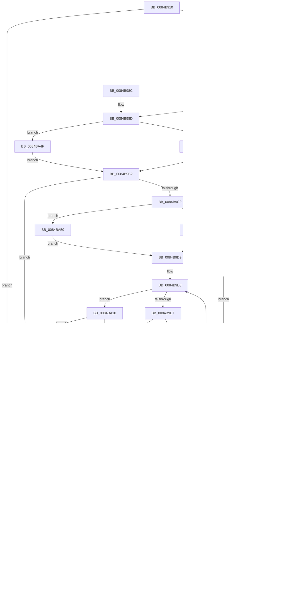

# CmpMarkValueDataDirty

- RVA: `0x0084B910`–`0x0084BA8C` (길이 `380` bytes)
- VA: `0x000000014084B910`
- 실행 섹션: `PAGE`
- PDB 이름 있음: `예`; PDB Function 태그: `아니요`
- unwind 정보 RVA: `0x00069674`
- 디코드: `117`개 명령, `380/380` bytes 표시
- 미해석 바이트: `0` (있으면 어셈블리에 `.byte`로 보존)

> 이 문서는 커널 이미지의 기계어와 PDB 기호를 분석해 생성했습니다. 4번과 5번은 함수 원형과 자료형을 바이너리 사용 방식에서 추정한 C 해석이며 원본 소스 복구 결과는 아닙니다.

## 1. Dependencies

- 직접 호출 지점: **11**; 고유 호출 대상: **5**
- 직접 호출자로 확인된 함수: **6**
- RIP 상대 이미지 참조: **0**

### Outgoing calls
- `0x0084B96A` → [HvpMarkCellDirty](../85/HvpMarkCellDirty_function_00858080.md) (function, `0x00858080`)
- `0x0084B9AD` → [HvpGetCellFlat](../85/HvpGetCellFlat_function_00854C60.md) (function, `0x00854C60`)
- `0x0084B9D4` → [HvpGetCellFlat](../85/HvpGetCellFlat_function_00854C60.md) (function, `0x00854C60`)
- `0x0084B9FC` → [HvpMarkCellDirty](../85/HvpMarkCellDirty_function_00858080.md) (function, `0x00858080`)
- `0x0084BA1D` → [HvpMarkCellDirty](../85/HvpMarkCellDirty_function_00858080.md) (function, `0x00858080`)
- `0x0084BA3D` → [HvpReleaseCellPaged](../85/HvpReleaseCellPaged_function_00855F40.md) (function, `0x00855F40`)
- `0x0084BA4F` → [HvpGetCellPaged](../85/HvpGetCellPaged_function_00854CB0.md) (function, `0x00854CB0`)
- `0x0084BA59` → [HvpGetCellPaged](../85/HvpGetCellPaged_function_00854CB0.md) (function, `0x00854CB0`)
- `0x0084BA73` → [HvpReleaseCellPaged](../85/HvpReleaseCellPaged_function_00855F40.md) (function, `0x00855F40`)
- `0x0084BA7A` → [HvpReleaseCellFlat](../85/HvpReleaseCellFlat_function_0085CC20.md) (function, `0x0085CC20`)
- `0x0084BA81` → [HvpReleaseCellFlat](../85/HvpReleaseCellFlat_function_0085CC20.md) (function, `0x0085CC20`)

### Direct callers
- [CmDeleteValueKey](CmDeleteValueKey_function_008476E8.md) at `0x00847B05`
- [CmDeleteValueKey](CmDeleteValueKey_function_008476E8.md) at `0x008481D7`
- [CmpMarkKeyDirty](CmpMarkKeyDirty_function_0084B1FC.md) at `0x0084B3C6`
- [CmpSetValueKeyExisting](CmpSetValueKeyExisting_function_0084B53C.md) at `0x0084B608`
- [CmpLightWeightPrepareSetValueKeyUoW](../A0/CmpLightWeightPrepareSetValueKeyUoW_function_00A0EF28.md) at `0x00A0F249`
- [CmpLightWeightPrepareDeleteValueKeyUoW](../A0/CmpLightWeightPrepareDeleteValueKeyUoW_function_00A0F3D8.md) at `0x00A0F516`
- [sub_00B46094](../B4/Unknown_function_00B46094.md) at `0x00B4610D`

### Static image references
- 디코드된 RIP-relative 메모리 참조가 없습니다.

## 2. Other-region calls and transfers

- 다른 실행 섹션으로 향하는 call: **0**
- 별도 외부 분기/꼬리 이동을 확인하지 못했습니다.

## 3. Assembly (complete function range)

```asm
0084B910  48 89 5C 24 08                  mov qword ptr [rsp + 8], rbx
0084B915  55                              push rbp
0084B916  56                              push rsi
0084B917  57                              push rdi
0084B918  41 54                           push r12
0084B91A  41 55                           push r13
0084B91C  41 56                           push r14
0084B91E  41 57                           push r15
0084B920  48 8B EC                        mov rbp, rsp
0084B923  48 83 EC 20                     sub rsp, 0x20
0084B927  4C 8B EA                        mov r13, rdx
0084B92A  33 FF                           xor edi, edi
0084B92C  8B 52 08                        mov edx, dword ptr [rdx + 8]
0084B92F  83 CE FF                        or esi, 0xffffffff
0084B932  48 8B D9                        mov rbx, rcx
0084B935  3B D6                           cmp edx, esi
0084B937  74 0B                           je 0x14084b944
0084B939  41 8B 45 04                     mov eax, dword ptr [r13 + 4]
0084B93D  3D 00 00 00 80                  cmp eax, 0x80000000
0084B942  72 04                           jb 0x14084b948
0084B944  8B F7                           mov esi, edi
0084B946  EB 2D                           jmp 0x14084b975
0084B948  83 B9 DC 00 00 00 04            cmp dword ptr [rcx + 0xdc], 4
0084B94F  72 0C                           jb 0x14084b95d
0084B951  05 27 C0 FF FF                  add eax, 0xffffc027
0084B956  3D 26 C0 FF 7F                  cmp eax, 0x7fffc026
0084B95B  76 30                           jbe 0x14084b98d
0084B95D  41 8B 55 08                     mov edx, dword ptr [r13 + 8]
0084B961  45 33 C9                        xor r9d, r9d
0084B964  45 33 C0                        xor r8d, r8d
0084B967  48 8B CB                        mov rcx, rbx
0084B96A  E8 11 C7 00 00                  call 0x140858080
0084B96F  8B F0                           mov esi, eax
0084B971  85 C0                           test eax, eax
0084B973  79 CF                           jns 0x14084b944
0084B975  48 8B 5C 24 60                  mov rbx, qword ptr [rsp + 0x60]
0084B97A  8B C6                           mov eax, esi
0084B97C  48 83 C4 20                     add rsp, 0x20
0084B980  41 5F                           pop r15
0084B982  41 5E                           pop r14
0084B984  41 5D                           pop r13
0084B986  41 5C                           pop r12
0084B988  5F                              pop rdi
0084B989  5E                              pop rsi
0084B98A  5D                              pop rbp
0084B98B  C3                              ret
0084B98C  CC                              int3
0084B98D  F6 81 8C 00 00 00 01            test byte ptr [rcx + 0x8c], 1
0084B994  4C 8D 45 50                     lea r8, [rbp + 0x50]
0084B998  89 75 50                        mov dword ptr [rbp + 0x50], esi
0084B99B  4C 8B E7                        mov r12, rdi
0084B99E  89 7D 54                        mov dword ptr [rbp + 0x54], edi
0084B9A1  89 75 48                        mov dword ptr [rbp + 0x48], esi
0084B9A4  89 7D 4C                        mov dword ptr [rbp + 0x4c], edi
0084B9A7  0F 84 A2 00 00 00               je 0x14084ba4f
0084B9AD  E8 AE 92 00 00                  call 0x140854c60
0084B9B2  8B 50 04                        mov edx, dword ptr [rax + 4]
0084B9B5  4C 8B F8                        mov r15, rax
0084B9B8  3B D6                           cmp edx, esi
0084B9BA  0F 84 C8 00 00 00               je 0x14084ba88
0084B9C0  F6 83 8C 00 00 00 01            test byte ptr [rbx + 0x8c], 1
0084B9C7  4C 8D 45 48                     lea r8, [rbp + 0x48]
0084B9CB  48 8B CB                        mov rcx, rbx
0084B9CE  0F 84 85 00 00 00               je 0x14084ba59
0084B9D4  E8 87 92 00 00                  call 0x140854c60
0084B9D9  4C 8B E0                        mov r12, rax
0084B9DC  44 0F B7 F7                     movzx r14d, di
0084B9E0  66 45 3B 77 02                  cmp r14w, word ptr [r15 + 2]
0084B9E5  73 29                           jae 0x14084ba10
0084B9E7  41 0F B7 C6                     movzx eax, r14w
0084B9EB  41 8B 14 84                     mov edx, dword ptr [r12 + rax*4]
0084B9EF  3B D6                           cmp edx, esi
0084B9F1  74 17                           je 0x14084ba0a
0084B9F3  45 33 C9                        xor r9d, r9d
0084B9F6  45 33 C0                        xor r8d, r8d
0084B9F9  48 8B CB                        mov rcx, rbx
0084B9FC  E8 7F C6 00 00                  call 0x140858080
0084BA01  8B F0                           mov esi, eax
0084BA03  85 C0                           test eax, eax
0084BA05  78 21                           js 0x14084ba28
0084BA07  83 CE FF                        or esi, 0xffffffff
0084BA0A  66 41 FF C6                     inc r14w
0084BA0E  EB D0                           jmp 0x14084b9e0
0084BA10  41 8B 57 04                     mov edx, dword ptr [r15 + 4]
0084BA14  45 33 C9                        xor r9d, r9d
0084BA17  45 33 C0                        xor r8d, r8d
0084BA1A  48 8B CB                        mov rcx, rbx
0084BA1D  E8 5E C6 00 00                  call 0x140858080
0084BA22  8B F0                           mov esi, eax
0084BA24  85 C0                           test eax, eax
0084BA26  79 60                           jns 0x14084ba88
0084BA28  4D 85 E4                        test r12, r12
0084BA2B  75 36                           jne 0x14084ba63
0084BA2D  F6 83 8C 00 00 00 01            test byte ptr [rbx + 0x8c], 1
0084BA34  48 8D 55 50                     lea rdx, [rbp + 0x50]
0084BA38  48 8B CB                        mov rcx, rbx
0084BA3B  75 3D                           jne 0x14084ba7a
0084BA3D  E8 FE A4 00 00                  call 0x140855f40
0084BA42  85 F6                           test esi, esi
0084BA44  0F 89 13 FF FF FF               jns 0x14084b95d
0084BA4A  E9 26 FF FF FF                  jmp 0x14084b975
0084BA4F  E8 5C 92 00 00                  call 0x140854cb0
0084BA54  E9 59 FF FF FF                  jmp 0x14084b9b2
0084BA59  E8 52 92 00 00                  call 0x140854cb0
0084BA5E  E9 76 FF FF FF                  jmp 0x14084b9d9
0084BA63  F6 83 8C 00 00 00 01            test byte ptr [rbx + 0x8c], 1
0084BA6A  48 8D 55 48                     lea rdx, [rbp + 0x48]
0084BA6E  48 8B CB                        mov rcx, rbx
0084BA71  75 0E                           jne 0x14084ba81
0084BA73  E8 C8 A4 00 00                  call 0x140855f40
0084BA78  EB B3                           jmp 0x14084ba2d
0084BA7A  E8 A1 11 01 00                  call 0x14085cc20
0084BA7F  EB C1                           jmp 0x14084ba42
0084BA81  E8 9A 11 01 00                  call 0x14085cc20
0084BA86  EB A5                           jmp 0x14084ba2d
0084BA88  8B F7                           mov esi, edi
0084BA8A  EB 9C                           jmp 0x14084ba28
```

## 4. C-style interpretation (structured pseudocode)

```c
__int64 __fastcall CmpMarkValueDataDirty(__int64 a1, __int64 a2, int a3, int a4)
{
    __int64 result;
    __int64 v_r14;
    __int64 v_rdi;
    __int64 v_rsi;
    __int64 v_rsp;
    unsigned int v_stack_p10;
    unsigned int v_stack_p14;
    unsigned __int64 v_stack_p18;
    unsigned int v_stack_p1C;
    unsigned __int64 v_stack_p8;

    v_stack_p8 = v_rbx;
    v_rsp = (v_rsp) - (32);
    v_rdi = 0;
    v_rsi = (unsigned int)((v_rsi) | (0xFFFFFFFFULL));
    if (((unsigned int)((unsigned int)(*(unsigned int *)(a2 + 8)))) == ((unsigned int)(v_rsi))) goto loc_0084B944;
    if (((unsigned int)((unsigned int)(*(unsigned int *)(a2 + 4)))) < 0x80000000ULL) goto loc_0084B948;
loc_0084B944:
    goto loc_0084B975;
loc_0084B948:
    if ((*(unsigned int *)(a1 + 220)) < 4) goto loc_0084B95D;
    result = (unsigned int)(((unsigned int)(*(unsigned int *)(a2 + 4))) + (0xFFFFC027ULL));
    if (((unsigned int)(result)) <= 0x7FFFC026ULL) goto loc_0084B98D;
loc_0084B95D:
    a4 = 0;
    a3 = 0;
    result = HvpMarkCellDirty(a1, (unsigned int)(*(unsigned int *)(a2 + 8)), a3, a4);
    if (!sign_flag) goto loc_0084B944;
loc_0084B975:
    v_rsp = (v_rsp) + (32);
    return (unsigned int)((unsigned int)((unsigned int)((unsigned int)(result))));
loc_0084B98D:
    v_stack_p18 = (unsigned int)((unsigned int)((unsigned int)(result)));
    v_stack_p1C = 0;
    v_stack_p10 = (unsigned int)((unsigned int)((unsigned int)(result)));
    v_stack_p14 = 0;
    if (((*(unsigned __int8 *)(a1 + 140)) & (1)) == 0) goto loc_0084BA4F;
    result = HvpGetCellFlat(a1, (unsigned int)(*(unsigned int *)(a2 + 8)), v_stack_p18, a4);
loc_0084B9B2:
    if (((unsigned int)((unsigned int)(*(unsigned int *)(result + 4)))) == ((unsigned int)((unsigned int)((unsigned int)(result))))) goto loc_0084BA88;
    if (((*(unsigned __int8 *)(v_stack_p8 + 140)) & (1)) == 0) goto loc_0084BA59;
    result = HvpGetCellFlat(v_stack_p8, (unsigned int)(*(unsigned int *)(result + 4)), v_stack_p10, a4);
loc_0084B9D9:
loc_0084B9E0:
    if (0 >= (*(unsigned __int16 *)(result + 2))) goto loc_0084BA10;
    if (((unsigned int)((unsigned int)(*(unsigned int *)(result + 0 * 4)))) == ((unsigned int)((unsigned int)((unsigned int)(result))))) goto loc_0084BA0A;
    a4 = 0;
    a3 = 0;
    result = HvpMarkCellDirty(v_stack_p8, (unsigned int)(*(unsigned int *)(result + 0 * 4)), a3, a4);
    if (sign_flag) goto loc_0084BA28;
    v_rsi = (unsigned int)(((unsigned int)((unsigned int)(result))) | (0xFFFFFFFFULL));
loc_0084BA0A:
    v_r14 = (unsigned __int16)((0) + 1);
    goto loc_0084B9E0;
loc_0084BA10:
    a4 = 0;
    a3 = 0;
    result = HvpMarkCellDirty(v_stack_p8, (unsigned int)(*(unsigned int *)(result + 4)), a3, a4);
    if (!sign_flag) goto loc_0084BA88;
loc_0084BA28:
    if (result != 0) goto loc_0084BA63;
loc_0084BA2D:
    if (((*(unsigned __int8 *)(v_stack_p8 + 140)) & (1)) != 0) goto loc_0084BA7A;
    result = HvpReleaseCellPaged(v_stack_p8, v_stack_p18, a3, a4);
loc_0084BA42:
    if (!sign_flag) goto loc_0084B95D;
    goto loc_0084B975;
loc_0084BA4F:
    result = HvpGetCellPaged(v_stack_p8, v_stack_p18, a3, a4);
    goto loc_0084B9B2;
loc_0084BA59:
    result = HvpGetCellPaged(v_stack_p8, v_stack_p18, a3, a4);
    goto loc_0084B9D9;
loc_0084BA63:
    if (((*(unsigned __int8 *)(v_stack_p8 + 140)) & (1)) != 0) goto loc_0084BA81;
    result = HvpReleaseCellPaged(v_stack_p8, v_stack_p10, a3, a4);
    goto loc_0084BA2D;
loc_0084BA7A:
    result = HvpReleaseCellFlat(v_stack_p8, v_stack_p10, a3, a4);
    goto loc_0084BA42;
loc_0084BA81:
    result = HvpReleaseCellFlat(v_stack_p8, v_stack_p10, a3, a4);
    goto loc_0084BA2D;
loc_0084BA88:
    goto loc_0084BA28;
}
```

## 5. (Beta) C Style

```c
int64_t CmpMarkValueDataDirty(void *Arg1, void *Arg2, int32_t Arg3, int32_t Arg4)
{
    uint8_t *arg1 = (uint8_t *)Arg1;
    uint8_t *arg2 = (uint8_t *)Arg2;

    int64_t result;
    int64_t local_r14;
    int64_t local_rdi;
    int64_t local_rsi;
    int64_t local_rsp;
    uint32_t v_stack_p10;
    uint32_t v_stack_p14;
    uint64_t v_stack_p18;
    uint32_t v_stack_p1C;
    uint64_t v_stack_p8;

    v_stack_p8 = local_rbx;
    local_rsp = (local_rsp) - (32);
    local_rdi = 0;
    local_rsi = (uint32_t)((local_rsi) | (0xFFFFFFFFULL));
    if (((uint32_t)((uint32_t)(*(uint32_t *)(arg2 + 0x8)))) == ((uint32_t)(local_rsi))) goto loc_0084B944;
    if (((uint32_t)((uint32_t)(*(uint32_t *)(arg2 + 0x4)))) < 0x80000000ULL) goto loc_0084B948;
loc_0084B944:
    goto loc_0084B975;
loc_0084B948:
    if ((*(uint32_t *)(arg1 + 0xDC)) < 4) goto loc_0084B95D;
    result = (uint32_t)(((uint32_t)(*(uint32_t *)(arg2 + 0x4))) + (0xFFFFC027ULL));
    if (((uint32_t)(result)) <= 0x7FFFC026ULL) goto loc_0084B98D;
loc_0084B95D:
    Arg4 = 0;
    Arg3 = 0;
    result = HvpMarkCellDirty(Arg1, (uint32_t)(*(uint32_t *)(arg2 + 0x8)), Arg3, Arg4);
    if (!sign_flag) goto loc_0084B944;
loc_0084B975:
    local_rsp = (local_rsp) + (32);
    return (uint32_t)((uint32_t)((uint32_t)((uint32_t)(result))));
loc_0084B98D:
    v_stack_p18 = (uint32_t)((uint32_t)((uint32_t)(result)));
    v_stack_p1C = 0;
    v_stack_p10 = (uint32_t)((uint32_t)((uint32_t)(result)));
    v_stack_p14 = 0;
    if (((*(uint8_t *)(arg1 + 0x8C)) & (1)) == 0) goto loc_0084BA4F;
    result = HvpGetCellFlat(Arg1, (uint32_t)(*(uint32_t *)(arg2 + 0x8)), v_stack_p18, Arg4);
loc_0084B9B2:
    if (((uint32_t)((uint32_t)(*(uint32_t *)(result + 0x4)))) == ((uint32_t)((uint32_t)((uint32_t)(result))))) goto loc_0084BA88;
    if (((*(uint8_t *)(v_stack_p8 + 0x8C)) & (1)) == 0) goto loc_0084BA59;
    result = HvpGetCellFlat(v_stack_p8, (uint32_t)(*(uint32_t *)(result + 0x4)), v_stack_p10, Arg4);
loc_0084B9D9:
loc_0084B9E0:
    if (0 >= (*(uint16_t *)(result + 0x2))) goto loc_0084BA10;
    if (((uint32_t)((uint32_t)(*(uint32_t *)(result + 0x0 * 4)))) == ((uint32_t)((uint32_t)((uint32_t)(result))))) goto loc_0084BA0A;
    Arg4 = 0;
    Arg3 = 0;
    result = HvpMarkCellDirty(v_stack_p8, (uint32_t)(*(uint32_t *)(result + 0x0 * 4)), Arg3, Arg4);
    if (sign_flag) goto loc_0084BA28;
    local_rsi = (uint32_t)(((uint32_t)((uint32_t)(result))) | (0xFFFFFFFFULL));
loc_0084BA0A:
    local_r14 = (uint16_t)((0) + 1);
    goto loc_0084B9E0;
loc_0084BA10:
    Arg4 = 0;
    Arg3 = 0;
    result = HvpMarkCellDirty(v_stack_p8, (uint32_t)(*(uint32_t *)(result + 0x4)), Arg3, Arg4);
    if (!sign_flag) goto loc_0084BA88;
loc_0084BA28:
    if (result != 0) goto loc_0084BA63;
loc_0084BA2D:
    if (((*(uint8_t *)(v_stack_p8 + 0x8C)) & (1)) != 0) goto loc_0084BA7A;
    result = HvpReleaseCellPaged(v_stack_p8, v_stack_p18, Arg3, Arg4);
loc_0084BA42:
    if (!sign_flag) goto loc_0084B95D;
    goto loc_0084B975;
loc_0084BA4F:
    result = HvpGetCellPaged(v_stack_p8, v_stack_p18, Arg3, Arg4);
    goto loc_0084B9B2;
loc_0084BA59:
    result = HvpGetCellPaged(v_stack_p8, v_stack_p18, Arg3, Arg4);
    goto loc_0084B9D9;
loc_0084BA63:
    if (((*(uint8_t *)(v_stack_p8 + 0x8C)) & (1)) != 0) goto loc_0084BA81;
    result = HvpReleaseCellPaged(v_stack_p8, v_stack_p10, Arg3, Arg4);
    goto loc_0084BA2D;
loc_0084BA7A:
    result = HvpReleaseCellFlat(v_stack_p8, v_stack_p10, Arg3, Arg4);
    goto loc_0084BA42;
loc_0084BA81:
    result = HvpReleaseCellFlat(v_stack_p8, v_stack_p10, Arg3, Arg4);
    goto loc_0084BA2D;
loc_0084BA88:
    goto loc_0084BA28;
}
```

### 관측된 메모리 오프셋

구조체 형식이 확인되지 않은 접근은 인자 기준의 오프셋으로만 기록했습니다.

| 기준 인자 | 오프셋 표현 | 폭 (bit) | 접근 |
|---|---:|---:|---|
| `Arg1` | `+ 0x8C` | `8` | `R` |
| `Arg1` | `+ 0xDC` | `32` | `R` |
| `Arg2` | `+ 0x4` | `32` | `R` |
| `Arg2` | `+ 0x8` | `32` | `R` |

## 6. Execution-region graph

[열기: 2D/3D 그래프와 함수 탐색 컨트롤 패널](../../../control-panel.html?section=page&rva=0x0084B910&view=graph)

- 2D 그래프는 위에서 아래로 흐르고, 3D 그래프는 빈 공간을 드래그해 회전합니다. Shift+드래그는 이동, 휠은 확대·축소, 함수 노드 선택은 대상 보고서 이동입니다.

### Static fallback


