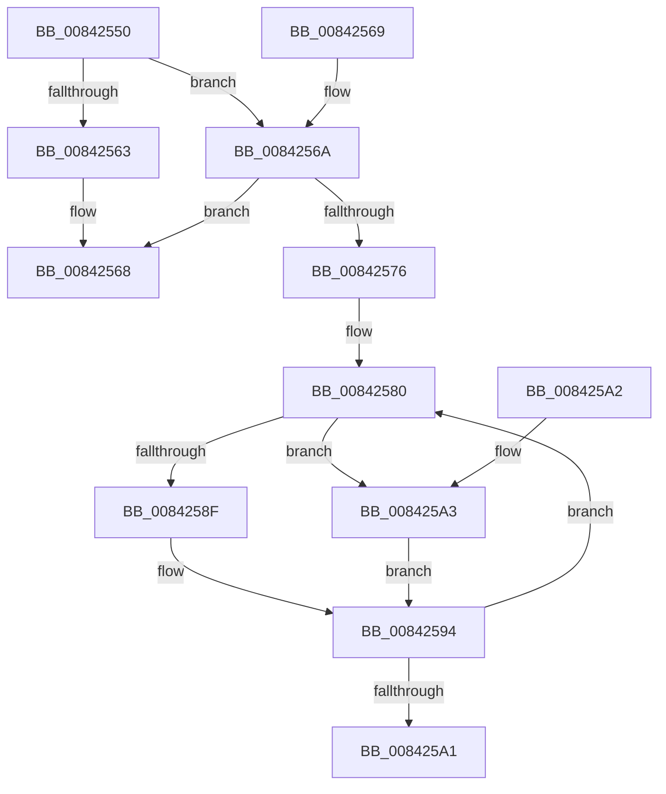

# CmpPopulateKcbStack

- RVA: `0x00842550`–`0x008425AE` (길이 `94` bytes)
- VA: `0x0000000140842550`
- 실행 섹션: `PAGE`
- PDB 이름 있음: `예`; PDB Function 태그: `아니요`
- unwind 정보 RVA: `0x000DB714`
- 디코드: `26`개 명령, `94/94` bytes 표시
- 미해석 바이트: `0` (있으면 어셈블리에 `.byte`로 보존)

> 이 문서는 커널 이미지의 기계어와 PDB 기호를 분석해 생성했습니다. 4번과 5번은 함수 원형과 자료형을 바이너리 사용 방식에서 추정한 C 해석이며 원본 소스 복구 결과는 아닙니다.

## 1. Dependencies

- 직접 호출 지점: **0**; 고유 호출 대상: **0**
- 직접 호출자로 확인된 함수: **4**
- RIP 상대 이미지 참조: **0**

### Outgoing calls
- 직접 디코드된 call 명령이 없습니다.

### Direct callers
- [CmpPartialPromoteSubkeys](../7F/CmpPartialPromoteSubkeys_function_007F4070.md) at `0x007F41DC`
- [CmpPromoteKey](CmpPromoteKey_function_00844388.md) at `0x0084445F`
- [CmpPromoteKey](CmpPromoteKey_function_00844388.md) at `0x0084448C`
- [CmpDoParseKey](../85/CmpDoParseKey_function_0085F750.md) at `0x0086073D`
- [CmpSubtreeEnumeratorAdvance](../94/CmpSubtreeEnumeratorAdvance_function_00946590.md) at `0x00946676`

### Static image references
- 디코드된 RIP-relative 메모리 참조가 없습니다.

## 2. Other-region calls and transfers

- 다른 실행 섹션으로 향하는 call: **0**
- 별도 외부 분기/꼬리 이동을 확인하지 못했습니다.

## 3. Assembly (complete function range)

```asm
00842550  0F B7 42 42                     movzx eax, word ptr [rdx + 0x42]
00842554  66 89 41 02                     mov word ptr [rcx + 2], ax
00842558  4C 0F BF 42 42                  movsx r8, word ptr [rdx + 0x42]
0084255D  66 45 85 C0                     test r8w, r8w
00842561  75 07                           jne 0x14084256a
00842563  4A 89 54 C1 08                  mov qword ptr [rcx + r8*8 + 8], rdx
00842568  C3                              ret
00842569  CC                              int3
0084256A  4C 8B 8A C0 00 00 00            mov r9, qword ptr [rdx + 0xc0]
00842571  4D 85 C9                        test r9, r9
00842574  74 F2                           je 0x140842568
00842576  66 66 0F 1F 84 00 00 00 00 00   nop word ptr [rax + rax]
00842580  49 8B 51 10                     mov rdx, qword ptr [r9 + 0x10]
00842584  4D 0F BF D0                     movsx r10, r8w
00842588  66 41 83 F8 02                  cmp r8w, 2
0084258D  7D 14                           jge 0x1408425a3
0084258F  4A 89 54 D1 08                  mov qword ptr [rcx + r10*8 + 8], rdx
00842594  4D 8B 49 18                     mov r9, qword ptr [r9 + 0x18]
00842598  66 41 FF C8                     dec r8w
0084259C  4D 85 C9                        test r9, r9
0084259F  75 DF                           jne 0x140842580
008425A1  C3                              ret
008425A2  CC                              int3
008425A3  48 8B 41 18                     mov rax, qword ptr [rcx + 0x18]
008425A7  4A 89 54 D0 F0                  mov qword ptr [rax + r10*8 - 0x10], rdx
008425AC  EB E6                           jmp 0x140842594
```

## 4. C-style interpretation (structured pseudocode)

```c
__int64 __fastcall CmpPopulateKcbStack(__int64 a1, __int64 a2)
{
    *(unsigned __int16 *)(a1 + 2) = (unsigned __int16)(*(unsigned __int16 *)(a2 + 66));
    if ((unsigned __int16)((__int16)(*(unsigned __int16 *)(a2 + 66))) != 0) goto loc_0084256A;
    *(unsigned __int64 *)(a1 + (__int16)(*(unsigned __int16 *)(a2 + 66)) * 8 + 8) = a2;
loc_00842568:
    return *(unsigned __int16 *)(a2 + 66);
loc_0084256A:
    if (*(unsigned __int64 *)(a2 + 192) == 0) goto loc_00842568;
loc_00842580:
    if (((unsigned __int16)((__int16)(*(unsigned __int16 *)(a2 + 66)))) >= 2) goto loc_008425A3;
    *(unsigned __int64 *)(a1 + (__int16)((unsigned __int16)((__int16)(*(unsigned __int16 *)(a2 + 66)))) * 8 + 8) = *(unsigned __int64 *)(*(unsigned __int64 *)(a2 + 192) + 16);
loc_00842594:
    a3 = (unsigned __int16)(((__int16)(*(unsigned __int16 *)(a2 + 66))) - 1);
    if (*(unsigned __int64 *)(*(unsigned __int64 *)(a2 + 192) + 24) != 0) goto loc_00842580;
    return *(unsigned __int16 *)(a2 + 66);
loc_008425A3:
    *(unsigned __int64 *)(*(unsigned __int64 *)(a1 + 24) + (__int16)((unsigned __int16)((__int16)(*(unsigned __int16 *)(a2 + 66)))) * 8 - 16) = *(unsigned __int64 *)(*(unsigned __int64 *)(a2 + 192) + 16);
    goto loc_00842594;
}
```

## 5. (Beta) C Style

```c
int64_t CmpPopulateKcbStack(void *Arg1, void *Arg2)
{
    uint8_t *arg1 = (uint8_t *)Arg1;
    uint8_t *arg2 = (uint8_t *)Arg2;

    *(uint16_t *)(arg1 + 0x2) = (uint16_t)(*(uint16_t *)(arg2 + 0x42));
    if ((uint16_t)((int16_t)(*(uint16_t *)(arg2 + 0x42))) != 0) goto loc_0084256A;
    *(void **)(arg1 + (int16_t)(*(uint16_t *)(arg2 + 0x42)) * 8 + 0x8) = Arg2;
loc_00842568:
    return *(uint16_t *)(arg2 + 0x42);
loc_0084256A:
    if (*(uint64_t *)(arg2 + 0xC0) == 0) goto loc_00842568;
loc_00842580:
    if (((uint16_t)((int16_t)(*(uint16_t *)(arg2 + 0x42)))) >= 2) goto loc_008425A3;
    *(uint64_t *)(arg1 + (int16_t)((uint16_t)((int16_t)(*(uint16_t *)(arg2 + 0x42)))) * 8 + 0x8) = *(uint64_t *)(*(uint64_t *)(arg2 + 0xC0) + 0x10);
loc_00842594:
    a3 = (uint16_t)(((int16_t)(*(uint16_t *)(arg2 + 0x42))) - 1);
    if (*(uint64_t *)(*(uint64_t *)(arg2 + 0xC0) + 0x18) != 0) goto loc_00842580;
    return *(uint16_t *)(arg2 + 0x42);
loc_008425A3:
    *(uint64_t *)(*(uint64_t *)(arg1 + 0x18) + (int16_t)((uint16_t)((int16_t)(*(uint16_t *)(arg2 + 0x42)))) * 8 - 0x10) = *(uint64_t *)(*(uint64_t *)(arg2 + 0xC0) + 0x10);
    goto loc_00842594;
}
```

### 관측된 메모리 오프셋

구조체 형식이 확인되지 않은 접근은 인자 기준의 오프셋으로만 기록했습니다.

| 기준 인자 | 오프셋 표현 | 폭 (bit) | 접근 |
|---|---:|---:|---|
| `Arg1` | `+ 0x2` | `16` | `W` |
| `Arg1` | `+ 0x8 + r10*8` | `64` | `W` |
| `Arg1` | `+ 0x8 + r8*8` | `64` | `W` |
| `Arg1` | `+ 0x18` | `64` | `R` |
| `Arg2` | `+ 0x42` | `16` | `R` |
| `Arg2` | `+ 0xC0` | `64` | `R` |

## 6. Execution-region graph

[열기: 2D/3D 그래프와 함수 탐색 컨트롤 패널](../../../control-panel.html?section=page&rva=0x00842550&view=graph)

- 2D 그래프는 위에서 아래로 흐르고, 3D 그래프는 빈 공간을 드래그해 회전합니다. Shift+드래그는 이동, 휠은 확대·축소, 함수 노드 선택은 대상 보고서 이동입니다.

### Static fallback


