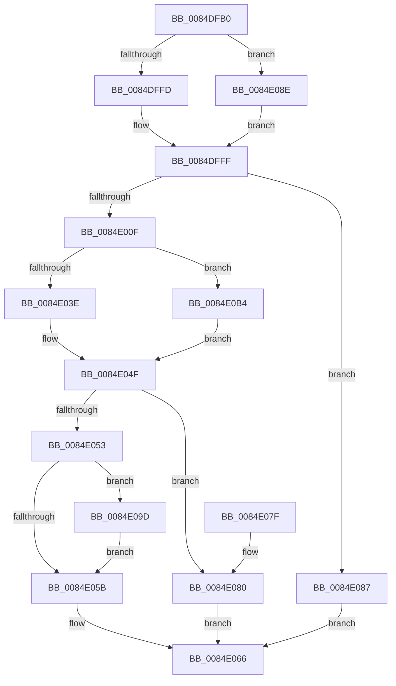

# CmpPopulateKeyNodeInformation

- RVA: `0x0084DFB0`–`0x0084E0CA` (길이 `282` bytes)
- VA: `0x000000014084DFB0`
- 실행 섹션: `PAGE`
- PDB 이름 있음: `예`; PDB Function 태그: `아니요`
- unwind 정보 RVA: `0x00069B64`
- 디코드: `88`개 명령, `282/282` bytes 표시
- 미해석 바이트: `0` (있으면 어셈블리에 `.byte`로 보존)

> 이 문서는 커널 이미지의 기계어와 PDB 기호를 분석해 생성했습니다. 4번과 5번은 함수 원형과 자료형을 바이너리 사용 방식에서 추정한 C 해석이며 원본 소스 복구 결과는 아닙니다.

## 1. Dependencies

- 직접 호출 지점: **3**; 고유 호출 대상: **2**
- 직접 호출자로 확인된 함수: **1**
- RIP 상대 이미지 참조: **0**

### Outgoing calls
- `0x0084E04A` → [CmpCopyCompressedName](CmpCopyCompressedName_function_0084E0D0.md) (function, `0x0084E0D0`)
- `0x0084E0AD` → [memcpy](../../text/6C/memcpy_function_006C6840.md) (function, `0x006C6840`)
- `0x0084E0C3` → [memcpy](../../text/6C/memcpy_function_006C6840.md) (function, `0x006C6840`)

### Direct callers
- [CmpQueryKeyDataFromKeyNodeStack](../../text/46/CmpQueryKeyDataFromKeyNodeStack_function_0046AC40.md) at `0x0046AF69`

### Static image references
- 디코드된 RIP-relative 메모리 참조가 없습니다.

## 2. Other-region calls and transfers

- 다른 실행 섹션으로 향하는 call: **2**
  - `0x0084E0AD` → [memcpy](../../text/6C/memcpy_function_006C6840.md) (`PAGE` → `.text`)
  - `0x0084E0C3` → [memcpy](../../text/6C/memcpy_function_006C6840.md) (`PAGE` → `.text`)
- 별도 외부 분기/꼬리 이동을 확인하지 못했습니다.

## 3. Assembly (complete function range)

```asm
0084DFB0  48 89 5C 24 08                  mov qword ptr [rsp + 8], rbx
0084DFB5  48 89 6C 24 10                  mov qword ptr [rsp + 0x10], rbp
0084DFBA  48 89 74 24 18                  mov qword ptr [rsp + 0x18], rsi
0084DFBF  57                              push rdi
0084DFC0  41 56                           push r14
0084DFC2  41 57                           push r15
0084DFC4  48 83 EC 20                     sub rsp, 0x20
0084DFC8  4C 8B 74 24 60                  mov r14, qword ptr [rsp + 0x60]
0084DFCD  41 8B E9                        mov ebp, r9d
0084DFD0  4C 8B CA                        mov r9, rdx
0084DFD3  4D 8B F8                        mov r15, r8
0084DFD6  48 8B D1                        mov rdx, rcx
0084DFD9  45 0F B7 59 48                  movzx r11d, word ptr [r9 + 0x48]
0084DFDE  41 0F B7 C3                     movzx eax, r11w
0084DFE2  66 03 C0                        add ax, ax
0084DFE5  41 F6 41 02 20                  test byte ptr [r9 + 2], 0x20
0084DFEA  66 41 0F 44 C3                  cmove ax, r11w
0084DFEF  0F B7 C8                        movzx ecx, ax
0084DFF2  8D 59 18                        lea ebx, [rcx + 0x18]
0084DFF5  85 ED                           test ebp, ebp
0084DFF7  0F 85 91 00 00 00               jne 0x14084e08e
0084DFFD  8B F3                           mov esi, ebx
0084DFFF  48 8B 44 24 70                  mov rax, qword ptr [rsp + 0x70]
0084E004  8B 7C 24 68                     mov edi, dword ptr [rsp + 0x68]
0084E008  89 18                           mov dword ptr [rax], ebx
0084E00A  83 FF 18                        cmp edi, 0x18
0084E00D  72 78                           jb 0x14084e087
0084E00F  48 8B 02                        mov rax, qword ptr [rdx]
0084E012  4D 8D 51 4C                     lea r10, [r9 + 0x4c]
0084E016  49 89 06                        mov qword ptr [r14], rax
0084E019  8B 42 08                        mov eax, dword ptr [rdx + 8]
0084E01C  8D 57 E8                        lea edx, [rdi - 0x18]
0084E01F  41 89 46 08                     mov dword ptr [r14 + 8], eax
0084E023  83 C8 FF                        or eax, 0xffffffff
0084E026  85 ED                           test ebp, ebp
0084E028  41 89 6E 10                     mov dword ptr [r14 + 0x10], ebp
0084E02C  41 89 4E 14                     mov dword ptr [r14 + 0x14], ecx
0084E030  0F 45 C6                        cmovne eax, esi
0084E033  41 89 46 0C                     mov dword ptr [r14 + 0xc], eax
0084E037  41 F6 41 02 20                  test byte ptr [r9 + 2], 0x20
0084E03C  74 76                           je 0x14084e0b4
0084E03E  45 0F B7 49 48                  movzx r9d, word ptr [r9 + 0x48]
0084E043  49 8D 4E 18                     lea rcx, [r14 + 0x18]
0084E047  4D 8B C2                        mov r8, r10
0084E04A  E8 81 00 00 00                  call 0x14084e0d0
0084E04F  3B FE                           cmp edi, esi
0084E051  72 2D                           jb 0x14084e080
0084E053  8B C7                           mov eax, edi
0084E055  2B C6                           sub eax, esi
0084E057  85 ED                           test ebp, ebp
0084E059  75 42                           jne 0x14084e09d
0084E05B  3B FB                           cmp edi, ebx
0084E05D  B8 05 00 00 80                  mov eax, 0x80000005
0084E062  1B C9                           sbb ecx, ecx
0084E064  23 C1                           and eax, ecx
0084E066  48 8B 5C 24 40                  mov rbx, qword ptr [rsp + 0x40]
0084E06B  48 8B 6C 24 48                  mov rbp, qword ptr [rsp + 0x48]
0084E070  48 8B 74 24 50                  mov rsi, qword ptr [rsp + 0x50]
0084E075  48 83 C4 20                     add rsp, 0x20
0084E079  41 5F                           pop r15
0084E07B  41 5E                           pop r14
0084E07D  5F                              pop rdi
0084E07E  C3                              ret
0084E07F  CC                              int3
0084E080  B8 05 00 00 80                  mov eax, 0x80000005
0084E085  EB DF                           jmp 0x14084e066
0084E087  B8 23 00 00 C0                  mov eax, 0xc0000023
0084E08C  EB D8                           jmp 0x14084e066
0084E08E  83 C3 03                        add ebx, 3
0084E091  83 E3 FC                        and ebx, 0xfffffffc
0084E094  8B F3                           mov esi, ebx
0084E096  03 DD                           add ebx, ebp
0084E098  E9 62 FF FF FF                  jmp 0x14084dfff
0084E09D  8B CE                           mov ecx, esi
0084E09F  49 8B D7                        mov rdx, r15
0084E0A2  49 03 CE                        add rcx, r14
0084E0A5  3B C5                           cmp eax, ebp
0084E0A7  0F 47 C5                        cmova eax, ebp
0084E0AA  44 8B C0                        mov r8d, eax
0084E0AD  E8 8E 87 E7 FF                  call 0x1406c6840
0084E0B2  EB A7                           jmp 0x14084e05b
0084E0B4  3B D1                           cmp edx, ecx
0084E0B6  0F 46 CA                        cmovbe ecx, edx
0084E0B9  49 8B D2                        mov rdx, r10
0084E0BC  44 8B C1                        mov r8d, ecx
0084E0BF  49 8D 4E 18                     lea rcx, [r14 + 0x18]
0084E0C3  E8 78 87 E7 FF                  call 0x1406c6840
0084E0C8  EB 85                           jmp 0x14084e04f
```

## 4. C-style interpretation (structured pseudocode)

```c
__int64 __fastcall CmpPopulateKeyNodeInformation(__int64 a1, __int64 a2, __int64 a3, int a4, __int64 a5, unsigned int a6, __int64 a7)
{
    __int64 result;
    __int64 v_rbx;
    __int64 v_rsp;
    unsigned __int64 v_stack_p10;
    unsigned __int64 v_stack_p18;
    unsigned __int64 v_stack_p8;

    v_stack_p8 = v_rbx;
    v_stack_p10 = v_rbp;
    v_stack_p18 = v_rsi;
    v_rsp = (v_rsp) - (32);
    result = (unsigned __int16)(((unsigned __int16)(*(unsigned __int16 *)(a2 + 72))) + ((unsigned __int16)((unsigned __int16)(*(unsigned __int16 *)(a2 + 72)))));
    if (((*(unsigned __int8 *)(a2 + 2)) & (32)) == 0) { result = (unsigned __int16)(*(unsigned __int16 *)(a2 + 72)); }
    if ((unsigned int)((unsigned int)(a4)) != 0) goto loc_0084E08E;
loc_0084DFFF:
    *(unsigned int *)(a7) = (unsigned int)((unsigned __int16)(result) + 24);
    if (((unsigned int)((unsigned int)(a6))) < 24) goto loc_0084E087;
    *(unsigned __int64 *)(a5) = *(unsigned __int64 *)(a1);
    *(unsigned int *)(a5 + 8) = (unsigned int)((unsigned int)(*(unsigned int *)(a1 + 8)));
    result = (unsigned int)(((unsigned int)(*(unsigned int *)(a1 + 8))) | (0xFFFFFFFFULL));
    *(unsigned int *)(a5 + 16) = (unsigned int)((unsigned int)(a4));
    *(unsigned int *)(a5 + 20) = (unsigned int)((unsigned __int16)(result));
    if ((unsigned int)((unsigned int)(a4)) != 0) { result = (unsigned int)((unsigned int)((unsigned int)((unsigned __int16)(result) + 24))); }
    *(unsigned int *)(a5 + 12) = (unsigned int)(result);
    if (((*(unsigned __int8 *)(a2 + 2)) & (32)) == 0) goto loc_0084E0B4;
    result = CmpCopyCompressedName(a5 + 24, (unsigned int)(a6) - 24, a2 + 76, *(unsigned __int16 *)(a2 + 72));
loc_0084E04F:
    if (((unsigned int)((unsigned int)(a6))) < ((unsigned int)((unsigned int)((unsigned int)((unsigned __int16)(result) + 24))))) goto loc_0084E080;
    result = (unsigned int)(((unsigned int)((unsigned int)((unsigned int)(a6)))) - ((unsigned int)((unsigned int)((unsigned int)((unsigned __int16)(result) + 24)))));
    if ((unsigned int)((unsigned int)(a4)) != 0) goto loc_0084E09D;
loc_0084E05B:
    result = (unsigned int)(((unsigned int)(0x80000005ULL)) & ((unsigned int)(a5 + 24)));
loc_0084E066:
    v_rsp = (v_rsp) + (32);
    return result;
loc_0084E080:
    goto loc_0084E066;
loc_0084E087:
    goto loc_0084E066;
loc_0084E08E:
    v_rbx = (unsigned int)((v_stack_p8) + (3));
    v_rbx = (unsigned int)((v_rbx) & (0xFFFFFFFCULL));
    v_rbx = (unsigned int)((v_rbx) + ((unsigned int)(v_stack_p10)));
    goto loc_0084DFFF;
loc_0084E09D:
    a1 = ((unsigned int)((unsigned int)((unsigned int)((unsigned int)(v_rbx))))) + (a5);
    result = (unsigned int)(0xC0000023ULL);
    if (((unsigned int)((unsigned int)(0xC0000023ULL))) > ((unsigned int)(v_stack_p10))) { result = (unsigned int)(v_stack_p10); }
    result = memcpy(a1, a3, (unsigned int)((unsigned int)(result)), *(unsigned __int16 *)(a2 + 72));
    goto loc_0084E05B;
loc_0084E0B4:
    if (((unsigned int)(a3)) <= ((unsigned int)(a1))) { a1 = (unsigned int)(a3); }
    result = memcpy(a5 + 24, a2 + 76, (unsigned int)((unsigned int)(a1)), *(unsigned __int16 *)(a2 + 72));
    goto loc_0084E04F;
}
```

## 5. (Beta) C Style

```c
int64_t CmpPopulateKeyNodeInformation(void *Arg1, void *Arg2, int64_t Arg3, int32_t Arg4, void *Arg5, uint32_t Arg6, void *Arg7)
{
    uint8_t *arg1 = (uint8_t *)Arg1;
    uint8_t *arg2 = (uint8_t *)Arg2;
    uint8_t *arg5 = (uint8_t *)Arg5;
    uint8_t *arg7 = (uint8_t *)Arg7;

    int64_t result;
    int64_t local_rbx;
    int64_t local_rsp;
    uint64_t v_stack_p10;
    uint64_t v_stack_p18;
    uint64_t v_stack_p8;

    v_stack_p8 = local_rbx;
    v_stack_p10 = local_rbp;
    v_stack_p18 = local_rsi;
    local_rsp = (local_rsp) - (32);
    result = (uint16_t)(((uint16_t)(*(uint16_t *)(arg2 + 0x48))) + ((uint16_t)((uint16_t)(*(uint16_t *)(arg2 + 0x48)))));
    if (((*(uint8_t *)(arg2 + 0x2)) & (32)) == 0) { result = (uint16_t)(*(uint16_t *)(arg2 + 0x48)); }
    if ((uint32_t)((uint32_t)(Arg4)) != 0) goto loc_0084E08E;
loc_0084DFFF:
    *(uint32_t *)(arg7) = (uint32_t)((uint16_t)(result) + 24);
    if (((uint32_t)((uint32_t)(Arg6))) < 24) goto loc_0084E087;
    *(uint64_t *)(arg5) = *(uint64_t *)(arg1);
    *(uint32_t *)(arg5 + 0x8) = (uint32_t)((uint32_t)(*(uint32_t *)(arg1 + 0x8)));
    result = (uint32_t)(((uint32_t)(*(uint32_t *)(arg1 + 0x8))) | (0xFFFFFFFFULL));
    *(uint32_t *)(arg5 + 0x10) = (uint32_t)((uint32_t)(Arg4));
    *(uint32_t *)(arg5 + 0x14) = (uint32_t)((uint16_t)(result));
    if ((uint32_t)((uint32_t)(Arg4)) != 0) { result = (uint32_t)((uint32_t)((uint32_t)((uint16_t)(result) + 24))); }
    *(uint32_t *)(arg5 + 0xC) = (uint32_t)(result);
    if (((*(uint8_t *)(arg2 + 0x2)) & (32)) == 0) goto loc_0084E0B4;
    result = CmpCopyCompressedName(Arg5 + 24, (uint32_t)(Arg6) - 24, Arg2 + 76, *(uint16_t *)(arg2 + 0x48));
loc_0084E04F:
    if (((uint32_t)((uint32_t)(Arg6))) < ((uint32_t)((uint32_t)((uint32_t)((uint16_t)(result) + 24))))) goto loc_0084E080;
    result = (uint32_t)(((uint32_t)((uint32_t)((uint32_t)(Arg6)))) - ((uint32_t)((uint32_t)((uint32_t)((uint16_t)(result) + 24)))));
    if ((uint32_t)((uint32_t)(Arg4)) != 0) goto loc_0084E09D;
loc_0084E05B:
    result = (uint32_t)(((uint32_t)(0x80000005ULL)) & ((uint32_t)(Arg5 + 24)));
loc_0084E066:
    local_rsp = (local_rsp) + (32);
    return result;
loc_0084E080:
    goto loc_0084E066;
loc_0084E087:
    goto loc_0084E066;
loc_0084E08E:
    local_rbx = (uint32_t)((v_stack_p8) + (3));
    local_rbx = (uint32_t)((local_rbx) & (0xFFFFFFFCULL));
    local_rbx = (uint32_t)((local_rbx) + ((uint32_t)(v_stack_p10)));
    goto loc_0084DFFF;
loc_0084E09D:
    Arg1 = ((uint32_t)((uint32_t)((uint32_t)((uint32_t)(local_rbx))))) + (Arg5);
    result = (uint32_t)(0xC0000023ULL);
    if (((uint32_t)((uint32_t)(0xC0000023ULL))) > ((uint32_t)(v_stack_p10))) { result = (uint32_t)(v_stack_p10); }
    result = memcpy(Arg1, Arg3, (uint32_t)((uint32_t)(result)), *(uint16_t *)(arg2 + 0x48));
    goto loc_0084E05B;
loc_0084E0B4:
    if (((uint32_t)(Arg3)) <= ((uint32_t)(Arg1))) { Arg1 = (uint32_t)(Arg3); }
    result = memcpy(Arg5 + 24, Arg2 + 76, (uint32_t)((uint32_t)(Arg1)), *(uint16_t *)(arg2 + 0x48));
    goto loc_0084E04F;
}
```

### 관측된 메모리 오프셋

구조체 형식이 확인되지 않은 접근은 인자 기준의 오프셋으로만 기록했습니다.

| 기준 인자 | 오프셋 표현 | 폭 (bit) | 접근 |
|---|---:|---:|---|
| `Arg1` | `+ 0x0` | `64` | `R` |
| `Arg1` | `+ 0x8` | `32` | `R` |
| `Arg2` | `+ 0x2` | `8` | `R` |
| `Arg2` | `+ 0x48` | `16` | `R` |
| `Arg2` | `+ 0x4C` | `64` | `R` |
| `Arg5` | `+ 0x0` | `64` | `W` |
| `Arg5` | `+ 0x8` | `32` | `W` |
| `Arg5` | `+ 0xC` | `32` | `W` |
| `Arg5` | `+ 0x10` | `32` | `W` |
| `Arg5` | `+ 0x14` | `32` | `W` |
| `Arg5` | `+ 0x18` | `64` | `R` |
| `Arg7` | `+ 0x0` | `32` | `W` |

## 6. Execution-region graph

[열기: 2D/3D 그래프와 함수 탐색 컨트롤 패널](../../../control-panel.html?section=page&rva=0x0084DFB0&view=graph)

- 2D 그래프는 위에서 아래로 흐르고, 3D 그래프는 빈 공간을 드래그해 회전합니다. Shift+드래그는 이동, 휠은 확대·축소, 함수 노드 선택은 대상 보고서 이동입니다.

### Static fallback


