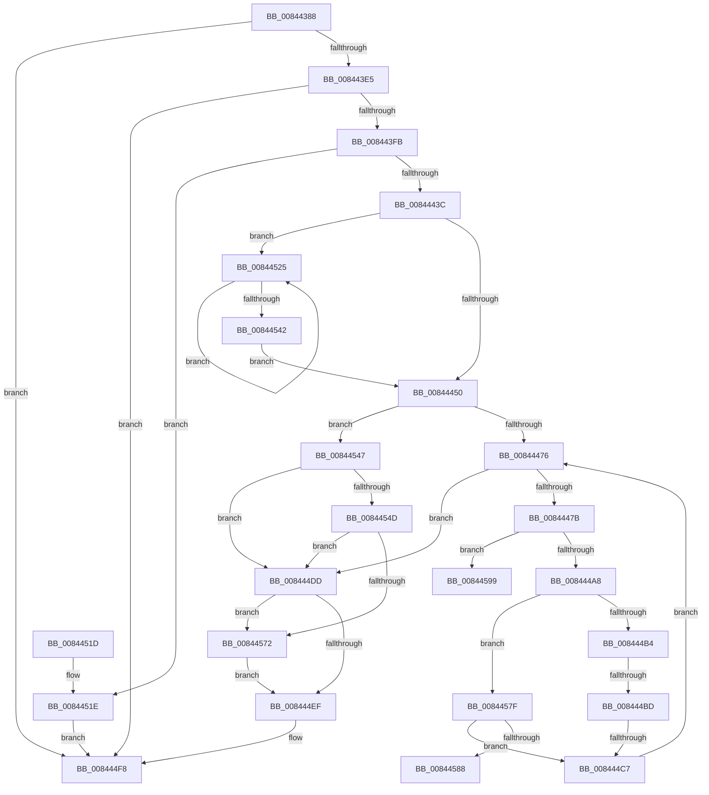

# CmpPromoteKey

- RVA: `0x00844388`–`0x008445A3` (길이 `539` bytes)
- VA: `0x0000000140844388`
- 실행 섹션: `PAGE`
- PDB 이름 있음: `예`; PDB Function 태그: `예`
- unwind 정보 RVA: `0x0006912C`
- 디코드: `146`개 명령, `539/539` bytes 표시
- 미해석 바이트: `0` (있으면 어셈블리에 `.byte`로 보존)

> 이 문서는 커널 이미지의 기계어와 PDB 기호를 분석해 생성했습니다. 4번과 5번은 함수 원형과 자료형을 바이너리 사용 방식에서 추정한 C 해석이며 원본 소스 복구 결과는 아닙니다.

## 1. Dependencies

- 직접 호출 지점: **18**; 고유 호출 대상: **12**
- 직접 호출자로 확인된 함수: **8**
- RIP 상대 이미지 참조: **0**

### Outgoing calls
- `0x008443C9` → [CmpGetKcbAtLayerHeight](../94/CmpGetKcbAtLayerHeight_function_00949210.md) (function, `0x00949210`)
- `0x008443D6` → [CmpStartKcbStack](../94/CmpStartKcbStack_function_009451F0.md) (function, `0x009451F0`)
- `0x008443EC` → [CmpStartKcbStack](../94/CmpStartKcbStack_function_009451F0.md) (function, `0x009451F0`)
- `0x0084442A` → [CmpAllocatePool](../../text/3C/CmpAllocatePool_function_003CD504.md) (function, `0x003CD504`)
- `0x0084445F` → [CmpPopulateKcbStack](CmpPopulateKcbStack_function_00842550.md) (function, `0x00842550`)
- `0x00844468` → [CmpLockKcbStackTopExclusiveRestShared](CmpLockKcbStackTopExclusiveRestShared_function_00846B04.md) (function, `0x00846B04`)
- `0x0084448C` → [CmpPopulateKcbStack](CmpPopulateKcbStack_function_00842550.md) (function, `0x00842550`)
- `0x00844491` → [CmpLockKcbStackTopExclusiveRestShared](CmpLockKcbStackTopExclusiveRestShared_function_00846B04.md) (function, `0x00846B04`)
- `0x0084449B` → [CmpIsKeyStackDeleted](CmpIsKeyStackDeleted_function_008426E0.md) (function, `0x008426E0`)
- `0x008444CA` → [CmpUnlockKcbStack](CmpUnlockKcbStack_function_00848460.md) (function, `0x00848460`)
- `0x008444F3` → [CmSiFreeMemory](../../text/47/CmSiFreeMemory_function_00475D80.md) (function, `0x00475D80`)
- `0x008444FC` → [CmpCleanupKcbStack](../94/CmpCleanupKcbStack_function_009470A0.md) (function, `0x009470A0`)
- `0x00844505` → [CmpCleanupKcbStack](../94/CmpCleanupKcbStack_function_009470A0.md) (function, `0x009470A0`)
- `0x00844551` → [HvLockHiveFlusherShared](HvLockHiveFlusherShared_function_0084F95C.md) (function, `0x0084F95C`)
- `0x0084455A` → [CmpFullPromoteHiveRootFromKcbStack](../7F/CmpFullPromoteHiveRootFromKcbStack_function_007F3F90.md) (function, `0x007F3F90`)
- `0x00844565` → [HvUnlockHiveFlusherShared](HvUnlockHiveFlusherShared_function_00848738.md) (function, `0x00848738`)
- `0x00844575` → [CmpUnlockKcbStack](CmpUnlockKcbStack_function_00848460.md) (function, `0x00848460`)
- `0x0084458C` → [HvLockHiveFlusherShared](HvLockHiveFlusherShared_function_0084F95C.md) (function, `0x0084F95C`)

### Direct callers
- [sub_006ED542](../../text/6E/Unknown_function_006ED542.md) at `0x006ED585`
- [CmRenameKey](../7E/CmRenameKey_function_007E8F48.md) at `0x007E9910`
- [CmSetLastWriteTimeKey](CmSetLastWriteTimeKey_function_00843368.md) at `0x0084354E`
- [CmSetValueKey](CmSetValueKey_function_008457C0.md) at `0x008462DC`
- [CmDeleteValueKey](CmDeleteValueKey_function_008476E8.md) at `0x00847DE0`
- [CmpSetKeySecurity](../94/CmpSetKeySecurity_function_0094A124.md) at `0x0094A623`
- [CmSetKeyFlags](../9A/CmSetKeyFlags_function_009AEEA4.md) at `0x009AF1AB`
- [sub_00B16F66](../B1/Unknown_function_00B16F66.md) at `0x00B17199`

### Static image references
- 디코드된 RIP-relative 메모리 참조가 없습니다.

## 2. Other-region calls and transfers

- 다른 실행 섹션으로 향하는 call: **2**
  - `0x0084442A` → [CmpAllocatePool](../../text/3C/CmpAllocatePool_function_003CD504.md) (`PAGE` → `.text`)
  - `0x008444F3` → [CmSiFreeMemory](../../text/47/CmSiFreeMemory_function_00475D80.md) (`PAGE` → `.text`)
- call이 아닌 외부 분기/꼬리 이동: **4**
  - `0x008444B7` → [sub_00B16026](../B1/Unknown_function_00B16026.md) (`tail-transfer`)
  - `0x008444C1` → [sub_00B16026](../B1/Unknown_function_00B16026.md) (`tail-transfer`)
  - `0x00844594` → [sub_00B16026 + 0xD](../B1/Unknown_function_00B16026.md) (`tail-transfer`)
  - `0x0084459E` → [sub_00B16026 + 0x30](../B1/Unknown_function_00B16026.md) (`tail-transfer`)

## 3. Assembly (complete function range)

```asm
00844388  44 88 44 24 18                  mov byte ptr [rsp + 0x18], r8b
0084438D  88 54 24 10                     mov byte ptr [rsp + 0x10], dl
00844391  55                              push rbp
00844392  53                              push rbx
00844393  56                              push rsi
00844394  57                              push rdi
00844395  41 54                           push r12
00844397  41 55                           push r13
00844399  41 56                           push r14
0084439B  41 57                           push r15
0084439D  48 8B EC                        mov rbp, rsp
008443A0  48 83 EC 68                     sub rsp, 0x68
008443A4  0F B7 79 02                     movzx edi, word ptr [rcx + 2]
008443A8  0F 57 C0                        xorps xmm0, xmm0
008443AB  83 C8 FF                        or eax, 0xffffffff
008443AE  0F B7 D7                        movzx edx, di
008443B1  0F 11 45 B8                     movups xmmword ptr [rbp - 0x48], xmm0
008443B5  66 89 45 BA                     mov word ptr [rbp - 0x46], ax
008443B9  0F 11 45 D8                     movups xmmword ptr [rbp - 0x28], xmm0
008443BD  66 89 45 DA                     mov word ptr [rbp - 0x26], ax
008443C1  0F 11 45 C8                     movups xmmword ptr [rbp - 0x38], xmm0
008443C5  0F 11 45 E8                     movups xmmword ptr [rbp - 0x18], xmm0
008443C9  E8 42 4E 10 00                  call 0x140949210
008443CE  48 8D 4D B8                     lea rcx, [rbp - 0x48]
008443D2  48 89 45 48                     mov qword ptr [rbp + 0x48], rax
008443D6  E8 15 0E 10 00                  call 0x1409451f0
008443DB  8B D8                           mov ebx, eax
008443DD  85 C0                           test eax, eax
008443DF  0F 88 13 01 00 00               js 0x1408444f8
008443E5  0F B7 D7                        movzx edx, di
008443E8  48 8D 4D D8                     lea rcx, [rbp - 0x28]
008443EC  E8 FF 0D 10 00                  call 0x1409451f0
008443F1  8B D8                           mov ebx, eax
008443F3  85 C0                           test eax, eax
008443F5  0F 88 FD 00 00 00               js 0x1408444f8
008443FB  48 8B 5D 48                     mov rbx, qword ptr [rbp + 0x48]
008443FF  41 BC FF 03 00 00               mov r12d, 0x3ff
00844405  BF 01 00 00 00                  mov edi, 1
0084440A  B9 00 01 00 00                  mov ecx, 0x100
0084440F  41 B8 43 4D 36 37               mov r8d, 0x37364d43
00844415  44 8B 7B 08                     mov r15d, dword ptr [rbx + 8]
00844419  41 C1 EF 15                     shr r15d, 0x15
0084441D  45 23 FC                        and r15d, r12d
00844420  44 03 FF                        add r15d, edi
00844423  41 8B D7                        mov edx, r15d
00844426  48 C1 E2 03                     shl rdx, 3
0084442A  E8 D5 90 B8 FF                  call 0x1403cd504
0084442F  48 89 45 60                     mov qword ptr [rbp + 0x60], rax
00844433  48 85 C0                        test rax, rax
00844436  0F 84 E2 00 00 00               je 0x14084451e
0084443C  0F BA A3 B8 00 00 00 12         bt dword ptr [rbx + 0xb8], 0x12
00844444  45 8B F7                        mov r14d, r15d
00844447  48 8B F3                        mov rsi, rbx
0084444A  0F 83 D5 00 00 00               jae 0x140844525
00844450  48 8B D6                        mov rdx, rsi
00844453  48 8D 4D D8                     lea rcx, [rbp - 0x28]
00844457  4C 8D 65 B8                     lea r12, [rbp - 0x48]
0084445B  4C 8D 6D D8                     lea r13, [rbp - 0x28]
0084445F  E8 EC E0 FF FF                  call 0x140842550
00844464  48 8D 4D D8                     lea rcx, [rbp - 0x28]
00844468  E8 97 26 00 00                  call 0x140846b04
0084446D  48 3B F3                        cmp rsi, rbx
00844470  0F 84 D1 00 00 00               je 0x140844547
00844476  45 3B F7                        cmp r14d, r15d
00844479  73 62                           jae 0x1408444dd
0084447B  48 8B 4D 60                     mov rcx, qword ptr [rbp + 0x60]
0084447F  41 8B C6                        mov eax, r14d
00844482  48 8B 34 C1                     mov rsi, qword ptr [rcx + rax*8]
00844486  49 8B CC                        mov rcx, r12
00844489  48 8B D6                        mov rdx, rsi
0084448C  E8 BF E0 FF FF                  call 0x140842550
00844491  E8 6E 26 00 00                  call 0x140846b04
00844496  33 D2                           xor edx, edx
00844498  49 8B CC                        mov rcx, r12
0084449B  E8 40 E2 FF FF                  call 0x1408426e0
008444A0  84 C0                           test al, al
008444A2  0F 85 F1 00 00 00               jne 0x140844599
008444A8  8B 46 28                        mov eax, dword ptr [rsi + 0x28]
008444AB  48 3B F3                        cmp rsi, rbx
008444AE  0F 85 CB 00 00 00               jne 0x14084457f
008444B4  83 F8 FF                        cmp eax, -1
008444B7  0F 84 69 1B 2D 00               je 0x140b16026
008444BD  80 7D 50 00                     cmp byte ptr [rbp + 0x50], 0
008444C1  0F 85 5F 1B 2D 00               jne 0x140b16026
008444C7  49 8B CD                        mov rcx, r13
008444CA  E8 91 3F 00 00                  call 0x140848460
008444CF  49 8B C4                        mov rax, r12
008444D2  44 03 F7                        add r14d, edi
008444D5  4D 8B E5                        mov r12, r13
008444D8  4C 8B E8                        mov r13, rax
008444DB  EB 99                           jmp 0x140844476
008444DD  33 DB                           xor ebx, ebx
008444DF  38 5D 58                        cmp byte ptr [rbp + 0x58], bl
008444E2  40 0F 94 C7                     sete dil
008444E6  40 84 FF                        test dil, dil
008444E9  0F 85 83 00 00 00               jne 0x140844572
008444EF  48 8B 4D 60                     mov rcx, qword ptr [rbp + 0x60]
008444F3  E8 88 18 C3 FF                  call 0x140475d80
008444F8  48 8D 4D B8                     lea rcx, [rbp - 0x48]
008444FC  E8 9F 2B 10 00                  call 0x1409470a0
00844501  48 8D 4D D8                     lea rcx, [rbp - 0x28]
00844505  E8 96 2B 10 00                  call 0x1409470a0
0084450A  8B C3                           mov eax, ebx
0084450C  48 83 C4 68                     add rsp, 0x68
00844510  41 5F                           pop r15
00844512  41 5E                           pop r14
00844514  41 5D                           pop r13
00844516  41 5C                           pop r12
00844518  5F                              pop rdi
00844519  5E                              pop rsi
0084451A  5B                              pop rbx
0084451B  5D                              pop rbp
0084451C  C3                              ret
0084451D  CC                              int3
0084451E  BB 9A 00 00 C0                  mov ebx, 0xc000009a
00844523  EB D3                           jmp 0x1408444f8
00844525  44 8B 76 08                     mov r14d, dword ptr [rsi + 8]
00844529  41 C1 EE 15                     shr r14d, 0x15
0084452D  45 23 F4                        and r14d, r12d
00844530  4A 89 34 F0                     mov qword ptr [rax + r14*8], rsi
00844534  48 8B 76 48                     mov rsi, qword ptr [rsi + 0x48]
00844538  0F BA A6 B8 00 00 00 12         bt dword ptr [rsi + 0xb8], 0x12
00844540  73 E3                           jae 0x140844525
00844542  E9 09 FF FF FF                  jmp 0x140844450
00844547  80 7D 50 00                     cmp byte ptr [rbp + 0x50], 0
0084454B  74 90                           je 0x1408444dd
0084454D  48 8B 4E 20                     mov rcx, qword ptr [rsi + 0x20]
00844551  E8 06 B4 00 00                  call 0x14084f95c
00844556  48 8D 4D D8                     lea rcx, [rbp - 0x28]
0084455A  E8 31 FA FA FF                  call 0x1407f3f90
0084455F  48 8B 4E 20                     mov rcx, qword ptr [rsi + 0x20]
00844563  8B D8                           mov ebx, eax
00844565  E8 CE 41 00 00                  call 0x140848738
0084456A  85 DB                           test ebx, ebx
0084456C  0F 89 6B FF FF FF               jns 0x1408444dd
00844572  49 8B CD                        mov rcx, r13
00844575  E8 E6 3E 00 00                  call 0x140848460
0084457A  E9 70 FF FF FF                  jmp 0x1408444ef
0084457F  83 F8 FF                        cmp eax, -1
00844582  0F 85 3F FF FF FF               jne 0x1408444c7
00844588  48 8B 4E 20                     mov rcx, qword ptr [rsi + 0x20]
0084458C  E8 CB B3 00 00                  call 0x14084f95c
00844591  45 33 C0                        xor r8d, r8d
00844594  E9 9A 1A 2D 00                  jmp 0x140b16033
00844599  BB 7C 01 00 C0                  mov ebx, 0xc000017c
0084459E  E9 B3 1A 2D 00                  jmp 0x140b16056
```

## 4. C-style interpretation (structured pseudocode)

```c
__int64 __fastcall CmpPromoteKey(__int64 a1, unsigned __int8 a2, unsigned __int8 a3)
{
    __int64 result;
    __int64 v_r14;
    __int64 v_r15;
    __int64 v_rbx;
    __int64 v_rdi;
    __int64 v_rsp;
    unsigned __int64 v_stack_m58;
    unsigned __int16 v_stack_m66;
    unsigned __int64 v_stack_m68;
    unsigned __int64 v_stack_m78;
    unsigned __int16 v_stack_m86;
    unsigned __int64 v_stack_m88;
    unsigned __int8 v_stack_p10;
    unsigned __int8 v_stack_p18;
    unsigned __int64 v_stack_p20;
    unsigned __int64 v_stack_p8;

    v_stack_p18 = a3;
    v_stack_p10 = a2;
    v_rsp = (v_rsp) - (104);
    result = (unsigned int)((result) | (0xFFFFFFFFULL));
    v_stack_m88 = v_xmm0;
    v_stack_m86 = (unsigned __int16)(result);
    v_stack_m68 = v_xmm0;
    v_stack_m66 = (unsigned __int16)(result);
    v_stack_m78 = v_xmm0;
    v_stack_m58 = v_xmm0;
    result = CmpGetKcbAtLayerHeight(a1, (unsigned __int16)(*(unsigned __int16 *)(a1 + 2)), a3, a4);
    v_stack_p8 = result;
    result = CmpStartKcbStack(v_stack_m88, (unsigned __int16)(*(unsigned __int16 *)(a1 + 2)), a3, a4);
    if (sign_flag) goto loc_008444F8;
    result = CmpStartKcbStack(v_stack_m68, (unsigned __int16)(*(unsigned __int16 *)(a1 + 2)), a3, a4);
    if (sign_flag) goto loc_008444F8;
    v_r15 = (unsigned int)(((unsigned int)(*(unsigned int *)(v_stack_p8 + 8))) >> (21));
    v_r15 = (unsigned int)((v_r15) & ((unsigned int)((unsigned int)(0x3FFULL))));
    v_r15 = (unsigned int)((v_r15) + (1));
    a2 = ((unsigned int)((unsigned int)(v_r15))) << (3);
    result = CmpAllocatePool(256, a2, (unsigned int)(0x37364D43ULL), a4);
    v_stack_p20 = result;
    if (result == 0) goto loc_0084451E;
    if (condition_is_above_or_equal) goto loc_00844525;
loc_00844450:
    result = CmpPopulateKcbStack(v_stack_m68, v_stack_p8, (unsigned int)(0x37364D43ULL), a4);
    result = CmpLockKcbStackTopExclusiveRestShared(v_stack_m68, v_stack_p8, (unsigned int)(0x37364D43ULL), a4);
    if (v_stack_p8 == v_stack_p8) goto loc_00844547;
loc_00844476:
    if (((unsigned int)((unsigned int)((unsigned int)(v_r15)))) >= ((unsigned int)(v_r15))) goto loc_008444DD;
    result = CmpPopulateKcbStack(v_stack_m88, *(unsigned __int64 *)(v_stack_p20 + (unsigned int)((unsigned int)((unsigned int)((unsigned int)(v_r15)))) * 8), (unsigned int)(0x37364D43ULL), a4);
    result = CmpLockKcbStackTopExclusiveRestShared(v_stack_m88, *(unsigned __int64 *)(v_stack_p20 + (unsigned int)((unsigned int)((unsigned int)((unsigned int)(v_r15)))) * 8), (unsigned int)(0x37364D43ULL), a4);
    a2 = 0;
    result = CmpIsKeyStackDeleted(v_stack_m88, a2, (unsigned int)(0x37364D43ULL), a4);
    if ((unsigned __int8)(result) != 0) goto loc_00844599;
    if ((*(unsigned __int64 *)(v_stack_p20 + (unsigned int)((unsigned int)((unsigned int)((unsigned int)(v_r15)))) * 8)) != v_stack_p8) goto loc_0084457F;
loc_008444C7:
    result = CmpUnlockKcbStack(v_stack_m68, a2, (unsigned int)(0x37364D43ULL), a4);
    v_r14 = (unsigned int)(((unsigned int)((unsigned int)(v_r15))) + (1));
    goto loc_00844476;
loc_008444DD:
    v_rbx = 0;
    v_rdi = (v_stack_p18 == 0) ? 1 : 0;
    if ((unsigned __int8)(v_rdi) != 0) goto loc_00844572;
loc_008444EF:
    result = CmSiFreeMemory(v_stack_p20, a2, (unsigned int)(0x37364D43ULL), a4);
loc_008444F8:
    result = CmpCleanupKcbStack(v_stack_m88, a2, (unsigned int)(0x37364D43ULL), a4);
    result = CmpCleanupKcbStack(v_stack_m68, a2, (unsigned int)(0x37364D43ULL), a4);
    v_rsp = (v_rsp) + (104);
    return 0;
loc_0084451E:
    goto loc_008444F8;
loc_00844525:
    v_r14 = (unsigned int)(((unsigned int)(*(unsigned int *)(*(unsigned __int64 *)(v_stack_p20 + (unsigned int)((unsigned int)((unsigned int)((unsigned int)(v_r15)))) * 8) + 8))) >> (21));
    v_r14 = (unsigned int)((v_r14) & ((unsigned int)(v_stack_m68)));
    *(unsigned __int64 *)(0 + v_r14 * 8) = *(unsigned __int64 *)(v_stack_p20 + (unsigned int)((unsigned int)((unsigned int)((unsigned int)(v_r15)))) * 8);
    if (condition_is_above_or_equal) goto loc_00844525;
    goto loc_00844450;
loc_00844547:
    if (v_stack_p10 == 0) goto loc_008444DD;
    result = HvLockHiveFlusherShared(*(unsigned __int64 *)(*(unsigned __int64 *)(*(unsigned __int64 *)(v_stack_p20 + (unsigned int)((unsigned int)((unsigned int)((unsigned int)(v_r15)))) * 8) + 72) + 32), a2, (unsigned int)(0x37364D43ULL), a4);
    result = CmpFullPromoteHiveRootFromKcbStack(v_stack_m68, a2, (unsigned int)(0x37364D43ULL), a4);
    result = HvUnlockHiveFlusherShared(*(unsigned __int64 *)(*(unsigned __int64 *)(*(unsigned __int64 *)(v_stack_p20 + (unsigned int)((unsigned int)((unsigned int)((unsigned int)(v_r15)))) * 8) + 72) + 32), a2, (unsigned int)(0x37364D43ULL), a4);
    if (!sign_flag) goto loc_008444DD;
loc_00844572:
    result = CmpUnlockKcbStack(v_stack_m88, a2, (unsigned int)(0x37364D43ULL), a4);
    goto loc_008444EF;
loc_0084457F:
    if (((unsigned int)(result)) != -1) goto loc_008444C7;
    result = HvLockHiveFlusherShared(*(unsigned __int64 *)(*(unsigned __int64 *)(*(unsigned __int64 *)(v_stack_p20 + (unsigned int)((unsigned int)((unsigned int)((unsigned int)(v_r15)))) * 8) + 72) + 32), a2, (unsigned int)(0x37364D43ULL), a4);
    a3 = 0;
loc_00844599:
}
```

## 5. (Beta) C Style

```c
int64_t CmpPromoteKey(void *Arg1, uint8_t Arg2, uint8_t Arg3)
{
    uint8_t *arg1 = (uint8_t *)Arg1;

    int64_t result;
    int64_t local_r14;
    int64_t local_r15;
    int64_t local_rbx;
    int64_t local_rdi;
    int64_t local_rsp;
    uint64_t v_stack_m58;
    uint16_t v_stack_m66;
    uint64_t v_stack_m68;
    uint64_t v_stack_m78;
    uint16_t v_stack_m86;
    uint64_t v_stack_m88;
    uint8_t v_stack_p10;
    uint8_t v_stack_p18;
    uint64_t v_stack_p20;
    uint64_t v_stack_p8;

    v_stack_p18 = Arg3;
    v_stack_p10 = Arg2;
    local_rsp = (local_rsp) - (104);
    result = (uint32_t)((result) | (0xFFFFFFFFULL));
    v_stack_m88 = v_xmm0;
    v_stack_m86 = (uint16_t)(result);
    v_stack_m68 = v_xmm0;
    v_stack_m66 = (uint16_t)(result);
    v_stack_m78 = v_xmm0;
    v_stack_m58 = v_xmm0;
    result = CmpGetKcbAtLayerHeight(Arg1, (uint16_t)(*(uint16_t *)(arg1 + 0x2)), Arg3, a4);
    v_stack_p8 = result;
    result = CmpStartKcbStack(v_stack_m88, (uint16_t)(*(uint16_t *)(arg1 + 0x2)), Arg3, a4);
    if (sign_flag) goto loc_008444F8;
    result = CmpStartKcbStack(v_stack_m68, (uint16_t)(*(uint16_t *)(arg1 + 0x2)), Arg3, a4);
    if (sign_flag) goto loc_008444F8;
    local_r15 = (uint32_t)(((uint32_t)(*(uint32_t *)(v_stack_p8 + 0x8))) >> (21));
    local_r15 = (uint32_t)((local_r15) & ((uint32_t)((uint32_t)(0x3FFULL))));
    local_r15 = (uint32_t)((local_r15) + (1));
    Arg2 = ((uint32_t)((uint32_t)(local_r15))) << (3);
    result = CmpAllocatePool(256, Arg2, (uint32_t)(0x37364D43ULL), a4);
    v_stack_p20 = result;
    if (result == 0) goto loc_0084451E;
    if (condition_is_above_or_equal) goto loc_00844525;
loc_00844450:
    result = CmpPopulateKcbStack(v_stack_m68, v_stack_p8, (uint32_t)(0x37364D43ULL), a4);
    result = CmpLockKcbStackTopExclusiveRestShared(v_stack_m68, v_stack_p8, (uint32_t)(0x37364D43ULL), a4);
    if (v_stack_p8 == v_stack_p8) goto loc_00844547;
loc_00844476:
    if (((uint32_t)((uint32_t)((uint32_t)(local_r15)))) >= ((uint32_t)(local_r15))) goto loc_008444DD;
    result = CmpPopulateKcbStack(v_stack_m88, *(uint64_t *)(v_stack_p20 + (uint32_t)((uint32_t)((uint32_t)((uint32_t)(local_r15)))) * 8), (uint32_t)(0x37364D43ULL), a4);
    result = CmpLockKcbStackTopExclusiveRestShared(v_stack_m88, *(uint64_t *)(v_stack_p20 + (uint32_t)((uint32_t)((uint32_t)((uint32_t)(local_r15)))) * 8), (uint32_t)(0x37364D43ULL), a4);
    Arg2 = 0;
    result = CmpIsKeyStackDeleted(v_stack_m88, Arg2, (uint32_t)(0x37364D43ULL), a4);
    if ((uint8_t)(result) != 0) goto loc_00844599;
    if ((*(uint64_t *)(v_stack_p20 + (uint32_t)((uint32_t)((uint32_t)((uint32_t)(local_r15)))) * 8)) != v_stack_p8) goto loc_0084457F;
loc_008444C7:
    result = CmpUnlockKcbStack(v_stack_m68, Arg2, (uint32_t)(0x37364D43ULL), a4);
    local_r14 = (uint32_t)(((uint32_t)((uint32_t)(local_r15))) + (1));
    goto loc_00844476;
loc_008444DD:
    local_rbx = 0;
    local_rdi = (v_stack_p18 == 0) ? 1 : 0;
    if ((uint8_t)(local_rdi) != 0) goto loc_00844572;
loc_008444EF:
    result = CmSiFreeMemory(v_stack_p20, Arg2, (uint32_t)(0x37364D43ULL), a4);
loc_008444F8:
    result = CmpCleanupKcbStack(v_stack_m88, Arg2, (uint32_t)(0x37364D43ULL), a4);
    result = CmpCleanupKcbStack(v_stack_m68, Arg2, (uint32_t)(0x37364D43ULL), a4);
    local_rsp = (local_rsp) + (104);
    return 0;
loc_0084451E:
    goto loc_008444F8;
loc_00844525:
    local_r14 = (uint32_t)(((uint32_t)(*(uint32_t *)(*(uint64_t *)(v_stack_p20 + (uint32_t)((uint32_t)((uint32_t)((uint32_t)(local_r15)))) * 8) + 0x8))) >> (21));
    local_r14 = (uint32_t)((local_r14) & ((uint32_t)(v_stack_m68)));
    *(uint64_t *)(0 + local_r14 * 8) = *(uint64_t *)(v_stack_p20 + (uint32_t)((uint32_t)((uint32_t)((uint32_t)(local_r15)))) * 8);
    if (condition_is_above_or_equal) goto loc_00844525;
    goto loc_00844450;
loc_00844547:
    if (v_stack_p10 == 0) goto loc_008444DD;
    result = HvLockHiveFlusherShared(*(uint64_t *)(*(uint64_t *)(*(uint64_t *)(v_stack_p20 + (uint32_t)((uint32_t)((uint32_t)((uint32_t)(local_r15)))) * 8) + 0x48) + 0x20), Arg2, (uint32_t)(0x37364D43ULL), a4);
    result = CmpFullPromoteHiveRootFromKcbStack(v_stack_m68, Arg2, (uint32_t)(0x37364D43ULL), a4);
    result = HvUnlockHiveFlusherShared(*(uint64_t *)(*(uint64_t *)(*(uint64_t *)(v_stack_p20 + (uint32_t)((uint32_t)((uint32_t)((uint32_t)(local_r15)))) * 8) + 0x48) + 0x20), Arg2, (uint32_t)(0x37364D43ULL), a4);
    if (!sign_flag) goto loc_008444DD;
loc_00844572:
    result = CmpUnlockKcbStack(v_stack_m88, Arg2, (uint32_t)(0x37364D43ULL), a4);
    goto loc_008444EF;
loc_0084457F:
    if (((uint32_t)(result)) != -1) goto loc_008444C7;
    result = HvLockHiveFlusherShared(*(uint64_t *)(*(uint64_t *)(*(uint64_t *)(v_stack_p20 + (uint32_t)((uint32_t)((uint32_t)((uint32_t)(local_r15)))) * 8) + 0x48) + 0x20), Arg2, (uint32_t)(0x37364D43ULL), a4);
    Arg3 = 0;
loc_00844599:
}
```

### 관측된 메모리 오프셋

구조체 형식이 확인되지 않은 접근은 인자 기준의 오프셋으로만 기록했습니다.

| 기준 인자 | 오프셋 표현 | 폭 (bit) | 접근 |
|---|---:|---:|---|
| `Arg1` | `+ 0x2` | `16` | `R` |

## 6. Execution-region graph

[열기: 2D/3D 그래프와 함수 탐색 컨트롤 패널](../../../control-panel.html?section=page&rva=0x00844388&view=graph)

- 2D 그래프는 위에서 아래로 흐르고, 3D 그래프는 빈 공간을 드래그해 회전합니다. Shift+드래그는 이동, 휠은 확대·축소, 함수 노드 선택은 대상 보고서 이동입니다.

### Static fallback


