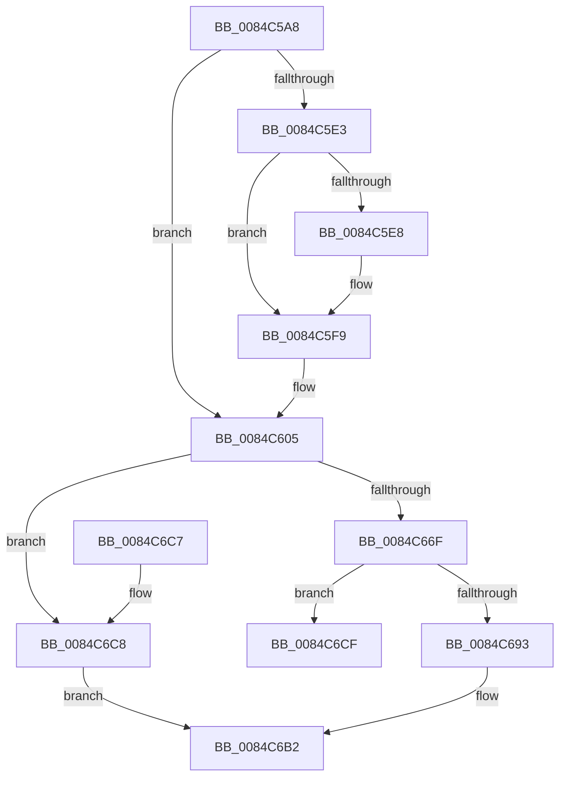

# CmpRebuildKcbCacheFromNode

- RVA: `0x0084C5A8`–`0x0084C6EE` (길이 `326` bytes)
- VA: `0x000000014084C5A8`
- 실행 섹션: `PAGE`
- PDB 이름 있음: `예`; PDB Function 태그: `아니요`
- unwind 정보 RVA: `0x000697B0`
- 디코드: `86`개 명령, `326/326` bytes 표시
- 미해석 바이트: `0` (있으면 어셈블리에 `.byte`로 보존)

> 이 문서는 커널 이미지의 기계어와 PDB 기호를 분석해 생성했습니다. 4번과 5번은 함수 원형과 자료형을 바이너리 사용 방식에서 추정한 C 해석이며 원본 소스 복구 결과는 아닙니다.

## 1. Dependencies

- 직접 호출 지점: **6**; 고유 호출 대상: **6**
- 직접 호출자로 확인된 함수: **8**
- RIP 상대 이미지 참조: **0**

### Outgoing calls
- `0x0084C5D2` → [CmpCleanUpSubKeyInfo](CmpCleanUpSubKeyInfo_function_0084C6F4.md) (function, `0x0084C6F4`)
- `0x0084C5EE` → [CmpCleanUpKcbCachedSymlink](CmpCleanUpKcbCachedSymlink_function_0084DF6C.md) (function, `0x0084DF6C`)
- `0x0084C67B` → [CmLockHiveSecurityShared](../../pagecmrc/BC/CmLockHiveSecurityShared_function_00BC996C.md) (function, `0x00BC996C`)
- `0x0084C68A` → [CmpFindSecurityCellCacheIndex](../../text/42/CmpFindSecurityCellCacheIndex_function_00428060.md) (function, `0x00428060`)
- `0x0084C6AD` → [CmUnlockHiveSecurity](../../pagecmrc/BC/CmUnlockHiveSecurity_function_00BC99C8.md) (function, `0x00BC99C8`)
- `0x0084C6E8` → [KeBugCheckEx](../../text/4F/KeBugCheckEx_function_004FD660.md) (function, `0x004FD660`)

### Direct callers
- [CmDeleteLayeredKey](../../text/41/CmDeleteLayeredKey_function_0041B598.md) at `0x0041B79C`
- [CmpCreateTombstone](../../text/66/CmpCreateTombstone_function_0066AF50.md) at `0x0066B13D`
- [CmpFullPromoteHiveRootFromKcbStack](../7F/CmpFullPromoteHiveRootFromKcbStack_function_007F3F90.md) at `0x007F4032`
- [CmpPromoteSingleKeyFromParentKcbAndChildKeyNode](../7F/CmpPromoteSingleKeyFromParentKcbAndChildKeyNode_function_007F426C.md) at `0x007F435A`
- [CmpDoParseKey](../85/CmpDoParseKey_function_0085F750.md) at `0x00861737`
- [CmpRebuildKcbCache](../87/CmpRebuildKcbCache_function_00874DF8.md) at `0x00874E6A`
- [CmpPromoteSingleKeyFromKcbStacks](../94/CmpPromoteSingleKeyFromKcbStacks_function_009446E8.md) at `0x009448ED`
- [CmpPromoteSingleKeyFromKcbStacks](../94/CmpPromoteSingleKeyFromKcbStacks_function_009446E8.md) at `0x00944906`
- [CmpCreateChild](../94/CmpCreateChild_function_0094817C.md) at `0x0094865B`
- [CmpCreateChild](../94/CmpCreateChild_function_0094817C.md) at `0x00948D9F`

### Static image references
- 디코드된 RIP-relative 메모리 참조가 없습니다.

## 2. Other-region calls and transfers

- 다른 실행 섹션으로 향하는 call: **4**
  - `0x0084C67B` → [CmLockHiveSecurityShared](../../pagecmrc/BC/CmLockHiveSecurityShared_function_00BC996C.md) (`PAGE` → `PAGECMRC`)
  - `0x0084C68A` → [CmpFindSecurityCellCacheIndex](../../text/42/CmpFindSecurityCellCacheIndex_function_00428060.md) (`PAGE` → `.text`)
  - `0x0084C6AD` → [CmUnlockHiveSecurity](../../pagecmrc/BC/CmUnlockHiveSecurity_function_00BC99C8.md) (`PAGE` → `PAGECMRC`)
  - `0x0084C6E8` → [KeBugCheckEx](../../text/4F/KeBugCheckEx_function_004FD660.md) (`PAGE` → `.text`)
- 별도 외부 분기/꼬리 이동을 확인하지 못했습니다.

## 3. Assembly (complete function range)

```asm
0084C5A8  48 89 5C 24 10                  mov qword ptr [rsp + 0x10], rbx
0084C5AD  48 89 6C 24 18                  mov qword ptr [rsp + 0x18], rbp
0084C5B2  48 89 74 24 20                  mov qword ptr [rsp + 0x20], rsi
0084C5B7  57                              push rdi
0084C5B8  48 83 EC 30                     sub rsp, 0x30
0084C5BC  8A 42 0D                        mov al, byte ptr [rdx + 0xd]
0084C5BF  48 8B FA                        mov rdi, rdx
0084C5C2  24 03                           and al, 3
0084C5C4  B2 01                           mov dl, 1
0084C5C6  88 41 41                        mov byte ptr [rcx + 0x41], al
0084C5C9  41 8A F1                        mov sil, r9b
0084C5CC  49 8B E8                        mov rbp, r8
0084C5CF  48 8B D9                        mov rbx, rcx
0084C5D2  E8 1D 01 00 00                  call 0x14084c6f4
0084C5D7  8B 93 B8 00 00 00               mov edx, dword ptr [rbx + 0xb8]
0084C5DD  0F BA E2 16                     bt edx, 0x16
0084C5E1  72 22                           jb 0x14084c605
0084C5E3  40 84 F6                        test sil, sil
0084C5E6  74 11                           je 0x14084c5f9
0084C5E8  48 8B D5                        mov rdx, rbp
0084C5EB  48 8B CB                        mov rcx, rbx
0084C5EE  E8 79 19 00 00                  call 0x14084df6c
0084C5F3  8B 93 B8 00 00 00               mov edx, dword ptr [rbx + 0xb8]
0084C5F9  8B 4F 28                        mov ecx, dword ptr [rdi + 0x28]
0084C5FC  8B 47 24                        mov eax, dword ptr [rdi + 0x24]
0084C5FF  89 43 60                        mov dword ptr [rbx + 0x60], eax
0084C602  89 4B 64                        mov dword ptr [rbx + 0x64], ecx
0084C605  48 8B 47 04                     mov rax, qword ptr [rdi + 4]
0084C609  48 89 83 A8 00 00 00            mov qword ptr [rbx + 0xa8], rax
0084C610  0F B7 47 34                     movzx eax, word ptr [rdi + 0x34]
0084C614  66 89 83 B0 00 00 00            mov word ptr [rbx + 0xb0], ax
0084C61B  0F B7 47 3C                     movzx eax, word ptr [rdi + 0x3c]
0084C61F  66 89 83 B2 00 00 00            mov word ptr [rbx + 0xb2], ax
0084C626  8B 47 40                        mov eax, dword ptr [rdi + 0x40]
0084C629  89 83 B4 00 00 00               mov dword ptr [rbx + 0xb4], eax
0084C62F  0F B7 4F 36                     movzx ecx, word ptr [rdi + 0x36]
0084C633  33 CA                           xor ecx, edx
0084C635  83 E1 0F                        and ecx, 0xf
0084C638  33 CA                           xor ecx, edx
0084C63A  89 8B B8 00 00 00               mov dword ptr [rbx + 0xb8], ecx
0084C640  0F B7 47 36                     movzx eax, word ptr [rdi + 0x36]
0084C644  33 C1                           xor eax, ecx
0084C646  25 F0 00 00 00                  and eax, 0xf0
0084C64B  33 C1                           xor eax, ecx
0084C64D  89 83 B8 00 00 00               mov dword ptr [rbx + 0xb8], eax
0084C653  8A 47 37                        mov al, byte ptr [rdi + 0x37]
0084C656  88 83 B9 00 00 00               mov byte ptr [rbx + 0xb9], al
0084C65C  0F B7 47 02                     movzx eax, word ptr [rdi + 2]
0084C660  66 89 83 BA 00 00 00            mov word ptr [rbx + 0xba], ax
0084C667  8B 77 2C                        mov esi, dword ptr [rdi + 0x2c]
0084C66A  83 FE FF                        cmp esi, -1
0084C66D  74 59                           je 0x14084c6c8
0084C66F  48 8B 7B 20                     mov rdi, qword ptr [rbx + 0x20]
0084C673  83 64 24 40 00                  and dword ptr [rsp + 0x40], 0
0084C678  48 8B CF                        mov rcx, rdi
0084C67B  E8 EC D2 37 00                  call 0x140bc996c
0084C680  4C 8D 44 24 40                  lea r8, [rsp + 0x40]
0084C685  8B D6                           mov edx, esi
0084C687  48 8B CF                        mov rcx, rdi
0084C68A  E8 D1 B9 BD FF                  call 0x140428060
0084C68F  84 C0                           test al, al
0084C691  74 3C                           je 0x14084c6cf
0084C693  48 8B 87 60 07 00 00            mov rax, qword ptr [rdi + 0x760]
0084C69A  8B 54 24 40                     mov edx, dword ptr [rsp + 0x40]
0084C69E  48 03 D2                        add rdx, rdx
0084C6A1  48 8B 54 D0 08                  mov rdx, qword ptr [rax + rdx*8 + 8]
0084C6A6  48 89 53 58                     mov qword ptr [rbx + 0x58], rdx
0084C6AA  48 8B CF                        mov rcx, rdi
0084C6AD  E8 16 D3 37 00                  call 0x140bc99c8
0084C6B2  48 8B 5C 24 48                  mov rbx, qword ptr [rsp + 0x48]
0084C6B7  48 8B 6C 24 50                  mov rbp, qword ptr [rsp + 0x50]
0084C6BC  48 8B 74 24 58                  mov rsi, qword ptr [rsp + 0x58]
0084C6C1  48 83 C4 30                     add rsp, 0x30
0084C6C5  5F                              pop rdi
0084C6C6  C3                              ret
0084C6C7  CC                              int3
0084C6C8  48 83 63 58 00                  and qword ptr [rbx + 0x58], 0
0084C6CD  EB E3                           jmp 0x14084c6b2
0084C6CF  48 83 63 58 00                  and qword ptr [rbx + 0x58], 0
0084C6D4  BA 04 00 00 00                  mov edx, 4
0084C6D9  4C 8B CB                        mov r9, rbx
0084C6DC  48 89 74 24 20                  mov qword ptr [rsp + 0x20], rsi
0084C6E1  8D 4A 4D                        lea ecx, [rdx + 0x4d]
0084C6E4  44 8D 42 FD                     lea r8d, [rdx - 3]
0084C6E8  E8 73 0F CB FF                  call 0x1404fd660
0084C6ED  CC                              int3
```

## 4. C-style interpretation (structured pseudocode)

```c
__int64 __fastcall CmpRebuildKcbCacheFromNode(__int64 a1, __int64 a2, __int64 a3, unsigned __int8 a4)
{
    __int64 result;
    __int64 v_rsp;
    unsigned __int64 v_stack_p10;
    unsigned __int64 v_stack_p18;
    unsigned __int64 v_stack_p20;
    unsigned int v_stack_p8;

    v_stack_p10 = v_rbx;
    v_stack_p18 = v_rbp;
    v_stack_p20 = v_rsi;
    v_rsp = (v_rsp) - (48);
    result = (unsigned __int8)((*(unsigned __int8 *)(a2 + 13)) & (3));
    *(unsigned __int8 *)(a1 + 65) = (unsigned __int8)(result);
    result = CmpCleanUpSubKeyInfo(a1, 1, a3, a4);
    if (condition_is_below) goto loc_0084C605;
    if (a4 != 0) {
        a2 = a3;
        a1 = a1;
        result = CmpCleanUpKcbCachedSymlink(a1, a2, a3, a4);
        a2 = *(unsigned int *)(a1 + 184);
    }
    *(unsigned int *)(a1 + 96) = (unsigned int)((unsigned int)(*(unsigned int *)(a2 + 36)));
    *(unsigned int *)(a1 + 100) = (unsigned int)((unsigned int)(*(unsigned int *)(a2 + 40)));
loc_0084C605:
    *(unsigned __int64 *)(a1 + 168) = *(unsigned __int64 *)(a2 + 4);
    *(unsigned __int16 *)(a1 + 176) = (unsigned __int16)(*(unsigned __int16 *)(a2 + 52));
    *(unsigned __int16 *)(a1 + 178) = (unsigned __int16)(*(unsigned __int16 *)(a2 + 60));
    *(unsigned int *)(a1 + 180) = (unsigned int)((unsigned int)(*(unsigned int *)(a2 + 64)));
    a1 = (unsigned int)((*(unsigned __int16 *)(a2 + 54)) ^ ((unsigned int)(a2)));
    a1 = (unsigned int)((a1) & (15));
    a1 = (unsigned int)((a1) ^ ((unsigned int)(a2)));
    *(unsigned int *)(a1 + 184) = (unsigned int)(a1);
    result = (unsigned int)((*(unsigned __int16 *)(a2 + 54)) ^ ((unsigned int)(a1)));
    result = (unsigned int)((result) & (240));
    result = (unsigned int)((result) ^ ((unsigned int)(a1)));
    *(unsigned int *)(a1 + 184) = (unsigned int)(result);
    *(unsigned __int8 *)(a1 + 185) = (unsigned __int8)(*(unsigned __int8 *)(a2 + 55));
    *(unsigned __int16 *)(a1 + 186) = (unsigned __int16)(*(unsigned __int16 *)(a2 + 2));
    if (((unsigned int)((unsigned int)(*(unsigned int *)(a2 + 44)))) == -1) goto loc_0084C6C8;
    result = CmLockHiveSecurityShared(*(unsigned __int64 *)(a1 + 32), a2, a3, a4);
    result = CmpFindSecurityCellCacheIndex(*(unsigned __int64 *)(a1 + 32), (unsigned int)((unsigned int)((unsigned int)(*(unsigned int *)(a2 + 44)))), v_stack_p8, a4);
    if ((unsigned __int8)(result) == 0) goto loc_0084C6CF;
    a2 = ((unsigned int)(v_stack_p8)) + ((unsigned int)(v_stack_p8));
    *(unsigned __int64 *)(a1 + 88) = *(unsigned __int64 *)(*(unsigned __int64 *)(*(unsigned __int64 *)(a1 + 32) + 1888) + a2 * 8 + 8);
    result = CmUnlockHiveSecurity(*(unsigned __int64 *)(a1 + 32), *(unsigned __int64 *)(*(unsigned __int64 *)(*(unsigned __int64 *)(a1 + 32) + 1888) + a2 * 8 + 8), v_stack_p8, a4);
loc_0084C6B2:
    v_rsp = (v_rsp) + (48);
    return result;
loc_0084C6C8:
    goto loc_0084C6B2;
loc_0084C6CF:
    v_stack_p20 = v_stack_p20;
    result = KeBugCheckEx(4 + 77, 4, 4 - 3, v_stack_p10);
    return result;
}
```

## 5. (Beta) C Style

```c
int64_t CmpRebuildKcbCacheFromNode(void *Arg1, void *Arg2, int64_t Arg3, uint8_t Arg4)
{
    uint8_t *arg1 = (uint8_t *)Arg1;
    uint8_t *arg2 = (uint8_t *)Arg2;

    int64_t result;
    int64_t local_rsp;
    uint64_t v_stack_p10;
    uint64_t v_stack_p18;
    uint64_t v_stack_p20;
    uint32_t v_stack_p8;

    v_stack_p10 = local_rbx;
    v_stack_p18 = local_rbp;
    v_stack_p20 = local_rsi;
    local_rsp = (local_rsp) - (48);
    result = (uint8_t)((*(uint8_t *)(arg2 + 0xD)) & (3));
    *(uint8_t *)(arg1 + 0x41) = (uint8_t)(result);
    result = CmpCleanUpSubKeyInfo(Arg1, 1, Arg3, Arg4);
    if (condition_is_below) goto loc_0084C605;
    if (Arg4 != 0) {
        Arg2 = Arg3;
        Arg1 = Arg1;
        result = CmpCleanUpKcbCachedSymlink(Arg1, Arg2, Arg3, Arg4);
        Arg2 = *(uint32_t *)(arg1 + 0xB8);
    }
    *(uint32_t *)(arg1 + 0x60) = (uint32_t)((uint32_t)(*(uint32_t *)(arg2 + 0x24)));
    *(uint32_t *)(arg1 + 0x64) = (uint32_t)((uint32_t)(*(uint32_t *)(arg2 + 0x28)));
loc_0084C605:
    *(uint64_t *)(arg1 + 0xA8) = *(uint64_t *)(arg2 + 0x4);
    *(uint16_t *)(arg1 + 0xB0) = (uint16_t)(*(uint16_t *)(arg2 + 0x34));
    *(uint16_t *)(arg1 + 0xB2) = (uint16_t)(*(uint16_t *)(arg2 + 0x3C));
    *(uint32_t *)(arg1 + 0xB4) = (uint32_t)((uint32_t)(*(uint32_t *)(arg2 + 0x40)));
    Arg1 = (uint32_t)((*(uint16_t *)(arg2 + 0x36)) ^ ((uint32_t)(Arg2)));
    Arg1 = (uint32_t)((Arg1) & (15));
    Arg1 = (uint32_t)((Arg1) ^ ((uint32_t)(Arg2)));
    *(uint32_t *)(arg1 + 0xB8) = (uint32_t)(Arg1);
    result = (uint32_t)((*(uint16_t *)(arg2 + 0x36)) ^ ((uint32_t)(Arg1)));
    result = (uint32_t)((result) & (240));
    result = (uint32_t)((result) ^ ((uint32_t)(Arg1)));
    *(uint32_t *)(arg1 + 0xB8) = (uint32_t)(result);
    *(uint8_t *)(arg1 + 0xB9) = (uint8_t)(*(uint8_t *)(arg2 + 0x37));
    *(uint16_t *)(arg1 + 0xBA) = (uint16_t)(*(uint16_t *)(arg2 + 0x2));
    if (((uint32_t)((uint32_t)(*(uint32_t *)(arg2 + 0x2C)))) == -1) goto loc_0084C6C8;
    result = CmLockHiveSecurityShared(*(uint64_t *)(arg1 + 0x20), Arg2, Arg3, Arg4);
    result = CmpFindSecurityCellCacheIndex(*(uint64_t *)(arg1 + 0x20), (uint32_t)((uint32_t)((uint32_t)(*(uint32_t *)(arg2 + 0x2C)))), v_stack_p8, Arg4);
    if ((uint8_t)(result) == 0) goto loc_0084C6CF;
    Arg2 = ((uint32_t)(v_stack_p8)) + ((uint32_t)(v_stack_p8));
    *(uint64_t *)(arg1 + 0x58) = *(uint64_t *)(*(uint64_t *)(*(uint64_t *)(arg1 + 0x20) + 0x760) + arg2 * 8 + 0x8);
    result = CmUnlockHiveSecurity(*(uint64_t *)(arg1 + 0x20), *(uint64_t *)(*(uint64_t *)(*(uint64_t *)(arg1 + 0x20) + 0x760) + arg2 * 8 + 0x8), v_stack_p8, Arg4);
loc_0084C6B2:
    local_rsp = (local_rsp) + (48);
    return result;
loc_0084C6C8:
    goto loc_0084C6B2;
loc_0084C6CF:
    v_stack_p20 = v_stack_p20;
    result = KeBugCheckEx(4 + 77, 4, 4 - 3, v_stack_p10);
    return result;
}
```

### 관측된 메모리 오프셋

구조체 형식이 확인되지 않은 접근은 인자 기준의 오프셋으로만 기록했습니다.

| 기준 인자 | 오프셋 표현 | 폭 (bit) | 접근 |
|---|---:|---:|---|
| `Arg1` | `+ 0x20` | `64` | `R` |
| `Arg1` | `+ 0x41` | `8` | `W` |
| `Arg1` | `+ 0x58` | `64` | `R/W` |
| `Arg1` | `+ 0x58` | `64` | `W` |
| `Arg1` | `+ 0x60` | `32` | `W` |
| `Arg1` | `+ 0x64` | `32` | `W` |
| `Arg1` | `+ 0xA8` | `64` | `W` |
| `Arg1` | `+ 0xB0` | `16` | `W` |
| `Arg1` | `+ 0xB2` | `16` | `W` |
| `Arg1` | `+ 0xB4` | `32` | `W` |
| `Arg1` | `+ 0xB8` | `32` | `R` |
| `Arg1` | `+ 0xB8` | `32` | `W` |
| `Arg1` | `+ 0xB9` | `8` | `W` |
| `Arg1` | `+ 0xBA` | `16` | `W` |
| `Arg2` | `+ 0x2` | `16` | `R` |
| `Arg2` | `+ 0x4` | `64` | `R` |
| `Arg2` | `+ 0xD` | `8` | `R` |
| `Arg2` | `+ 0x24` | `32` | `R` |
| `Arg2` | `+ 0x28` | `32` | `R` |
| `Arg2` | `+ 0x2C` | `32` | `R` |
| `Arg2` | `+ 0x34` | `16` | `R` |
| `Arg2` | `+ 0x36` | `16` | `R` |
| `Arg2` | `+ 0x37` | `8` | `R` |
| `Arg2` | `+ 0x3C` | `16` | `R` |
| `Arg2` | `+ 0x40` | `32` | `R` |

## 6. Execution-region graph

[열기: 2D/3D 그래프와 함수 탐색 컨트롤 패널](../../../control-panel.html?section=page&rva=0x0084C5A8&view=graph)

- 2D 그래프는 위에서 아래로 흐르고, 3D 그래프는 빈 공간을 드래그해 회전합니다. Shift+드래그는 이동, 휠은 확대·축소, 함수 노드 선택은 대상 보고서 이동입니다.

### Static fallback


