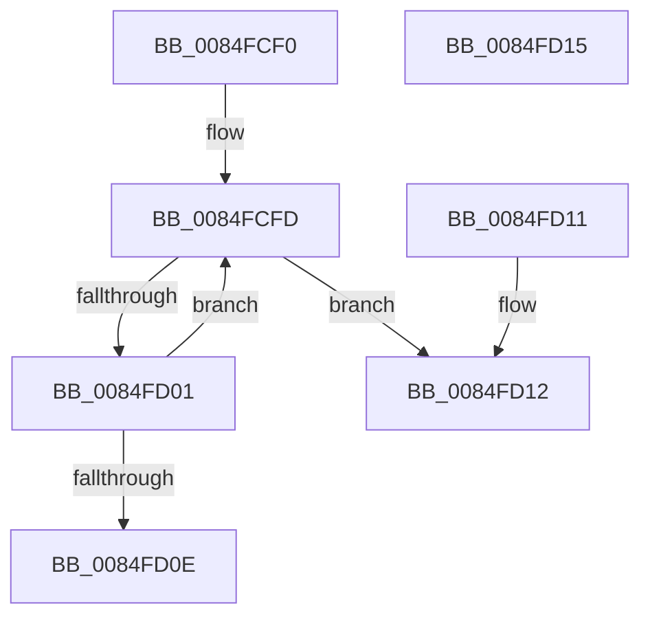

# CmpReferenceHive

- RVA: `0x0084FCF0`–`0x0084FD16` (길이 `38` bytes)
- VA: `0x000000014084FCF0`
- 실행 섹션: `PAGE`
- PDB 이름 있음: `예`; PDB Function 태그: `아니요`
- unwind 정보 RVA: `0x000DB714`
- 디코드: `13`개 명령, `38/38` bytes 표시
- 미해석 바이트: `0` (있으면 어셈블리에 `.byte`로 보존)

> 이 문서는 커널 이미지의 기계어와 PDB 기호를 분석해 생성했습니다. 4번과 5번은 함수 원형과 자료형을 바이너리 사용 방식에서 추정한 C 해석이며 원본 소스 복구 결과는 아닙니다.

## 1. Dependencies

- 직접 호출 지점: **0**; 고유 호출 대상: **0**
- 직접 호출자로 확인된 함수: **12**
- RIP 상대 이미지 참조: **0**

### Outgoing calls
- 직접 디코드된 call 명령이 없습니다.

### Direct callers
- [CmpLockHashEntryByIndexExclusive](../7F/CmpLockHashEntryByIndexExclusive_function_007F1290.md) at `0x007F12F9`
- [CmpVEExecuteRealStoreParseLogic](CmpVEExecuteRealStoreParseLogic_function_0084CCD4.md) at `0x0084CD66`
- [CmpVEExecuteRealStoreParseLogic](CmpVEExecuteRealStoreParseLogic_function_0084CCD4.md) at `0x0084CD9B`
- [CmpBlockHiveWrites](CmpBlockHiveWrites_function_0084CF94.md) at `0x0084CFD4`
- [CmpBlockHiveWrites](CmpBlockHiveWrites_function_0084CF94.md) at `0x0084D011`
- [CmpBlockTwoHiveWrites](CmpBlockTwoHiveWrites_function_0084DE64.md) at `0x0084DEB1`
- [CmpGetNextHive](CmpGetNextHive_function_0084E330.md) at `0x0084E376`
- [CmpDoQueueLateUnloadWorker](CmpDoQueueLateUnloadWorker_function_0084FB18.md) at `0x0084FBA3`
- [CmpPerformCompleteKcbCacheLookup](CmpPerformCompleteKcbCacheLookup_function_0084FD20.md) at `0x0085082B`
- [CmpPerformCompleteKcbCacheLookup](CmpPerformCompleteKcbCacheLookup_function_0084FD20.md) at `0x00851155`
- [sub_00851966](../85/Unknown_function_00851966.md) at `0x00851A43`
- [sub_00865C6D](../86/Unknown_function_00865C6D.md) at `0x00865C81`
- [CmpGetLastHive](../87/CmpGetLastHive_function_008786B4.md) at `0x008786DB`
- [CmpLockDeletedHashEntryExclusiveByKcb](../9B/CmpLockDeletedHashEntryExclusiveByKcb_function_009B3030.md) at `0x009B30C0`
- [CmpTryToLockHashEntryExclusive](../A6/CmpTryToLockHashEntryExclusive_function_00A68030.md) at `0x00A680AF`

### Static image references
- 디코드된 RIP-relative 메모리 참조가 없습니다.

## 2. Other-region calls and transfers

- 다른 실행 섹션으로 향하는 call: **0**
- 별도 외부 분기/꼬리 이동을 확인하지 못했습니다.

## 3. Assembly (complete function range)

```asm
0084FCF0  0F 0D 89 88 10 00 00            prefetchw byte ptr [rcx + 0x1088]
0084FCF7  8B 81 88 10 00 00               mov eax, dword ptr [rcx + 0x1088]
0084FCFD  85 C0                           test eax, eax
0084FCFF  74 11                           je 0x14084fd12
0084FD01  8D 50 01                        lea edx, [rax + 1]
0084FD04  F0 0F B1 91 88 10 00 00         lock cmpxchg dword ptr [rcx + 0x1088], edx
0084FD0C  75 EF                           jne 0x14084fcfd
0084FD0E  B0 01                           mov al, 1
0084FD10  C3                              ret
0084FD11  CC                              int3
0084FD12  32 C0                           xor al, al
0084FD14  C3                              ret
0084FD15  CC                              int3
```

## 4. C-style interpretation (structured pseudocode)

```c
__int64 __fastcall CmpReferenceHive(__int64 a1)
{
    __int64 result;

loc_0084FCFD:
    if ((unsigned int)((unsigned int)(*(unsigned int *)(a1 + 4232))) == 0) goto loc_0084FD12;
    if ((unsigned int)((unsigned int)(*(unsigned int *)(a1 + 4232))) != 0) goto loc_0084FCFD;
    return 1;
loc_0084FD12:
    result = 0;
    return result;
}
```

## 5. (Beta) C Style

```c
int64_t CmpReferenceHive(void *Arg1)
{
    uint8_t *arg1 = (uint8_t *)Arg1;

    int64_t result;

loc_0084FCFD:
    if ((uint32_t)((uint32_t)(*(uint32_t *)(arg1 + 0x1088))) == 0) goto loc_0084FD12;
    if ((uint32_t)((uint32_t)(*(uint32_t *)(arg1 + 0x1088))) != 0) goto loc_0084FCFD;
    return 1;
loc_0084FD12:
    result = 0;
    return result;
}
```

### 관측된 메모리 오프셋

구조체 형식이 확인되지 않은 접근은 인자 기준의 오프셋으로만 기록했습니다.

| 기준 인자 | 오프셋 표현 | 폭 (bit) | 접근 |
|---|---:|---:|---|
| `Arg1` | `+ 0x1088` | `8` | `R` |
| `Arg1` | `+ 0x1088` | `32` | `R` |

## 6. Execution-region graph

[열기: 2D/3D 그래프와 함수 탐색 컨트롤 패널](../../../control-panel.html?section=page&rva=0x0084FCF0&view=graph)

- 2D 그래프는 위에서 아래로 흐르고, 3D 그래프는 빈 공간을 드래그해 회전합니다. Shift+드래그는 이동, 휠은 확대·축소, 함수 노드 선택은 대상 보고서 이동입니다.

### Static fallback


