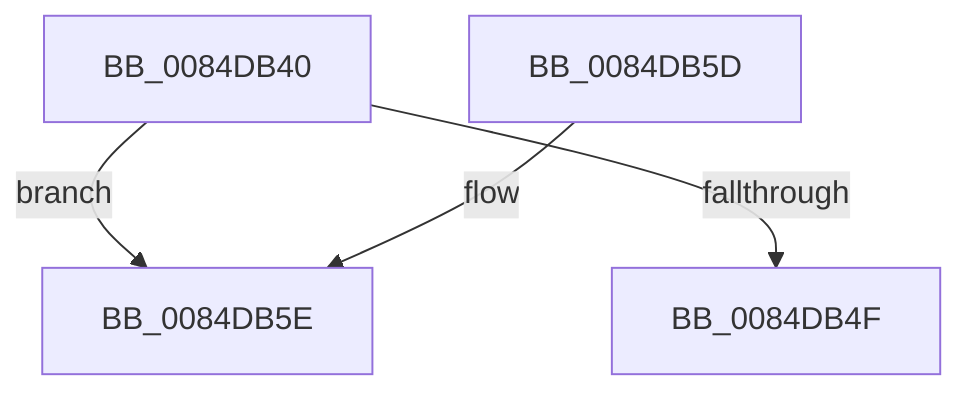

# CmpReleaseGlobalQuota

- RVA: `0x0084DB40`–`0x0084DB78` (길이 `56` bytes)
- VA: `0x000000014084DB40`
- 실행 섹션: `PAGE`
- PDB 이름 있음: `예`; PDB Function 태그: `아니요`
- unwind 정보 RVA: `0x00069AC4`
- 디코드: `16`개 명령, `56/56` bytes 표시
- 미해석 바이트: `0` (있으면 어셈블리에 `.byte`로 보존)

> 이 문서는 커널 이미지의 기계어와 PDB 기호를 분석해 생성했습니다. 4번과 5번은 함수 원형과 자료형을 바이너리 사용 방식에서 추정한 C 해석이며 원본 소스 복구 결과는 아닙니다.

## 1. Dependencies

- 직접 호출 지점: **1**; 고유 호출 대상: **1**
- 직접 호출자로 확인된 함수: **9**
- RIP 상대 이미지 참조: **2**

### Outgoing calls
- `0x0084DB72` → [KeBugCheckEx](../../text/4F/KeBugCheckEx_function_004FD660.md) (function, `0x004FD660`)

### Direct callers
- [CmpAllocateForNonPagedHive](../../text/4D/CmpAllocateForNonPagedHive_function_004D92F0.md) at `0x004D9336`
- [CmpFree](CmpFree_function_0084D8F0.md) at `0x0084D8FB`
- [HvHiveCleanup](HvHiveCleanup_function_0084D918.md) at `0x0084D9FC`
- [CmpAllocate](CmpAllocate_function_0084DD40.md) at `0x0084DD9C`
- [HvpDropPagedBins](../9B/HvpDropPagedBins_function_009B7168.md) at `0x009B72AB`
- [HvpAllocateNonPagedBin](../9B/HvpAllocateNonPagedBin_function_009B7904.md) at `0x009B7956`
- [HvpAddBin](../AF/HvpAddBin_function_00AF7D48.md) at `0x00AF81D1`
- [sub_00B2E0F0](../B2/Unknown_function_00B2E0F0.md) at `0x00B2E2F3`
- [sub_00B3E78C](../B3/Unknown_function_00B3E78C.md) at `0x00B3E802`

### Static image references
- `0x0084DB46` → RVA `0x00FD9C80` (`PAGEDATA`; read)
- `0x0084DB51` → RVA `0x00FD9C80` (`PAGEDATA`; read/write)

## 2. Other-region calls and transfers

- 다른 실행 섹션으로 향하는 call: **1**
  - `0x0084DB72` → [KeBugCheckEx](../../text/4F/KeBugCheckEx_function_004FD660.md) (`PAGE` → `.text`)
- 별도 외부 분기/꼬리 이동을 확인하지 못했습니다.

## 3. Assembly (complete function range)

```asm
0084DB40  48 83 EC 38                     sub rsp, 0x38
0084DB44  8B C1                           mov eax, ecx
0084DB46  48 3B 05 33 C1 78 00            cmp rax, qword ptr [rip + 0x78c133]
0084DB4D  77 0F                           ja 0x14084db5e
0084DB4F  F7 D9                           neg ecx
0084DB51  F0 01 0D 28 C1 78 00            lock add dword ptr [rip + 0x78c128], ecx
0084DB58  48 83 C4 38                     add rsp, 0x38
0084DB5C  C3                              ret
0084DB5D  CC                              int3
0084DB5E  48 83 64 24 20 00               and qword ptr [rsp + 0x20], 0
0084DB64  45 33 C9                        xor r9d, r9d
0084DB67  41 8D 51 0D                     lea edx, [r9 + 0xd]
0084DB6B  8D 4A 44                        lea ecx, [rdx + 0x44]
0084DB6E  45 8D 41 01                     lea r8d, [r9 + 1]
0084DB72  E8 E9 FA CA FF                  call 0x1404fd660
0084DB77  CC                              int3
```

## 4. C-style interpretation (structured pseudocode)

```c
__int64 __fastcall CmpReleaseGlobalQuota(int a1, __int64 a2, __int64 a3, int a4)
{
    __int64 result;
    __int64 v_rsp;
    unsigned __int64 v_stack_p20;

    v_rsp = (v_rsp) - (56);
    if (((unsigned int)(a1)) > (*(unsigned __int64 *)(v_rip + 7913779))) goto loc_0084DB5E;
    a1 = (unsigned int)(-(a1));
    v_rsp = (v_rsp) + (56);
    return (unsigned int)(a1);
loc_0084DB5E:
    a4 = 0;
    result = KeBugCheckEx(a4 + 13 + 68, a4 + 13, a4 + 1, a4);
    return result;
}
```

## 5. (Beta) C Style

```c
int64_t CmpReleaseGlobalQuota(int32_t Arg1, int64_t Arg2, int64_t Arg3, int32_t Arg4)
{
    int64_t result;
    int64_t local_rsp;
    uint64_t v_stack_p20;

    local_rsp = (local_rsp) - (56);
    if (((uint32_t)(Arg1)) > (*(uint64_t *)(v_rip + 0x78C133))) goto loc_0084DB5E;
    Arg1 = (uint32_t)(-(Arg1));
    local_rsp = (local_rsp) + (56);
    return (uint32_t)(Arg1);
loc_0084DB5E:
    Arg4 = 0;
    result = KeBugCheckEx(Arg4 + 13 + 68, Arg4 + 13, Arg4 + 1, Arg4);
    return result;
}
```

## 6. Execution-region graph

[열기: 2D/3D 그래프와 함수 탐색 컨트롤 패널](../../../control-panel.html?section=page&rva=0x0084DB40&view=graph)

- 2D 그래프는 위에서 아래로 흐르고, 3D 그래프는 빈 공간을 드래그해 회전합니다. Shift+드래그는 이동, 휠은 확대·축소, 함수 노드 선택은 대상 보고서 이동입니다.

### Static fallback


