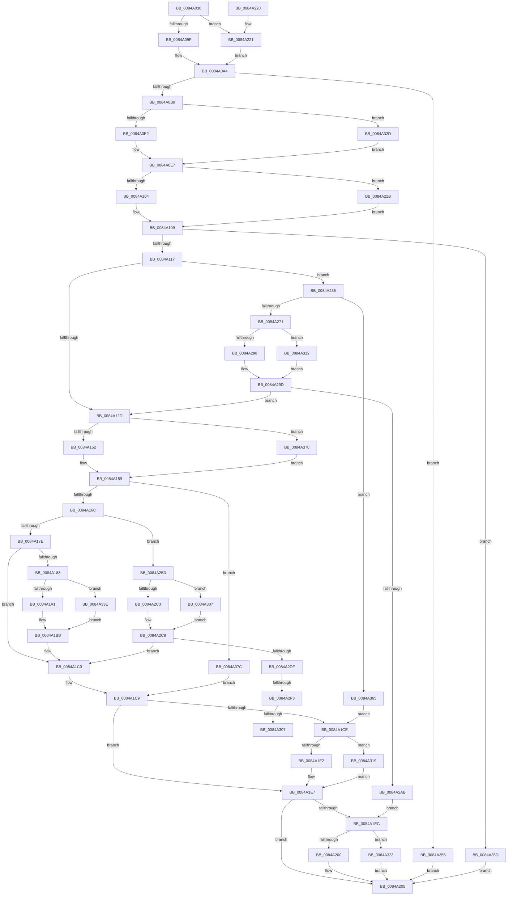

# CmpRemoveSubKeyFromList

- RVA: `0x0084A030`–`0x0084A384` (길이 `852` bytes)
- VA: `0x000000014084A030`
- 실행 섹션: `PAGE`
- PDB 이름 있음: `예`; PDB Function 태그: `예`
- unwind 정보 RVA: `0x000694D0`
- 디코드: `220`개 명령, `852/852` bytes 표시
- 미해석 바이트: `0` (있으면 어셈블리에 `.byte`로 보존)

> 이 문서는 커널 이미지의 기계어와 PDB 기호를 분석해 생성했습니다. 4번과 5번은 함수 원형과 자료형을 바이너리 사용 방식에서 추정한 C 해석이며 원본 소스 복구 결과는 아닙니다.

## 1. Dependencies

- 직접 호출 지점: **21**; 고유 호출 대상: **10**
- 직접 호출자로 확인된 함수: **3**
- RIP 상대 이미지 참조: **0**

### Outgoing calls
- `0x0084A084` → [RtlInitUnicodeString](../../text/42/RtlInitUnicodeString_function_0042A780.md) (function, `0x0042A780`)
- `0x0084A09F` → [HvpGetCellFlat](../85/HvpGetCellFlat_function_00854C60.md) (function, `0x00854C60`)
- `0x0084A0E2` → [HvpReleaseCellPaged](../85/HvpReleaseCellPaged_function_00855F40.md) (function, `0x00855F40`)
- `0x0084A104` → [HvpGetCellFlat](../85/HvpGetCellFlat_function_00854C60.md) (function, `0x00854C60`)
- `0x0084A159` → [CmpFindSubKeyInLeafWithStatus](../85/CmpFindSubKeyInLeafWithStatus_function_00853A70.md) (function, `0x00853A70`)
- `0x0084A1BB` → [memcpy](../../text/6C/memcpy_function_006C6840.md) (function, `0x006C6840`)
- `0x0084A1E2` → [HvpReleaseCellPaged](../85/HvpReleaseCellPaged_function_00855F40.md) (function, `0x00855F40`)
- `0x0084A200` → [HvpReleaseCellPaged](../85/HvpReleaseCellPaged_function_00855F40.md) (function, `0x00855F40`)
- `0x0084A221` → [HvpGetCellPaged](../85/HvpGetCellPaged_function_00854CB0.md) (function, `0x00854CB0`)
- `0x0084A22B` → [HvpGetCellPaged](../85/HvpGetCellPaged_function_00854CB0.md) (function, `0x00854CB0`)
- `0x0084A261` → [CmpFindSubKeyInRoot](../85/CmpFindSubKeyInRoot_function_0085D890.md) (function, `0x0085D890`)
- `0x0084A27C` → [HvpGetCellContextMove](../85/HvpGetCellContextMove_function_00859F58.md) (function, `0x00859F58`)
- `0x0084A298` → [HvpGetCellFlat](../85/HvpGetCellFlat_function_00854C60.md) (function, `0x00854C60`)
- `0x0084A2C3` → [HvpReleaseCellPaged](../85/HvpReleaseCellPaged_function_00855F40.md) (function, `0x00855F40`)
- `0x0084A2D1` → [HvFreeCell](../85/HvFreeCell_function_0085A72C.md) (function, `0x0085A72C`)
- `0x0084A307` → [HvpReleaseCellFlat](../85/HvpReleaseCellFlat_function_0085CC20.md) (function, `0x0085CC20`)
- `0x0084A312` → [HvpGetCellPaged](../85/HvpGetCellPaged_function_00854CB0.md) (function, `0x00854CB0`)
- `0x0084A319` → [HvpReleaseCellFlat](../85/HvpReleaseCellFlat_function_0085CC20.md) (function, `0x0085CC20`)
- `0x0084A323` → [HvpReleaseCellFlat](../85/HvpReleaseCellFlat_function_0085CC20.md) (function, `0x0085CC20`)
- `0x0084A32D` → [HvpReleaseCellFlat](../85/HvpReleaseCellFlat_function_0085CC20.md) (function, `0x0085CC20`)
- `0x0084A337` → [HvpReleaseCellFlat](../85/HvpReleaseCellFlat_function_0085CC20.md) (function, `0x0085CC20`)

### Direct callers
- [CmRenameKey](../7E/CmRenameKey_function_007E8F48.md) at `0x007E9C90`
- [CmRenameKey](../7E/CmRenameKey_function_007E8F48.md) at `0x007E9CEF`
- [CmpRemoveSubKey](CmpRemoveSubKey_function_00849F84.md) at `0x00849FD7`
- [CmpLightWeightPrepareDeleteKeyUoW](../A5/CmpLightWeightPrepareDeleteKeyUoW_function_00A54494.md) at `0x00A54586`

### Static image references
- 디코드된 RIP-relative 메모리 참조가 없습니다.

## 2. Other-region calls and transfers

- 다른 실행 섹션으로 향하는 call: **2**
  - `0x0084A084` → [RtlInitUnicodeString](../../text/42/RtlInitUnicodeString_function_0042A780.md) (`PAGE` → `.text`)
  - `0x0084A1BB` → [memcpy](../../text/6C/memcpy_function_006C6840.md) (`PAGE` → `.text`)
- call이 아닌 외부 분기/꼬리 이동: **3**
  - `0x0084A2ED` → [sub_00B16760 + 0x19](../B1/Unknown_function_00B16760.md) (`tail-transfer`)
  - `0x0084A301` → [sub_00B16760](../B1/Unknown_function_00B16760.md) (`tail-transfer`)
  - `0x0084A30D` → [sub_00B16760 + 0x5](../B1/Unknown_function_00B16760.md) (`tail-transfer`)

## 3. Assembly (complete function range)

```asm
0084A030  48 89 5C 24 18                  mov qword ptr [rsp + 0x18], rbx
0084A035  48 89 54 24 10                  mov qword ptr [rsp + 0x10], rdx
0084A03A  55                              push rbp
0084A03B  56                              push rsi
0084A03C  57                              push rdi
0084A03D  41 54                           push r12
0084A03F  41 55                           push r13
0084A041  41 56                           push r14
0084A043  41 57                           push r15
0084A045  48 8B EC                        mov rbp, rsp
0084A048  48 83 EC 60                     sub rsp, 0x60
0084A04C  45 33 FF                        xor r15d, r15d
0084A04F  83 CE FF                        or esi, 0xffffffff
0084A052  4C 8B F2                        mov r14, rdx
0084A055  89 75 58                        mov dword ptr [rbp + 0x58], esi
0084A058  48 8B D9                        mov rbx, rcx
0084A05B  44 89 7D 5C                     mov dword ptr [rbp + 0x5c], r15d
0084A05F  0F 57 C0                        xorps xmm0, xmm0
0084A062  89 75 D8                        mov dword ptr [rbp - 0x28], esi
0084A065  33 D2                           xor edx, edx
0084A067  44 89 7D DC                     mov dword ptr [rbp - 0x24], r15d
0084A06B  48 8D 4D E8                     lea rcx, [rbp - 0x18]
0084A06F  89 75 E0                        mov dword ptr [rbp - 0x20], esi
0084A072  44 89 7D E4                     mov dword ptr [rbp - 0x1c], r15d
0084A076  45 8B EF                        mov r13d, r15d
0084A079  44 89 7D 40                     mov dword ptr [rbp + 0x40], r15d
0084A07D  41 8B F8                        mov edi, r8d
0084A080  0F 11 45 E8                     movups xmmword ptr [rbp - 0x18], xmm0
0084A084  E8 F7 06 BE FF                  call 0x14042a780
0084A089  F6 83 8C 00 00 00 01            test byte ptr [rbx + 0x8c], 1
0084A090  4C 8D 45 58                     lea r8, [rbp + 0x58]
0084A094  8B D7                           mov edx, edi
0084A096  48 8B CB                        mov rcx, rbx
0084A099  0F 84 82 01 00 00               je 0x14084a221
0084A09F  E8 BC AB 00 00                  call 0x140854c60
0084A0A4  48 8B C8                        mov rcx, rax
0084A0A7  48 85 C0                        test rax, rax
0084A0AA  0F 84 A5 02 00 00               je 0x14084a355
0084A0B0  44 0F B7 60 02                  movzx r12d, word ptr [rax + 2]
0084A0B5  48 8D 55 58                     lea rdx, [rbp + 0x58]
0084A0B9  0F B7 40 48                     movzx eax, word ptr [rax + 0x48]
0084A0BD  66 41 83 E4 20                  and r12w, 0x20
0084A0C2  F6 83 8C 00 00 00 01            test byte ptr [rbx + 0x8c], 1
0084A0C9  66 89 45 E8                     mov word ptr [rbp - 0x18], ax
0084A0CD  66 89 45 EA                     mov word ptr [rbp - 0x16], ax
0084A0D1  48 8D 41 4C                     lea rax, [rcx + 0x4c]
0084A0D5  48 89 45 F0                     mov qword ptr [rbp - 0x10], rax
0084A0D9  48 8B CB                        mov rcx, rbx
0084A0DC  0F 85 4B 02 00 00               jne 0x14084a32d
0084A0E2  E8 59 BE 00 00                  call 0x140855f40
0084A0E7  F6 83 8C 00 00 00 01            test byte ptr [rbx + 0x8c], 1
0084A0EE  4C 8D 45 D8                     lea r8, [rbp - 0x28]
0084A0F2  45 8B 3E                        mov r15d, dword ptr [r14]
0084A0F5  48 8B CB                        mov rcx, rbx
0084A0F8  45 8B F7                        mov r14d, r15d
0084A0FB  41 8B D7                        mov edx, r15d
0084A0FE  0F 84 27 01 00 00               je 0x14084a22b
0084A104  E8 57 AB 00 00                  call 0x140854c60
0084A109  33 D2                           xor edx, edx
0084A10B  48 8B F8                        mov rdi, rax
0084A10E  48 85 C0                        test rax, rax
0084A111  0F 84 46 02 00 00               je 0x14084a35d
0084A117  B9 72 69 00 00                  mov ecx, 0x6972
0084A11C  B8 00 00 00 80                  mov eax, 0x80000000
0084A121  89 45 D0                        mov dword ptr [rbp - 0x30], eax
0084A124  66 39 0F                        cmp word ptr [rdi], cx
0084A127  0F 84 08 01 00 00               je 0x14084a235
0084A12D  89 55 58                        mov dword ptr [rbp + 0x58], edx
0084A130  48 8D 45 58                     lea rax, [rbp + 0x58]
0084A134  48 89 44 24 28                  mov qword ptr [rsp + 0x28], rax
0084A139  48 8D 45 40                     lea rax, [rbp + 0x40]
0084A13D  48 89 44 24 20                  mov qword ptr [rsp + 0x20], rax
0084A142  48 8B CB                        mov rcx, rbx
0084A145  48 8B D7                        mov rdx, rdi
0084A148  66 45 85 E4                     test r12w, r12w
0084A14C  0F 84 1E 02 00 00               je 0x14084a370
0084A152  4C 8D 4D E8                     lea r9, [rbp - 0x18]
0084A156  45 33 C0                        xor r8d, r8d
0084A159  E8 12 99 00 00                  call 0x140853a70
0084A15E  8B 4D 58                        mov ecx, dword ptr [rbp + 0x58]
0084A161  45 33 E4                        xor r12d, r12d
0084A164  85 C9                           test ecx, ecx
0084A166  0F 88 10 02 00 00               js 0x14084a37c
0084A16C  0F B7 47 02                     movzx eax, word ptr [rdi + 2]
0084A170  66 83 E8 01                     sub ax, 1
0084A174  66 89 47 02                     mov word ptr [rdi + 2], ax
0084A178  0F 84 35 01 00 00               je 0x14084a2b3
0084A17E  0F B7 D0                        movzx edx, ax
0084A181  41 8B F7                        mov esi, r15d
0084A184  3B CA                           cmp ecx, edx
0084A186  73 38                           jae 0x14084a1c0
0084A188  2B D1                           sub edx, ecx
0084A18A  8B C1                           mov eax, ecx
0084A18C  44 8D 49 01                     lea r9d, [rcx + 1]
0084A190  44 8B C2                        mov r8d, edx
0084A193  B9 6C 69 00 00                  mov ecx, 0x696c
0084A198  66 39 0F                        cmp word ptr [rdi], cx
0084A19B  0F 84 9D 01 00 00               je 0x14084a33e
0084A1A1  4A 8D 14 CD 04 00 00 00         lea rdx, [r9*8 + 4]
0084A1A9  49 C1 E0 03                     shl r8, 3
0084A1AD  48 03 D7                        add rdx, rdi
0084A1B0  48 8D 0C C5 04 00 00 00         lea rcx, [rax*8 + 4]
0084A1B8  48 03 CF                        add rcx, rdi
0084A1BB  E8 80 C6 E7 FF                  call 0x1406c6840
0084A1C0  48 8B 45 48                     mov rax, qword ptr [rbp + 0x48]
0084A1C4  89 30                           mov dword ptr [rax], esi
0084A1C6  40 B6 01                        mov sil, 1
0084A1C9  48 85 FF                        test rdi, rdi
0084A1CC  74 19                           je 0x14084a1e7
0084A1CE  F6 83 8C 00 00 00 01            test byte ptr [rbx + 0x8c], 1
0084A1D5  48 8D 55 D8                     lea rdx, [rbp - 0x28]
0084A1D9  48 8B CB                        mov rcx, rbx
0084A1DC  0F 85 37 01 00 00               jne 0x14084a319
0084A1E2  E8 59 BD 00 00                  call 0x140855f40
0084A1E7  4D 85 ED                        test r13, r13
0084A1EA  74 19                           je 0x14084a205
0084A1EC  F6 83 8C 00 00 00 01            test byte ptr [rbx + 0x8c], 1
0084A1F3  48 8D 55 E0                     lea rdx, [rbp - 0x20]
0084A1F7  48 8B CB                        mov rcx, rbx
0084A1FA  0F 85 23 01 00 00               jne 0x14084a323
0084A200  E8 3B BD 00 00                  call 0x140855f40
0084A205  48 8B 9C 24 B0 00 00 00         mov rbx, qword ptr [rsp + 0xb0]
0084A20D  40 8A C6                        mov al, sil
0084A210  48 83 C4 60                     add rsp, 0x60
0084A214  41 5F                           pop r15
0084A216  41 5E                           pop r14
0084A218  41 5D                           pop r13
0084A21A  41 5C                           pop r12
0084A21C  5F                              pop rdi
0084A21D  5E                              pop rsi
0084A21E  5D                              pop rbp
0084A21F  C3                              ret
0084A220  CC                              int3
0084A221  E8 8A AA 00 00                  call 0x140854cb0
0084A226  E9 79 FE FF FF                  jmp 0x14084a0a4
0084A22B  E8 80 AA 00 00                  call 0x140854cb0
0084A230  E9 D4 FE FF FF                  jmp 0x14084a109
0084A235  41 0F B7 C4                     movzx eax, r12w
0084A239  4C 8D 45 E8                     lea r8, [rbp - 0x18]
0084A23D  66 F7 D8                        neg ax
0084A240  48 8B CB                        mov rcx, rbx
0084A243  48 8D 45 E8                     lea rax, [rbp - 0x18]
0084A247  4D 1B C9                        sbb r9, r9
0084A24A  4C 23 C8                        and r9, rax
0084A24D  48 8D 45 40                     lea rax, [rbp + 0x40]
0084A251  66 45 85 E4                     test r12w, r12w
0084A255  48 89 44 24 20                  mov qword ptr [rsp + 0x20], rax
0084A25A  4C 0F 45 C2                     cmovne r8, rdx
0084A25E  48 8B D7                        mov rdx, rdi
0084A261  E8 2A 36 01 00                  call 0x14085d890
0084A266  89 45 D0                        mov dword ptr [rbp - 0x30], eax
0084A269  85 C0                           test eax, eax
0084A26B  0F 88 F4 00 00 00               js 0x14084a365
0084A271  48 8D 55 D8                     lea rdx, [rbp - 0x28]
0084A275  4C 8B EF                        mov r13, rdi
0084A278  48 8D 4D E0                     lea rcx, [rbp - 0x20]
0084A27C  E8 D7 FC 00 00                  call 0x140859f58
0084A281  F6 83 8C 00 00 00 01            test byte ptr [rbx + 0x8c], 1
0084A288  4C 8D 45 D8                     lea r8, [rbp - 0x28]
0084A28C  44 8B 75 40                     mov r14d, dword ptr [rbp + 0x40]
0084A290  48 8B CB                        mov rcx, rbx
0084A293  41 8B D6                        mov edx, r14d
0084A296  74 7A                           je 0x14084a312
0084A298  E8 C3 A9 00 00                  call 0x140854c60
0084A29D  33 D2                           xor edx, edx
0084A29F  48 8B F8                        mov rdi, rax
0084A2A2  48 85 C0                        test rax, rax
0084A2A5  0F 85 82 FE FF FF               jne 0x14084a12d
0084A2AB  40 8A F2                        mov sil, dl
0084A2AE  E9 39 FF FF FF                  jmp 0x14084a1ec
0084A2B3  F6 83 8C 00 00 00 01            test byte ptr [rbx + 0x8c], 1
0084A2BA  48 8D 55 D8                     lea rdx, [rbp - 0x28]
0084A2BE  48 8B CB                        mov rcx, rbx
0084A2C1  75 74                           jne 0x14084a337
0084A2C3  E8 78 BC 00 00                  call 0x140855f40
0084A2C8  41 8B D6                        mov edx, r14d
0084A2CB  48 8B CB                        mov rcx, rbx
0084A2CE  49 8B FC                        mov rdi, r12
0084A2D1  E8 56 04 01 00                  call 0x14085a72c
0084A2D6  4D 85 ED                        test r13, r13
0084A2D9  0F 84 E1 FE FF FF               je 0x14084a1c0
0084A2DF  41 0F B7 45 02                  movzx eax, word ptr [r13 + 2]
0084A2E4  66 83 E8 01                     sub ax, 1
0084A2E8  66 41 89 45 02                  mov word ptr [r13 + 2], ax
0084A2ED  0F 85 86 C4 2C 00               jne 0x140b16779
0084A2F3  F6 83 8C 00 00 00 01            test byte ptr [rbx + 0x8c], 1
0084A2FA  48 8D 55 E0                     lea rdx, [rbp - 0x20]
0084A2FE  48 8B CB                        mov rcx, rbx
0084A301  0F 84 59 C4 2C 00               je 0x140b16760
0084A307  E8 14 29 01 00                  call 0x14085cc20
0084A30C  90                              nop
0084A30D  E9 53 C4 2C 00                  jmp 0x140b16765
0084A312  E8 99 A9 00 00                  call 0x140854cb0
0084A317  EB 84                           jmp 0x14084a29d
0084A319  E8 02 29 01 00                  call 0x14085cc20
0084A31E  E9 C4 FE FF FF                  jmp 0x14084a1e7
0084A323  E8 F8 28 01 00                  call 0x14085cc20
0084A328  E9 D8 FE FF FF                  jmp 0x14084a205
0084A32D  E8 EE 28 01 00                  call 0x14085cc20
0084A332  E9 B0 FD FF FF                  jmp 0x14084a0e7
0084A337  E8 E4 28 01 00                  call 0x14085cc20
0084A33C  EB 8A                           jmp 0x14084a2c8
0084A33E  49 FF C1                        inc r9
0084A341  49 C1 E0 02                     shl r8, 2
0084A345  48 FF C0                        inc rax
0084A348  4A 8D 14 8F                     lea rdx, [rdi + r9*4]
0084A34C  48 8D 0C 87                     lea rcx, [rdi + rax*4]
0084A350  E9 66 FE FF FF                  jmp 0x14084a1bb
0084A355  41 8A F7                        mov sil, r15b
0084A358  E9 A8 FE FF FF                  jmp 0x14084a205
0084A35D  40 8A F2                        mov sil, dl
0084A360  E9 A0 FE FF FF                  jmp 0x14084a205
0084A365  45 33 E4                        xor r12d, r12d
0084A368  41 8A F4                        mov sil, r12b
0084A36B  E9 5E FE FF FF                  jmp 0x14084a1ce
0084A370  45 33 C9                        xor r9d, r9d
0084A373  4C 8D 45 E8                     lea r8, [rbp - 0x18]
0084A377  E9 DD FD FF FF                  jmp 0x14084a159
0084A37C  41 8A F4                        mov sil, r12b
0084A37F  E9 45 FE FF FF                  jmp 0x14084a1c9
```

## 4. C-style interpretation (structured pseudocode)

```c
__int64 __fastcall CmpRemoveSubKeyFromList(__int64 a1, __int64 a2, int a3)
{
    __int64 result;
    __int64 v_r12;
    __int64 v_r15;
    __int64 v_rsi;
    __int64 v_rsp;
    unsigned __int64 v_stack_m48;
    unsigned __int16 v_stack_m4E;
    unsigned __int64 v_stack_m50;
    unsigned int v_stack_m54;
    unsigned int v_stack_m58;
    unsigned int v_stack_m5C;
    unsigned int v_stack_m60;
    unsigned int v_stack_m68;
    unsigned __int64 v_stack_m70;
    unsigned __int64 v_stack_m78;
    unsigned __int64 v_stack_p10;
    unsigned __int64 v_stack_p18;
    unsigned int v_stack_p20;
    unsigned int v_stack_p24;
    unsigned int v_stack_p8;

    v_stack_p18 = v_rbx;
    v_stack_p10 = a2;
    v_rsp = (v_rsp) - (96);
    v_r15 = 0;
    v_rsi = (unsigned int)((v_rsi) | (0xFFFFFFFFULL));
    v_stack_p20 = (unsigned int)(v_rsi);
    v_stack_p24 = 0;
    v_stack_m60 = (unsigned int)(v_rsi);
    a2 = 0;
    v_stack_m5C = 0;
    v_stack_m58 = (unsigned int)(v_rsi);
    v_stack_m54 = 0;
    v_stack_p8 = 0;
    v_stack_m50 = v_xmm0;
    result = RtlInitUnicodeString(v_stack_m50, a2, a3, a4);
    if (((*(unsigned __int8 *)(a1 + 140)) & (1)) == 0) goto loc_0084A221;
    result = HvpGetCellFlat(a1, (unsigned int)((unsigned int)((unsigned int)(a3))), v_stack_p20, a4);
loc_0084A0A4:
    if (result == 0) goto loc_0084A355;
    v_r12 = (unsigned __int16)((*(unsigned __int16 *)(result + 2)) & (32));
    v_stack_m50 = (unsigned __int16)(*(unsigned __int16 *)(result + 72));
    v_stack_m4E = (unsigned __int16)(*(unsigned __int16 *)(result + 72));
    v_stack_m48 = result + 76;
    if (((*(unsigned __int8 *)(a1 + 140)) & (1)) != 0) goto loc_0084A32D;
    result = HvpReleaseCellPaged(a1, v_stack_p20, v_stack_p20, a4);
loc_0084A0E7:
    if (((*(unsigned __int8 *)(a1 + 140)) & (1)) == 0) goto loc_0084A22B;
    result = HvpGetCellFlat(a1, (unsigned int)((unsigned int)((unsigned int)(*(unsigned int *)(a2)))), v_stack_m60, a4);
loc_0084A109:
    a2 = 0;
    if (result == 0) goto loc_0084A35D;
    v_stack_m68 = (unsigned int)((unsigned int)(0x80000000ULL));
    if ((*(unsigned __int16 *)(result)) == ((unsigned __int16)((unsigned int)(0x6972ULL)))) goto loc_0084A235;
loc_0084A12D:
    v_stack_p20 = 0;
    v_stack_m70 = v_stack_p20;
    v_stack_m78 = v_stack_p8;
    if ((unsigned __int16)(v_r12) == 0) goto loc_0084A370;
    a3 = 0;
loc_0084A159:
    result = CmpFindSubKeyInLeafWithStatus(a1, result, a3, v_stack_m50);
    v_r12 = 0;
    if (sign_flag) goto loc_0084A37C;
    result = (unsigned __int16)((*(unsigned __int16 *)(result + 2)) - (1));
    *(unsigned __int16 *)(result + 2) = (unsigned __int16)(result);
    if (condition_is_equal) goto loc_0084A2B3;
    if (((unsigned int)((unsigned int)(v_stack_p20))) >= ((unsigned int)((unsigned __int16)(result)))) goto loc_0084A1C0;
    a2 = (unsigned int)(((unsigned __int16)(result)) - ((unsigned int)((unsigned int)(v_stack_p20))));
    if ((*(unsigned __int16 *)(result)) == ((unsigned __int16)((unsigned int)(0x696CULL)))) goto loc_0084A33E;
    a3 = ((unsigned int)((unsigned int)(a2))) << (3);
    a2 = ((unsigned int)(v_stack_p20) + 1 * 8 + 4) + (result);
    a1 = ((unsigned int)((unsigned int)((unsigned int)(v_stack_p20))) * 8 + 4) + (result);
loc_0084A1BB:
    result = memcpy(a1, a2, a3, (unsigned int)(v_stack_p20) + 1);
loc_0084A1C0:
    *(unsigned int *)(v_stack_p10) = (unsigned int)((unsigned int)((unsigned int)((unsigned int)(*(unsigned int *)(a2)))));
loc_0084A1C9:
    if (result == 0) goto loc_0084A1E7;
loc_0084A1CE:
    if (((*(unsigned __int8 *)(a1 + 140)) & (1)) != 0) goto loc_0084A319;
    result = HvpReleaseCellPaged(a1, v_stack_m60, a3, (unsigned int)(v_stack_p20) + 1);
loc_0084A1E7:
    if (0 == 0) goto loc_0084A205;
loc_0084A1EC:
    if (((*(unsigned __int8 *)(a1 + 140)) & (1)) != 0) goto loc_0084A323;
    result = HvpReleaseCellPaged(a1, v_stack_m58, a3, (unsigned int)(v_stack_p20) + 1);
loc_0084A205:
    v_rsp = (v_rsp) + (96);
    return 1;
loc_0084A221:
    result = HvpGetCellPaged(a1, v_stack_m58, a3, (unsigned int)(v_stack_p20) + 1);
    goto loc_0084A0A4;
loc_0084A22B:
    result = HvpGetCellPaged(a1, v_stack_m58, a3, (unsigned int)(v_stack_p20) + 1);
    goto loc_0084A109;
loc_0084A235:
    result = (unsigned __int16)(-(0));
    a4 = ((unsigned int)(v_stack_p20) + 1) & (v_stack_m50);
    v_stack_p20 = v_stack_p8;
    a3 = v_stack_m50;
    if (0 != 0) { a3 = v_stack_m58; }
    result = CmpFindSubKeyInRoot(v_stack_p18, result, a3, a4);
    v_stack_m68 = (unsigned int)(result);
    if (sign_flag) goto loc_0084A365;
    result = HvpGetCellContextMove(v_stack_m58, v_stack_m60, a3, a4);
    if (((*(unsigned __int8 *)(v_stack_p18 + 140)) & (1)) == 0) goto loc_0084A312;
    result = HvpGetCellFlat(v_stack_p18, (unsigned int)((unsigned int)((unsigned int)(v_stack_p8))), v_stack_m60, a4);
loc_0084A29D:
    a2 = 0;
    if (result != 0) goto loc_0084A12D;
    goto loc_0084A1EC;
loc_0084A2B3:
    if (((*(unsigned __int8 *)(v_stack_p18 + 140)) & (1)) != 0) goto loc_0084A337;
    result = HvpReleaseCellPaged(v_stack_p18, v_stack_m60, v_stack_m60, a4);
loc_0084A2C8:
    result = HvFreeCell(v_stack_p18, (unsigned int)((unsigned int)((unsigned int)(v_stack_p8))), v_stack_m60, a4);
    if (result == 0) goto loc_0084A1C0;
    result = (unsigned __int16)((*(unsigned __int16 *)(result + 2)) - (1));
    *(unsigned __int16 *)(result + 2) = (unsigned __int16)(result);
    result = HvpReleaseCellFlat(v_stack_p18, v_stack_m58, v_stack_m60, a4);
loc_0084A312:
    result = HvpGetCellPaged(v_stack_p18, v_stack_m58, v_stack_m60, a4);
    goto loc_0084A29D;
loc_0084A319:
    result = HvpReleaseCellFlat(v_stack_p18, v_stack_m58, v_stack_m60, a4);
    goto loc_0084A1E7;
loc_0084A323:
    result = HvpReleaseCellFlat(v_stack_p18, v_stack_m58, v_stack_m60, a4);
    goto loc_0084A205;
loc_0084A32D:
    result = HvpReleaseCellFlat(v_stack_p18, v_stack_m58, v_stack_m60, a4);
    goto loc_0084A0E7;
loc_0084A337:
    result = HvpReleaseCellFlat(v_stack_p18, v_stack_m58, v_stack_m60, a4);
    goto loc_0084A2C8;
loc_0084A33E:
    a4 = (a4) + 1;
    a3 = (v_stack_m60) << (2);
    result = (result) + 1;
    goto loc_0084A1BB;
loc_0084A355:
    goto loc_0084A205;
loc_0084A35D:
    goto loc_0084A205;
loc_0084A365:
    v_r12 = 0;
    goto loc_0084A1CE;
loc_0084A370:
    a4 = 0;
    goto loc_0084A159;
loc_0084A37C:
    goto loc_0084A1C9;
}
```

## 5. (Beta) C Style

```c
int64_t CmpRemoveSubKeyFromList(void *Arg1, void *Arg2, int32_t Arg3)
{
    uint8_t *arg1 = (uint8_t *)Arg1;
    uint8_t *arg2 = (uint8_t *)Arg2;

    int64_t result;
    int64_t local_r12;
    int64_t local_r15;
    int64_t local_rsi;
    int64_t local_rsp;
    uint64_t v_stack_m48;
    uint16_t v_stack_m4E;
    uint64_t v_stack_m50;
    uint32_t v_stack_m54;
    uint32_t v_stack_m58;
    uint32_t v_stack_m5C;
    uint32_t v_stack_m60;
    uint32_t v_stack_m68;
    uint64_t v_stack_m70;
    uint64_t v_stack_m78;
    uint64_t v_stack_p10;
    uint64_t v_stack_p18;
    uint32_t v_stack_p20;
    uint32_t v_stack_p24;
    uint32_t v_stack_p8;

    v_stack_p18 = local_rbx;
    v_stack_p10 = Arg2;
    local_rsp = (local_rsp) - (96);
    local_r15 = 0;
    local_rsi = (uint32_t)((local_rsi) | (0xFFFFFFFFULL));
    v_stack_p20 = (uint32_t)(local_rsi);
    v_stack_p24 = 0;
    v_stack_m60 = (uint32_t)(local_rsi);
    Arg2 = 0;
    v_stack_m5C = 0;
    v_stack_m58 = (uint32_t)(local_rsi);
    v_stack_m54 = 0;
    v_stack_p8 = 0;
    v_stack_m50 = v_xmm0;
    result = RtlInitUnicodeString(v_stack_m50, Arg2, Arg3, a4);
    if (((*(uint8_t *)(arg1 + 0x8C)) & (1)) == 0) goto loc_0084A221;
    result = HvpGetCellFlat(Arg1, (uint32_t)((uint32_t)((uint32_t)(Arg3))), v_stack_p20, a4);
loc_0084A0A4:
    if (result == 0) goto loc_0084A355;
    local_r12 = (uint16_t)((*(uint16_t *)(result + 0x2)) & (32));
    v_stack_m50 = (uint16_t)(*(uint16_t *)(result + 0x48));
    v_stack_m4E = (uint16_t)(*(uint16_t *)(result + 0x48));
    v_stack_m48 = result + 76;
    if (((*(uint8_t *)(arg1 + 0x8C)) & (1)) != 0) goto loc_0084A32D;
    result = HvpReleaseCellPaged(Arg1, v_stack_p20, v_stack_p20, a4);
loc_0084A0E7:
    if (((*(uint8_t *)(arg1 + 0x8C)) & (1)) == 0) goto loc_0084A22B;
    result = HvpGetCellFlat(Arg1, (uint32_t)((uint32_t)((uint32_t)(*(uint32_t *)(arg2)))), v_stack_m60, a4);
loc_0084A109:
    Arg2 = 0;
    if (result == 0) goto loc_0084A35D;
    v_stack_m68 = (uint32_t)((uint32_t)(0x80000000ULL));
    if ((*(uint16_t *)(result)) == ((uint16_t)((uint32_t)(0x6972ULL)))) goto loc_0084A235;
loc_0084A12D:
    v_stack_p20 = 0;
    v_stack_m70 = v_stack_p20;
    v_stack_m78 = v_stack_p8;
    if ((uint16_t)(local_r12) == 0) goto loc_0084A370;
    Arg3 = 0;
loc_0084A159:
    result = CmpFindSubKeyInLeafWithStatus(Arg1, result, Arg3, v_stack_m50);
    local_r12 = 0;
    if (sign_flag) goto loc_0084A37C;
    result = (uint16_t)((*(uint16_t *)(result + 0x2)) - (1));
    *(uint16_t *)(result + 0x2) = (uint16_t)(result);
    if (condition_is_equal) goto loc_0084A2B3;
    if (((uint32_t)((uint32_t)(v_stack_p20))) >= ((uint32_t)((uint16_t)(result)))) goto loc_0084A1C0;
    Arg2 = (uint32_t)(((uint16_t)(result)) - ((uint32_t)((uint32_t)(v_stack_p20))));
    if ((*(uint16_t *)(result)) == ((uint16_t)((uint32_t)(0x696CULL)))) goto loc_0084A33E;
    Arg3 = ((uint32_t)((uint32_t)(Arg2))) << (3);
    Arg2 = ((uint32_t)(v_stack_p20) + 1 * 8 + 4) + (result);
    Arg1 = ((uint32_t)((uint32_t)((uint32_t)(v_stack_p20))) * 8 + 4) + (result);
loc_0084A1BB:
    result = memcpy(Arg1, Arg2, Arg3, (uint32_t)(v_stack_p20) + 1);
loc_0084A1C0:
    *(uint32_t *)(v_stack_p10) = (uint32_t)((uint32_t)((uint32_t)((uint32_t)(*(uint32_t *)(arg2)))));
loc_0084A1C9:
    if (result == 0) goto loc_0084A1E7;
loc_0084A1CE:
    if (((*(uint8_t *)(arg1 + 0x8C)) & (1)) != 0) goto loc_0084A319;
    result = HvpReleaseCellPaged(Arg1, v_stack_m60, Arg3, (uint32_t)(v_stack_p20) + 1);
loc_0084A1E7:
    if (0 == 0) goto loc_0084A205;
loc_0084A1EC:
    if (((*(uint8_t *)(arg1 + 0x8C)) & (1)) != 0) goto loc_0084A323;
    result = HvpReleaseCellPaged(Arg1, v_stack_m58, Arg3, (uint32_t)(v_stack_p20) + 1);
loc_0084A205:
    local_rsp = (local_rsp) + (96);
    return 1;
loc_0084A221:
    result = HvpGetCellPaged(Arg1, v_stack_m58, Arg3, (uint32_t)(v_stack_p20) + 1);
    goto loc_0084A0A4;
loc_0084A22B:
    result = HvpGetCellPaged(Arg1, v_stack_m58, Arg3, (uint32_t)(v_stack_p20) + 1);
    goto loc_0084A109;
loc_0084A235:
    result = (uint16_t)(-(0));
    a4 = ((uint32_t)(v_stack_p20) + 1) & (v_stack_m50);
    v_stack_p20 = v_stack_p8;
    Arg3 = v_stack_m50;
    if (0 != 0) { Arg3 = v_stack_m58; }
    result = CmpFindSubKeyInRoot(v_stack_p18, result, Arg3, a4);
    v_stack_m68 = (uint32_t)(result);
    if (sign_flag) goto loc_0084A365;
    result = HvpGetCellContextMove(v_stack_m58, v_stack_m60, Arg3, a4);
    if (((*(uint8_t *)(v_stack_p18 + 0x8C)) & (1)) == 0) goto loc_0084A312;
    result = HvpGetCellFlat(v_stack_p18, (uint32_t)((uint32_t)((uint32_t)(v_stack_p8))), v_stack_m60, a4);
loc_0084A29D:
    Arg2 = 0;
    if (result != 0) goto loc_0084A12D;
    goto loc_0084A1EC;
loc_0084A2B3:
    if (((*(uint8_t *)(v_stack_p18 + 0x8C)) & (1)) != 0) goto loc_0084A337;
    result = HvpReleaseCellPaged(v_stack_p18, v_stack_m60, v_stack_m60, a4);
loc_0084A2C8:
    result = HvFreeCell(v_stack_p18, (uint32_t)((uint32_t)((uint32_t)(v_stack_p8))), v_stack_m60, a4);
    if (result == 0) goto loc_0084A1C0;
    result = (uint16_t)((*(uint16_t *)(result + 0x2)) - (1));
    *(uint16_t *)(result + 0x2) = (uint16_t)(result);
    result = HvpReleaseCellFlat(v_stack_p18, v_stack_m58, v_stack_m60, a4);
loc_0084A312:
    result = HvpGetCellPaged(v_stack_p18, v_stack_m58, v_stack_m60, a4);
    goto loc_0084A29D;
loc_0084A319:
    result = HvpReleaseCellFlat(v_stack_p18, v_stack_m58, v_stack_m60, a4);
    goto loc_0084A1E7;
loc_0084A323:
    result = HvpReleaseCellFlat(v_stack_p18, v_stack_m58, v_stack_m60, a4);
    goto loc_0084A205;
loc_0084A32D:
    result = HvpReleaseCellFlat(v_stack_p18, v_stack_m58, v_stack_m60, a4);
    goto loc_0084A0E7;
loc_0084A337:
    result = HvpReleaseCellFlat(v_stack_p18, v_stack_m58, v_stack_m60, a4);
    goto loc_0084A2C8;
loc_0084A33E:
    a4 = (a4) + 1;
    Arg3 = (v_stack_m60) << (2);
    result = (result) + 1;
    goto loc_0084A1BB;
loc_0084A355:
    goto loc_0084A205;
loc_0084A35D:
    goto loc_0084A205;
loc_0084A365:
    local_r12 = 0;
    goto loc_0084A1CE;
loc_0084A370:
    a4 = 0;
    goto loc_0084A159;
loc_0084A37C:
    goto loc_0084A1C9;
}
```

### 관측된 메모리 오프셋

구조체 형식이 확인되지 않은 접근은 인자 기준의 오프셋으로만 기록했습니다.

| 기준 인자 | 오프셋 표현 | 폭 (bit) | 접근 |
|---|---:|---:|---|
| `Arg1` | `+ 0x8C` | `8` | `R` |
| `Arg2` | `+ 0x0` | `32` | `R` |

## 6. Execution-region graph

[열기: 2D/3D 그래프와 함수 탐색 컨트롤 패널](../../../control-panel.html?section=page&rva=0x0084A030&view=graph)

- 2D 그래프는 위에서 아래로 흐르고, 3D 그래프는 빈 공간을 드래그해 회전합니다. Shift+드래그는 이동, 휠은 확대·축소, 함수 노드 선택은 대상 보고서 이동입니다.

### Static fallback


