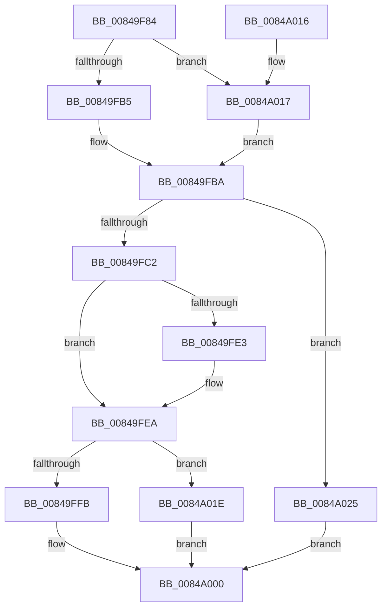

# CmpRemoveSubKey

- RVA: `0x00849F84`–`0x0084A02A` (길이 `166` bytes)
- VA: `0x0000000140849F84`
- 실행 섹션: `PAGE`
- PDB 이름 있음: `예`; PDB Function 태그: `아니요`
- unwind 정보 RVA: `0x000694B8`
- 디코드: `51`개 명령, `166/166` bytes 표시
- 미해석 바이트: `0` (있으면 어셈블리에 `.byte`로 보존)

> 이 문서는 커널 이미지의 기계어와 PDB 기호를 분석해 생성했습니다. 4번과 5번은 함수 원형과 자료형을 바이너리 사용 방식에서 추정한 C 해석이며 원본 소스 복구 결과는 아닙니다.

## 1. Dependencies

- 직접 호출 지점: **5**; 고유 호출 대상: **5**
- 직접 호출자로 확인된 함수: **1**
- RIP 상대 이미지 참조: **0**

### Outgoing calls
- `0x00849FB5` → [HvpGetCellFlat](../85/HvpGetCellFlat_function_00854C60.md) (function, `0x00854C60`)
- `0x00849FD7` → [CmpRemoveSubKeyFromList](CmpRemoveSubKeyFromList_function_0084A030.md) (function, `0x0084A030`)
- `0x00849FFB` → [HvpReleaseCellPaged](../85/HvpReleaseCellPaged_function_00855F40.md) (function, `0x00855F40`)
- `0x0084A017` → [HvpGetCellPaged](../85/HvpGetCellPaged_function_00854CB0.md) (function, `0x00854CB0`)
- `0x0084A01E` → [HvpReleaseCellFlat](../85/HvpReleaseCellFlat_function_0085CC20.md) (function, `0x0085CC20`)

### Direct callers
- [CmpFreeKeyByCell](CmpFreeKeyByCell_function_0084AD70.md) at `0x0084ADFF`

### Static image references
- 디코드된 RIP-relative 메모리 참조가 없습니다.

## 2. Other-region calls and transfers

- 다른 실행 섹션으로 향하는 call: **0**
- 별도 외부 분기/꼬리 이동을 확인하지 못했습니다.

## 3. Assembly (complete function range)

```asm
00849F84  48 8B C4                        mov rax, rsp
00849F87  48 89 58 10                     mov qword ptr [rax + 0x10], rbx
00849F8B  48 89 68 18                     mov qword ptr [rax + 0x18], rbp
00849F8F  56                              push rsi
00849F90  57                              push rdi
00849F91  41 56                           push r14
00849F93  48 83 EC 20                     sub rsp, 0x20
00849F97  83 48 08 FF                     or dword ptr [rax + 8], 0xffffffff
00849F9B  45 33 F6                        xor r14d, r14d
00849F9E  F6 81 8C 00 00 00 01            test byte ptr [rcx + 0x8c], 1
00849FA5  48 8B D9                        mov rbx, rcx
00849FA8  41 8B F8                        mov edi, r8d
00849FAB  4C 8D 40 08                     lea r8, [rax + 8]
00849FAF  44 89 70 0C                     mov dword ptr [rax + 0xc], r14d
00849FB3  74 62                           je 0x14084a017
00849FB5  E8 A6 AC 00 00                  call 0x140854c60
00849FBA  48 8B F0                        mov rsi, rax
00849FBD  48 85 C0                        test rax, rax
00849FC0  74 63                           je 0x14084a025
00849FC2  48 8B EF                        mov rbp, rdi
00849FC5  44 8B C7                        mov r8d, edi
00849FC8  48 C1 ED 1F                     shr rbp, 0x1f
00849FCC  48 8B CB                        mov rcx, rbx
00849FCF  48 8D 55 07                     lea rdx, [rbp + 7]
00849FD3  48 8D 14 90                     lea rdx, [rax + rdx*4]
00849FD7  E8 54 00 00 00                  call 0x14084a030
00849FDC  40 8A F8                        mov dil, al
00849FDF  84 C0                           test al, al
00849FE1  74 07                           je 0x140849fea
00849FE3  FF 4C AE 14                     dec dword ptr [rsi + rbp*4 + 0x14]
00849FE7  40 B7 01                        mov dil, 1
00849FEA  F6 83 8C 00 00 00 01            test byte ptr [rbx + 0x8c], 1
00849FF1  48 8D 54 24 40                  lea rdx, [rsp + 0x40]
00849FF6  48 8B CB                        mov rcx, rbx
00849FF9  75 23                           jne 0x14084a01e
00849FFB  E8 40 BF 00 00                  call 0x140855f40
0084A000  48 8B 5C 24 48                  mov rbx, qword ptr [rsp + 0x48]
0084A005  40 8A C7                        mov al, dil
0084A008  48 8B 6C 24 50                  mov rbp, qword ptr [rsp + 0x50]
0084A00D  48 83 C4 20                     add rsp, 0x20
0084A011  41 5E                           pop r14
0084A013  5F                              pop rdi
0084A014  5E                              pop rsi
0084A015  C3                              ret
0084A016  CC                              int3
0084A017  E8 94 AC 00 00                  call 0x140854cb0
0084A01C  EB 9C                           jmp 0x140849fba
0084A01E  E8 FD 2B 01 00                  call 0x14085cc20
0084A023  EB DB                           jmp 0x14084a000
0084A025  41 8A FE                        mov dil, r14b
0084A028  EB D6                           jmp 0x14084a000
```

## 4. C-style interpretation (structured pseudocode)

```c
__int64 __fastcall CmpRemoveSubKey(__int64 a1, __int64 a2, int a3)
{
    __int64 result;
    __int64 v_r14;
    __int64 v_rbp;
    __int64 v_rdi;
    __int64 v_rsp;
    unsigned __int64 v_stack_p10;
    unsigned __int64 v_stack_p18;
    unsigned __int64 v_stack_p8;

    *(unsigned __int64 *)(v_rsp + 16) = v_rbx;
    *(unsigned __int64 *)(v_rsp + 24) = v_rbp;
    v_rsp = (v_rsp) - (32);
    v_r14 = 0;
    *(unsigned int *)(v_rsp + 12) = 0;
    if (((*(unsigned __int8 *)(a1 + 140)) & (1)) == 0) goto loc_0084A017;
    result = HvpGetCellFlat(a1, a2, v_rsp + 8, a4);
loc_00849FBA:
    if (result == 0) goto loc_0084A025;
    v_rbp = ((unsigned int)(a3)) >> (31);
    result = CmpRemoveSubKeyFromList(a1, result + v_rbp + 7 * 4, (unsigned int)((unsigned int)((unsigned int)(a3))), a4);
    v_rdi = (unsigned __int8)(result);
    if ((unsigned __int8)(result) != 0) {
        v_rdi = 1;
    }
    if (((*(unsigned __int8 *)(a1 + 140)) & (1)) != 0) goto loc_0084A01E;
    result = HvpReleaseCellPaged(a1, v_stack_p8, (unsigned int)((unsigned int)((unsigned int)(a3))), a4);
loc_0084A000:
    v_rsp = (v_rsp) + (32);
    return (unsigned __int8)(v_rdi);
loc_0084A017:
    result = HvpGetCellPaged(a1, v_stack_p8, (unsigned int)((unsigned int)((unsigned int)(a3))), a4);
    goto loc_00849FBA;
loc_0084A01E:
    result = HvpReleaseCellFlat(a1, v_stack_p8, (unsigned int)((unsigned int)((unsigned int)(a3))), a4);
    goto loc_0084A000;
loc_0084A025:
    goto loc_0084A000;
}
```

## 5. (Beta) C Style

```c
int64_t CmpRemoveSubKey(void *Arg1, int64_t Arg2, int32_t Arg3)
{
    uint8_t *arg1 = (uint8_t *)Arg1;

    int64_t result;
    int64_t local_r14;
    int64_t local_rbp;
    int64_t local_rdi;
    int64_t local_rsp;
    uint64_t v_stack_p10;
    uint64_t v_stack_p18;
    uint64_t v_stack_p8;

    *(uint64_t *)(local_rsp + 0x10) = local_rbx;
    *(uint64_t *)(local_rsp + 0x18) = local_rbp;
    local_rsp = (local_rsp) - (32);
    local_r14 = 0;
    *(uint32_t *)(local_rsp + 0xC) = 0;
    if (((*(uint8_t *)(arg1 + 0x8C)) & (1)) == 0) goto loc_0084A017;
    result = HvpGetCellFlat(Arg1, Arg2, local_rsp + 8, a4);
loc_00849FBA:
    if (result == 0) goto loc_0084A025;
    local_rbp = ((uint32_t)(Arg3)) >> (31);
    result = CmpRemoveSubKeyFromList(Arg1, result + local_rbp + 7 * 4, (uint32_t)((uint32_t)((uint32_t)(Arg3))), a4);
    local_rdi = (uint8_t)(result);
    if ((uint8_t)(result) != 0) {
        local_rdi = 1;
    }
    if (((*(uint8_t *)(arg1 + 0x8C)) & (1)) != 0) goto loc_0084A01E;
    result = HvpReleaseCellPaged(Arg1, v_stack_p8, (uint32_t)((uint32_t)((uint32_t)(Arg3))), a4);
loc_0084A000:
    local_rsp = (local_rsp) + (32);
    return (uint8_t)(local_rdi);
loc_0084A017:
    result = HvpGetCellPaged(Arg1, v_stack_p8, (uint32_t)((uint32_t)((uint32_t)(Arg3))), a4);
    goto loc_00849FBA;
loc_0084A01E:
    result = HvpReleaseCellFlat(Arg1, v_stack_p8, (uint32_t)((uint32_t)((uint32_t)(Arg3))), a4);
    goto loc_0084A000;
loc_0084A025:
    goto loc_0084A000;
}
```

### 관측된 메모리 오프셋

구조체 형식이 확인되지 않은 접근은 인자 기준의 오프셋으로만 기록했습니다.

| 기준 인자 | 오프셋 표현 | 폭 (bit) | 접근 |
|---|---:|---:|---|
| `Arg1` | `+ 0x8C` | `8` | `R` |

## 6. Execution-region graph

[열기: 2D/3D 그래프와 함수 탐색 컨트롤 패널](../../../control-panel.html?section=page&rva=0x00849F84&view=graph)

- 2D 그래프는 위에서 아래로 흐르고, 3D 그래프는 빈 공간을 드래그해 회전합니다. Shift+드래그는 이동, 휠은 확대·축소, 함수 노드 선택은 대상 보고서 이동입니다.

### Static fallback


