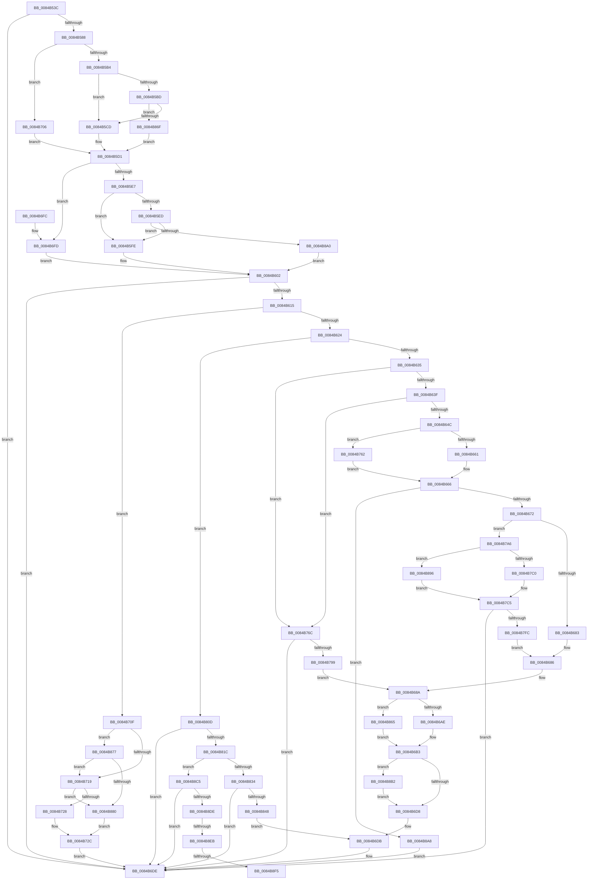

# CmpSetValueKeyExisting

- RVA: `0x0084B53C`–`0x0084B909` (길이 `973` bytes)
- VA: `0x000000014084B53C`
- 실행 섹션: `PAGE`
- PDB 이름 있음: `예`; PDB Function 태그: `예`
- unwind 정보 RVA: `0x00069644`
- 디코드: `241`개 명령, `973/973` bytes 표시
- 미해석 바이트: `0` (있으면 어셈블리에 `.byte`로 보존)

> 이 문서는 커널 이미지의 기계어와 PDB 기호를 분석해 생성했습니다. 4번과 5번은 함수 원형과 자료형을 바이너리 사용 방식에서 추정한 C 해석이며 원본 소스 복구 결과는 아닙니다.

## 1. Dependencies

- 직접 호출 지점: **17**; 고유 호출 대상: **13**
- 직접 호출자로 확인된 함수: **2**
- RIP 상대 이미지 참조: **0**

### Outgoing calls
- `0x0084B57B` → [HvpMarkCellDirty](../85/HvpMarkCellDirty_function_00858080.md) (function, `0x00858080`)
- `0x0084B608` → [CmpMarkValueDataDirty](CmpMarkValueDataDirty_function_0084B910.md) (function, `0x0084B910`)
- `0x0084B661` → [HvpGetCellFlat](../85/HvpGetCellFlat_function_00854C60.md) (function, `0x00854C60`)
- `0x0084B691` → [memcpy](../../text/6C/memcpy_function_006C6840.md) (function, `0x006C6840`)
- `0x0084B6AE` → [HvpReleaseCellPaged](../85/HvpReleaseCellPaged_function_00855F40.md) (function, `0x00855F40`)
- `0x0084B747` → [memcpy](../../text/6C/memcpy_function_006C6840.md) (function, `0x006C6840`)
- `0x0084B762` → [HvpGetCellPaged](../85/HvpGetCellPaged_function_00854CB0.md) (function, `0x00854CB0`)
- `0x0084B78C` → [HvAllocateCell](../85/HvAllocateCell_function_00859C94.md) (function, `0x00859C94`)
- `0x0084B7C0` → [HvpReleaseCellPaged](../85/HvpReleaseCellPaged_function_00855F40.md) (function, `0x00855F40`)
- `0x0084B7EF` → [HvReallocateCell](../85/HvReallocateCell_function_0085B5D0.md) (function, `0x0085B5D0`)
- `0x0084B838` → [CmpSetValueDataExisting](../A7/CmpSetValueDataExisting_function_00A79260.md) (function, `0x00A79260`)
- `0x0084B865` → [HvpReleaseCellFlat](../85/HvpReleaseCellFlat_function_0085CC20.md) (function, `0x0085CC20`)
- `0x0084B88C` → [CmpFreeValueData](CmpFreeValueData_function_0084B040.md) (function, `0x0084B040`)
- `0x0084B896` → [HvpReleaseCellFlat](../85/HvpReleaseCellFlat_function_0085CC20.md) (function, `0x0085CC20`)
- `0x0084B8BB` → [CmpFreeValueData](CmpFreeValueData_function_0084B040.md) (function, `0x0084B040`)
- `0x0084B8CE` → [CmpSetValueDataNew](../A2/CmpSetValueDataNew_function_00A26550.md) (function, `0x00A26550`)
- `0x0084B8FB` → [HvFreeCell](../85/HvFreeCell_function_0085A72C.md) (function, `0x0085A72C`)

### Direct callers
- [CmpPreserveSystemHiveData](../7F/CmpPreserveSystemHiveData_function_007F2518.md) at `0x007F2CA9`
- [CmSetValueKey](CmSetValueKey_function_008457C0.md) at `0x0084636F`

### Static image references
- 디코드된 RIP-relative 메모리 참조가 없습니다.

## 2. Other-region calls and transfers

- 다른 실행 섹션으로 향하는 call: **2**
  - `0x0084B691` → [memcpy](../../text/6C/memcpy_function_006C6840.md) (`PAGE` → `.text`)
  - `0x0084B747` → [memcpy](../../text/6C/memcpy_function_006C6840.md) (`PAGE` → `.text`)
- call이 아닌 외부 분기/꼬리 이동: **3**
  - `0x0084B8E5` → [sub_00B16864](../B1/Unknown_function_00B16864.md) (`tail-transfer`)
  - `0x0084B8EF` → [sub_00B16864](../B1/Unknown_function_00B16864.md) (`tail-transfer`)
  - `0x0084B904` → [sub_00B16864](../B1/Unknown_function_00B16864.md) (`tail-transfer`)

## 3. Assembly (complete function range)

```asm
0084B53C  48 8B C4                        mov rax, rsp
0084B53F  48 89 58 08                     mov qword ptr [rax + 8], rbx
0084B543  48 89 70 10                     mov qword ptr [rax + 0x10], rsi
0084B547  48 89 78 18                     mov qword ptr [rax + 0x18], rdi
0084B54B  44 89 48 20                     mov dword ptr [rax + 0x20], r9d
0084B54F  55                              push rbp
0084B550  41 54                           push r12
0084B552  41 55                           push r13
0084B554  41 56                           push r14
0084B556  41 57                           push r15
0084B558  48 8B EC                        mov rbp, rsp
0084B55B  48 83 EC 60                     sub rsp, 0x60
0084B55F  83 4D E8 FF                     or dword ptr [rbp - 0x18], 0xffffffff
0084B563  33 F6                           xor esi, esi
0084B565  49 8B F8                        mov rdi, r8
0084B568  48 89 75 F0                     mov qword ptr [rbp - 0x10], rsi
0084B56C  45 33 C0                        xor r8d, r8d
0084B56F  89 75 EC                        mov dword ptr [rbp - 0x14], esi
0084B572  45 33 C9                        xor r9d, r9d
0084B575  89 75 E0                        mov dword ptr [rbp - 0x20], esi
0084B578  48 8B D9                        mov rbx, rcx
0084B57B  E8 00 CB 00 00                  call 0x140858080
0084B580  85 C0                           test eax, eax
0084B582  0F 88 56 01 00 00               js 0x14084b6de
0084B588  8B 47 04                        mov eax, dword ptr [rdi + 4]
0084B58B  8D 56 01                        lea edx, [rsi + 1]
0084B58E  B9 00 00 00 80                  mov ecx, 0x80000000
0084B593  44 8D 4E 02                     lea r9d, [rsi + 2]
0084B597  3B C1                           cmp eax, ecx
0084B599  41 B8 26 C0 FF 7F               mov r8d, 0x7fffc026
0084B59F  44 8D B0 00 00 00 80            lea r14d, [rax - 0x80000000]
0084B5A6  44 0F 42 F0                     cmovb r14d, eax
0084B5AA  44 89 75 E4                     mov dword ptr [rbp - 0x1c], r14d
0084B5AE  0F 83 52 01 00 00               jae 0x14084b706
0084B5B4  83 BB DC 00 00 00 04            cmp dword ptr [rbx + 0xdc], 4
0084B5BB  72 10                           jb 0x14084b5cd
0084B5BD  41 8D 86 27 C0 FF FF            lea eax, [r14 - 0x3fd9]
0084B5C4  41 3B C0                        cmp eax, r8d
0084B5C7  0F 86 A2 02 00 00               jbe 0x14084b86f
0084B5CD  44 0F B7 EA                     movzx r13d, dx
0084B5D1  44 8B 65 58                     mov r12d, dword ptr [rbp + 0x58]
0084B5D5  48 8B CB                        mov rcx, rbx
0084B5D8  B8 DC 00 00 00                  mov eax, 0xdc
0084B5DD  41 83 FC 04                     cmp r12d, 4
0084B5E1  0F 86 16 01 00 00               jbe 0x14084b6fd
0084B5E7  83 3C 18 04                     cmp dword ptr [rax + rbx], 4
0084B5EB  72 11                           jb 0x14084b5fe
0084B5ED  41 8D 84 24 27 C0 FF FF         lea eax, [r12 - 0x3fd9]
0084B5F5  41 3B C0                        cmp eax, r8d
0084B5F8  0F 86 A2 02 00 00               jbe 0x14084b8a0
0084B5FE  44 0F B7 FA                     movzx r15d, dx
0084B602  48 8B D7                        mov rdx, rdi
0084B605  48 8B CB                        mov rcx, rbx
0084B608  E8 03 03 00 00                  call 0x14084b910
0084B60D  85 C0                           test eax, eax
0084B60F  0F 88 C9 00 00 00               js 0x14084b6de
0084B615  B9 01 00 00 00                  mov ecx, 1
0084B61A  66 45 85 FF                     test r15w, r15w
0084B61E  0F 84 EB 00 00 00               je 0x14084b70f
0084B624  4C 8D 77 08                     lea r14, [rdi + 8]
0084B628  41 8B 36                        mov esi, dword ptr [r14]
0084B62B  66 44 3B F9                     cmp r15w, cx
0084B62F  0F 85 D8 01 00 00               jne 0x14084b80d
0084B635  66 44 3B E9                     cmp r13w, cx
0084B639  0F 85 2D 01 00 00               jne 0x14084b76c
0084B63F  45 33 FF                        xor r15d, r15d
0084B642  44 39 7D E4                     cmp dword ptr [rbp - 0x1c], r15d
0084B646  0F 86 20 01 00 00               jbe 0x14084b76c
0084B64C  84 8B 8C 00 00 00               test byte ptr [rbx + 0x8c], cl
0084B652  4C 8D 45 E8                     lea r8, [rbp - 0x18]
0084B656  48 8B CB                        mov rcx, rbx
0084B659  8B D6                           mov edx, esi
0084B65B  0F 84 01 01 00 00               je 0x14084b762
0084B661  E8 FA 95 00 00                  call 0x140854c60
0084B666  48 8B C8                        mov rcx, rax
0084B669  48 85 C0                        test rax, rax
0084B66C  0F 84 36 02 00 00               je 0x14084b8a8
0084B672  B8 FC FF FF FF                  mov eax, 0xfffffffc
0084B677  2B 41 FC                        sub eax, dword ptr [rcx - 4]
0084B67A  44 3B E0                        cmp r12d, eax
0084B67D  0F 87 23 01 00 00               ja 0x14084b7a6
0084B683  44 8B FE                        mov r15d, esi
0084B686  4C 8D 77 08                     lea r14, [rdi + 8]
0084B68A  48 8B 55 50                     mov rdx, qword ptr [rbp + 0x50]
0084B68E  4D 8B C4                        mov r8, r12
0084B691  E8 AA B1 E7 FF                  call 0x1406c6840
0084B696  B9 01 00 00 00                  mov ecx, 1
0084B69B  48 8D 55 E8                     lea rdx, [rbp - 0x18]
0084B69F  84 8B 8C 00 00 00               test byte ptr [rbx + 0x8c], cl
0084B6A5  48 8B CB                        mov rcx, rbx
0084B6A8  0F 85 B7 01 00 00               jne 0x14084b865
0084B6AE  E8 8D A8 00 00                  call 0x140855f40
0084B6B3  8B 45 48                        mov eax, dword ptr [rbp + 0x48]
0084B6B6  B9 02 00 00 00                  mov ecx, 2
0084B6BB  89 47 0C                        mov dword ptr [rdi + 0xc], eax
0084B6BE  B8 FD FF 00 00                  mov eax, 0xfffd
0084B6C3  66 21 47 10                     and word ptr [rdi + 0x10], ax
0084B6C7  45 89 3E                        mov dword ptr [r14], r15d
0084B6CA  44 89 67 04                     mov dword ptr [rdi + 4], r12d
0084B6CE  66 44 3B E9                     cmp r13w, cx
0084B6D2  0F 84 DA 01 00 00               je 0x14084b8b2
0084B6D8  45 33 FF                        xor r15d, r15d
0084B6DB  41 8B C7                        mov eax, r15d
0084B6DE  4C 8D 5C 24 60                  lea r11, [rsp + 0x60]
0084B6E3  49 8B 5B 30                     mov rbx, qword ptr [r11 + 0x30]
0084B6E7  49 8B 73 38                     mov rsi, qword ptr [r11 + 0x38]
0084B6EB  49 8B 7B 40                     mov rdi, qword ptr [r11 + 0x40]
0084B6EF  49 8B E3                        mov rsp, r11
0084B6F2  41 5F                           pop r15
0084B6F4  41 5E                           pop r14
0084B6F6  41 5D                           pop r13
0084B6F8  41 5C                           pop r12
0084B6FA  5D                              pop rbp
0084B6FB  C3                              ret
0084B6FC  CC                              int3
0084B6FD  44 0F B7 FE                     movzx r15d, si
0084B701  E9 FC FE FF FF                  jmp 0x14084b602
0084B706  44 0F B7 EE                     movzx r13d, si
0084B70A  E9 C2 FE FF FF                  jmp 0x14084b5d1
0084B70F  66 44 3B E9                     cmp r13w, cx
0084B713  0F 84 5E 01 00 00               je 0x14084b877
0084B719  B9 02 00 00 00                  mov ecx, 2
0084B71E  66 44 3B E9                     cmp r13w, cx
0084B722  0F 84 58 01 00 00               je 0x14084b880
0084B728  48 8D 77 08                     lea rsi, [rdi + 8]
0084B72C  48 8B 55 50                     mov rdx, qword ptr [rbp + 0x50]
0084B730  B8 00 00 00 80                  mov eax, 0x80000000
0084B735  41 03 C4                        add eax, r12d
0084B738  45 33 FF                        xor r15d, r15d
0084B73B  4D 8B C4                        mov r8, r12
0084B73E  89 47 04                        mov dword ptr [rdi + 4], eax
0084B741  48 8B CE                        mov rcx, rsi
0084B744  44 89 3E                        mov dword ptr [rsi], r15d
0084B747  E8 F4 B0 E7 FF                  call 0x1406c6840
0084B74C  8B 45 48                        mov eax, dword ptr [rbp + 0x48]
0084B74F  89 47 0C                        mov dword ptr [rdi + 0xc], eax
0084B752  B8 FD FF 00 00                  mov eax, 0xfffd
0084B757  66 21 47 10                     and word ptr [rdi + 0x10], ax
0084B75B  33 C0                           xor eax, eax
0084B75D  E9 7C FF FF FF                  jmp 0x14084b6de
0084B762  E8 49 95 00 00                  call 0x140854cb0
0084B767  E9 FA FE FF FF                  jmp 0x14084b666
0084B76C  44 8B 45 60                     mov r8d, dword ptr [rbp + 0x60]
0084B770  48 8D 45 E8                     lea rax, [rbp - 0x18]
0084B774  48 89 44 24 28                  mov qword ptr [rsp + 0x28], rax
0084B779  4C 8D 4D E0                     lea r9, [rbp - 0x20]
0084B77D  48 8D 45 F0                     lea rax, [rbp - 0x10]
0084B781  41 8B D4                        mov edx, r12d
0084B784  48 8B CB                        mov rcx, rbx
0084B787  48 89 44 24 20                  mov qword ptr [rsp + 0x20], rax
0084B78C  E8 03 E5 00 00                  call 0x140859c94
0084B791  85 C0                           test eax, eax
0084B793  0F 88 45 FF FF FF               js 0x14084b6de
0084B799  48 8B 4D F0                     mov rcx, qword ptr [rbp - 0x10]
0084B79D  44 8B 7D E0                     mov r15d, dword ptr [rbp - 0x20]
0084B7A1  E9 E4 FE FF FF                  jmp 0x14084b68a
0084B7A6  41 BE 01 00 00 00               mov r14d, 1
0084B7AC  48 8D 55 E8                     lea rdx, [rbp - 0x18]
0084B7B0  48 8B CB                        mov rcx, rbx
0084B7B3  44 84 B3 8C 00 00 00            test byte ptr [rbx + 0x8c], r14b
0084B7BA  0F 85 D6 00 00 00               jne 0x14084b896
0084B7C0  E8 7B A7 00 00                  call 0x140855f40
0084B7C5  48 8D 45 E8                     lea rax, [rbp - 0x18]
0084B7C9  4C 89 7D F0                     mov qword ptr [rbp - 0x10], r15
0084B7CD  48 89 44 24 30                  mov qword ptr [rsp + 0x30], rax
0084B7D2  45 8A CE                        mov r9b, r14b
0084B7D5  48 8D 45 F0                     lea rax, [rbp - 0x10]
0084B7D9  45 8B C4                        mov r8d, r12d
0084B7DC  48 89 44 24 28                  mov qword ptr [rsp + 0x28], rax
0084B7E1  8B D6                           mov edx, esi
0084B7E3  48 8D 45 E0                     lea rax, [rbp - 0x20]
0084B7E7  48 8B CB                        mov rcx, rbx
0084B7EA  48 89 44 24 20                  mov qword ptr [rsp + 0x20], rax
0084B7EF  E8 DC FD 00 00                  call 0x14085b5d0
0084B7F4  85 C0                           test eax, eax
0084B7F6  0F 88 E2 FE FF FF               js 0x14084b6de
0084B7FC  44 8B 7D E0                     mov r15d, dword ptr [rbp - 0x20]
0084B800  48 8B 4D F0                     mov rcx, qword ptr [rbp - 0x10]
0084B804  44 89 7F 08                     mov dword ptr [rdi + 8], r15d
0084B808  E9 79 FE FF FF                  jmp 0x14084b686
0084B80D  B9 02 00 00 00                  mov ecx, 2
0084B812  66 44 3B F9                     cmp r15w, cx
0084B816  0F 85 C2 FE FF FF               jne 0x14084b6de
0084B81C  44 8B 4D 60                     mov r9d, dword ptr [rbp + 0x60]
0084B820  66 44 3B E9                     cmp r13w, cx
0084B824  48 8B 55 50                     mov rdx, qword ptr [rbp + 0x50]
0084B828  48 8B CB                        mov rcx, rbx
0084B82B  45 8B C4                        mov r8d, r12d
0084B82E  0F 85 91 00 00 00               jne 0x14084b8c5
0084B834  89 74 24 20                     mov dword ptr [rsp + 0x20], esi
0084B838  E8 23 DA 22 00                  call 0x140a79260
0084B83D  45 33 FF                        xor r15d, r15d
0084B840  85 C0                           test eax, eax
0084B842  0F 88 96 FE FF FF               js 0x14084b6de
0084B848  49 8B C6                        mov rax, r14
0084B84B  89 30                           mov dword ptr [rax], esi
0084B84D  8B 45 48                        mov eax, dword ptr [rbp + 0x48]
0084B850  89 47 0C                        mov dword ptr [rdi + 0xc], eax
0084B853  B8 FD FF 00 00                  mov eax, 0xfffd
0084B858  66 21 47 10                     and word ptr [rdi + 0x10], ax
0084B85C  44 89 67 04                     mov dword ptr [rdi + 4], r12d
0084B860  E9 76 FE FF FF                  jmp 0x14084b6db
0084B865  E8 B6 13 01 00                  call 0x14085cc20
0084B86A  E9 44 FE FF FF                  jmp 0x14084b6b3
0084B86F  45 8B E9                        mov r13d, r9d
0084B872  E9 5A FD FF FF                  jmp 0x14084b5d1
0084B877  45 85 F6                        test r14d, r14d
0084B87A  0F 84 99 FE FF FF               je 0x14084b719
0084B880  48 8D 77 08                     lea rsi, [rdi + 8]
0084B884  45 8B C6                        mov r8d, r14d
0084B887  8B 16                           mov edx, dword ptr [rsi]
0084B889  48 8B CB                        mov rcx, rbx
0084B88C  E8 AF F7 FF FF                  call 0x14084b040
0084B891  E9 96 FE FF FF                  jmp 0x14084b72c
0084B896  E8 85 13 01 00                  call 0x14085cc20
0084B89B  E9 25 FF FF FF                  jmp 0x14084b7c5
0084B8A0  45 8B F9                        mov r15d, r9d
0084B8A3  E9 5A FD FF FF                  jmp 0x14084b602
0084B8A8  B8 9A 00 00 C0                  mov eax, 0xc000009a
0084B8AD  E9 2C FE FF FF                  jmp 0x14084b6de
0084B8B2  44 8B 45 E4                     mov r8d, dword ptr [rbp - 0x1c]
0084B8B6  8B D6                           mov edx, esi
0084B8B8  48 8B CB                        mov rcx, rbx
0084B8BB  E8 80 F7 FF FF                  call 0x14084b040
0084B8C0  E9 13 FE FF FF                  jmp 0x14084b6d8
0084B8C5  48 8D 45 E0                     lea rax, [rbp - 0x20]
0084B8C9  48 89 44 24 20                  mov qword ptr [rsp + 0x20], rax
0084B8CE  E8 7D AC 1D 00                  call 0x140a26550
0084B8D3  45 33 FF                        xor r15d, r15d
0084B8D6  85 C0                           test eax, eax
0084B8D8  0F 88 00 FE FF FF               js 0x14084b6de
0084B8DE  49 8B C6                        mov rax, r14
0084B8E1  66 45 85 ED                     test r13w, r13w
0084B8E5  0F 84 79 AF 2C 00               je 0x140b16864
0084B8EB  44 39 7D E4                     cmp dword ptr [rbp - 0x1c], r15d
0084B8EF  0F 84 6F AF 2C 00               je 0x140b16864
0084B8F5  41 8B 16                        mov edx, dword ptr [r14]
0084B8F8  48 8B CB                        mov rcx, rbx
0084B8FB  E8 2C EE 00 00                  call 0x14085a72c
0084B900  48 8D 47 08                     lea rax, [rdi + 8]
0084B904  E9 5B AF 2C 00                  jmp 0x140b16864
```

## 4. C-style interpretation (structured pseudocode)

```c
__int64 __fastcall CmpSetValueKeyExisting(__int64 a1, __int64 a2, __int64 a3, int a4, __int64 a5, unsigned int a6, unsigned int a7)
{
    __int64 result;
    __int64 v_r14;
    __int64 v_r15;
    __int64 v_rsi;
    __int64 v_rsp;
    unsigned __int64 v_stack_m28;
    unsigned __int64 v_stack_m30;
    unsigned __int64 v_stack_m38;
    unsigned int v_stack_m3C;
    unsigned int v_stack_m40;
    unsigned int v_stack_m44;
    unsigned int v_stack_m48;
    unsigned int v_stack_p20;

    *(unsigned __int64 *)(v_rsp + 8) = v_rbx;
    *(unsigned __int64 *)(v_rsp + 16) = v_rsi;
    *(unsigned __int64 *)(v_rsp + 24) = v_rdi;
    *(unsigned int *)(v_rsp + 32) = a4;
    v_rsp = (v_rsp) - (96);
    v_rsi = 0;
    v_stack_m38 = 0;
    a3 = 0;
    v_stack_m3C = 0;
    a4 = 0;
    v_stack_m48 = 0;
    result = HvpMarkCellDirty(a1, a2, a3, a4);
    if (sign_flag) goto loc_0084B6DE;
    v_r14 = (unsigned int)(*(unsigned int *)(a3 + 4)) - 2147483648;
    if (((unsigned int)((unsigned int)(*(unsigned int *)(a3 + 4)))) < ((unsigned int)((unsigned int)(0x80000000ULL)))) { v_r14 = (unsigned int)((unsigned int)(*(unsigned int *)(a3 + 4))); }
    v_stack_m44 = (unsigned int)(v_r14);
    if (((unsigned int)((unsigned int)(*(unsigned int *)(a3 + 4)))) >= ((unsigned int)((unsigned int)(0x80000000ULL)))) goto loc_0084B706;
    if ((*(unsigned int *)(a1 + 220)) < 4) goto loc_0084B5CD;
    if (((unsigned int)(v_r14 - 16345)) <= ((unsigned int)((unsigned int)(0x7FFFC026ULL)))) goto loc_0084B86F;
loc_0084B5CD:
loc_0084B5D1:
    if (((unsigned int)((unsigned int)(a6))) <= 4) goto loc_0084B6FD;
    if ((*(unsigned int *)(220 + a1 * 1)) < 4) goto loc_0084B5FE;
    if (((unsigned int)((unsigned int)(a6) - 16345)) <= ((unsigned int)((unsigned int)(0x7FFFC026ULL)))) goto loc_0084B8A0;
loc_0084B5FE:
loc_0084B602:
    result = CmpMarkValueDataDirty(a1, 0, (unsigned int)(0x7FFFC026ULL), v_rsi + 2);
    if (sign_flag) goto loc_0084B6DE;
    if ((unsigned __int16)((unsigned __int16)(v_rsi + 1)) == 0) goto loc_0084B70F;
    if (((unsigned __int16)((unsigned __int16)(v_rsi + 1))) != 1) goto loc_0084B80D;
    if (((unsigned __int16)((unsigned __int16)(v_rsi + 1))) != 1) goto loc_0084B76C;
    v_r15 = 0;
    if (v_stack_m44 <= 0) goto loc_0084B76C;
    if (((*(unsigned __int8 *)(a1 + 140)) & (1)) == 0) goto loc_0084B762;
    result = HvpGetCellFlat(a1, (unsigned int)((unsigned int)((unsigned int)(*(unsigned int *)(a3 + 8)))), v_stack_m40, v_rsi + 2);
loc_0084B666:
    if (result == 0) goto loc_0084B8A8;
    result = (unsigned int)(((unsigned int)(0xFFFFFFFCULL)) - (*(unsigned int *)(result - 4)));
    if (((unsigned int)((unsigned int)(a6))) > ((unsigned int)(result))) goto loc_0084B7A6;
loc_0084B686:
loc_0084B68A:
    result = memcpy(result, a5, (unsigned int)(a6), v_rsi + 2);
    if (((*(unsigned __int8 *)(a1 + 140)) & (1)) != 0) goto loc_0084B865;
    result = HvpReleaseCellPaged(a1, v_stack_m40, (unsigned int)(a6), v_rsi + 2);
loc_0084B6B3:
    *(unsigned int *)(a3 + 12) = (unsigned int)((unsigned int)(v_stack_p20));
    *(unsigned int *)(a3 + 8) = (unsigned int)((unsigned int)((unsigned int)((unsigned int)(*(unsigned int *)(a3 + 8)))));
    *(unsigned int *)(a3 + 4) = (unsigned int)((unsigned int)(a6));
    if (((unsigned __int16)((unsigned __int16)(v_rsi + 1))) == 2) goto loc_0084B8B2;
loc_0084B6D8:
    v_r15 = 0;
loc_0084B6DB:
loc_0084B6DE:
    return 0;
loc_0084B6FD:
    goto loc_0084B602;
loc_0084B706:
    goto loc_0084B5D1;
loc_0084B70F:
    if (((unsigned __int16)((unsigned __int16)(*(unsigned __int64 *)(v_stack_m28 + 56)))) == 2) goto loc_0084B877;
loc_0084B719:
    if (((unsigned __int16)((unsigned __int16)(*(unsigned __int64 *)(v_stack_m28 + 56)))) == 2) goto loc_0084B880;
loc_0084B72C:
    result = (unsigned int)(((unsigned int)(0x80000000ULL)) + ((unsigned int)((unsigned int)(a6))));
    v_r15 = 0;
    *(unsigned int *)(*(unsigned __int64 *)(v_stack_m28 + 64) + 4) = (unsigned int)(result);
    *(unsigned int *)(*(unsigned __int64 *)(v_stack_m28 + 64) + 8) = 0;
    result = memcpy(*(unsigned __int64 *)(v_stack_m28 + 64) + 8, a5, (unsigned int)(a6), v_rsi + 2);
    *(unsigned int *)(*(unsigned __int64 *)(v_stack_m28 + 64) + 12) = (unsigned int)((unsigned int)(v_stack_p20));
    result = 0;
    goto loc_0084B6DE;
loc_0084B762:
    result = HvpGetCellPaged(*(unsigned __int64 *)(v_stack_m28 + 64) + 8, a5, (unsigned int)(a6), v_rsi + 2);
    goto loc_0084B666;
loc_0084B76C:
    v_stack_m38 = v_stack_m40;
    v_stack_m40 = v_stack_m38;
    result = HvAllocateCell(*(unsigned __int64 *)(v_stack_m28 + 48), (unsigned int)((unsigned int)((unsigned int)(a6))), (unsigned int)(a7), v_stack_m48);
    if (sign_flag) goto loc_0084B6DE;
    goto loc_0084B68A;
loc_0084B7A6:
    if (((*(unsigned __int8 *)(*(unsigned __int64 *)(v_stack_m28 + 48) + 140)) & (1)) != 0) goto loc_0084B896;
    result = HvpReleaseCellPaged(*(unsigned __int64 *)(v_stack_m28 + 48), v_stack_m40, (unsigned int)(a7), v_stack_m48);
loc_0084B7C5:
    v_stack_m38 = (unsigned int)(v_stack_m48);
    v_stack_m30 = v_stack_m40;
    v_stack_m38 = v_stack_m38;
    v_stack_m40 = v_stack_m48;
    result = HvReallocateCell(*(unsigned __int64 *)(v_stack_m28 + 48), (unsigned int)((unsigned int)(*(unsigned __int64 *)(v_stack_m28 + 64) + 8)), (unsigned int)((unsigned int)((unsigned int)(a6))), 1);
    if (sign_flag) goto loc_0084B6DE;
    *(unsigned int *)(*(unsigned __int64 *)(v_stack_m28 + 64) + 8) = (unsigned int)((unsigned int)(v_stack_m48));
    goto loc_0084B686;
loc_0084B80D:
    if (((unsigned __int16)((unsigned int)(v_stack_m48))) != 2) goto loc_0084B6DE;
    if (((unsigned __int16)((unsigned __int16)(*(unsigned __int64 *)(v_stack_m28 + 56)))) != 2) goto loc_0084B8C5;
    v_stack_m40 = (unsigned int)(*(unsigned __int64 *)(v_stack_m28 + 64) + 8);
    result = CmpSetValueDataExisting(*(unsigned __int64 *)(v_stack_m28 + 48), a5, (unsigned int)((unsigned int)((unsigned int)(a6))), (unsigned int)(a7));
    v_r15 = 0;
    if (sign_flag) goto loc_0084B6DE;
    *(unsigned int *)(1) = (unsigned int)(*(unsigned __int64 *)(v_stack_m28 + 64) + 8);
    *(unsigned int *)(*(unsigned __int64 *)(v_stack_m28 + 64) + 12) = (unsigned int)((unsigned int)(v_stack_p20));
    *(unsigned int *)(*(unsigned __int64 *)(v_stack_m28 + 64) + 4) = (unsigned int)((unsigned int)(a6));
    goto loc_0084B6DB;
loc_0084B865:
    result = HvpReleaseCellFlat(*(unsigned __int64 *)(v_stack_m28 + 48), a5, (unsigned int)((unsigned int)((unsigned int)(a6))), (unsigned int)(a7));
    goto loc_0084B6B3;
loc_0084B86F:
    goto loc_0084B5D1;
loc_0084B877:
    if (1 == 0) goto loc_0084B719;
loc_0084B880:
    result = CmpFreeValueData(*(unsigned __int64 *)(v_stack_m28 + 48), (unsigned int)(*(unsigned int *)(*(unsigned __int64 *)(v_stack_m28 + 64) + 8)), 1, (unsigned int)(a7));
    goto loc_0084B72C;
loc_0084B896:
    result = HvpReleaseCellFlat(*(unsigned __int64 *)(v_stack_m28 + 48), (unsigned int)(*(unsigned int *)(*(unsigned __int64 *)(v_stack_m28 + 64) + 8)), 1, (unsigned int)(a7));
    goto loc_0084B7C5;
loc_0084B8A0:
    goto loc_0084B602;
loc_0084B8A8:
    goto loc_0084B6DE;
loc_0084B8B2:
    result = CmpFreeValueData(*(unsigned __int64 *)(v_stack_m28 + 48), (unsigned int)((unsigned int)(*(unsigned __int64 *)(v_stack_m28 + 64) + 8)), (unsigned int)(v_stack_m44), (unsigned int)(a7));
    goto loc_0084B6D8;
loc_0084B8C5:
    v_stack_m40 = v_stack_m48;
    result = CmpSetValueDataNew(*(unsigned __int64 *)(v_stack_m28 + 48), (unsigned int)((unsigned int)(*(unsigned __int64 *)(v_stack_m28 + 64) + 8)), (unsigned int)(v_stack_m44), (unsigned int)(a7));
    v_r15 = 0;
    if (sign_flag) goto loc_0084B6DE;
    result = HvFreeCell(*(unsigned __int64 *)(v_stack_m28 + 48), (unsigned int)(*(unsigned int *)(1)), (unsigned int)(v_stack_m44), (unsigned int)(a7));
}
```

## 5. (Beta) C Style

```c
int64_t CmpSetValueKeyExisting(void *Arg1, int64_t Arg2, void *Arg3, int32_t Arg4, int64_t Arg5, uint32_t Arg6, uint32_t Arg7)
{
    uint8_t *arg1 = (uint8_t *)Arg1;
    uint8_t *arg3 = (uint8_t *)Arg3;

    int64_t result;
    int64_t local_r14;
    int64_t local_r15;
    int64_t local_rsi;
    int64_t local_rsp;
    uint64_t v_stack_m28;
    uint64_t v_stack_m30;
    uint64_t v_stack_m38;
    uint32_t v_stack_m3C;
    uint32_t v_stack_m40;
    uint32_t v_stack_m44;
    uint32_t v_stack_m48;
    uint32_t v_stack_p20;

    *(uint64_t *)(local_rsp + 0x8) = local_rbx;
    *(uint64_t *)(local_rsp + 0x10) = local_rsi;
    *(uint64_t *)(local_rsp + 0x18) = local_rdi;
    *(uint32_t *)(local_rsp + 0x20) = Arg4;
    local_rsp = (local_rsp) - (96);
    local_rsi = 0;
    v_stack_m38 = 0;
    Arg3 = 0;
    v_stack_m3C = 0;
    Arg4 = 0;
    v_stack_m48 = 0;
    result = HvpMarkCellDirty(Arg1, Arg2, Arg3, Arg4);
    if (sign_flag) goto loc_0084B6DE;
    local_r14 = (uint32_t)(*(uint32_t *)(arg3 + 0x4)) - 2147483648;
    if (((uint32_t)((uint32_t)(*(uint32_t *)(arg3 + 0x4)))) < ((uint32_t)((uint32_t)(0x80000000ULL)))) { local_r14 = (uint32_t)((uint32_t)(*(uint32_t *)(arg3 + 0x4))); }
    v_stack_m44 = (uint32_t)(local_r14);
    if (((uint32_t)((uint32_t)(*(uint32_t *)(arg3 + 0x4)))) >= ((uint32_t)((uint32_t)(0x80000000ULL)))) goto loc_0084B706;
    if ((*(uint32_t *)(arg1 + 0xDC)) < 4) goto loc_0084B5CD;
    if (((uint32_t)(local_r14 - 16345)) <= ((uint32_t)((uint32_t)(0x7FFFC026ULL)))) goto loc_0084B86F;
loc_0084B5CD:
loc_0084B5D1:
    if (((uint32_t)((uint32_t)(Arg6))) <= 4) goto loc_0084B6FD;
    if ((*(uint32_t *)(220 + arg1 * 1)) < 4) goto loc_0084B5FE;
    if (((uint32_t)((uint32_t)(Arg6) - 16345)) <= ((uint32_t)((uint32_t)(0x7FFFC026ULL)))) goto loc_0084B8A0;
loc_0084B5FE:
loc_0084B602:
    result = CmpMarkValueDataDirty(Arg1, 0, (uint32_t)(0x7FFFC026ULL), local_rsi + 2);
    if (sign_flag) goto loc_0084B6DE;
    if ((uint16_t)((uint16_t)(local_rsi + 1)) == 0) goto loc_0084B70F;
    if (((uint16_t)((uint16_t)(local_rsi + 1))) != 1) goto loc_0084B80D;
    if (((uint16_t)((uint16_t)(local_rsi + 1))) != 1) goto loc_0084B76C;
    local_r15 = 0;
    if (v_stack_m44 <= 0) goto loc_0084B76C;
    if (((*(uint8_t *)(arg1 + 0x8C)) & (1)) == 0) goto loc_0084B762;
    result = HvpGetCellFlat(Arg1, (uint32_t)((uint32_t)((uint32_t)(*(uint32_t *)(arg3 + 0x8)))), v_stack_m40, local_rsi + 2);
loc_0084B666:
    if (result == 0) goto loc_0084B8A8;
    result = (uint32_t)(((uint32_t)(0xFFFFFFFCULL)) - (*(uint32_t *)(result - 0x4)));
    if (((uint32_t)((uint32_t)(Arg6))) > ((uint32_t)(result))) goto loc_0084B7A6;
loc_0084B686:
loc_0084B68A:
    result = memcpy(result, Arg5, (uint32_t)(Arg6), local_rsi + 2);
    if (((*(uint8_t *)(arg1 + 0x8C)) & (1)) != 0) goto loc_0084B865;
    result = HvpReleaseCellPaged(Arg1, v_stack_m40, (uint32_t)(Arg6), local_rsi + 2);
loc_0084B6B3:
    *(uint32_t *)(arg3 + 0xC) = (uint32_t)((uint32_t)(v_stack_p20));
    *(uint32_t *)(arg3 + 0x8) = (uint32_t)((uint32_t)((uint32_t)((uint32_t)(*(uint32_t *)(arg3 + 0x8)))));
    *(uint32_t *)(arg3 + 0x4) = (uint32_t)((uint32_t)(Arg6));
    if (((uint16_t)((uint16_t)(local_rsi + 1))) == 2) goto loc_0084B8B2;
loc_0084B6D8:
    local_r15 = 0;
loc_0084B6DB:
loc_0084B6DE:
    return 0;
loc_0084B6FD:
    goto loc_0084B602;
loc_0084B706:
    goto loc_0084B5D1;
loc_0084B70F:
    if (((uint16_t)((uint16_t)(*(uint64_t *)(v_stack_m28 + 0x38)))) == 2) goto loc_0084B877;
loc_0084B719:
    if (((uint16_t)((uint16_t)(*(uint64_t *)(v_stack_m28 + 0x38)))) == 2) goto loc_0084B880;
loc_0084B72C:
    result = (uint32_t)(((uint32_t)(0x80000000ULL)) + ((uint32_t)((uint32_t)(Arg6))));
    local_r15 = 0;
    *(uint32_t *)(*(uint64_t *)(v_stack_m28 + 0x40) + 0x4) = (uint32_t)(result);
    *(uint32_t *)(*(uint64_t *)(v_stack_m28 + 0x40) + 0x8) = 0;
    result = memcpy(*(uint64_t *)(v_stack_m28 + 0x40) + 8, Arg5, (uint32_t)(Arg6), local_rsi + 2);
    *(uint32_t *)(*(uint64_t *)(v_stack_m28 + 0x40) + 0xC) = (uint32_t)((uint32_t)(v_stack_p20));
    result = 0;
    goto loc_0084B6DE;
loc_0084B762:
    result = HvpGetCellPaged(*(uint64_t *)(v_stack_m28 + 0x40) + 8, Arg5, (uint32_t)(Arg6), local_rsi + 2);
    goto loc_0084B666;
loc_0084B76C:
    v_stack_m38 = v_stack_m40;
    v_stack_m40 = v_stack_m38;
    result = HvAllocateCell(*(uint64_t *)(v_stack_m28 + 0x30), (uint32_t)((uint32_t)((uint32_t)(Arg6))), (uint32_t)(Arg7), v_stack_m48);
    if (sign_flag) goto loc_0084B6DE;
    goto loc_0084B68A;
loc_0084B7A6:
    if (((*(uint8_t *)(*(uint64_t *)(v_stack_m28 + 0x30) + 0x8C)) & (1)) != 0) goto loc_0084B896;
    result = HvpReleaseCellPaged(*(uint64_t *)(v_stack_m28 + 0x30), v_stack_m40, (uint32_t)(Arg7), v_stack_m48);
loc_0084B7C5:
    v_stack_m38 = (uint32_t)(v_stack_m48);
    v_stack_m30 = v_stack_m40;
    v_stack_m38 = v_stack_m38;
    v_stack_m40 = v_stack_m48;
    result = HvReallocateCell(*(uint64_t *)(v_stack_m28 + 0x30), (uint32_t)((uint32_t)(*(uint64_t *)(v_stack_m28 + 0x40) + 8)), (uint32_t)((uint32_t)((uint32_t)(Arg6))), 1);
    if (sign_flag) goto loc_0084B6DE;
    *(uint32_t *)(*(uint64_t *)(v_stack_m28 + 0x40) + 0x8) = (uint32_t)((uint32_t)(v_stack_m48));
    goto loc_0084B686;
loc_0084B80D:
    if (((uint16_t)((uint32_t)(v_stack_m48))) != 2) goto loc_0084B6DE;
    if (((uint16_t)((uint16_t)(*(uint64_t *)(v_stack_m28 + 0x38)))) != 2) goto loc_0084B8C5;
    v_stack_m40 = (uint32_t)(*(uint64_t *)(v_stack_m28 + 0x40) + 8);
    result = CmpSetValueDataExisting(*(uint64_t *)(v_stack_m28 + 0x30), Arg5, (uint32_t)((uint32_t)((uint32_t)(Arg6))), (uint32_t)(Arg7));
    local_r15 = 0;
    if (sign_flag) goto loc_0084B6DE;
    *(uint32_t *)(1) = (uint32_t)(*(uint64_t *)(v_stack_m28 + 0x40) + 8);
    *(uint32_t *)(*(uint64_t *)(v_stack_m28 + 0x40) + 0xC) = (uint32_t)((uint32_t)(v_stack_p20));
    *(uint32_t *)(*(uint64_t *)(v_stack_m28 + 0x40) + 0x4) = (uint32_t)((uint32_t)(Arg6));
    goto loc_0084B6DB;
loc_0084B865:
    result = HvpReleaseCellFlat(*(uint64_t *)(v_stack_m28 + 0x30), Arg5, (uint32_t)((uint32_t)((uint32_t)(Arg6))), (uint32_t)(Arg7));
    goto loc_0084B6B3;
loc_0084B86F:
    goto loc_0084B5D1;
loc_0084B877:
    if (1 == 0) goto loc_0084B719;
loc_0084B880:
    result = CmpFreeValueData(*(uint64_t *)(v_stack_m28 + 0x30), (uint32_t)(*(uint32_t *)(*(uint64_t *)(v_stack_m28 + 0x40) + 0x8)), 1, (uint32_t)(Arg7));
    goto loc_0084B72C;
loc_0084B896:
    result = HvpReleaseCellFlat(*(uint64_t *)(v_stack_m28 + 0x30), (uint32_t)(*(uint32_t *)(*(uint64_t *)(v_stack_m28 + 0x40) + 0x8)), 1, (uint32_t)(Arg7));
    goto loc_0084B7C5;
loc_0084B8A0:
    goto loc_0084B602;
loc_0084B8A8:
    goto loc_0084B6DE;
loc_0084B8B2:
    result = CmpFreeValueData(*(uint64_t *)(v_stack_m28 + 0x30), (uint32_t)((uint32_t)(*(uint64_t *)(v_stack_m28 + 0x40) + 8)), (uint32_t)(v_stack_m44), (uint32_t)(Arg7));
    goto loc_0084B6D8;
loc_0084B8C5:
    v_stack_m40 = v_stack_m48;
    result = CmpSetValueDataNew(*(uint64_t *)(v_stack_m28 + 0x30), (uint32_t)((uint32_t)(*(uint64_t *)(v_stack_m28 + 0x40) + 8)), (uint32_t)(v_stack_m44), (uint32_t)(Arg7));
    local_r15 = 0;
    if (sign_flag) goto loc_0084B6DE;
    result = HvFreeCell(*(uint64_t *)(v_stack_m28 + 0x30), (uint32_t)(*(uint32_t *)(1)), (uint32_t)(v_stack_m44), (uint32_t)(Arg7));
}
```

### 관측된 메모리 오프셋

구조체 형식이 확인되지 않은 접근은 인자 기준의 오프셋으로만 기록했습니다.

| 기준 인자 | 오프셋 표현 | 폭 (bit) | 접근 |
|---|---:|---:|---|
| `Arg1` | `+ 0x8C` | `8` | `R` |
| `Arg1` | `+ 0xDC` | `32` | `R` |
| `Arg3` | `+ 0x0` | `32` | `R` |
| `Arg3` | `+ 0x0` | `32` | `W` |
| `Arg3` | `+ 0x4` | `32` | `R` |
| `Arg3` | `+ 0x4` | `32` | `W` |
| `Arg3` | `+ 0x8` | `32` | `W` |
| `Arg3` | `+ 0x8` | `64` | `R` |
| `Arg3` | `+ 0xC` | `32` | `W` |
| `Arg3` | `+ 0x10` | `16` | `R/W` |

## 6. Execution-region graph

[열기: 2D/3D 그래프와 함수 탐색 컨트롤 패널](../../../control-panel.html?section=page&rva=0x0084B53C&view=graph)

- 2D 그래프는 위에서 아래로 흐르고, 3D 그래프는 빈 공간을 드래그해 회전합니다. Shift+드래그는 이동, 휠은 확대·축소, 함수 노드 선택은 대상 보고서 이동입니다.

### Static fallback


