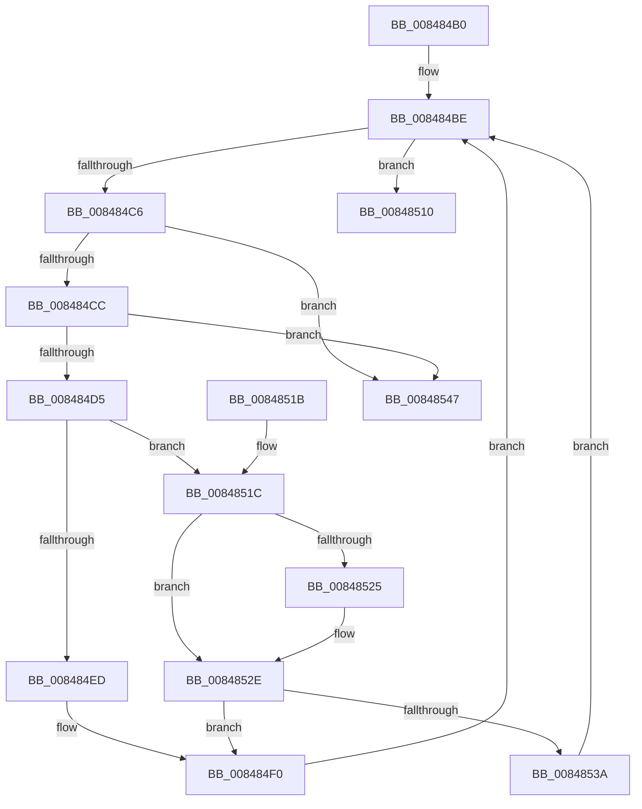

# CmpSignalDeferredPosts

- RVA: `0x008484B0`–`0x0084854E` (길이 `158` bytes)
- VA: `0x00000001408484B0`
- 실행 섹션: `PAGE`
- PDB 이름 있음: `예`; PDB Function 태그: `아니요`
- unwind 정보 RVA: `0x00069344`
- 디코드: `48`개 명령, `158/158` bytes 표시
- 미해석 바이트: `0` (있으면 어셈블리에 `.byte`로 보존)

> 이 문서는 커널 이미지의 기계어와 PDB 기호를 분석해 생성했습니다. 4번과 5번은 함수 원형과 자료형을 바이너리 사용 방식에서 추정한 C 해석이며 원본 소스 복구 결과는 아닙니다.

## 1. Dependencies

- 직접 호출 지점: **5**; 고유 호출 대상: **4**
- 직접 호출자로 확인된 함수: **9**
- RIP 상대 이미지 참조: **0**

### Outgoing calls
- `0x008484F5` → [KeSetEvent](../../text/33/KeSetEvent_function_0033F310.md) (function, `0x0033F310`)
- `0x00848501` → [ObfDereferenceObject](../../text/2F/ObfDereferenceObject_function_002F9350.md) (function, `0x002F9350`)
- `0x00848509` → [CmpFreePostBlock](CmpFreePostBlock_function_00848560.md) (function, `0x00848560`)
- `0x00848529` → [ExQueueWorkItem](../../text/2F/ExQueueWorkItem_function_002F9520.md) (function, `0x002F9520`)
- `0x0084853D` → [CmpFreePostBlock](CmpFreePostBlock_function_00848560.md) (function, `0x00848560`)

### Direct callers
- [CmRestoreKey](../7D/CmRestoreKey_function_007DCF04.md) at `0x007DDA95`
- [CmSetValueKey](CmSetValueKey_function_008457C0.md) at `0x00845F7B`
- [CmDeleteValueKey](CmDeleteValueKey_function_008476E8.md) at `0x00847CAC`
- [CmDeleteKey](CmDeleteKey_function_00848E5C.md) at `0x00849396`
- [CmpCloseKeyObject](../86/CmpCloseKeyObject_function_00863AD0.md) at `0x00863C95`
- [CmpPostNotify](../86/CmpPostNotify_function_008645D8.md) at `0x00864987`
- [CmpSetKeySecurity](../94/CmpSetKeySecurity_function_0094A124.md) at `0x0094A475`
- [CmpPerformUnloadKey](../9A/CmpPerformUnloadKey_function_009AFA28.md) at `0x009AFD25`
- [CmpProcessLightWeightUOW](../9B/CmpProcessLightWeightUOW_function_009B0EAC.md) at `0x009B0F0E`

### Static image references
- 디코드된 RIP-relative 메모리 참조가 없습니다.

## 2. Other-region calls and transfers

- 다른 실행 섹션으로 향하는 call: **3**
  - `0x008484F5` → [KeSetEvent](../../text/33/KeSetEvent_function_0033F310.md) (`PAGE` → `.text`)
  - `0x00848501` → [ObfDereferenceObject](../../text/2F/ObfDereferenceObject_function_002F9350.md) (`PAGE` → `.text`)
  - `0x00848529` → [ExQueueWorkItem](../../text/2F/ExQueueWorkItem_function_002F9520.md) (`PAGE` → `.text`)
- 별도 외부 분기/꼬리 이동을 확인하지 못했습니다.

## 3. Assembly (complete function range)

```asm
008484B0  40 53                           push rbx
008484B2  48 83 EC 20                     sub rsp, 0x20
008484B6  48 8B D9                        mov rbx, rcx
008484B9  48 89 7C 24 30                  mov qword ptr [rsp + 0x30], rdi
008484BE  48 8B 03                        mov rax, qword ptr [rbx]
008484C1  48 3B C3                        cmp rax, rbx
008484C4  74 4A                           je 0x140848510
008484C6  48 39 58 08                     cmp qword ptr [rax + 8], rbx
008484CA  75 7B                           jne 0x140848547
008484CC  48 8B 08                        mov rcx, qword ptr [rax]
008484CF  48 39 41 08                     cmp qword ptr [rcx + 8], rax
008484D3  75 72                           jne 0x140848547
008484D5  48 89 0B                        mov qword ptr [rbx], rcx
008484D8  48 8D 78 F0                     lea rdi, [rax - 0x10]
008484DC  48 89 59 08                     mov qword ptr [rcx + 8], rbx
008484E0  8B 47 38                        mov eax, dword ptr [rdi + 0x38]
008484E3  4C 8B 4F 40                     mov r9, qword ptr [rdi + 0x40]
008484E7  66 83 F8 03                     cmp ax, 3
008484EB  74 2F                           je 0x14084851c
008484ED  49 8B 09                        mov rcx, qword ptr [r9]
008484F0  45 33 C0                        xor r8d, r8d
008484F3  33 D2                           xor edx, edx
008484F5  E8 16 6E AF FF                  call 0x14033f310
008484FA  48 8B 4F 40                     mov rcx, qword ptr [rdi + 0x40]
008484FE  48 8B 09                        mov rcx, qword ptr [rcx]
00848501  E8 4A 0E AB FF                  call 0x1402f9350
00848506  48 8B CF                        mov rcx, rdi
00848509  E8 52 00 00 00                  call 0x140848560
0084850E  EB AE                           jmp 0x1408484be
00848510  48 8B 7C 24 30                  mov rdi, qword ptr [rsp + 0x30]
00848515  48 83 C4 20                     add rsp, 0x20
00848519  5B                              pop rbx
0084851A  C3                              ret
0084851B  CC                              int3
0084851C  49 8B 49 08                     mov rcx, qword ptr [r9 + 8]
00848520  48 85 C9                        test rcx, rcx
00848523  74 09                           je 0x14084852e
00848525  41 8B 51 10                     mov edx, dword ptr [r9 + 0x10]
00848529  E8 F2 0F AB FF                  call 0x1402f9520
0084852E  48 8B 47 40                     mov rax, qword ptr [rdi + 0x40]
00848532  48 8B 08                        mov rcx, qword ptr [rax]
00848535  48 85 C9                        test rcx, rcx
00848538  75 B6                           jne 0x1408484f0
0084853A  48 8B CF                        mov rcx, rdi
0084853D  E8 1E 00 00 00                  call 0x140848560
00848542  E9 77 FF FF FF                  jmp 0x1408484be
00848547  B9 03 00 00 00                  mov ecx, 3
0084854C  CD 29                           int 0x29
```

## 4. C-style interpretation (structured pseudocode)

```c
__int64 __fastcall CmpSignalDeferredPosts(__int64 a1, int a2, int a3)
{
    __int64 result;
    __int64 v_rsp;
    unsigned __int64 v_stack_p8;

    v_rsp = (v_rsp) - (32);
    v_stack_p8 = v_rdi;
loc_008484BE:
    if ((*(unsigned __int64 *)(a1)) == a1) goto loc_00848510;
    if ((*(unsigned __int64 *)(*(unsigned __int64 *)(a1) + 8)) != a1) goto loc_00848547;
    if ((*(unsigned __int64 *)(*(unsigned __int64 *)(*(unsigned __int64 *)(a1)) + 8)) != (*(unsigned __int64 *)(a1))) goto loc_00848547;
    *(unsigned __int64 *)(a1) = *(unsigned __int64 *)(*(unsigned __int64 *)(a1));
    *(unsigned __int64 *)(*(unsigned __int64 *)(*(unsigned __int64 *)(a1)) + 8) = a1;
    if (((unsigned __int16)((unsigned int)(*(unsigned int *)(*(unsigned __int64 *)(a1) - 16 + 56)))) == 3) goto loc_0084851C;
loc_008484F0:
    a3 = 0;
    a2 = 0;
    result = KeSetEvent(*(unsigned __int64 *)(*(unsigned __int64 *)(*(unsigned __int64 *)(a1) - 16 + 64)), a2, a3, *(unsigned __int64 *)(*(unsigned __int64 *)(a1) - 16 + 64));
    result = ObfDereferenceObject(*(unsigned __int64 *)(*(unsigned __int64 *)(*(unsigned __int64 *)(a1) - 16 + 64)), a2, a3, *(unsigned __int64 *)(*(unsigned __int64 *)(a1) - 16 + 64));
    result = CmpFreePostBlock(*(unsigned __int64 *)(a1) - 16, a2, a3, *(unsigned __int64 *)(*(unsigned __int64 *)(a1) - 16 + 64));
    goto loc_008484BE;
loc_00848510:
    v_rsp = (v_rsp) + (32);
    return result;
loc_0084851C:
    if (*(unsigned __int64 *)(*(unsigned __int64 *)(*(unsigned __int64 *)(a1) - 16 + 64) + 8) != 0) {
        a2 = *(unsigned int *)(*(unsigned __int64 *)(*(unsigned __int64 *)(a1) - 16 + 64) + 16);
        result = ExQueueWorkItem(*(unsigned __int64 *)(*(unsigned __int64 *)(*(unsigned __int64 *)(a1) - 16 + 64) + 8), a2, a3, *(unsigned __int64 *)(*(unsigned __int64 *)(a1) - 16 + 64));
    }
    if (*(unsigned __int64 *)(*(unsigned __int64 *)(v_stack_p8 + 64)) != 0) goto loc_008484F0;
    result = CmpFreePostBlock(v_stack_p8, a2, a3, *(unsigned __int64 *)(*(unsigned __int64 *)(a1) - 16 + 64));
    goto loc_008484BE;
loc_00848547:
    return result;
}
```

## 5. (Beta) C Style

```c
int64_t CmpSignalDeferredPosts(void *Arg1, int32_t Arg2, int32_t Arg3)
{
    uint8_t *arg1 = (uint8_t *)Arg1;

    int64_t result;
    int64_t local_rsp;
    uint64_t v_stack_p8;

    local_rsp = (local_rsp) - (32);
    v_stack_p8 = local_rdi;
loc_008484BE:
    if ((*(uint64_t *)(arg1)) == Arg1) goto loc_00848510;
    if ((*(uint64_t *)(*(uint64_t *)(arg1) + 0x8)) != Arg1) goto loc_00848547;
    if ((*(uint64_t *)(*(uint64_t *)(*(uint64_t *)(arg1)) + 0x8)) != (*(uint64_t *)(arg1))) goto loc_00848547;
    *(uint64_t *)(arg1) = *(uint64_t *)(*(uint64_t *)(arg1));
    *(void **)(*(uint64_t *)(*(uint64_t *)(arg1)) + 0x8) = Arg1;
    if (((uint16_t)((uint32_t)(*(uint32_t *)(*(uint64_t *)(arg1) - 0x10 + 0x38)))) == 3) goto loc_0084851C;
loc_008484F0:
    Arg3 = 0;
    Arg2 = 0;
    result = KeSetEvent(*(uint64_t *)(*(uint64_t *)(*(uint64_t *)(arg1) - 0x10 + 0x40)), Arg2, Arg3, *(uint64_t *)(*(uint64_t *)(arg1) - 0x10 + 0x40));
    result = ObfDereferenceObject(*(uint64_t *)(*(uint64_t *)(*(uint64_t *)(arg1) - 0x10 + 0x40)), Arg2, Arg3, *(uint64_t *)(*(uint64_t *)(arg1) - 0x10 + 0x40));
    result = CmpFreePostBlock(*(uint64_t *)(arg1) - 16, Arg2, Arg3, *(uint64_t *)(*(uint64_t *)(arg1) - 0x10 + 0x40));
    goto loc_008484BE;
loc_00848510:
    local_rsp = (local_rsp) + (32);
    return result;
loc_0084851C:
    if (*(uint64_t *)(*(uint64_t *)(*(uint64_t *)(arg1) - 0x10 + 0x40) + 0x8) != 0) {
        Arg2 = *(uint32_t *)(*(uint64_t *)(*(uint64_t *)(arg1) - 0x10 + 0x40) + 0x10);
        result = ExQueueWorkItem(*(uint64_t *)(*(uint64_t *)(*(uint64_t *)(arg1) - 0x10 + 0x40) + 0x8), Arg2, Arg3, *(uint64_t *)(*(uint64_t *)(arg1) - 0x10 + 0x40));
    }
    if (*(uint64_t *)(*(uint64_t *)(v_stack_p8 + 0x40)) != 0) goto loc_008484F0;
    result = CmpFreePostBlock(v_stack_p8, Arg2, Arg3, *(uint64_t *)(*(uint64_t *)(arg1) - 0x10 + 0x40));
    goto loc_008484BE;
loc_00848547:
    return result;
}
```

### 관측된 메모리 오프셋

구조체 형식이 확인되지 않은 접근은 인자 기준의 오프셋으로만 기록했습니다.

| 기준 인자 | 오프셋 표현 | 폭 (bit) | 접근 |
|---|---:|---:|---|
| `Arg1` | `+ 0x0` | `64` | `R` |
| `Arg1` | `+ 0x0` | `64` | `W` |

## 6. Execution-region graph

[열기: 2D/3D 그래프와 함수 탐색 컨트롤 패널](../../../control-panel.html?section=page&rva=0x008484B0&view=graph)

- 2D 그래프는 위에서 아래로 흐르고, 3D 그래프는 빈 공간을 드래그해 회전합니다. Shift+드래그는 이동, 휠은 확대·축소, 함수 노드 선택은 대상 보고서 이동입니다.

### Static fallback


