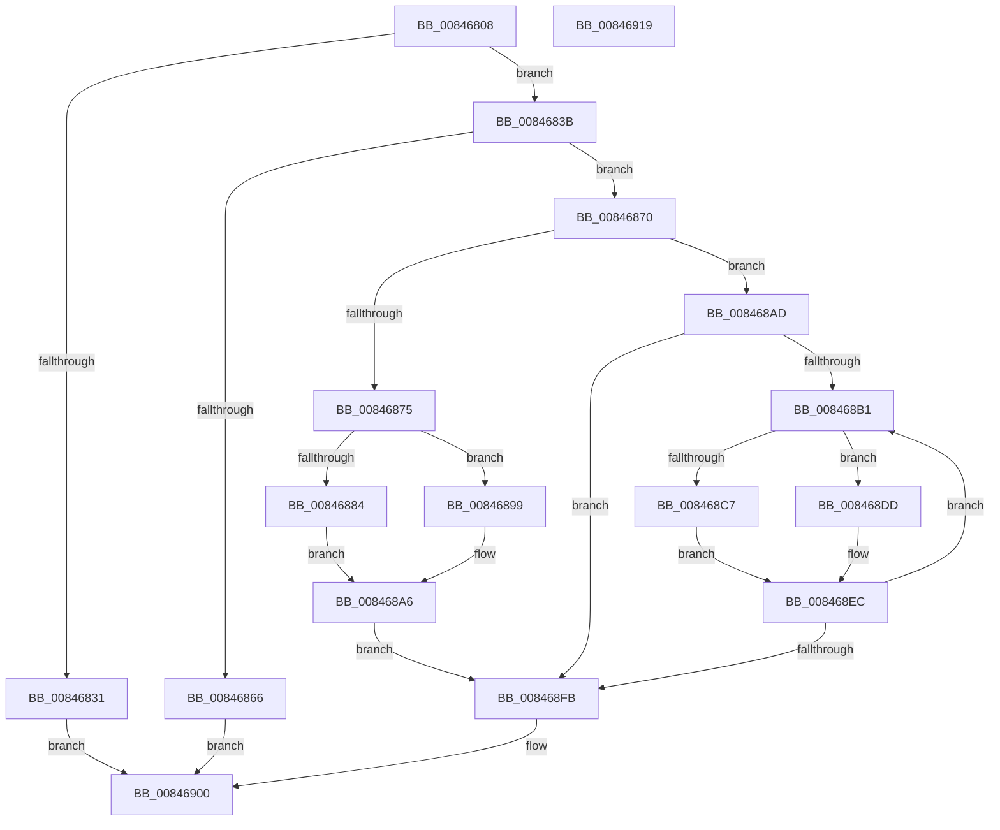

# CmpSnapshotTxOwnerArray

- RVA: `0x00846808`–`0x0084691A` (길이 `274` bytes)
- VA: `0x0000000140846808`
- 실행 섹션: `PAGE`
- PDB 이름 있음: `예`; PDB Function 태그: `아니요`
- unwind 정보 RVA: `0x00060300`
- 디코드: `82`개 명령, `274/274` bytes 표시
- 미해석 바이트: `0` (있으면 어셈블리에 `.byte`로 보존)

> 이 문서는 커널 이미지의 기계어와 PDB 기호를 분석해 생성했습니다. 4번과 5번은 함수 원형과 자료형을 바이너리 사용 방식에서 추정한 C 해석이며 원본 소스 복구 결과는 아닙니다.

## 1. Dependencies

- 직접 호출 지점: **3**; 고유 호출 대상: **2**
- 직접 호출자로 확인된 함수: **5**
- RIP 상대 이미지 참조: **0**

### Outgoing calls
- `0x00846856` → [ExAllocatePool2](../../poolcode/B8/ExAllocatePool2_function_00B820F0.md) (function, `0x00B820F0`)
- `0x008468A6` → [ObfReferenceObject](../../text/20/ObfReferenceObject_function_0020FA20.md) (function, `0x0020FA20`)
- `0x008468EC` → [ObfReferenceObject](../../text/20/ObfReferenceObject_function_0020FA20.md) (function, `0x0020FA20`)

### Direct callers
- [CmSetValueKey](CmSetValueKey_function_008457C0.md) at `0x00845A86`
- [CmSetValueKey](CmSetValueKey_function_008457C0.md) at `0x00846639`
- [CmDeleteValueKey](CmDeleteValueKey_function_008476E8.md) at `0x00847F97`
- [CmDeleteValueKey](CmDeleteValueKey_function_008476E8.md) at `0x008482AA`
- [CmDeleteKey](CmDeleteKey_function_00848E5C.md) at `0x008493E8`
- [CmDeleteKey](CmDeleteKey_function_00848E5C.md) at `0x00849631`
- [CmpSetKeySecurity](../94/CmpSetKeySecurity_function_0094A124.md) at `0x0094A539`
- [CmpSetKeySecurity](../94/CmpSetKeySecurity_function_0094A124.md) at `0x0094A656`
- [sub_00B258D8](../B2/Unknown_function_00B258D8.md) at `0x00B25AA7`
- [sub_00B258D8](../B2/Unknown_function_00B258D8.md) at `0x00B25AF3`
- [sub_00B258D8](../B2/Unknown_function_00B258D8.md) at `0x00B25B3F`
- [sub_00B258D8](../B2/Unknown_function_00B258D8.md) at `0x00B25B88`

### Static image references
- 디코드된 RIP-relative 메모리 참조가 없습니다.

## 2. Other-region calls and transfers

- 다른 실행 섹션으로 향하는 call: **3**
  - `0x00846856` → [ExAllocatePool2](../../poolcode/B8/ExAllocatePool2_function_00B820F0.md) (`PAGE` → `POOLCODE`)
  - `0x008468A6` → [ObfReferenceObject](../../text/20/ObfReferenceObject_function_0020FA20.md) (`PAGE` → `.text`)
  - `0x008468EC` → [ObfReferenceObject](../../text/20/ObfReferenceObject_function_0020FA20.md) (`PAGE` → `.text`)
- 별도 외부 분기/꼬리 이동을 확인하지 못했습니다.

## 3. Assembly (complete function range)

```asm
00846808  48 89 5C 24 08                  mov qword ptr [rsp + 8], rbx
0084680D  48 89 6C 24 10                  mov qword ptr [rsp + 0x10], rbp
00846812  48 89 74 24 18                  mov qword ptr [rsp + 0x18], rsi
00846817  57                              push rdi
00846818  41 56                           push r14
0084681A  41 57                           push r15
0084681C  48 83 EC 20                     sub rsp, 0x20
00846820  8B 39                           mov edi, dword ptr [rcx]
00846822  33 DB                           xor ebx, ebx
00846824  49 8B F0                        mov rsi, r8
00846827  4C 8B FA                        mov r15, rdx
0084682A  4C 8B F1                        mov r14, rcx
0084682D  85 FF                           test edi, edi
0084682F  75 0A                           jne 0x14084683b
00846831  B8 0D 00 00 C0                  mov eax, 0xc000000d
00846836  E9 C5 00 00 00                  jmp 0x140846900
0084683B  0F BA F7 1F                     btr edi, 0x1f
0084683F  89 1A                           mov dword ptr [rdx], ebx
00846841  B9 00 01 00 00                  mov ecx, 0x100
00846846  8B EF                           mov ebp, edi
00846848  41 B8 43 4D 34 36               mov r8d, 0x36344d43
0084684E  48 8D 14 FD 00 00 00 00         lea rdx, [rdi*8]
00846856  E8 95 B8 33 00                  call 0x140b820f0
0084685B  48 89 06                        mov qword ptr [rsi], rax
0084685E  48 8B D0                        mov rdx, rax
00846861  48 85 C0                        test rax, rax
00846864  75 0A                           jne 0x140846870
00846866  B8 9A 00 00 C0                  mov eax, 0xc000009a
0084686B  E9 90 00 00 00                  jmp 0x140846900
00846870  83 FF 01                        cmp edi, 1
00846873  75 38                           jne 0x1408468ad
00846875  4D 8B 46 08                     mov r8, qword ptr [r14 + 8]
00846879  49 8B 48 38                     mov rcx, qword ptr [r8 + 0x38]
0084687D  8B 41 30                        mov eax, dword ptr [rcx + 0x30]
00846880  84 C0                           test al, al
00846882  79 15                           jns 0x140846899
00846884  48 8B 41 38                     mov rax, qword ptr [rcx + 0x38]
00846888  48 89 02                        mov qword ptr [rdx], rax
0084688B  49 8B 40 38                     mov rax, qword ptr [r8 + 0x38]
0084688F  48 8B 48 38                     mov rcx, qword ptr [rax + 0x38]
00846893  48 83 E1 FE                     and rcx, 0xfffffffffffffffe
00846897  EB 0D                           jmp 0x1408468a6
00846899  48 8B 41 48                     mov rax, qword ptr [rcx + 0x48]
0084689D  48 89 02                        mov qword ptr [rdx], rax
008468A0  48 8B 06                        mov rax, qword ptr [rsi]
008468A3  48 8B 08                        mov rcx, qword ptr [rax]
008468A6  E8 75 91 9C FF                  call 0x14020fa20
008468AB  EB 4E                           jmp 0x1408468fb
008468AD  85 FF                           test edi, edi
008468AF  74 4A                           je 0x1408468fb
008468B1  49 8B 46 08                     mov rax, qword ptr [r14 + 8]
008468B5  48 8B 0E                        mov rcx, qword ptr [rsi]
008468B8  4C 8B 04 03                     mov r8, qword ptr [rbx + rax]
008468BC  49 8B 50 38                     mov rdx, qword ptr [r8 + 0x38]
008468C0  8B 42 30                        mov eax, dword ptr [rdx + 0x30]
008468C3  84 C0                           test al, al
008468C5  79 16                           jns 0x1408468dd
008468C7  48 8B 42 38                     mov rax, qword ptr [rdx + 0x38]
008468CB  48 89 04 0B                     mov qword ptr [rbx + rcx], rax
008468CF  49 8B 40 38                     mov rax, qword ptr [r8 + 0x38]
008468D3  48 8B 48 38                     mov rcx, qword ptr [rax + 0x38]
008468D7  48 83 E1 FE                     and rcx, 0xfffffffffffffffe
008468DB  EB 0F                           jmp 0x1408468ec
008468DD  48 8B 42 48                     mov rax, qword ptr [rdx + 0x48]
008468E1  48 89 04 0B                     mov qword ptr [rbx + rcx], rax
008468E5  48 8B 06                        mov rax, qword ptr [rsi]
008468E8  48 8B 0C 03                     mov rcx, qword ptr [rbx + rax]
008468EC  E8 2F 91 9C FF                  call 0x14020fa20
008468F1  48 83 C3 08                     add rbx, 8
008468F5  48 83 ED 01                     sub rbp, 1
008468F9  75 B6                           jne 0x1408468b1
008468FB  41 89 3F                        mov dword ptr [r15], edi
008468FE  33 C0                           xor eax, eax
00846900  48 8B 5C 24 40                  mov rbx, qword ptr [rsp + 0x40]
00846905  48 8B 6C 24 48                  mov rbp, qword ptr [rsp + 0x48]
0084690A  48 8B 74 24 50                  mov rsi, qword ptr [rsp + 0x50]
0084690F  48 83 C4 20                     add rsp, 0x20
00846913  41 5F                           pop r15
00846915  41 5E                           pop r14
00846917  5F                              pop rdi
00846918  C3                              ret
00846919  CC                              int3
```

## 4. C-style interpretation (structured pseudocode)

```c
__int64 __fastcall CmpSnapshotTxOwnerArray(__int64 a1, __int64 a2, __int64 a3)
{
    __int64 result;
    __int64 v_rbp;
    __int64 v_rbx;
    __int64 v_rsp;
    unsigned __int64 v_stack_p10;
    unsigned __int64 v_stack_p18;
    unsigned __int64 v_stack_p8;

    v_stack_p8 = v_rbx;
    v_stack_p10 = v_rbp;
    v_stack_p18 = v_rsi;
    v_rsp = (v_rsp) - (32);
    v_rbx = 0;
    if ((unsigned int)((unsigned int)(*(unsigned int *)(a1))) != 0) goto loc_0084683B;
    goto loc_00846900;
loc_0084683B:
    *(unsigned int *)(a2) = 0;
    result = ExAllocatePool2(256, (unsigned int)(*(unsigned int *)(a1)) * 8, (unsigned int)(0x36344D43ULL), a4);
    *(unsigned __int64 *)(a3) = result;
    if (result != 0) goto loc_00846870;
    goto loc_00846900;
loc_00846870:
    if (((unsigned int)((unsigned int)(*(unsigned int *)(a1)))) != 1) goto loc_008468AD;
    if (!sign_flag) goto loc_00846899;
    *(unsigned __int64 *)(result) = *(unsigned __int64 *)(*(unsigned __int64 *)(*(unsigned __int64 *)(a1 + 8) + 56) + 56);
    a1 = (*(unsigned __int64 *)(*(unsigned __int64 *)(*(unsigned __int64 *)(a1 + 8) + 56) + 56)) & (-2);
    goto loc_008468A6;
loc_00846899:
    *(unsigned __int64 *)(result) = *(unsigned __int64 *)(a1 + 72);
loc_008468A6:
    result = ObfReferenceObject(*(unsigned __int64 *)(*(unsigned __int64 *)(a3)), result, *(unsigned __int64 *)(a1 + 8), a4);
    goto loc_008468FB;
loc_008468AD:
    if ((unsigned int)((unsigned int)(*(unsigned int *)(a1))) == 0) goto loc_008468FB;
loc_008468B1:
    if (!sign_flag) goto loc_008468DD;
    *(unsigned __int64 *)(v_rbx + *(unsigned __int64 *)(a3) * 1) = *(unsigned __int64 *)(*(unsigned __int64 *)(*(unsigned __int64 *)(v_rbx + *(unsigned __int64 *)(a1 + 8) * 1) + 56) + 56);
    a1 = (*(unsigned __int64 *)(*(unsigned __int64 *)(*(unsigned __int64 *)(v_rbx + *(unsigned __int64 *)(a1 + 8) * 1) + 56) + 56)) & (-2);
    goto loc_008468EC;
loc_008468DD:
    *(unsigned __int64 *)(v_rbx + a1 * 1) = *(unsigned __int64 *)(*(unsigned __int64 *)(*(unsigned __int64 *)(v_rbx + *(unsigned __int64 *)(a1 + 8) * 1) + 56) + 72);
loc_008468EC:
    result = ObfReferenceObject(*(unsigned __int64 *)(v_rbx + *(unsigned __int64 *)(a3) * 1), *(unsigned __int64 *)(*(unsigned __int64 *)(v_rbx + *(unsigned __int64 *)(a1 + 8) * 1) + 56), *(unsigned __int64 *)(v_rbx + *(unsigned __int64 *)(a1 + 8) * 1), a4);
    v_rbx = (v_rbx) + (8);
    v_rbp = ((unsigned int)((unsigned int)((unsigned int)(*(unsigned int *)(a1))))) - (1);
    if (condition_is_not_equal) goto loc_008468B1;
loc_008468FB:
    *(unsigned int *)(a2) = (unsigned int)((unsigned int)(*(unsigned int *)(a1)));
    result = 0;
loc_00846900:
    v_rsp = (v_rsp) + (32);
    return result;
}
```

## 5. (Beta) C Style

```c
int64_t CmpSnapshotTxOwnerArray(void *Arg1, void *Arg2, void *Arg3)
{
    uint8_t *arg1 = (uint8_t *)Arg1;
    uint8_t *arg2 = (uint8_t *)Arg2;
    uint8_t *arg3 = (uint8_t *)Arg3;

    int64_t result;
    int64_t local_rbp;
    int64_t local_rbx;
    int64_t local_rsp;
    uint64_t v_stack_p10;
    uint64_t v_stack_p18;
    uint64_t v_stack_p8;

    v_stack_p8 = local_rbx;
    v_stack_p10 = local_rbp;
    v_stack_p18 = local_rsi;
    local_rsp = (local_rsp) - (32);
    local_rbx = 0;
    if ((uint32_t)((uint32_t)(*(uint32_t *)(arg1))) != 0) goto loc_0084683B;
    goto loc_00846900;
loc_0084683B:
    *(uint32_t *)(arg2) = 0;
    result = ExAllocatePool2(256, (uint32_t)(*(uint32_t *)(arg1)) * 8, (uint32_t)(0x36344D43ULL), a4);
    *(uint64_t *)(arg3) = result;
    if (result != 0) goto loc_00846870;
    goto loc_00846900;
loc_00846870:
    if (((uint32_t)((uint32_t)(*(uint32_t *)(arg1)))) != 1) goto loc_008468AD;
    if (!sign_flag) goto loc_00846899;
    *(uint64_t *)(result) = *(uint64_t *)(*(uint64_t *)(*(uint64_t *)(arg1 + 0x8) + 0x38) + 0x38);
    Arg1 = (*(uint64_t *)(*(uint64_t *)(*(uint64_t *)(arg1 + 0x8) + 0x38) + 0x38)) & (-2);
    goto loc_008468A6;
loc_00846899:
    *(uint64_t *)(result) = *(uint64_t *)(arg1 + 0x48);
loc_008468A6:
    result = ObfReferenceObject(*(uint64_t *)(*(uint64_t *)(arg3)), result, *(uint64_t *)(arg1 + 0x8), a4);
    goto loc_008468FB;
loc_008468AD:
    if ((uint32_t)((uint32_t)(*(uint32_t *)(arg1))) == 0) goto loc_008468FB;
loc_008468B1:
    if (!sign_flag) goto loc_008468DD;
    *(uint64_t *)(local_rbx + *(uint64_t *)(arg3) * 1) = *(uint64_t *)(*(uint64_t *)(*(uint64_t *)(local_rbx + *(uint64_t *)(arg1 + 0x8) * 1) + 0x38) + 0x38);
    Arg1 = (*(uint64_t *)(*(uint64_t *)(*(uint64_t *)(local_rbx + *(uint64_t *)(arg1 + 0x8) * 1) + 0x38) + 0x38)) & (-2);
    goto loc_008468EC;
loc_008468DD:
    *(uint64_t *)(local_rbx + arg1 * 1) = *(uint64_t *)(*(uint64_t *)(*(uint64_t *)(local_rbx + *(uint64_t *)(arg1 + 0x8) * 1) + 0x38) + 0x48);
loc_008468EC:
    result = ObfReferenceObject(*(uint64_t *)(local_rbx + *(uint64_t *)(arg3) * 1), *(uint64_t *)(*(uint64_t *)(local_rbx + *(uint64_t *)(arg1 + 0x8) * 1) + 0x38), *(uint64_t *)(local_rbx + *(uint64_t *)(arg1 + 0x8) * 1), a4);
    local_rbx = (local_rbx) + (8);
    local_rbp = ((uint32_t)((uint32_t)((uint32_t)(*(uint32_t *)(arg1))))) - (1);
    if (condition_is_not_equal) goto loc_008468B1;
loc_008468FB:
    *(uint32_t *)(arg2) = (uint32_t)((uint32_t)(*(uint32_t *)(arg1)));
    result = 0;
loc_00846900:
    local_rsp = (local_rsp) + (32);
    return result;
}
```

### 관측된 메모리 오프셋

구조체 형식이 확인되지 않은 접근은 인자 기준의 오프셋으로만 기록했습니다.

| 기준 인자 | 오프셋 표현 | 폭 (bit) | 접근 |
|---|---:|---:|---|
| `Arg1` | `+ 0x0` | `32` | `R` |
| `Arg1` | `+ 0x8` | `64` | `R` |
| `Arg2` | `+ 0x0` | `32` | `W` |
| `Arg3` | `+ 0x0` | `64` | `R` |
| `Arg3` | `+ 0x0` | `64` | `W` |

## 6. Execution-region graph

[열기: 2D/3D 그래프와 함수 탐색 컨트롤 패널](../../../control-panel.html?section=page&rva=0x00846808&view=graph)

- 2D 그래프는 위에서 아래로 흐르고, 3D 그래프는 빈 공간을 드래그해 회전합니다. Shift+드래그는 이동, 휠은 확대·축소, 함수 노드 선택은 대상 보고서 이동입니다.

### Static fallback


