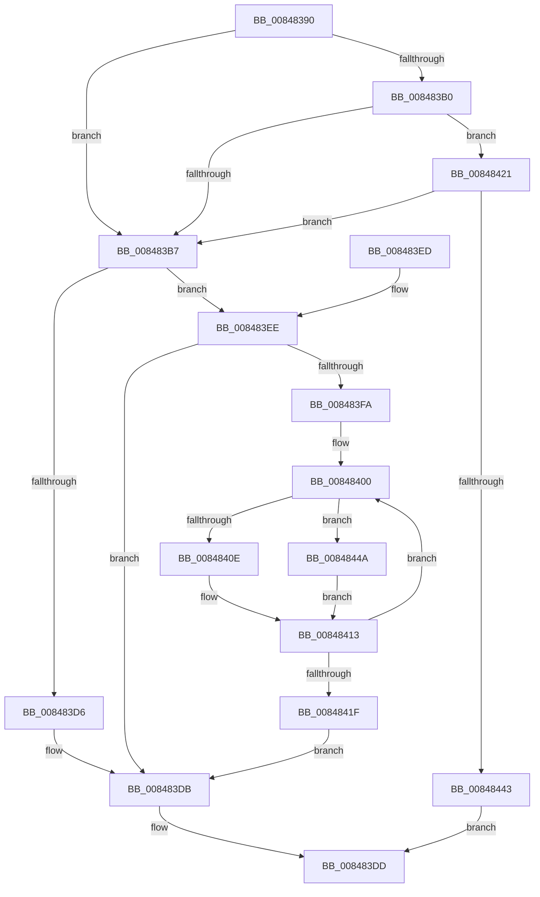

# CmpStartKcbStackForTopLayerKcb

- RVA: `0x00848390`–`0x00848455` (길이 `197` bytes)
- VA: `0x0000000140848390`
- 실행 섹션: `PAGE`
- PDB 이름 있음: `예`; PDB Function 태그: `아니요`
- unwind 정보 RVA: `0x00069320`
- 디코드: `56`개 명령, `197/197` bytes 표시
- 미해석 바이트: `0` (있으면 어셈블리에 `.byte`로 보존)

> 이 문서는 커널 이미지의 기계어와 PDB 기호를 분석해 생성했습니다. 4번과 5번은 함수 원형과 자료형을 바이너리 사용 방식에서 추정한 C 해석이며 원본 소스 복구 결과는 아닙니다.

## 1. Dependencies

- 직접 호출 지점: **1**; 고유 호출 대상: **1**
- 직접 호출자로 확인된 함수: **23**
- RIP 상대 이미지 참조: **0**

### Outgoing calls
- `0x00848432` → [CmpAllocatePool](../../text/3C/CmpAllocatePool_function_003CD504.md) (function, `0x003CD504`)

### Direct callers
- [CmDeleteLayeredKey](../../text/41/CmDeleteLayeredKey_function_0041B598.md) at `0x0041B643`
- [CmDeleteLayeredKey](../../text/41/CmDeleteLayeredKey_function_0041B598.md) at `0x0041B659`
- [CmQueryLayeredKey](../../text/46/CmQueryLayeredKey_function_0046A930.md) at `0x0046A9E6`
- [CmSaveKey](../7D/CmSaveKey_function_007DDBDC.md) at `0x007DDCCE`
- [CmOpenKeyForBugCheckRecovery](../7D/CmOpenKeyForBugCheckRecovery_function_007DF3C0.md) at `0x007DF4A6`
- [CmRenameKey](../7E/CmRenameKey_function_007E8F48.md) at `0x007E90B0`
- [CmRenameKey](../7E/CmRenameKey_function_007E8F48.md) at `0x007E90CA`
- [CmRenameKey](../7E/CmRenameKey_function_007E8F48.md) at `0x007E92CB`
- [CmpDoBuildVirtualStack](../7E/CmpDoBuildVirtualStack_function_007EB4C4.md) at `0x007EB637`
- [CmpAssignKeySecurity](../7E/CmpAssignKeySecurity_function_007EC8B0.md) at `0x007EC91D`
- [CmSetLastWriteTimeKey](CmSetLastWriteTimeKey_function_00843368.md) at `0x00843412`
- [CmDeleteValueKey](CmDeleteValueKey_function_008476E8.md) at `0x0084781D`
- [CmDeleteKey](CmDeleteKey_function_00848E5C.md) at `0x00848FC4`
- [CmDeleteKey](CmDeleteKey_function_00848E5C.md) at `0x00848FDC`
- [sub_00857A33](../85/Unknown_function_00857A33.md) at `0x00857AF5`
- [CmpDoParseKey](../85/CmpDoParseKey_function_0085F750.md) at `0x00861603`
- [CmpCheckOpenAccessOnKeyBody](../87/CmpCheckOpenAccessOnKeyBody_function_00870000.md) at `0x00870583`
- [CmEnumerateValueFromLayeredKey](../8B/CmEnumerateValueFromLayeredKey_function_008B31FC.md) at `0x008B32C1`
- [CmpReportNotify](../8C/CmpReportNotify_function_008C8094.md) at `0x008C80BF`
- [CmpEnumerateLayeredKey](../94/CmpEnumerateLayeredKey_function_00945E58.md) at `0x00945F50`
- [CmpSetKeySecurity](../94/CmpSetKeySecurity_function_0094A124.md) at `0x0094A229`
- [sub_0094AF2A](../94/Unknown_function_0094AF2A.md) at `0x0094AF49`
- [CmSetKeyFlags](../9A/CmSetKeyFlags_function_009AEEA4.md) at `0x009AEF55`
- [CmpPerformUnloadKey](../9A/CmpPerformUnloadKey_function_009AFA28.md) at `0x009AFB03`
- [CmpProcessLightWeightUOW](../9B/CmpProcessLightWeightUOW_function_009B0EAC.md) at `0x009B0F88`
- [CmpStartSiloRegistryNamespace](../9E/CmpStartSiloRegistryNamespace_function_009E85D0.md) at `0x009E86BA`
- [CmQueryMultipleValueForLayeredKey](../A8/CmQueryMultipleValueForLayeredKey_function_00A8DE80.md) at `0x00A8DF2A`

### Static image references
- 디코드된 RIP-relative 메모리 참조가 없습니다.

## 2. Other-region calls and transfers

- 다른 실행 섹션으로 향하는 call: **1**
  - `0x00848432` → [CmpAllocatePool](../../text/3C/CmpAllocatePool_function_003CD504.md) (`PAGE` → `.text`)
- 별도 외부 분기/꼬리 이동을 확인하지 못했습니다.

## 3. Assembly (complete function range)

```asm
00848390  48 89 5C 24 08                  mov qword ptr [rsp + 8], rbx
00848395  48 89 74 24 10                  mov qword ptr [rsp + 0x10], rsi
0084839A  57                              push rdi
0084839B  48 83 EC 20                     sub rsp, 0x20
0084839F  0F BF 72 42                     movsx esi, word ptr [rdx + 0x42]
008483A3  48 8B F9                        mov rdi, rcx
008483A6  33 C9                           xor ecx, ecx
008483A8  48 8B DA                        mov rbx, rdx
008483AB  83 FE 02                        cmp esi, 2
008483AE  7C 07                           jl 0x1408483b7
008483B0  8B C6                           mov eax, esi
008483B2  83 E8 01                        sub eax, 1
008483B5  75 6A                           jne 0x140848421
008483B7  66 C7 47 02 FF FF               mov word ptr [rdi + 2], 0xffff
008483BD  66 89 37                        mov word ptr [rdi], si
008483C0  48 89 4F 18                     mov qword ptr [rdi + 0x18], rcx
008483C4  0F B7 4B 42                     movzx ecx, word ptr [rbx + 0x42]
008483C8  66 89 4F 02                     mov word ptr [rdi + 2], cx
008483CC  48 0F BF 4B 42                  movsx rcx, word ptr [rbx + 0x42]
008483D1  66 85 C9                        test cx, cx
008483D4  75 18                           jne 0x1408483ee
008483D6  48 89 5C CF 08                  mov qword ptr [rdi + rcx*8 + 8], rbx
008483DB  33 C0                           xor eax, eax
008483DD  48 8B 5C 24 30                  mov rbx, qword ptr [rsp + 0x30]
008483E2  48 8B 74 24 38                  mov rsi, qword ptr [rsp + 0x38]
008483E7  48 83 C4 20                     add rsp, 0x20
008483EB  5F                              pop rdi
008483EC  C3                              ret
008483ED  CC                              int3
008483EE  48 8B 93 C0 00 00 00            mov rdx, qword ptr [rbx + 0xc0]
008483F5  48 85 D2                        test rdx, rdx
008483F8  74 E1                           je 0x1408483db
008483FA  66 0F 1F 44 00 00               nop word ptr [rax + rax]
00848400  4C 8B 42 10                     mov r8, qword ptr [rdx + 0x10]
00848404  4C 0F BF C9                     movsx r9, cx
00848408  66 83 F9 02                     cmp cx, 2
0084840C  7D 3C                           jge 0x14084844a
0084840E  4E 89 44 CF 08                  mov qword ptr [rdi + r9*8 + 8], r8
00848413  48 8B 52 18                     mov rdx, qword ptr [rdx + 0x18]
00848417  66 FF C9                        dec cx
0084841A  48 85 D2                        test rdx, rdx
0084841D  75 E1                           jne 0x140848400
0084841F  EB BA                           jmp 0x1408483db
00848421  8B D0                           mov edx, eax
00848423  B9 00 01 00 00                  mov ecx, 0x100
00848428  48 C1 E2 03                     shl rdx, 3
0084842C  41 B8 43 4D 36 35               mov r8d, 0x35364d43
00848432  E8 CD 50 B8 FF                  call 0x1403cd504
00848437  48 8B C8                        mov rcx, rax
0084843A  48 85 C0                        test rax, rax
0084843D  0F 85 74 FF FF FF               jne 0x1408483b7
00848443  B8 9A 00 00 C0                  mov eax, 0xc000009a
00848448  EB 93                           jmp 0x1408483dd
0084844A  48 8B 47 18                     mov rax, qword ptr [rdi + 0x18]
0084844E  4E 89 44 C8 F0                  mov qword ptr [rax + r9*8 - 0x10], r8
00848453  EB BE                           jmp 0x140848413
```

## 4. C-style interpretation (structured pseudocode)

```c
__int64 __fastcall CmpStartKcbStackForTopLayerKcb(__int64 a1, __int64 a2)
{
    __int64 result;
    __int64 v_rsp;
    unsigned __int64 v_stack_p10;
    unsigned __int64 v_stack_p8;

    v_stack_p8 = v_rbx;
    v_stack_p10 = v_rsi;
    v_rsp = (v_rsp) - (32);
    a1 = 0;
    if (((unsigned int)((__int16)(*(unsigned __int16 *)(a2 + 66)))) < 2) goto loc_008483B7;
    result = (unsigned int)(((unsigned int)((unsigned int)((__int16)(*(unsigned __int16 *)(a2 + 66))))) - (1));
    if (condition_is_not_equal) goto loc_00848421;
loc_008483B7:
    *(unsigned __int16 *)(a1 + 2) = 0xFFFFULL;
    *(unsigned __int16 *)(a1) = (unsigned __int16)((__int16)(*(unsigned __int16 *)(a2 + 66)));
    *(unsigned __int64 *)(a1 + 24) = 0;
    *(unsigned __int16 *)(a1 + 2) = (unsigned __int16)(*(unsigned __int16 *)(a2 + 66));
    if ((unsigned __int16)((__int16)(*(unsigned __int16 *)(a2 + 66))) != 0) goto loc_008483EE;
    *(unsigned __int64 *)(a1 + (__int16)(*(unsigned __int16 *)(a2 + 66)) * 8 + 8) = a2;
loc_008483DB:
    result = 0;
loc_008483DD:
    v_rsp = (v_rsp) + (32);
    return result;
loc_008483EE:
    if (*(unsigned __int64 *)(v_stack_p8 + 192) == 0) goto loc_008483DB;
loc_00848400:
    if (((unsigned __int16)((__int16)(*(unsigned __int16 *)(a2 + 66)))) >= 2) goto loc_0084844A;
    *(unsigned __int64 *)(a1 + (__int16)((unsigned __int16)((__int16)(*(unsigned __int16 *)(a2 + 66)))) * 8 + 8) = *(unsigned __int64 *)(*(unsigned __int64 *)(v_stack_p8 + 192) + 16);
loc_00848413:
    a1 = (unsigned __int16)(((__int16)(*(unsigned __int16 *)(a2 + 66))) - 1);
    if (*(unsigned __int64 *)(*(unsigned __int64 *)(v_stack_p8 + 192) + 24) != 0) goto loc_00848400;
    goto loc_008483DB;
loc_00848421:
    a2 = (0) << (3);
    result = CmpAllocatePool(256, a2, (unsigned int)(0x35364D43ULL), (__int16)((unsigned __int16)((__int16)(*(unsigned __int16 *)(a2 + 66)))));
    if (result != 0) goto loc_008483B7;
    goto loc_008483DD;
loc_0084844A:
    *(unsigned __int64 *)(*(unsigned __int64 *)(a1 + 24) + (__int16)((unsigned __int16)((__int16)(*(unsigned __int16 *)(a2 + 66)))) * 8 - 16) = (unsigned int)(0x35364D43ULL);
    goto loc_00848413;
}
```

## 5. (Beta) C Style

```c
int64_t CmpStartKcbStackForTopLayerKcb(void *Arg1, void *Arg2)
{
    uint8_t *arg1 = (uint8_t *)Arg1;
    uint8_t *arg2 = (uint8_t *)Arg2;

    int64_t result;
    int64_t local_rsp;
    uint64_t v_stack_p10;
    uint64_t v_stack_p8;

    v_stack_p8 = local_rbx;
    v_stack_p10 = local_rsi;
    local_rsp = (local_rsp) - (32);
    Arg1 = 0;
    if (((uint32_t)((int16_t)(*(uint16_t *)(arg2 + 0x42)))) < 2) goto loc_008483B7;
    result = (uint32_t)(((uint32_t)((uint32_t)((int16_t)(*(uint16_t *)(arg2 + 0x42))))) - (1));
    if (condition_is_not_equal) goto loc_00848421;
loc_008483B7:
    *(uint16_t *)(arg1 + 0x2) = 0xFFFFULL;
    *(uint16_t *)(arg1) = (uint16_t)((int16_t)(*(uint16_t *)(arg2 + 0x42)));
    *(uint64_t *)(arg1 + 0x18) = 0;
    *(uint16_t *)(arg1 + 0x2) = (uint16_t)(*(uint16_t *)(arg2 + 0x42));
    if ((uint16_t)((int16_t)(*(uint16_t *)(arg2 + 0x42))) != 0) goto loc_008483EE;
    *(void **)(arg1 + (int16_t)(*(uint16_t *)(arg2 + 0x42)) * 8 + 0x8) = Arg2;
loc_008483DB:
    result = 0;
loc_008483DD:
    local_rsp = (local_rsp) + (32);
    return result;
loc_008483EE:
    if (*(uint64_t *)(v_stack_p8 + 0xC0) == 0) goto loc_008483DB;
loc_00848400:
    if (((uint16_t)((int16_t)(*(uint16_t *)(arg2 + 0x42)))) >= 2) goto loc_0084844A;
    *(uint64_t *)(arg1 + (int16_t)((uint16_t)((int16_t)(*(uint16_t *)(arg2 + 0x42)))) * 8 + 0x8) = *(uint64_t *)(*(uint64_t *)(v_stack_p8 + 0xC0) + 0x10);
loc_00848413:
    Arg1 = (uint16_t)(((int16_t)(*(uint16_t *)(arg2 + 0x42))) - 1);
    if (*(uint64_t *)(*(uint64_t *)(v_stack_p8 + 0xC0) + 0x18) != 0) goto loc_00848400;
    goto loc_008483DB;
loc_00848421:
    Arg2 = (0) << (3);
    result = CmpAllocatePool(256, Arg2, (uint32_t)(0x35364D43ULL), (int16_t)((uint16_t)((int16_t)(*(uint16_t *)(arg2 + 0x42)))));
    if (result != 0) goto loc_008483B7;
    goto loc_008483DD;
loc_0084844A:
    *(uint64_t *)(*(uint64_t *)(arg1 + 0x18) + (int16_t)((uint16_t)((int16_t)(*(uint16_t *)(arg2 + 0x42)))) * 8 - 0x10) = (uint32_t)(0x35364D43ULL);
    goto loc_00848413;
}
```

### 관측된 메모리 오프셋

구조체 형식이 확인되지 않은 접근은 인자 기준의 오프셋으로만 기록했습니다.

| 기준 인자 | 오프셋 표현 | 폭 (bit) | 접근 |
|---|---:|---:|---|
| `Arg1` | `+ 0x0` | `16` | `W` |
| `Arg1` | `+ 0x2` | `16` | `W` |
| `Arg1` | `+ 0x8 + r9*8` | `64` | `W` |
| `Arg1` | `+ 0x8 + rcx*8` | `64` | `W` |
| `Arg1` | `+ 0x18` | `64` | `R` |
| `Arg1` | `+ 0x18` | `64` | `W` |
| `Arg2` | `+ 0x42` | `16` | `R` |
| `Arg2` | `+ 0xC0` | `64` | `R` |

## 6. Execution-region graph

[열기: 2D/3D 그래프와 함수 탐색 컨트롤 패널](../../../control-panel.html?section=page&rva=0x00848390&view=graph)

- 2D 그래프는 위에서 아래로 흐르고, 3D 그래프는 빈 공간을 드래그해 회전합니다. Shift+드래그는 이동, 휠은 확대·축소, 함수 노드 선택은 대상 보고서 이동입니다.

### Static fallback


