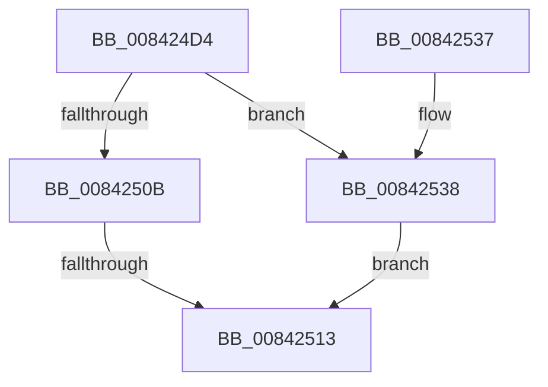

# CmpStartRMLogs

- RVA: `0x008424D4`–`0x0084253F` (길이 `107` bytes)
- VA: `0x00000001408424D4`
- 실행 섹션: `PAGE`
- PDB 이름 있음: `예`; PDB Function 태그: `예`
- unwind 정보 RVA: `0x00068F30`
- 디코드: `30`개 명령, `107/107` bytes 표시
- 미해석 바이트: `0` (있으면 어셈블리에 `.byte`로 보존)

> 이 문서는 커널 이미지의 기계어와 PDB 기호를 분석해 생성했습니다. 4번과 5번은 함수 원형과 자료형을 바이너리 사용 방식에서 추정한 C 해석이며 원본 소스 복구 결과는 아닙니다.

## 1. Dependencies

- 직접 호출 지점: **1**; 고유 호출 대상: **1**
- 직접 호출자로 확인된 함수: **1**
- RIP 상대 이미지 참조: **1**

### Outgoing calls
- `0x0084251D` → [_security_check_cookie](../../text/6A/_security_check_cookie_function_006AC640.md) (function, `0x006AC640`)

### Direct callers
- [CmpTransInitializeTransaction](CmpTransInitializeTransaction_function_008422C8.md) at `0x00842355`

### Static image references
- `0x008424E8` → RVA `0x00E0A740` (`.data`; read)

## 2. Other-region calls and transfers

- 다른 실행 섹션으로 향하는 call: **1**
  - `0x0084251D` → [_security_check_cookie](../../text/6A/_security_check_cookie_function_006AC640.md) (`PAGE` → `.text`)
- call이 아닌 외부 분기/꼬리 이동: **1**
  - `0x0084250D` → [sub_00B15E66](../B1/Unknown_function_00B15E66.md) (`tail-transfer`)

## 3. Assembly (complete function range)

```asm
008424D4  48 89 5C 24 10                  mov qword ptr [rsp + 0x10], rbx
008424D9  48 89 6C 24 18                  mov qword ptr [rsp + 0x18], rbp
008424DE  48 89 74 24 20                  mov qword ptr [rsp + 0x20], rsi
008424E3  57                              push rdi
008424E4  48 83 EC 40                     sub rsp, 0x40
008424E8  48 8B 05 51 82 5C 00            mov rax, qword ptr [rip + 0x5c8251]
008424EF  48 33 C4                        xor rax, rsp
008424F2  48 89 44 24 30                  mov qword ptr [rsp + 0x30], rax
008424F7  8B 41 68                        mov eax, dword ptr [rcx + 0x68]
008424FA  33 DB                           xor ebx, ebx
008424FC  0F 57 C0                        xorps xmm0, xmm0
008424FF  48 8B F9                        mov rdi, rcx
00842502  0F 11 44 24 20                  movups xmmword ptr [rsp + 0x20], xmm0
00842507  A8 08                           test al, 8
00842509  75 2D                           jne 0x140842538
0084250B  A8 01                           test al, 1
0084250D  0F 84 53 39 2D 00               je 0x140b15e66
00842513  8B C3                           mov eax, ebx
00842515  48 8B 4C 24 30                  mov rcx, qword ptr [rsp + 0x30]
0084251A  48 33 CC                        xor rcx, rsp
0084251D  E8 1E A1 E6 FF                  call 0x1406ac640
00842522  48 8B 5C 24 58                  mov rbx, qword ptr [rsp + 0x58]
00842527  48 8B 6C 24 60                  mov rbp, qword ptr [rsp + 0x60]
0084252C  48 8B 74 24 68                  mov rsi, qword ptr [rsp + 0x68]
00842531  48 83 C4 40                     add rsp, 0x40
00842535  5F                              pop rdi
00842536  C3                              ret
00842537  CC                              int3
00842538  BB 89 01 00 C0                  mov ebx, 0xc0000189
0084253D  EB D4                           jmp 0x140842513
```

## 4. C-style interpretation (structured pseudocode)

```c
__int64 __fastcall CmpStartRMLogs(__int64 a1)
{
    __int64 result;
    __int64 v_rbx;
    __int64 v_rsp;
    unsigned __int64 v_stack_m18;
    unsigned __int64 v_stack_m28;
    unsigned __int64 v_stack_p10;
    unsigned __int64 v_stack_p18;
    unsigned __int64 v_stack_p20;

    v_stack_p10 = v_rbx;
    v_stack_p18 = v_rbp;
    v_stack_p20 = v_rsi;
    v_rsp = (v_rsp) - (64);
    result = (*(unsigned __int64 *)(v_rip + 6062673)) ^ (v_rsp);
    v_stack_m18 = result;
    v_rbx = 0;
    v_stack_m28 = v_xmm0;
    if ((((unsigned __int8)((unsigned int)(*(unsigned int *)(a1 + 104)))) & (8)) != 0) goto loc_00842538;
loc_00842513:
    a1 = (v_stack_m18) ^ (v_rsp);
    result = _security_check_cookie(a1, a2, a3, a4);
    v_rsp = (v_rsp) + (64);
    return result;
loc_00842538:
    goto loc_00842513;
}
```

## 5. (Beta) C Style

```c
int64_t CmpStartRMLogs(void *Arg1)
{
    uint8_t *arg1 = (uint8_t *)Arg1;

    int64_t result;
    int64_t local_rbx;
    int64_t local_rsp;
    uint64_t v_stack_m18;
    uint64_t v_stack_m28;
    uint64_t v_stack_p10;
    uint64_t v_stack_p18;
    uint64_t v_stack_p20;

    v_stack_p10 = local_rbx;
    v_stack_p18 = local_rbp;
    v_stack_p20 = local_rsi;
    local_rsp = (local_rsp) - (64);
    result = (*(uint64_t *)(v_rip + 0x5C8251)) ^ (local_rsp);
    v_stack_m18 = result;
    local_rbx = 0;
    v_stack_m28 = v_xmm0;
    if ((((uint8_t)((uint32_t)(*(uint32_t *)(arg1 + 0x68)))) & (8)) != 0) goto loc_00842538;
loc_00842513:
    Arg1 = (v_stack_m18) ^ (local_rsp);
    result = _security_check_cookie(Arg1, a2, a3, a4);
    local_rsp = (local_rsp) + (64);
    return result;
loc_00842538:
    goto loc_00842513;
}
```

### 관측된 메모리 오프셋

구조체 형식이 확인되지 않은 접근은 인자 기준의 오프셋으로만 기록했습니다.

| 기준 인자 | 오프셋 표현 | 폭 (bit) | 접근 |
|---|---:|---:|---|
| `Arg1` | `+ 0x68` | `32` | `R` |

## 6. Execution-region graph

[열기: 2D/3D 그래프와 함수 탐색 컨트롤 패널](../../../control-panel.html?section=page&rva=0x008424D4&view=graph)

- 2D 그래프는 위에서 아래로 흐르고, 3D 그래프는 빈 공간을 드래그해 회전합니다. Shift+드래그는 이동, 휠은 확대·축소, 함수 노드 선택은 대상 보고서 이동입니다.

### Static fallback


