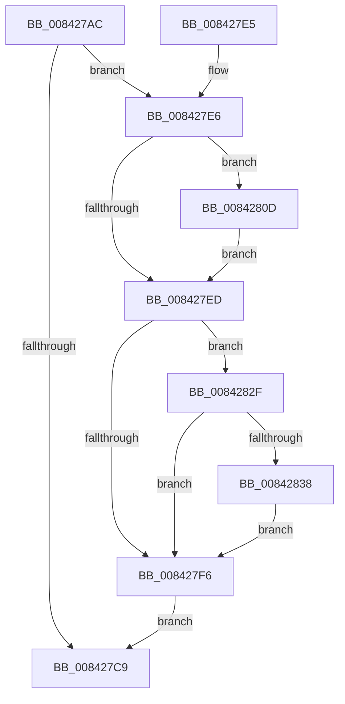

# CmpStopRMLog

- RVA: `0x008427AC`–`0x0084284A` (길이 `158` bytes)
- VA: `0x00000001408427AC`
- 실행 섹션: `PAGE`
- PDB 이름 있음: `예`; PDB Function 태그: `아니요`
- unwind 정보 RVA: `0x00068F88`
- 디코드: `40`개 명령, `158/158` bytes 표시
- 미해석 바이트: `0` (있으면 어셈블리에 `.byte`로 보존)

> 이 문서는 커널 이미지의 기계어와 PDB 기호를 분석해 생성했습니다. 4번과 5번은 함수 원형과 자료형을 바이너리 사용 방식에서 추정한 C 해석이며 원본 소스 복구 결과는 아닙니다.

## 1. Dependencies

- 직접 호출 지점: **9**; 고유 호출 대상: **9**
- 직접 호출자로 확인된 함수: **1**
- RIP 상대 이미지 참조: **4**

### Outgoing calls
- `0x008427B5` → [CmpLockRegistry](../../pagecmrc/BC/CmpLockRegistry_function_00BC9B34.md) (function, `0x00BC9B34`)
- `0x008427BD` → [LockRMLog](LockRMLog_function_00842B88.md) (function, `0x00842B88`)
- `0x008427D0` → [ExReleaseResourceLite](../../text/25/ExReleaseResourceLite_function_0025FA10.md) (function, `0x0025FA10`)
- `0x008427D5` → [KeLeaveCriticalRegion](../../text/25/KeLeaveCriticalRegion_function_0025D8B0.md) (function, `0x0025D8B0`)
- `0x008427DA` → [CmpUnlockRegistry](../../pagecmrc/BC/CmpUnlockRegistry_function_00BC9A84.md) (function, `0x00BC9A84`)
- `0x008427FA` → `ext-ms-win-fs-clfs-l1-1-0.dll!ClfsCloseLogFileObject` (import, 간접 대상; import `ext-ms-win-fs-clfs-l1-1-0.dll!ClfsCloseLogFileObject`)
- `0x00842813` → [CmpLogCheckpoint](CmpLogCheckpoint_function_00842F04.md) (function, `0x00842F04`)
- `0x0084281C` → `ext-ms-win-fs-clfs-l1-1-0.dll!ClfsDeleteMarshallingArea` (import, 간접 대상; import `ext-ms-win-fs-clfs-l1-1-0.dll!ClfsDeleteMarshallingArea`)
- `0x0084283C` → `ext-ms-win-fs-clfs-l1-1-0.dll!ClfsDeleteLogByPointer` (import, 간접 대상; import `ext-ms-win-fs-clfs-l1-1-0.dll!ClfsDeleteLogByPointer`)

### Direct callers
- [CmShutdownCmRM](../9B/CmShutdownCmRM_function_009B05E0.md) at `0x009B061C`

### Static image references
- `0x008427ED` → RVA `0x00EEFC78` (`.data`; read)
- `0x008427FA` → RVA `0x00151250` (`ext-ms-win-fs-clfs-l1-1-0.dll!ClfsCloseLogFileObject (IAT)`; read)
- `0x0084281C` → RVA `0x001511F0` (`ext-ms-win-fs-clfs-l1-1-0.dll!ClfsDeleteMarshallingArea (IAT)`; read)
- `0x0084283C` → RVA `0x001511E8` (`ext-ms-win-fs-clfs-l1-1-0.dll!ClfsDeleteLogByPointer (IAT)`; read)

## 2. Other-region calls and transfers

- 다른 실행 섹션으로 향하는 call: **4**
  - `0x008427B5` → [CmpLockRegistry](../../pagecmrc/BC/CmpLockRegistry_function_00BC9B34.md) (`PAGE` → `PAGECMRC`)
  - `0x008427D0` → [ExReleaseResourceLite](../../text/25/ExReleaseResourceLite_function_0025FA10.md) (`PAGE` → `.text`)
  - `0x008427D5` → [KeLeaveCriticalRegion](../../text/25/KeLeaveCriticalRegion_function_0025D8B0.md) (`PAGE` → `.text`)
  - `0x008427DA` → [CmpUnlockRegistry](../../pagecmrc/BC/CmpUnlockRegistry_function_00BC9A84.md) (`PAGE` → `PAGECMRC`)
- 별도 외부 분기/꼬리 이동을 확인하지 못했습니다.

## 3. Assembly (complete function range)

```asm
008427AC  40 53                           push rbx
008427AE  48 83 EC 20                     sub rsp, 0x20
008427B2  48 8B D9                        mov rbx, rcx
008427B5  E8 7A 73 38 00                  call 0x140bc9b34
008427BA  48 8B CB                        mov rcx, rbx
008427BD  E8 C6 03 00 00                  call 0x140842b88
008427C2  48 83 7B 58 00                  cmp qword ptr [rbx + 0x58], 0
008427C7  75 1D                           jne 0x1408427e6
008427C9  48 8B 8B 80 00 00 00            mov rcx, qword ptr [rbx + 0x80]
008427D0  E8 3B D2 A1 FF                  call 0x14025fa10
008427D5  E8 D6 B0 A1 FF                  call 0x14025d8b0
008427DA  E8 A5 72 38 00                  call 0x140bc9a84
008427DF  48 83 C4 20                     add rsp, 0x20
008427E3  5B                              pop rbx
008427E4  C3                              ret
008427E5  CC                              int3
008427E6  48 83 7B 60 00                  cmp qword ptr [rbx + 0x60], 0
008427EB  75 20                           jne 0x14084280d
008427ED  48 3B 1D 84 D4 6A 00            cmp rbx, qword ptr [rip + 0x6ad484]
008427F4  75 39                           jne 0x14084282f
008427F6  48 8B 4B 58                     mov rcx, qword ptr [rbx + 0x58]
008427FA  48 FF 15 4F EA 90 FF            call qword ptr [rip - 0x6f15b1]
00842801  0F 1F 44 00 00                  nop dword ptr [rax + rax]
00842806  48 83 63 58 00                  and qword ptr [rbx + 0x58], 0
0084280B  EB BC                           jmp 0x1408427c9
0084280D  45 33 C0                        xor r8d, r8d
00842810  48 8B CB                        mov rcx, rbx
00842813  E8 EC 06 00 00                  call 0x140842f04
00842818  48 8B 4B 60                     mov rcx, qword ptr [rbx + 0x60]
0084281C  48 FF 15 CD E9 90 FF            call qword ptr [rip - 0x6f1633]
00842823  0F 1F 44 00 00                  nop dword ptr [rax + rax]
00842828  48 83 63 60 00                  and qword ptr [rbx + 0x60], 0
0084282D  EB BE                           jmp 0x1408427ed
0084282F  48 8D 43 10                     lea rax, [rbx + 0x10]
00842833  48 39 00                        cmp qword ptr [rax], rax
00842836  75 BE                           jne 0x1408427f6
00842838  48 8B 4B 58                     mov rcx, qword ptr [rbx + 0x58]
0084283C  48 FF 15 A5 E9 90 FF            call qword ptr [rip - 0x6f165b]
00842843  0F 1F 44 00 00                  nop dword ptr [rax + rax]
00842848  EB AC                           jmp 0x1408427f6
```

## 4. C-style interpretation (structured pseudocode)

```c
__int64 __fastcall CmpStopRMLog(__int64 a1, __int64 a2, int a3)
{
    __int64 result;
    __int64 v_rsp;

    v_rsp = (v_rsp) - (32);
    result = CmpLockRegistry(a1, a2, a3, a4);
    result = LockRMLog(a1, a2, a3, a4);
    if ((*(unsigned __int64 *)(a1 + 88)) != 0) goto loc_008427E6;
loc_008427C9:
    result = ExReleaseResourceLite(*(unsigned __int64 *)(a1 + 128), a2, a3, a4);
    result = KeLeaveCriticalRegion(*(unsigned __int64 *)(a1 + 128), a2, a3, a4);
    result = CmpUnlockRegistry(*(unsigned __int64 *)(a1 + 128), a2, a3, a4);
    v_rsp = (v_rsp) + (32);
    return result;
loc_008427E6:
    if ((*(unsigned __int64 *)(a1 + 96)) != 0) goto loc_0084280D;
loc_008427ED:
    if (a1 != (*(unsigned __int64 *)(v_rip + 7001220))) goto loc_0084282F;
loc_008427F6:
    result = ext_ms_win_fs_clfs_l1_1_0_dll_ClfsCloseLogFileObject(*(unsigned __int64 *)(a1 + 88), a2, a3, a4);
    goto loc_008427C9;
loc_0084280D:
    a3 = 0;
    result = CmpLogCheckpoint(a1, a2, a3, a4);
    result = ext_ms_win_fs_clfs_l1_1_0_dll_ClfsDeleteMarshallingArea(*(unsigned __int64 *)(a1 + 96), a2, a3, a4);
    goto loc_008427ED;
loc_0084282F:
    if ((*(unsigned __int64 *)(a1 + 16)) != (a1 + 16)) goto loc_008427F6;
    result = ext_ms_win_fs_clfs_l1_1_0_dll_ClfsDeleteLogByPointer(*(unsigned __int64 *)(a1 + 88), a2, a3, a4);
    goto loc_008427F6;
}
```

## 5. (Beta) C Style

```c
int64_t CmpStopRMLog(void *Arg1, int64_t Arg2, int32_t Arg3)
{
    uint8_t *arg1 = (uint8_t *)Arg1;

    int64_t result;
    int64_t local_rsp;

    local_rsp = (local_rsp) - (32);
    result = CmpLockRegistry(Arg1, Arg2, Arg3, a4);
    result = LockRMLog(Arg1, Arg2, Arg3, a4);
    if ((*(uint64_t *)(arg1 + 0x58)) != 0) goto loc_008427E6;
loc_008427C9:
    result = ExReleaseResourceLite(*(uint64_t *)(arg1 + 0x80), Arg2, Arg3, a4);
    result = KeLeaveCriticalRegion(*(uint64_t *)(arg1 + 0x80), Arg2, Arg3, a4);
    result = CmpUnlockRegistry(*(uint64_t *)(arg1 + 0x80), Arg2, Arg3, a4);
    local_rsp = (local_rsp) + (32);
    return result;
loc_008427E6:
    if ((*(uint64_t *)(arg1 + 0x60)) != 0) goto loc_0084280D;
loc_008427ED:
    if (Arg1 != (*(uint64_t *)(v_rip + 0x6AD484))) goto loc_0084282F;
loc_008427F6:
    result = kernel_indirect_call(*(uint64_t *)(arg1 + 0x58), Arg2, Arg3, a4);
    goto loc_008427C9;
loc_0084280D:
    Arg3 = 0;
    result = CmpLogCheckpoint(Arg1, Arg2, Arg3, a4);
    result = kernel_indirect_call(*(uint64_t *)(arg1 + 0x60), Arg2, Arg3, a4);
    goto loc_008427ED;
loc_0084282F:
    if ((*(uint64_t *)(arg1 + 0x10)) != (Arg1 + 16)) goto loc_008427F6;
    result = kernel_indirect_call(*(uint64_t *)(arg1 + 0x58), Arg2, Arg3, a4);
    goto loc_008427F6;
}
```

### 관측된 메모리 오프셋

구조체 형식이 확인되지 않은 접근은 인자 기준의 오프셋으로만 기록했습니다.

| 기준 인자 | 오프셋 표현 | 폭 (bit) | 접근 |
|---|---:|---:|---|
| `Arg1` | `+ 0x58` | `64` | `R` |
| `Arg1` | `+ 0x60` | `64` | `R` |
| `Arg1` | `+ 0x60` | `64` | `R/W` |

## 6. Execution-region graph

[열기: 2D/3D 그래프와 함수 탐색 컨트롤 패널](../../../control-panel.html?section=page&rva=0x008427AC&view=graph)

- 2D 그래프는 위에서 아래로 흐르고, 3D 그래프는 빈 공간을 드래그해 회전합니다. Shift+드래그는 이동, 휠은 확대·축소, 함수 노드 선택은 대상 보고서 이동입니다.

### Static fallback


