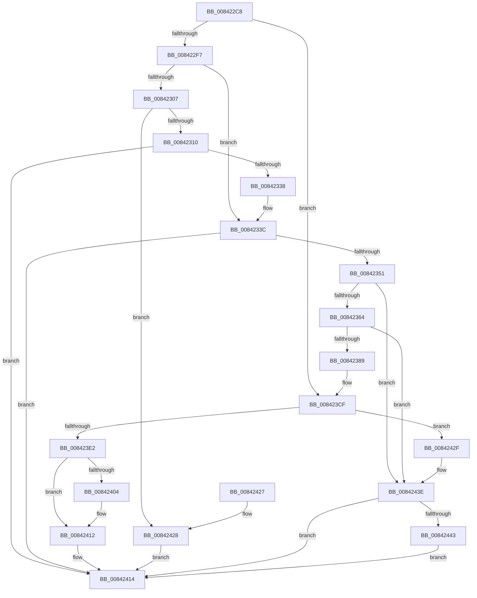

# CmpTransInitializeTransaction

- RVA: `0x008422C8`–`0x0084244D` (길이 `389` bytes)
- VA: `0x00000001408422C8`
- 실행 섹션: `PAGE`
- PDB 이름 있음: `예`; PDB Function 태그: `아니요`
- unwind 정보 RVA: `0x00068F0C`
- 디코드: `106`개 명령, `389/389` bytes 표시
- 미해석 바이트: `0` (있으면 어셈블리에 `.byte`로 보존)

> 이 문서는 커널 이미지의 기계어와 PDB 기호를 분석해 생성했습니다. 4번과 5번은 함수 원형과 자료형을 바이너리 사용 방식에서 추정한 C 해석이며 원본 소스 복구 결과는 아닙니다.

## 1. Dependencies

- 직접 호출 지점: **13**; 고유 호출 대상: **11**
- 직접 호출자로 확인된 함수: **1**
- RIP 상대 이미지 참조: **5**

### Outgoing calls
- `0x00842329` → [CmpTransSearchAddTrans](../87/CmpTransSearchAddTrans_function_008743FC.md) (function, `0x008743FC`)
- `0x00842342` → [CmpTransReferenceTransaction](../87/CmpTransReferenceTransaction_function_00873434.md) (function, `0x00873434`)
- `0x00842355` → [CmpStartRMLogs](CmpStartRMLogs_function_008424D4.md) (function, `0x008424D4`)
- `0x0084237A` → [CmTmCreateEnlistment](CmTmCreateEnlistment_function_00842454.md) (function, `0x00842454`)
- `0x008423AB` → [ObReferenceObjectByHandle](../86/ObReferenceObjectByHandle_function_00868DB0.md) (function, `0x00868DB0`)
- `0x008423C0` → [CmpAccountForLogReservation](CmpAccountForLogReservation_function_00842850.md) (function, `0x00842850`)
- `0x008423CF` → [LOCK_TRANSACTION_LIST](../87/LOCK_TRANSACTION_LIST_function_00874AD4.md) (function, `0x00874AD4`)
- `0x008423EB` → [ExReleaseFastMutexUnsafe](../../text/25/ExReleaseFastMutexUnsafe_function_002503A0.md) (function, `0x002503A0`)
- `0x008423F0` → [KeLeaveCriticalRegion](../../text/25/KeLeaveCriticalRegion_function_0025D8B0.md) (function, `0x0025D8B0`)
- `0x0084240D` → [ExfUnblockPushLock](../../text/2A/ExfUnblockPushLock_function_002A3FE0.md) (function, `0x002A3FE0`)
- `0x00842434` → [ExReleaseFastMutexUnsafe](../../text/25/ExReleaseFastMutexUnsafe_function_002503A0.md) (function, `0x002503A0`)
- `0x00842439` → [KeLeaveCriticalRegion](../../text/25/KeLeaveCriticalRegion_function_0025D8B0.md) (function, `0x0025D8B0`)
- `0x00842446` → [CmpTransDereferenceTransaction](../87/CmpTransDereferenceTransaction_function_00873608.md) (function, `0x00873608`)

### Direct callers
- [CmpTransSearchAddTrans](../87/CmpTransSearchAddTrans_function_008743FC.md) at `0x0087453D`

### Static image references
- `0x008422F7` → RVA `0x00EEFC78` (`.data`; read)
- `0x00842310` → RVA `0x00E09AE0` (`.data`; read)
- `0x008423D7` → RVA `0x00EF5820` (`.data`; read)
- `0x008423E5` → RVA `0x00EEFC38` (`.data`; read/write)
- `0x008423FA` → RVA `0x00EF5810` (`.data`; read)

## 2. Other-region calls and transfers

- 다른 실행 섹션으로 향하는 call: **5**
  - `0x008423EB` → [ExReleaseFastMutexUnsafe](../../text/25/ExReleaseFastMutexUnsafe_function_002503A0.md) (`PAGE` → `.text`)
  - `0x008423F0` → [KeLeaveCriticalRegion](../../text/25/KeLeaveCriticalRegion_function_0025D8B0.md) (`PAGE` → `.text`)
  - `0x0084240D` → [ExfUnblockPushLock](../../text/2A/ExfUnblockPushLock_function_002A3FE0.md) (`PAGE` → `.text`)
  - `0x00842434` → [ExReleaseFastMutexUnsafe](../../text/25/ExReleaseFastMutexUnsafe_function_002503A0.md) (`PAGE` → `.text`)
  - `0x00842439` → [KeLeaveCriticalRegion](../../text/25/KeLeaveCriticalRegion_function_0025D8B0.md) (`PAGE` → `.text`)
- 별도 외부 분기/꼬리 이동을 확인하지 못했습니다.

## 3. Assembly (complete function range)

```asm
008422C8  4C 8B DC                        mov r11, rsp
008422CB  49 89 5B 18                     mov qword ptr [r11 + 0x18], rbx
008422CF  55                              push rbp
008422D0  56                              push rsi
008422D1  57                              push rdi
008422D2  41 56                           push r14
008422D4  41 57                           push r15
008422D6  48 83 EC 30                     sub rsp, 0x30
008422DA  49 83 63 10 00                  and qword ptr [r11 + 0x10], 0
008422DF  4C 8D 71 38                     lea r14, [rcx + 0x38]
008422E3  33 DB                           xor ebx, ebx
008422E5  48 8B F1                        mov rsi, rcx
008422E8  49 8B 0E                        mov rcx, qword ptr [r14]
008422EB  8D 6B 40                        lea ebp, [rbx + 0x40]
008422EE  48 85 C9                        test rcx, rcx
008422F1  0F 84 D8 00 00 00               je 0x1408423cf
008422F7  4C 8B 05 7A D9 6A 00            mov r8, qword ptr [rip + 0x6ad97a]
008422FE  4D 8B FE                        mov r15, r14
00842301  4C 39 46 40                     cmp qword ptr [rsi + 0x40], r8
00842305  74 35                           je 0x14084233c
00842307  4D 85 C0                        test r8, r8
0084230A  0F 84 18 01 00 00               je 0x140842428
00842310  4C 8B 0D C9 77 5C 00            mov r9, qword ptr [rip + 0x5c77c9]
00842317  49 8D 43 10                     lea rax, [r11 + 0x10]
0084231B  49 89 43 D0                     mov qword ptr [r11 - 0x30], rax
0084231F  33 D2                           xor edx, edx
00842321  C7 44 24 20 01 00 00 00         mov dword ptr [rsp + 0x20], 1
00842329  E8 CE 20 03 00                  call 0x1408743fc
0084232E  8B F8                           mov edi, eax
00842330  85 C0                           test eax, eax
00842332  0F 88 DC 00 00 00               js 0x140842414
00842338  4C 8D 7E 38                     lea r15, [rsi + 0x38]
0084233C  49 8B 1E                        mov rbx, qword ptr [r14]
0084233F  48 8B CB                        mov rcx, rbx
00842342  E8 ED 10 03 00                  call 0x140873434
00842347  8B F8                           mov edi, eax
00842349  85 C0                           test eax, eax
0084234B  0F 88 C3 00 00 00               js 0x140842414
00842351  48 8B 4E 40                     mov rcx, qword ptr [rsi + 0x40]
00842355  E8 7A 01 00 00                  call 0x1408424d4
0084235A  8B F8                           mov edi, eax
0084235C  85 C0                           test eax, eax
0084235E  0F 88 DA 00 00 00               js 0x14084243e
00842364  48 8B 56 40                     mov rdx, qword ptr [rsi + 0x40]
00842368  48 8D 4E 50                     lea rcx, [rsi + 0x50]
0084236C  4D 8B 07                        mov r8, qword ptr [r15]
0084236F  4C 8B CE                        mov r9, rsi
00842372  49 83 E0 FE                     and r8, 0xfffffffffffffffe
00842376  48 8B 52 38                     mov rdx, qword ptr [rdx + 0x38]
0084237A  E8 D5 00 00 00                  call 0x140842454
0084237F  8B F8                           mov edi, eax
00842381  85 C0                           test eax, eax
00842383  0F 88 B5 00 00 00               js 0x14084243e
00842389  48 83 64 24 28 00               and qword ptr [rsp + 0x28], 0
0084238F  48 8D 44 24 60                  lea rax, [rsp + 0x60]
00842394  48 8B 4E 50                     mov rcx, qword ptr [rsi + 0x50]
00842398  45 33 C9                        xor r9d, r9d
0084239B  48 83 64 24 60 00               and qword ptr [rsp + 0x60], 0
008423A1  45 33 C0                        xor r8d, r8d
008423A4  33 D2                           xor edx, edx
008423A6  48 89 44 24 20                  mov qword ptr [rsp + 0x20], rax
008423AB  E8 00 6A 02 00                  call 0x140868db0
008423B0  48 8B 44 24 60                  mov rax, qword ptr [rsp + 0x60]
008423B5  41 B0 01                        mov r8b, 1
008423B8  48 8B 4E 40                     mov rcx, qword ptr [rsi + 0x40]
008423BC  48 89 46 48                     mov qword ptr [rsi + 0x48], rax
008423C0  E8 8B 04 00 00                  call 0x140842850
008423C5  85 C0                           test eax, eax
008423C7  B9 60 00 00 00                  mov ecx, 0x60
008423CC  0F 49 E9                        cmovns ebp, ecx
008423CF  E8 00 27 03 00                  call 0x140874ad4
008423D4  8B 46 30                        mov eax, dword ptr [rsi + 0x30]
008423D7  48 8D 0D 42 34 6B 00            lea rcx, [rip + 0x6b3442]
008423DE  A8 06                           test al, 6
008423E0  75 4D                           jne 0x14084242f
008423E2  89 6E 30                        mov dword ptr [rsi + 0x30], ebp
008423E5  FF 0D 4D D8 6A 00               dec dword ptr [rip + 0x6ad84d]
008423EB  E8 B0 DF A0 FF                  call 0x1402503a0
008423F0  E8 BB B4 A1 FF                  call 0x14025d8b0
008423F5  F0 83 0C 24 00                  lock or dword ptr [rsp], 0
008423FA  48 83 3D 0E 34 6B 00 00         cmp qword ptr [rip + 0x6b340e], 0
00842402  74 0E                           je 0x140842412
00842404  33 D2                           xor edx, edx
00842406  48 8D 0D 03 34 6B 00            lea rcx, [rip + 0x6b3403]
0084240D  E8 CE 1B A6 FF                  call 0x1402a3fe0
00842412  33 FF                           xor edi, edi
00842414  48 8B 5C 24 70                  mov rbx, qword ptr [rsp + 0x70]
00842419  8B C7                           mov eax, edi
0084241B  48 83 C4 30                     add rsp, 0x30
0084241F  41 5F                           pop r15
00842421  41 5E                           pop r14
00842423  5F                              pop rdi
00842424  5E                              pop rsi
00842425  5D                              pop rbp
00842426  C3                              ret
00842427  CC                              int3
00842428  BF 05 00 19 C0                  mov edi, 0xc0190005
0084242D  EB E5                           jmp 0x140842414
0084242F  BF 02 00 19 C0                  mov edi, 0xc0190002
00842434  E8 67 DF A0 FF                  call 0x1402503a0
00842439  E8 72 B4 A1 FF                  call 0x14025d8b0
0084243E  48 85 DB                        test rbx, rbx
00842441  74 D1                           je 0x140842414
00842443  48 8B CB                        mov rcx, rbx
00842446  E8 BD 11 03 00                  call 0x140873608
0084244B  EB C7                           jmp 0x140842414
```

## 4. C-style interpretation (structured pseudocode)

```c
__int64 __fastcall CmpTransInitializeTransaction(__int64 a1, int a2)
{
    __int64 result;
    __int64 v_rbp;
    __int64 v_rbx;
    __int64 v_rdi;
    __int64 v_rsp;
    unsigned __int64 v_stack_m30;
    unsigned int v_stack_m38;
    unsigned int v_stack_m58;
    unsigned __int64 v_stack_p18;
    unsigned __int64 v_stack_p8;

    *(unsigned __int64 *)(v_rsp + 24) = v_rbx;
    v_rsp = (v_rsp) - (48);
    v_rbx = 0;
    if (*(unsigned __int64 *)(a1 + 56) == 0) goto loc_008423CF;
    if ((*(unsigned __int64 *)(a1 + 64)) == (*(unsigned __int64 *)(v_rip + 7002490))) goto loc_0084233C;
    if (*(unsigned __int64 *)(v_rip + 7002490) == 0) goto loc_00842428;
    *(unsigned __int64 *)(v_rsp - 48) = v_rsp + 16;
    a2 = 0;
    v_stack_m38 = 1;
    result = CmpTransSearchAddTrans(*(unsigned __int64 *)(a1 + 56), a2, *(unsigned __int64 *)(v_rip + 7002490), *(unsigned __int64 *)(v_rip + 6059977));
    if (sign_flag) goto loc_00842414;
loc_0084233C:
    result = CmpTransReferenceTransaction(*(unsigned __int64 *)(a1 + 56), a2, *(unsigned __int64 *)(v_rip + 7002490), *(unsigned __int64 *)(v_rip + 6059977));
    if (sign_flag) goto loc_00842414;
    result = CmpStartRMLogs(*(unsigned __int64 *)(a1 + 64), a2, *(unsigned __int64 *)(v_rip + 7002490), *(unsigned __int64 *)(v_rip + 6059977));
    if (sign_flag) goto loc_0084243E;
    a3 = (*(unsigned __int64 *)(a1 + 56)) & (-2);
    result = CmTmCreateEnlistment(a1 + 80, *(unsigned __int64 *)(*(unsigned __int64 *)(a1 + 64) + 56), a3, a1);
    if (sign_flag) goto loc_0084243E;
    a4 = 0;
    a3 = 0;
    a2 = 0;
    v_stack_m38 = v_stack_p8;
    result = ObReferenceObjectByHandle(*(unsigned __int64 *)(a1 + 80), a2, a3, a4);
    *(unsigned __int64 *)(a1 + 72) = v_stack_p8;
    result = CmpAccountForLogReservation(*(unsigned __int64 *)(a1 + 64), a2, 1, a4);
    v_rbp = v_rbx + 64;
    if (!sign_flag) { v_rbp = 96; }
loc_008423CF:
    result = LOCK_TRANSACTION_LIST(96, a2, 1, a4);
    if ((((unsigned __int8)((unsigned int)(*(unsigned int *)(a1 + 48)))) & (6)) != 0) goto loc_0084242F;
    *(unsigned int *)(a1 + 48) = (unsigned int)(v_rbp);
    result = ExReleaseFastMutexUnsafe(v_rip + 7025730, a2, 1, a4);
    result = KeLeaveCriticalRegion(v_rip + 7025730, a2, 1, a4);
    if ((*(unsigned __int64 *)(v_rip + 7025678)) != 0) {
        a2 = 0;
        a1 = v_rip + 7025667;
        result = ExfUnblockPushLock(a1, a2, 1, a4);
    }
    v_rdi = 0;
loc_00842414:
    v_rsp = (v_rsp) + (48);
    return 0;
loc_00842428:
    goto loc_00842414;
loc_0084242F:
    result = ExReleaseFastMutexUnsafe(a1, a2, 1, a4);
    result = KeLeaveCriticalRegion(a1, a2, 1, a4);
loc_0084243E:
    if (v_stack_p18 == 0) goto loc_00842414;
    result = CmpTransDereferenceTransaction(v_stack_p18, a2, 1, a4);
    goto loc_00842414;
}
```

## 5. (Beta) C Style

```c
int64_t CmpTransInitializeTransaction(void *Arg1, int32_t Arg2)
{
    uint8_t *arg1 = (uint8_t *)Arg1;

    int64_t result;
    int64_t local_rbp;
    int64_t local_rbx;
    int64_t local_rdi;
    int64_t local_rsp;
    uint64_t v_stack_m30;
    uint32_t v_stack_m38;
    uint32_t v_stack_m58;
    uint64_t v_stack_p18;
    uint64_t v_stack_p8;

    *(uint64_t *)(local_rsp + 0x18) = local_rbx;
    local_rsp = (local_rsp) - (48);
    local_rbx = 0;
    if (*(uint64_t *)(arg1 + 0x38) == 0) goto loc_008423CF;
    if ((*(uint64_t *)(arg1 + 0x40)) == (*(uint64_t *)(v_rip + 0x6AD97A))) goto loc_0084233C;
    if (*(uint64_t *)(v_rip + 0x6AD97A) == 0) goto loc_00842428;
    *(uint64_t *)(local_rsp - 0x30) = local_rsp + 16;
    Arg2 = 0;
    v_stack_m38 = 1;
    result = CmpTransSearchAddTrans(*(uint64_t *)(arg1 + 0x38), Arg2, *(uint64_t *)(v_rip + 0x6AD97A), *(uint64_t *)(v_rip + 0x5C77C9));
    if (sign_flag) goto loc_00842414;
loc_0084233C:
    result = CmpTransReferenceTransaction(*(uint64_t *)(arg1 + 0x38), Arg2, *(uint64_t *)(v_rip + 0x6AD97A), *(uint64_t *)(v_rip + 0x5C77C9));
    if (sign_flag) goto loc_00842414;
    result = CmpStartRMLogs(*(uint64_t *)(arg1 + 0x40), Arg2, *(uint64_t *)(v_rip + 0x6AD97A), *(uint64_t *)(v_rip + 0x5C77C9));
    if (sign_flag) goto loc_0084243E;
    a3 = (*(uint64_t *)(arg1 + 0x38)) & (-2);
    result = CmTmCreateEnlistment(Arg1 + 80, *(uint64_t *)(*(uint64_t *)(arg1 + 0x40) + 0x38), a3, Arg1);
    if (sign_flag) goto loc_0084243E;
    a4 = 0;
    a3 = 0;
    Arg2 = 0;
    v_stack_m38 = v_stack_p8;
    result = ObReferenceObjectByHandle(*(uint64_t *)(arg1 + 0x50), Arg2, a3, a4);
    *(uint64_t *)(arg1 + 0x48) = v_stack_p8;
    result = CmpAccountForLogReservation(*(uint64_t *)(arg1 + 0x40), Arg2, 1, a4);
    local_rbp = local_rbx + 64;
    if (!sign_flag) { local_rbp = 96; }
loc_008423CF:
    result = LOCK_TRANSACTION_LIST(96, Arg2, 1, a4);
    if ((((uint8_t)((uint32_t)(*(uint32_t *)(arg1 + 0x30)))) & (6)) != 0) goto loc_0084242F;
    *(uint32_t *)(arg1 + 0x30) = (uint32_t)(local_rbp);
    result = ExReleaseFastMutexUnsafe(v_rip + 7025730, Arg2, 1, a4);
    result = KeLeaveCriticalRegion(v_rip + 7025730, Arg2, 1, a4);
    if ((*(uint64_t *)(v_rip + 0x6B340E)) != 0) {
        Arg2 = 0;
        Arg1 = v_rip + 7025667;
        result = ExfUnblockPushLock(Arg1, Arg2, 1, a4);
    }
    local_rdi = 0;
loc_00842414:
    local_rsp = (local_rsp) + (48);
    return 0;
loc_00842428:
    goto loc_00842414;
loc_0084242F:
    result = ExReleaseFastMutexUnsafe(Arg1, Arg2, 1, a4);
    result = KeLeaveCriticalRegion(Arg1, Arg2, 1, a4);
loc_0084243E:
    if (v_stack_p18 == 0) goto loc_00842414;
    result = CmpTransDereferenceTransaction(v_stack_p18, Arg2, 1, a4);
    goto loc_00842414;
}
```

### 관측된 메모리 오프셋

구조체 형식이 확인되지 않은 접근은 인자 기준의 오프셋으로만 기록했습니다.

| 기준 인자 | 오프셋 표현 | 폭 (bit) | 접근 |
|---|---:|---:|---|
| `Arg1` | `+ 0x0` | `64` | `R` |
| `Arg1` | `+ 0x30` | `32` | `R` |
| `Arg1` | `+ 0x30` | `32` | `W` |
| `Arg1` | `+ 0x38` | `64` | `R` |
| `Arg1` | `+ 0x40` | `64` | `R` |
| `Arg1` | `+ 0x48` | `64` | `W` |
| `Arg1` | `+ 0x50` | `64` | `R` |

## 6. Execution-region graph

[열기: 2D/3D 그래프와 함수 탐색 컨트롤 패널](../../../control-panel.html?section=page&rva=0x008422C8&view=graph)

- 2D 그래프는 위에서 아래로 흐르고, 3D 그래프는 빈 공간을 드래그해 회전합니다. Shift+드래그는 이동, 휠은 확대·축소, 함수 노드 선택은 대상 보고서 이동입니다.

### Static fallback


