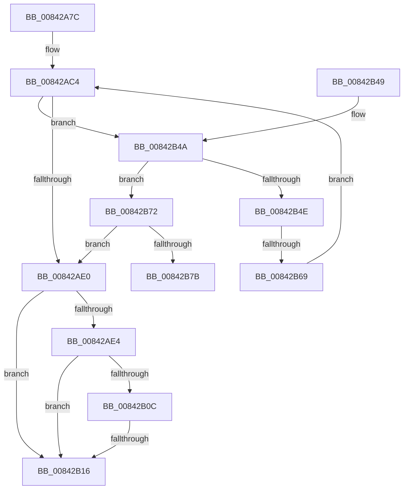

# CmpTransWriteLog

- RVA: `0x00842A7C`–`0x00842B80` (길이 `260` bytes)
- VA: `0x0000000140842A7C`
- 실행 섹션: `PAGE`
- PDB 이름 있음: `예`; PDB Function 태그: `예`
- unwind 정보 RVA: `0x00068FCC`
- 디코드: `78`개 명령, `260/260` bytes 표시
- 미해석 바이트: `0` (있으면 어셈블리에 `.byte`로 보존)

> 이 문서는 커널 이미지의 기계어와 PDB 기호를 분석해 생성했습니다. 4번과 5번은 함수 원형과 자료형을 바이너리 사용 방식에서 추정한 C 해석이며 원본 소스 복구 결과는 아닙니다.

## 1. Dependencies

- 직접 호출 지점: **7**; 고유 호출 대상: **7**
- 직접 호출자로 확인된 함수: **2**
- RIP 상대 이미지 참조: **1**

### Outgoing calls
- `0x00842ABC` → [LockRMLog](LockRMLog_function_00842B88.md) (function, `0x00842B88`)
- `0x00842AD2` → [CmpDoTransWriteLogRecord](CmpDoTransWriteLogRecord_function_00842D30.md) (function, `0x00842D30`)
- `0x00842B03` → [CmpComputeLogFillLevel](CmpComputeLogFillLevel_function_00842BB8.md) (function, `0x00842BB8`)
- `0x00842B1D` → [ExReleaseResourceLite](../../text/25/ExReleaseResourceLite_function_0025FA10.md) (function, `0x0025FA10`)
- `0x00842B22` → [KeLeaveCriticalRegion](../../text/25/KeLeaveCriticalRegion_function_0025D8B0.md) (function, `0x0025D8B0`)
- `0x00842B30` → [_security_check_cookie](../../text/6A/_security_check_cookie_function_006AC640.md) (function, `0x006AC640`)
- `0x00842B5C` → [CmpLogCheckpoint](CmpLogCheckpoint_function_00842F04.md) (function, `0x00842F04`)

### Direct callers
- [CmAddLogForAction](CmAddLogForAction_function_008445AC.md) at `0x00844912`
- [CmLogTmRmAction](../9B/CmLogTmRmAction_function_009B1598.md) at `0x009B1620`

### Static image references
- `0x00842A95` → RVA `0x00E0A740` (`.data`; read)

## 2. Other-region calls and transfers

- 다른 실행 섹션으로 향하는 call: **3**
  - `0x00842B1D` → [ExReleaseResourceLite](../../text/25/ExReleaseResourceLite_function_0025FA10.md) (`PAGE` → `.text`)
  - `0x00842B22` → [KeLeaveCriticalRegion](../../text/25/KeLeaveCriticalRegion_function_0025D8B0.md) (`PAGE` → `.text`)
  - `0x00842B30` → [_security_check_cookie](../../text/6A/_security_check_cookie_function_006AC640.md) (`PAGE` → `.text`)
- call이 아닌 외부 분기/꼬리 이동: **3**
  - `0x00842B10` → [sub_00B15EDA + 0x96](../B1/Unknown_function_00B15EDA.md) (`tail-transfer`)
  - `0x00842B63` → [sub_00B15EDA](../B1/Unknown_function_00B15EDA.md) (`tail-transfer`)
  - `0x00842B7B` → [sub_00B15EDA](../B1/Unknown_function_00B15EDA.md) (`tail-transfer`)

## 3. Assembly (complete function range)

```asm
00842A7C  40 55                           push rbp
00842A7E  53                              push rbx
00842A7F  56                              push rsi
00842A80  57                              push rdi
00842A81  41 54                           push r12
00842A83  41 55                           push r13
00842A85  41 56                           push r14
00842A87  41 57                           push r15
00842A89  48 8D 6C 24 E9                  lea rbp, [rsp - 0x17]
00842A8E  48 81 EC 98 00 00 00            sub rsp, 0x98
00842A95  48 8B 05 A4 7C 5C 00            mov rax, qword ptr [rip + 0x5c7ca4]
00842A9C  48 33 C4                        xor rax, rsp
00842A9F  48 89 45 FF                     mov qword ptr [rbp - 1], rax
00842AA3  4C 8B 7D 7F                     mov r15, qword ptr [rbp + 0x7f]
00842AA7  33 FF                           xor edi, edi
00842AA9  89 7D AF                        mov dword ptr [rbp - 0x51], edi
00842AAC  41 8B F1                        mov esi, r9d
00842AAF  44 89 4D B7                     mov dword ptr [rbp - 0x49], r9d
00842AB3  45 8B E8                        mov r13d, r8d
00842AB6  4C 8B E2                        mov r12, rdx
00842AB9  48 8B D9                        mov rbx, rcx
00842ABC  E8 C7 00 00 00                  call 0x140842b88
00842AC1  44 8B CE                        mov r9d, esi
00842AC4  45 8B C5                        mov r8d, r13d
00842AC7  4C 89 7C 24 20                  mov qword ptr [rsp + 0x20], r15
00842ACC  49 8B D4                        mov rdx, r12
00842ACF  48 8B CB                        mov rcx, rbx
00842AD2  E8 59 02 00 00                  call 0x140842d30
00842AD7  8B F0                           mov esi, eax
00842AD9  3D 1D 00 1A C0                  cmp eax, 0xc01a001d
00842ADE  74 6A                           je 0x140842b4a
00842AE0  85 F6                           test esi, esi
00842AE2  78 32                           js 0x140842b16
00842AE4  44 8B 4B 48                     mov r9d, dword ptr [rbx + 0x48]
00842AE8  48 8D 45 AF                     lea rax, [rbp - 0x51]
00842AEC  48 8B 4B 58                     mov rcx, qword ptr [rbx + 0x58]
00842AF0  48 8D 53 78                     lea rdx, [rbx + 0x78]
00842AF4  48 89 44 24 28                  mov qword ptr [rsp + 0x28], rax
00842AF9  4D 8B C7                        mov r8, r15
00842AFC  8B 43 44                        mov eax, dword ptr [rbx + 0x44]
00842AFF  89 44 24 20                     mov dword ptr [rsp + 0x20], eax
00842B03  E8 B0 00 00 00                  call 0x140842bb8
00842B08  85 C0                           test eax, eax
00842B0A  78 0A                           js 0x140842b16
00842B0C  83 7D AF 50                     cmp dword ptr [rbp - 0x51], 0x50
00842B10  0F 83 5A 34 2D 00               jae 0x140b15f70
00842B16  48 8B 8B 80 00 00 00            mov rcx, qword ptr [rbx + 0x80]
00842B1D  E8 EE CE A1 FF                  call 0x14025fa10
00842B22  E8 89 AD A1 FF                  call 0x14025d8b0
00842B27  8B C6                           mov eax, esi
00842B29  48 8B 4D FF                     mov rcx, qword ptr [rbp - 1]
00842B2D  48 33 CC                        xor rcx, rsp
00842B30  E8 0B 9B E6 FF                  call 0x1406ac640
00842B35  48 81 C4 98 00 00 00            add rsp, 0x98
00842B3C  41 5F                           pop r15
00842B3E  41 5E                           pop r14
00842B40  41 5D                           pop r13
00842B42  41 5C                           pop r12
00842B44  5F                              pop rdi
00842B45  5E                              pop rsi
00842B46  5B                              pop rbx
00842B47  5D                              pop rbp
00842B48  C3                              ret
00842B49  CC                              int3
00842B4A  85 FF                           test edi, edi
00842B4C  75 24                           jne 0x140842b72
00842B4E  BF 01 00 00 00                  mov edi, 1
00842B53  48 8B CB                        mov rcx, rbx
00842B56  44 8A C7                        mov r8b, dil
00842B59  89 7D AF                        mov dword ptr [rbp - 0x51], edi
00842B5C  E8 A3 03 00 00                  call 0x140842f04
00842B61  85 C0                           test eax, eax
00842B63  0F 88 71 33 2D 00               js 0x140b15eda
00842B69  44 8B 4D B7                     mov r9d, dword ptr [rbp - 0x49]
00842B6D  E9 52 FF FF FF                  jmp 0x140842ac4
00842B72  83 FF 01                        cmp edi, 1
00842B75  0F 85 65 FF FF FF               jne 0x140842ae0
00842B7B  E9 5A 33 2D 00                  jmp 0x140b15eda
```

## 4. C-style interpretation (structured pseudocode)

```c
__int64 __fastcall CmpTransWriteLog(__int64 a1, __int64 a2, int a3, int a4, __int64 a5)
{
    __int64 result;
    __int64 v_rdi;
    __int64 v_rsp;
    unsigned __int64 v_stack_m57;
    unsigned __int64 v_stack_m58;
    unsigned int v_stack_mA0;
    unsigned int v_stack_mA8;
    unsigned __int64 v_stack_mB0;
    unsigned __int64 v_stack_mB8;

    v_rsp = (v_rsp) - (152);
    result = (*(unsigned __int64 *)(v_rip + 6061220)) ^ (v_rsp);
    v_stack_m58 = result;
    v_rdi = 0;
    v_stack_mA8 = 0;
    v_stack_mA0 = a4;
    result = LockRMLog(a1, a2, a3, a4);
loc_00842AC4:
    v_stack_mB8 = a5;
    result = CmpDoTransWriteLogRecord(a1, a2, (unsigned int)((unsigned int)((unsigned int)(a3))), (unsigned int)((unsigned int)((unsigned int)(a4))));
    if (((unsigned int)(result)) == 0xC01A001DULL) goto loc_00842B4A;
loc_00842AE0:
    if (sign_flag) goto loc_00842B16;
    v_stack_mB0 = v_stack_mA8;
    v_stack_mB8 = (unsigned int)((unsigned int)(*(unsigned int *)(a1 + 68)));
    result = CmpComputeLogFillLevel(*(unsigned __int64 *)(a1 + 88), a1 + 120, a5, (unsigned int)(*(unsigned int *)(a1 + 72)));
    if (sign_flag) goto loc_00842B16;
loc_00842B16:
    result = ExReleaseResourceLite(*(unsigned __int64 *)(a1 + 128), a1 + 120, a5, (unsigned int)(*(unsigned int *)(a1 + 72)));
    result = KeLeaveCriticalRegion(*(unsigned __int64 *)(a1 + 128), a1 + 120, a5, (unsigned int)(*(unsigned int *)(a1 + 72)));
    a1 = (v_stack_m58) ^ (v_rsp);
    result = _security_check_cookie(a1, a1 + 120, a5, (unsigned int)(*(unsigned int *)(a1 + 72)));
    v_rsp = (v_rsp) + (152);
    return result;
loc_00842B4A:
    if (0 != 0) goto loc_00842B72;
    v_stack_mA8 = 1;
    result = CmpLogCheckpoint(a1, a1 + 120, 1, (unsigned int)(*(unsigned int *)(a1 + 72)));
    goto loc_00842AC4;
loc_00842B72:
    if (1 != 1) goto loc_00842AE0;
}
```

## 5. (Beta) C Style

```c
int64_t CmpTransWriteLog(void *Arg1, int64_t Arg2, int32_t Arg3, int32_t Arg4, int64_t Arg5)
{
    uint8_t *arg1 = (uint8_t *)Arg1;

    int64_t result;
    int64_t local_rdi;
    int64_t local_rsp;
    uint64_t v_stack_m57;
    uint64_t v_stack_m58;
    uint32_t v_stack_mA0;
    uint32_t v_stack_mA8;
    uint64_t v_stack_mB0;
    uint64_t v_stack_mB8;

    local_rsp = (local_rsp) - (152);
    result = (*(uint64_t *)(v_rip + 0x5C7CA4)) ^ (local_rsp);
    v_stack_m58 = result;
    local_rdi = 0;
    v_stack_mA8 = 0;
    v_stack_mA0 = Arg4;
    result = LockRMLog(Arg1, Arg2, Arg3, Arg4);
loc_00842AC4:
    v_stack_mB8 = Arg5;
    result = CmpDoTransWriteLogRecord(Arg1, Arg2, (uint32_t)((uint32_t)((uint32_t)(Arg3))), (uint32_t)((uint32_t)((uint32_t)(Arg4))));
    if (((uint32_t)(result)) == 0xC01A001DULL) goto loc_00842B4A;
loc_00842AE0:
    if (sign_flag) goto loc_00842B16;
    v_stack_mB0 = v_stack_mA8;
    v_stack_mB8 = (uint32_t)((uint32_t)(*(uint32_t *)(arg1 + 0x44)));
    result = CmpComputeLogFillLevel(*(uint64_t *)(arg1 + 0x58), Arg1 + 120, Arg5, (uint32_t)(*(uint32_t *)(arg1 + 0x48)));
    if (sign_flag) goto loc_00842B16;
loc_00842B16:
    result = ExReleaseResourceLite(*(uint64_t *)(arg1 + 0x80), Arg1 + 120, Arg5, (uint32_t)(*(uint32_t *)(arg1 + 0x48)));
    result = KeLeaveCriticalRegion(*(uint64_t *)(arg1 + 0x80), Arg1 + 120, Arg5, (uint32_t)(*(uint32_t *)(arg1 + 0x48)));
    Arg1 = (v_stack_m58) ^ (local_rsp);
    result = _security_check_cookie(Arg1, Arg1 + 120, Arg5, (uint32_t)(*(uint32_t *)(arg1 + 0x48)));
    local_rsp = (local_rsp) + (152);
    return result;
loc_00842B4A:
    if (0 != 0) goto loc_00842B72;
    v_stack_mA8 = 1;
    result = CmpLogCheckpoint(Arg1, Arg1 + 120, 1, (uint32_t)(*(uint32_t *)(arg1 + 0x48)));
    goto loc_00842AC4;
loc_00842B72:
    if (1 != 1) goto loc_00842AE0;
}
```

### 관측된 메모리 오프셋

구조체 형식이 확인되지 않은 접근은 인자 기준의 오프셋으로만 기록했습니다.

| 기준 인자 | 오프셋 표현 | 폭 (bit) | 접근 |
|---|---:|---:|---|
| `Arg1` | `+ 0x44` | `32` | `R` |
| `Arg1` | `+ 0x48` | `32` | `R` |
| `Arg1` | `+ 0x58` | `64` | `R` |
| `Arg1` | `+ 0x78` | `64` | `R` |
| `Arg1` | `+ 0x80` | `64` | `R` |

## 6. Execution-region graph

[열기: 2D/3D 그래프와 함수 탐색 컨트롤 패널](../../../control-panel.html?section=page&rva=0x00842A7C&view=graph)

- 2D 그래프는 위에서 아래로 흐르고, 3D 그래프는 빈 공간을 드래그해 회전합니다. Shift+드래그는 이동, 휠은 확대·축소, 함수 노드 선택은 대상 보고서 이동입니다.

### Static fallback


