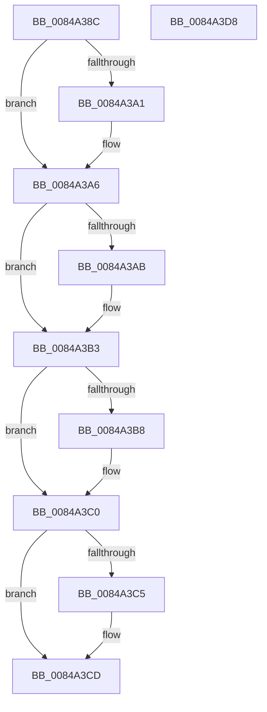

# CmpUnblockTwoHiveWrites

- RVA: `0x0084A38C`–`0x0084A3D9` (길이 `77` bytes)
- VA: `0x000000014084A38C`
- 실행 섹션: `PAGE`
- PDB 이름 있음: `예`; PDB Function 태그: `아니요`
- unwind 정보 RVA: `0x0005CAAC`
- 디코드: `25`개 명령, `77/77` bytes 표시
- 미해석 바이트: `0` (있으면 어셈블리에 `.byte`로 보존)

> 이 문서는 커널 이미지의 기계어와 PDB 기호를 분석해 생성했습니다. 4번과 5번은 함수 원형과 자료형을 바이너리 사용 방식에서 추정한 C 해석이며 원본 소스 복구 결과는 아닙니다.

## 1. Dependencies

- 직접 호출 지점: **4**; 고유 호출 대상: **2**
- 직접 호출자로 확인된 함수: **2**
- RIP 상대 이미지 참조: **0**

### Outgoing calls
- `0x0084A3A1` → [HvUnlockHiveFlusherExclusive](../../pagecmrc/BC/HvUnlockHiveFlusherExclusive_function_00BC9C34.md) (function, `0x00BC9C34`)
- `0x0084A3AE` → [HvUnlockHiveFlusherExclusive](../../pagecmrc/BC/HvUnlockHiveFlusherExclusive_function_00BC9C34.md) (function, `0x00BC9C34`)
- `0x0084A3BB` → [CmpDereferenceHive](../86/CmpDereferenceHive_function_008632B0.md) (function, `0x008632B0`)
- `0x0084A3C8` → [CmpDereferenceHive](../86/CmpDereferenceHive_function_008632B0.md) (function, `0x008632B0`)

### Direct callers
- [CmpVirtualPathPresent](../7E/CmpVirtualPathPresent_function_007EBDB4.md) at `0x007EBEB2`
- [CmpVirtualBranchIsReplicated](CmpVirtualBranchIsReplicated_function_0084A3E0.md) at `0x0084A539`

### Static image references
- 디코드된 RIP-relative 메모리 참조가 없습니다.

## 2. Other-region calls and transfers

- 다른 실행 섹션으로 향하는 call: **2**
  - `0x0084A3A1` → [HvUnlockHiveFlusherExclusive](../../pagecmrc/BC/HvUnlockHiveFlusherExclusive_function_00BC9C34.md) (`PAGE` → `PAGECMRC`)
  - `0x0084A3AE` → [HvUnlockHiveFlusherExclusive](../../pagecmrc/BC/HvUnlockHiveFlusherExclusive_function_00BC9C34.md) (`PAGE` → `PAGECMRC`)
- 별도 외부 분기/꼬리 이동을 확인하지 못했습니다.

## 3. Assembly (complete function range)

```asm
0084A38C  48 89 5C 24 08                  mov qword ptr [rsp + 8], rbx
0084A391  57                              push rdi
0084A392  48 83 EC 20                     sub rsp, 0x20
0084A396  48 8B DA                        mov rbx, rdx
0084A399  48 8B F9                        mov rdi, rcx
0084A39C  48 85 C9                        test rcx, rcx
0084A39F  74 05                           je 0x14084a3a6
0084A3A1  E8 8E F8 37 00                  call 0x140bc9c34
0084A3A6  48 85 DB                        test rbx, rbx
0084A3A9  74 08                           je 0x14084a3b3
0084A3AB  48 8B CB                        mov rcx, rbx
0084A3AE  E8 81 F8 37 00                  call 0x140bc9c34
0084A3B3  48 85 FF                        test rdi, rdi
0084A3B6  74 08                           je 0x14084a3c0
0084A3B8  48 8B CF                        mov rcx, rdi
0084A3BB  E8 F0 8E 01 00                  call 0x1408632b0
0084A3C0  48 85 DB                        test rbx, rbx
0084A3C3  74 08                           je 0x14084a3cd
0084A3C5  48 8B CB                        mov rcx, rbx
0084A3C8  E8 E3 8E 01 00                  call 0x1408632b0
0084A3CD  48 8B 5C 24 30                  mov rbx, qword ptr [rsp + 0x30]
0084A3D2  48 83 C4 20                     add rsp, 0x20
0084A3D6  5F                              pop rdi
0084A3D7  C3                              ret
0084A3D8  CC                              int3
```

## 4. C-style interpretation (structured pseudocode)

```c
__int64 __fastcall CmpUnblockTwoHiveWrites(__int64 a1, __int64 a2)
{
    __int64 result;
    __int64 v_rsp;
    unsigned __int64 v_stack_p8;

    v_stack_p8 = v_rbx;
    v_rsp = (v_rsp) - (32);
    if (a1 != 0) {
        result = HvUnlockHiveFlusherExclusive(a1, a2, a3, a4);
    }
    if (a2 != 0) {
        a1 = a2;
        result = HvUnlockHiveFlusherExclusive(a1, a2, a3, a4);
    }
    if (a1 != 0) {
        a1 = a1;
        result = CmpDereferenceHive(a1, a2, a3, a4);
    }
    if (a2 != 0) {
        a1 = a2;
        result = CmpDereferenceHive(a1, a2, a3, a4);
    }
    v_rsp = (v_rsp) + (32);
    return result;
}
```

## 5. (Beta) C Style

```c
int64_t CmpUnblockTwoHiveWrites(int64_t Arg1, int64_t Arg2)
{
    int64_t result;
    int64_t local_rsp;
    uint64_t v_stack_p8;

    v_stack_p8 = local_rbx;
    local_rsp = (local_rsp) - (32);
    if (Arg1 != 0) {
        result = HvUnlockHiveFlusherExclusive(Arg1, Arg2, a3, a4);
    }
    if (Arg2 != 0) {
        Arg1 = Arg2;
        result = HvUnlockHiveFlusherExclusive(Arg1, Arg2, a3, a4);
    }
    if (Arg1 != 0) {
        Arg1 = Arg1;
        result = CmpDereferenceHive(Arg1, Arg2, a3, a4);
    }
    if (Arg2 != 0) {
        Arg1 = Arg2;
        result = CmpDereferenceHive(Arg1, Arg2, a3, a4);
    }
    local_rsp = (local_rsp) + (32);
    return result;
}
```

## 6. Execution-region graph

[열기: 2D/3D 그래프와 함수 탐색 컨트롤 패널](../../../control-panel.html?section=page&rva=0x0084A38C&view=graph)

- 2D 그래프는 위에서 아래로 흐르고, 3D 그래프는 빈 공간을 드래그해 회전합니다. Shift+드래그는 이동, 휠은 확대·축소, 함수 노드 선택은 대상 보고서 이동입니다.

### Static fallback


