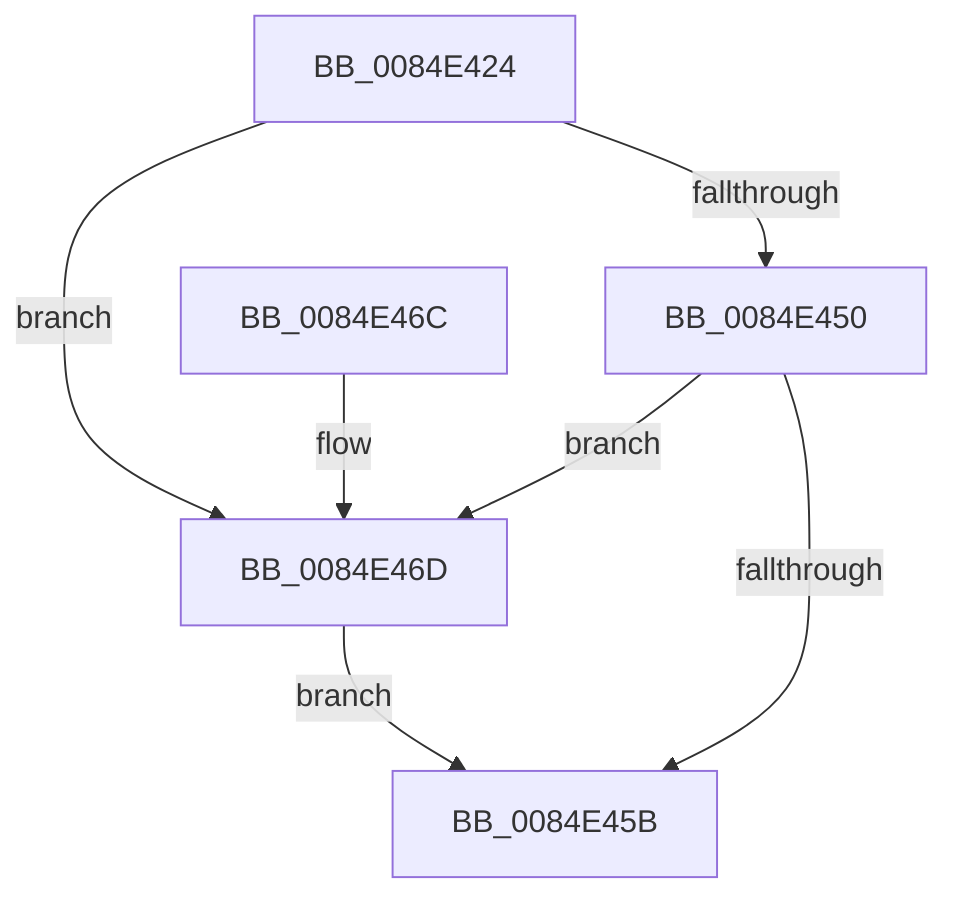

# CmpUnlockHiveList

- RVA: `0x0084E424`–`0x0084E47B` (길이 `87` bytes)
- VA: `0x000000014084E424`
- 실행 섹션: `PAGE`
- PDB 이름 있음: `예`; PDB Function 태그: `아니요`
- unwind 정보 RVA: `0x00064C74`
- 디코드: `21`개 명령, `87/87` bytes 표시
- 미해석 바이트: `0` (있으면 어셈블리에 `.byte`로 보존)

> 이 문서는 커널 이미지의 기계어와 PDB 기호를 분석해 생성했습니다. 4번과 5번은 함수 원형과 자료형을 바이너리 사용 방식에서 추정한 C 해석이며 원본 소스 복구 결과는 아닙니다.

## 1. Dependencies

- 직접 호출 지점: **2**; 고유 호출 대상: **2**
- 직접 호출자로 확인된 함수: **13**
- RIP 상대 이미지 참조: **1**

### Outgoing calls
- `0x0084E462` → [KeAbPostRelease](../../text/2E/KeAbPostRelease_function_002E1600.md) (function, `0x002E1600`)
- `0x0084E474` → [ExfReleasePushLock](../../text/26/ExfReleasePushLock_function_002638D0.md) (function, `0x002638D0`)

### Direct callers
- [CmpLoadKeyCommon](../../text/46/CmpLoadKeyCommon_function_0046E9F8.md) at `0x0046ECDD`
- [CmpJoinClassOfTrust](../../text/46/CmpJoinClassOfTrust_function_0046EEB4.md) at `0x0046EF23`
- [CmpUnJoinClassOfTrust](../../text/4A/CmpUnJoinClassOfTrust_function_004A27C0.md) at `0x004A27F7`
- [CmpFinishSystemHivesLoad](../7D/CmpFinishSystemHivesLoad_function_007DA210.md) at `0x007DA562`
- [CmpLoadHiveVolatile](../7D/CmpLoadHiveVolatile_function_007DE5F0.md) at `0x007DEA1D`
- [CmpVEExecuteRealStoreParseLogic](CmpVEExecuteRealStoreParseLogic_function_0084CCD4.md) at `0x0084CD73`
- [CmpBlockHiveWrites](CmpBlockHiveWrites_function_0084CF94.md) at `0x0084CFDD`
- [CmpGetNextActiveHive](CmpGetNextActiveHive_function_0084E2A0.md) at `0x0084E2EC`
- [CmpGetNextHive](CmpGetNextHive_function_0084E330.md) at `0x0084E37F`
- [CmpDoParseKey](../85/CmpDoParseKey_function_0085F750.md) at `0x0085FE07`
- [CmpDoParseKey](../85/CmpDoParseKey_function_0085F750.md) at `0x008603AA`
- [CmpDeleteHive](../86/CmpDeleteHive_function_0086450C.md) at `0x0086454A`
- [CmpGetLastHive](../87/CmpGetLastHive_function_008786B4.md) at `0x008786E7`
- [sub_00B1802A](../B1/Unknown_function_00B1802A.md) at `0x00B1832A`

### Static image references
- `0x0084E428` → RVA `0x00EF7C70` (`.data`; read)

## 2. Other-region calls and transfers

- 다른 실행 섹션으로 향하는 call: **2**
  - `0x0084E462` → [KeAbPostRelease](../../text/2E/KeAbPostRelease_function_002E1600.md) (`PAGE` → `.text`)
  - `0x0084E474` → [ExfReleasePushLock](../../text/26/ExfReleasePushLock_function_002638D0.md) (`PAGE` → `.text`)
- 별도 외부 분기/꼬리 이동을 확인하지 못했습니다.

## 3. Assembly (complete function range)

```asm
0084E424  48 83 EC 28                     sub rsp, 0x28
0084E428  0F 0D 0D 41 98 6A 00            prefetchw byte ptr [rip + 0x6a9841]
0084E42F  48 8B 05 3A 98 6A 00            mov rax, qword ptr [rip + 0x6a983a]
0084E436  45 33 C0                        xor r8d, r8d
0084E439  48 8B C8                        mov rcx, rax
0084E43C  48 83 E1 F0                     and rcx, 0xfffffffffffffff0
0084E440  48 83 F9 10                     cmp rcx, 0x10
0084E444  48 8D 50 F0                     lea rdx, [rax - 0x10]
0084E448  49 0F 46 D0                     cmovbe rdx, r8
0084E44C  A8 02                           test al, 2
0084E44E  75 1D                           jne 0x14084e46d
0084E450  F0 48 0F B1 15 17 98 6A 00      lock cmpxchg qword ptr [rip + 0x6a9817], rdx
0084E459  75 12                           jne 0x14084e46d
0084E45B  48 8D 0D 0E 98 6A 00            lea rcx, [rip + 0x6a980e]
0084E462  E8 99 31 A9 FF                  call 0x1402e1600
0084E467  48 83 C4 28                     add rsp, 0x28
0084E46B  C3                              ret
0084E46C  CC                              int3
0084E46D  48 8D 0D FC 97 6A 00            lea rcx, [rip + 0x6a97fc]
0084E474  E8 57 54 A1 FF                  call 0x1402638d0
0084E479  EB E0                           jmp 0x14084e45b
```

## 4. C-style interpretation (structured pseudocode)

```c
__int64 __fastcall CmpUnlockHiveList(__int64 a1, __int64 a2, int a3)
{
    __int64 result;
    __int64 v_rsp;

    v_rsp = (v_rsp) - (40);
    a3 = 0;
    a1 = (*(unsigned __int64 *)(v_rip + 6985786)) & (-16);
    a2 = *(unsigned __int64 *)(v_rip + 6985786) - 16;
    if (a1 <= 16) { a2 = 0; }
    if ((((unsigned __int8)(*(unsigned __int64 *)(v_rip + 6985786))) & (2)) != 0) goto loc_0084E46D;
    if ((((unsigned __int8)(*(unsigned __int64 *)(v_rip + 6985786))) & (2)) != 0) goto loc_0084E46D;
loc_0084E45B:
    result = KeAbPostRelease(v_rip + 6985742, a2, a3, a4);
    v_rsp = (v_rsp) + (40);
    return result;
loc_0084E46D:
    result = ExfReleasePushLock(v_rip + 6985724, a2, a3, a4);
    goto loc_0084E45B;
}
```

## 5. (Beta) C Style

```c
int64_t CmpUnlockHiveList(int64_t Arg1, int64_t Arg2, int32_t Arg3)
{
    int64_t result;
    int64_t local_rsp;

    local_rsp = (local_rsp) - (40);
    Arg3 = 0;
    Arg1 = (*(uint64_t *)(v_rip + 0x6A983A)) & (-16);
    Arg2 = *(uint64_t *)(v_rip + 0x6A983A) - 16;
    if (Arg1 <= 16) { Arg2 = 0; }
    if ((((uint8_t)(*(uint64_t *)(v_rip + 0x6A983A))) & (2)) != 0) goto loc_0084E46D;
    if ((((uint8_t)(*(uint64_t *)(v_rip + 0x6A983A))) & (2)) != 0) goto loc_0084E46D;
loc_0084E45B:
    result = KeAbPostRelease(v_rip + 6985742, Arg2, Arg3, a4);
    local_rsp = (local_rsp) + (40);
    return result;
loc_0084E46D:
    result = ExfReleasePushLock(v_rip + 6985724, Arg2, Arg3, a4);
    goto loc_0084E45B;
}
```

## 6. Execution-region graph

[열기: 2D/3D 그래프와 함수 탐색 컨트롤 패널](../../../control-panel.html?section=page&rva=0x0084E424&view=graph)

- 2D 그래프는 위에서 아래로 흐르고, 3D 그래프는 빈 공간을 드래그해 회전합니다. Shift+드래그는 이동, 휠은 확대·축소, 함수 노드 선택은 대상 보고서 이동입니다.

### Static fallback


