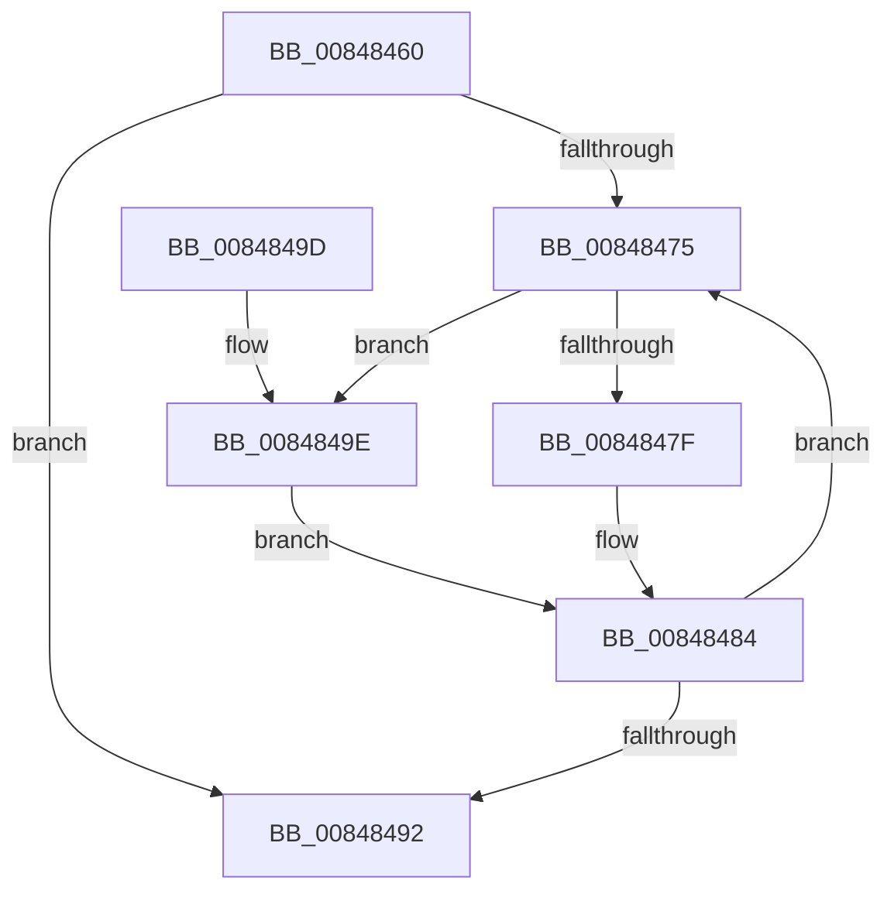

# CmpUnlockKcbStack

- RVA: `0x00848460`–`0x008484A9` (길이 `73` bytes)
- VA: `0x0000000140848460`
- 실행 섹션: `PAGE`
- PDB 이름 있음: `예`; PDB Function 태그: `아니요`
- unwind 정보 RVA: `0x00069334`
- 디코드: `23`개 명령, `73/73` bytes 표시
- 미해석 바이트: `0` (있으면 어셈블리에 `.byte`로 보존)

> 이 문서는 커널 이미지의 기계어와 PDB 기호를 분석해 생성했습니다. 4번과 5번은 함수 원형과 자료형을 바이너리 사용 방식에서 추정한 C 해석이며 원본 소스 복구 결과는 아닙니다.

## 1. Dependencies

- 직접 호출 지점: **1**; 고유 호출 대상: **1**
- 직접 호출자로 확인된 함수: **28**
- RIP 상대 이미지 참조: **0**

### Outgoing calls
- `0x00848484` → [CmpUnlockKcb](../../pagecmrc/BC/CmpUnlockKcb_function_00BC92C0.md) (function, `0x00BC92C0`)

### Direct callers
- [CmDeleteLayeredKey](../../text/41/CmDeleteLayeredKey_function_0041B598.md) at `0x0041B812`
- [CmDeleteLayeredKey](../../text/41/CmDeleteLayeredKey_function_0041B598.md) at `0x0041B81B`
- [CmDeleteLayeredKey](../../text/41/CmDeleteLayeredKey_function_0041B598.md) at `0x0041B8BD`
- [CmDeleteLayeredKey](../../text/41/CmDeleteLayeredKey_function_0041B598.md) at `0x0041B8C6`
- [CmDeleteLayeredKey](../../text/41/CmDeleteLayeredKey_function_0041B598.md) at `0x0041B94D`
- [CmDeleteLayeredKey](../../text/41/CmDeleteLayeredKey_function_0041B598.md) at `0x0041B956`
- [CmQueryLayeredKey](../../text/46/CmQueryLayeredKey_function_0046A930.md) at `0x0046AADA`
- [sub_006ED542](../../text/6E/Unknown_function_006ED542.md) at `0x006ED56E`
- [sub_006ED542](../../text/6E/Unknown_function_006ED542.md) at `0x006ED577`
- [CmSaveKey](../7D/CmSaveKey_function_007DDBDC.md) at `0x007DDDFE`
- [CmSaveKey](../7D/CmSaveKey_function_007DDBDC.md) at `0x007DDF72`
- [CmSaveKey](../7D/CmSaveKey_function_007DDBDC.md) at `0x007DDFC1`
- [CmOpenKeyForBugCheckRecovery](../7D/CmOpenKeyForBugCheckRecovery_function_007DF3C0.md) at `0x007DF510`
- [CmpDoBuildVirtualStack](../7E/CmpDoBuildVirtualStack_function_007EB4C4.md) at `0x007EB71A`
- [CmpDoBuildVirtualStack](../7E/CmpDoBuildVirtualStack_function_007EB4C4.md) at `0x007EB723`
- [CmpDoBuildVirtualStack](../7E/CmpDoBuildVirtualStack_function_007EB4C4.md) at `0x007EB788`
- [CmpDoBuildVirtualStack](../7E/CmpDoBuildVirtualStack_function_007EB4C4.md) at `0x007EB791`
- [CmpAssignKeySecurity](../7E/CmpAssignKeySecurity_function_007EC8B0.md) at `0x007ECA28`
- [CmSetLastWriteTimeKey](CmSetLastWriteTimeKey_function_00843368.md) at `0x008434D5`
- [CmSetLastWriteTimeKey](CmSetLastWriteTimeKey_function_00843368.md) at `0x00843540`
- [CmSetLastWriteTimeKey](CmSetLastWriteTimeKey_function_00843368.md) at `0x008436A8`
- [CmpPromoteKey](CmpPromoteKey_function_00844388.md) at `0x008444CA`
- [CmpPromoteKey](CmpPromoteKey_function_00844388.md) at `0x00844575`
- [CmSetValueKey](CmSetValueKey_function_008457C0.md) at `0x00845F53`
- [CmSetValueKey](CmSetValueKey_function_008457C0.md) at `0x00846662`
- [CmDeleteValueKey](CmDeleteValueKey_function_008476E8.md) at `0x00847C82`
- [CmDeleteValueKey](CmDeleteValueKey_function_008476E8.md) at `0x00847DCF`
- [CmDeleteValueKey](CmDeleteValueKey_function_008476E8.md) at `0x00847FC0`
- [CmDeleteValueKey](CmDeleteValueKey_function_008476E8.md) at `0x008482CF`
- [CmDeleteKey](CmDeleteKey_function_00848E5C.md) at `0x0084932F`
- [CmDeleteKey](CmDeleteKey_function_00848E5C.md) at `0x00849339`
- [CmDeleteKey](CmDeleteKey_function_00848E5C.md) at `0x008493FF`
- [CmDeleteKey](CmDeleteKey_function_00848E5C.md) at `0x00849409`
- [CmDeleteKey](CmDeleteKey_function_00848E5C.md) at `0x0084964C`
- [CmDeleteKey](CmDeleteKey_function_00848E5C.md) at `0x00849656`
- [sub_00855472](../85/Unknown_function_00855472.md) at `0x0085549B`
- [sub_00857864](../85/Unknown_function_00857864.md) at `0x008578D7`
- [sub_00857A33](../85/Unknown_function_00857A33.md) at `0x00857B1B`
- [sub_00857E06](../85/Unknown_function_00857E06.md) at `0x00857E5A`
- [sub_00858022](../85/Unknown_function_00858022.md) at `0x00858044`
- [CmpDoParseKey](../85/CmpDoParseKey_function_0085F750.md) at `0x0085FFA6`
- [CmpDoParseKey](../85/CmpDoParseKey_function_0085F750.md) at `0x008600DD`
- [CmpDoParseKey](../85/CmpDoParseKey_function_0085F750.md) at `0x00860BE0`
- [CmpDoParseKey](../85/CmpDoParseKey_function_0085F750.md) at `0x00860BEC`
- [CmpDoParseKey](../85/CmpDoParseKey_function_0085F750.md) at `0x00861003`
- [CmpDoParseKey](../85/CmpDoParseKey_function_0085F750.md) at `0x008610AE`
- [CmpDoParseKey](../85/CmpDoParseKey_function_0085F750.md) at `0x008610E2`
- [CmpDoParseKey](../85/CmpDoParseKey_function_0085F750.md) at `0x0086125A`
- [CmpDoParseKey](../85/CmpDoParseKey_function_0085F750.md) at `0x00861262`
- [CmpDoParseKey](../85/CmpDoParseKey_function_0085F750.md) at `0x0086145D`
- [CmpDoParseKey](../85/CmpDoParseKey_function_0085F750.md) at `0x00861466`
- [CmpDoParseKey](../85/CmpDoParseKey_function_0085F750.md) at `0x00861B42`
- [CmEnumerateValueFromLayeredKey](../8B/CmEnumerateValueFromLayeredKey_function_008B31FC.md) at `0x008B347F`
- [CmpEnumerateLayeredKey](../94/CmpEnumerateLayeredKey_function_00945E58.md) at `0x009461F7`
- [CmpSetKeySecurity](../94/CmpSetKeySecurity_function_0094A124.md) at `0x0094A449`
- [CmpSetKeySecurity](../94/CmpSetKeySecurity_function_0094A124.md) at `0x0094A4F5`
- [CmpSetKeySecurity](../94/CmpSetKeySecurity_function_0094A124.md) at `0x0094A554`
- [CmpSetKeySecurity](../94/CmpSetKeySecurity_function_0094A124.md) at `0x0094A675`
- [CmSetKeyFlags](../9A/CmSetKeyFlags_function_009AEEA4.md) at `0x009AEF93`
- [CmSetKeyFlags](../9A/CmSetKeyFlags_function_009AEEA4.md) at `0x009AF19D`
- [CmpStartSiloRegistryNamespace](../9E/CmpStartSiloRegistryNamespace_function_009E85D0.md) at `0x009E874A`
- [CmQueryMultipleValueForLayeredKey](../A8/CmQueryMultipleValueForLayeredKey_function_00A8DE80.md) at `0x00A8E34B`
- [sub_00B16026](../B1/Unknown_function_00B16026.md) at `0x00B16059`
- [sub_00B16440](../B1/Unknown_function_00B16440.md) at `0x00B16468`
- [sub_00B16440](../B1/Unknown_function_00B16440.md) at `0x00B16472`
- [sub_00B16F66](../B1/Unknown_function_00B16F66.md) at `0x00B1716B`
- [sub_00B16F66](../B1/Unknown_function_00B16F66.md) at `0x00B17173`
- [sub_00B16F66](../B1/Unknown_function_00B16F66.md) at `0x00B17260`
- [sub_00B2D804](../B2/Unknown_function_00B2D804.md) at `0x00B2D81D`

### Static image references
- 디코드된 RIP-relative 메모리 참조가 없습니다.

## 2. Other-region calls and transfers

- 다른 실행 섹션으로 향하는 call: **1**
  - `0x00848484` → [CmpUnlockKcb](../../pagecmrc/BC/CmpUnlockKcb_function_00BC92C0.md) (`PAGE` → `PAGECMRC`)
- 별도 외부 분기/꼬리 이동을 확인하지 못했습니다.

## 3. Assembly (complete function range)

```asm
00848460  48 89 5C 24 08                  mov qword ptr [rsp + 8], rbx
00848465  57                              push rdi
00848466  48 83 EC 20                     sub rsp, 0x20
0084846A  33 DB                           xor ebx, ebx
0084846C  48 8B F9                        mov rdi, rcx
0084846F  66 3B 59 02                     cmp bx, word ptr [rcx + 2]
00848473  7F 1D                           jg 0x140848492
00848475  48 0F BF CB                     movsx rcx, bx
00848479  66 83 FB 02                     cmp bx, 2
0084847D  7D 1F                           jge 0x14084849e
0084847F  48 8B 4C CF 08                  mov rcx, qword ptr [rdi + rcx*8 + 8]
00848484  E8 37 0E 38 00                  call 0x140bc92c0
00848489  66 FF C3                        inc bx
0084848C  66 3B 5F 02                     cmp bx, word ptr [rdi + 2]
00848490  7E E3                           jle 0x140848475
00848492  48 8B 5C 24 30                  mov rbx, qword ptr [rsp + 0x30]
00848497  48 83 C4 20                     add rsp, 0x20
0084849B  5F                              pop rdi
0084849C  C3                              ret
0084849D  CC                              int3
0084849E  48 8B 47 18                     mov rax, qword ptr [rdi + 0x18]
008484A2  48 8B 4C C8 F0                  mov rcx, qword ptr [rax + rcx*8 - 0x10]
008484A7  EB DB                           jmp 0x140848484
```

## 4. C-style interpretation (structured pseudocode)

```c
__int64 __fastcall CmpUnlockKcbStack(__int64 a1)
{
    __int64 result;
    __int64 v_rbx;
    __int64 v_rsp;
    unsigned __int64 v_stack_p8;

    v_stack_p8 = v_rbx;
    v_rsp = (v_rsp) - (32);
    v_rbx = 0;
    if (0 > (*(unsigned __int16 *)(a1 + 2))) goto loc_00848492;
loc_00848475:
    if (0 >= 2) goto loc_0084849E;
loc_00848484:
    result = CmpUnlockKcb(*(unsigned __int64 *)(a1 + (__int16)(0) * 8 + 8), a2, a3, a4);
    v_rbx = (unsigned __int16)((v_rbx) + 1);
    if (((unsigned __int16)(v_rbx)) <= (*(unsigned __int16 *)(a1 + 2))) goto loc_00848475;
loc_00848492:
    v_rsp = (v_rsp) + (32);
    return result;
loc_0084849E:
    goto loc_00848484;
}
```

## 5. (Beta) C Style

```c
int64_t CmpUnlockKcbStack(void *Arg1)
{
    uint8_t *arg1 = (uint8_t *)Arg1;

    int64_t result;
    int64_t local_rbx;
    int64_t local_rsp;
    uint64_t v_stack_p8;

    v_stack_p8 = local_rbx;
    local_rsp = (local_rsp) - (32);
    local_rbx = 0;
    if (0 > (*(uint16_t *)(arg1 + 0x2))) goto loc_00848492;
loc_00848475:
    if (0 >= 2) goto loc_0084849E;
loc_00848484:
    result = CmpUnlockKcb(*(uint64_t *)(arg1 + (int16_t)(0) * 8 + 0x8), a2, a3, a4);
    local_rbx = (uint16_t)((local_rbx) + 1);
    if (((uint16_t)(local_rbx)) <= (*(uint16_t *)(arg1 + 0x2))) goto loc_00848475;
loc_00848492:
    local_rsp = (local_rsp) + (32);
    return result;
loc_0084849E:
    goto loc_00848484;
}
```

### 관측된 메모리 오프셋

구조체 형식이 확인되지 않은 접근은 인자 기준의 오프셋으로만 기록했습니다.

| 기준 인자 | 오프셋 표현 | 폭 (bit) | 접근 |
|---|---:|---:|---|
| `Arg1` | `+ 0x2` | `16` | `R` |
| `Arg1` | `+ 0x8 + rcx*8` | `64` | `R` |
| `Arg1` | `+ 0x18` | `64` | `R` |

## 6. Execution-region graph

[열기: 2D/3D 그래프와 함수 탐색 컨트롤 패널](../../../control-panel.html?section=page&rva=0x00848460&view=graph)

- 2D 그래프는 위에서 아래로 흐르고, 3D 그래프는 빈 공간을 드래그해 회전합니다. Shift+드래그는 이동, 휠은 확대·축소, 함수 노드 선택은 대상 보고서 이동입니다.

### Static fallback


