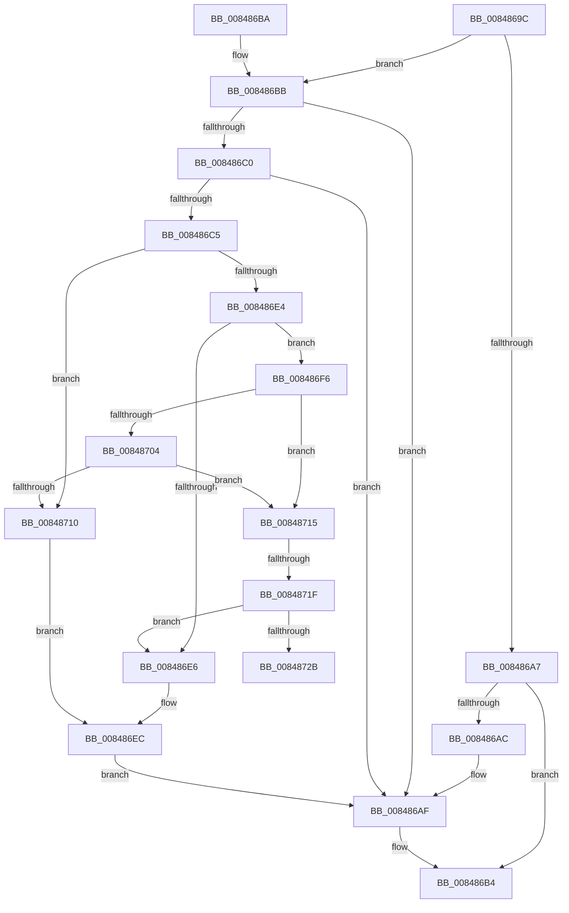

# CmpUnlockTwoKcbs

- RVA: `0x0084869C`–`0x00848730` (길이 `148` bytes)
- VA: `0x000000014084869C`
- 실행 섹션: `PAGE`
- PDB 이름 있음: `예`; PDB Function 태그: `예`
- unwind 정보 RVA: `0x0006937C`
- 디코드: `43`개 명령, `148/148` bytes 표시
- 미해석 바이트: `0` (있으면 어셈블리에 `.byte`로 보존)

> 이 문서는 커널 이미지의 기계어와 PDB 기호를 분석해 생성했습니다. 4번과 5번은 함수 원형과 자료형을 바이너리 사용 방식에서 추정한 C 해석이며 원본 소스 복구 결과는 아닙니다.

## 1. Dependencies

- 직접 호출 지점: **2**; 고유 호출 대상: **1**
- 직접 호출자로 확인된 함수: **6**
- RIP 상대 이미지 참조: **0**

### Outgoing calls
- `0x008486AF` → [CmpUnlockKcb](../../pagecmrc/BC/CmpUnlockKcb_function_00BC92C0.md) (function, `0x00BC92C0`)
- `0x008486EC` → [CmpUnlockKcb](../../pagecmrc/BC/CmpUnlockKcb_function_00BC92C0.md) (function, `0x00BC92C0`)

### Direct callers
- [CmSaveMergedKeys](../7D/CmSaveMergedKeys_function_007DE040.md) at `0x007DE3D9`
- [CmSaveMergedKeys](../7D/CmSaveMergedKeys_function_007DE040.md) at `0x007DE470`
- [CmQueryMultipleValueKey](CmQueryMultipleValueKey_function_00846EC0.md) at `0x00847349`
- [CmQueryMultipleValueKey](CmQueryMultipleValueKey_function_00846EC0.md) at `0x00847475`
- [CmQueryMultipleValueKey](CmQueryMultipleValueKey_function_00846EC0.md) at `0x00847495`
- [CmQueryKey](../85/CmQueryKey_function_00858240.md) at `0x00858E3A`
- [NtNotifyChangeMultipleKeys](../9D/NtNotifyChangeMultipleKeys_function_009DC6B0.md) at `0x009DCCF4`
- [NtNotifyChangeMultipleKeys](../9D/NtNotifyChangeMultipleKeys_function_009DC6B0.md) at `0x009DCE8A`
- [NtNotifyChangeMultipleKeys](../9D/NtNotifyChangeMultipleKeys_function_009DC6B0.md) at `0x009DD27E`
- [CmEnumerateValueKeyFromMergedView](../A7/CmEnumerateValueKeyFromMergedView_function_00A7D650.md) at `0x00A7D97D`
- [CmQueryKey$fin$0](../B0/CmQueryKey_fin_0_function_00B0E530.md) at `0x00B0E551`

### Static image references
- 디코드된 RIP-relative 메모리 참조가 없습니다.

## 2. Other-region calls and transfers

- 다른 실행 섹션으로 향하는 call: **2**
  - `0x008486AF` → [CmpUnlockKcb](../../pagecmrc/BC/CmpUnlockKcb_function_00BC92C0.md) (`PAGE` → `PAGECMRC`)
  - `0x008486EC` → [CmpUnlockKcb](../../pagecmrc/BC/CmpUnlockKcb_function_00BC92C0.md) (`PAGE` → `PAGECMRC`)
- call이 아닌 외부 분기/꼬리 이동: **2**
  - `0x00848719` → [sub_00B1640A](../B1/Unknown_function_00B1640A.md) (`tail-transfer`)
  - `0x0084872B` → [sub_00B1640A](../B1/Unknown_function_00B1640A.md) (`tail-transfer`)

## 3. Assembly (complete function range)

```asm
0084869C  40 53                           push rbx
0084869E  48 83 EC 20                     sub rsp, 0x20
008486A2  48 85 C9                        test rcx, rcx
008486A5  75 14                           jne 0x1408486bb
008486A7  48 85 D2                        test rdx, rdx
008486AA  74 08                           je 0x1408486b4
008486AC  48 8B CA                        mov rcx, rdx
008486AF  E8 0C 0C 38 00                  call 0x140bc92c0
008486B4  48 83 C4 20                     add rsp, 0x20
008486B8  5B                              pop rbx
008486B9  C3                              ret
008486BA  CC                              int3
008486BB  48 85 D2                        test rdx, rdx
008486BE  74 EF                           je 0x1408486af
008486C0  48 3B CA                        cmp rcx, rdx
008486C3  74 EA                           je 0x1408486af
008486C5  8B 41 08                        mov eax, dword ptr [rcx + 8]
008486C8  41 B9 FF 03 00 00               mov r9d, 0x3ff
008486CE  44 8B 42 08                     mov r8d, dword ptr [rdx + 8]
008486D2  C1 E8 15                        shr eax, 0x15
008486D5  41 C1 E8 15                     shr r8d, 0x15
008486D9  41 23 C1                        and eax, r9d
008486DC  45 23 C1                        and r8d, r9d
008486DF  41 3B C0                        cmp eax, r8d
008486E2  77 2C                           ja 0x140848710
008486E4  73 10                           jae 0x1408486f6
008486E6  48 8B D9                        mov rbx, rcx
008486E9  48 8B CA                        mov rcx, rdx
008486EC  E8 CF 0B 38 00                  call 0x140bc92c0
008486F1  48 8B CB                        mov rcx, rbx
008486F4  EB B9                           jmp 0x1408486af
008486F6  44 0F B7 81 BA 00 00 00         movzx r8d, word ptr [rcx + 0xba]
008486FE  41 F6 C0 04                     test r8b, 4
00848702  74 11                           je 0x140848715
00848704  F7 82 B8 00 00 00 00 00 02 00   test dword ptr [rdx + 0xb8], 0x20000
0084870E  74 05                           je 0x140848715
00848710  48 8B DA                        mov rbx, rdx
00848713  EB D7                           jmp 0x1408486ec
00848715  41 F6 C0 02                     test r8b, 2
00848719  0F 84 EB DC 2C 00               je 0x140b1640a
0084871F  F7 82 B8 00 00 00 00 00 04 00   test dword ptr [rdx + 0xb8], 0x40000
00848729  75 BB                           jne 0x1408486e6
0084872B  E9 DA DC 2C 00                  jmp 0x140b1640a
```

## 4. C-style interpretation (structured pseudocode)

```c
__int64 __fastcall CmpUnlockTwoKcbs(__int64 a1, __int64 a2)
{
    __int64 result;
    __int64 v_rsp;

    v_rsp = (v_rsp) - (32);
    if (a1 != 0) goto loc_008486BB;
    if (a2 == 0) goto loc_008486B4;
loc_008486AF:
    result = CmpUnlockKcb(a2, a2, a3, a4);
loc_008486B4:
    v_rsp = (v_rsp) + (32);
    return result;
loc_008486BB:
    if (a2 == 0) goto loc_008486AF;
    if (a2 == a2) goto loc_008486AF;
    result = (unsigned int)(((unsigned int)(*(unsigned int *)(a2 + 8))) >> (21));
    a3 = (unsigned int)(((unsigned int)(*(unsigned int *)(a2 + 8))) >> (21));
    result = (unsigned int)((result) & ((unsigned int)((unsigned int)(0x3FFULL))));
    a3 = (unsigned int)((a3) & ((unsigned int)((unsigned int)(0x3FFULL))));
    if (((unsigned int)(result)) > ((unsigned int)(a3))) goto loc_00848710;
    if (((unsigned int)(result)) >= ((unsigned int)(a3))) goto loc_008486F6;
loc_008486E6:
loc_008486EC:
    result = CmpUnlockKcb(a2, a2, a3, (unsigned int)(0x3FFULL));
    goto loc_008486AF;
loc_008486F6:
    if ((((unsigned __int8)(*(unsigned __int16 *)(a2 + 186))) & (4)) == 0) goto loc_00848715;
    if (((*(unsigned int *)(a2 + 184)) & (0x20000ULL)) == 0) goto loc_00848715;
loc_00848710:
    goto loc_008486EC;
loc_00848715:
    if (((*(unsigned int *)(a2 + 184)) & (0x40000ULL)) != 0) goto loc_008486E6;
}
```

## 5. (Beta) C Style

```c
int64_t CmpUnlockTwoKcbs(int64_t Arg1, int64_t Arg2)
{
    int64_t result;
    int64_t local_rsp;

    local_rsp = (local_rsp) - (32);
    if (Arg1 != 0) goto loc_008486BB;
    if (Arg2 == 0) goto loc_008486B4;
loc_008486AF:
    result = CmpUnlockKcb(Arg2, Arg2, a3, a4);
loc_008486B4:
    local_rsp = (local_rsp) + (32);
    return result;
loc_008486BB:
    if (Arg2 == 0) goto loc_008486AF;
    if (Arg2 == Arg2) goto loc_008486AF;
    result = (uint32_t)(((uint32_t)(*(uint32_t *)(Arg2 + 0x8))) >> (21));
    a3 = (uint32_t)(((uint32_t)(*(uint32_t *)(Arg2 + 0x8))) >> (21));
    result = (uint32_t)((result) & ((uint32_t)((uint32_t)(0x3FFULL))));
    a3 = (uint32_t)((a3) & ((uint32_t)((uint32_t)(0x3FFULL))));
    if (((uint32_t)(result)) > ((uint32_t)(a3))) goto loc_00848710;
    if (((uint32_t)(result)) >= ((uint32_t)(a3))) goto loc_008486F6;
loc_008486E6:
loc_008486EC:
    result = CmpUnlockKcb(Arg2, Arg2, a3, (uint32_t)(0x3FFULL));
    goto loc_008486AF;
loc_008486F6:
    if ((((uint8_t)(*(uint16_t *)(Arg2 + 0xBA))) & (4)) == 0) goto loc_00848715;
    if (((*(uint32_t *)(Arg2 + 0xB8)) & (0x20000ULL)) == 0) goto loc_00848715;
loc_00848710:
    goto loc_008486EC;
loc_00848715:
    if (((*(uint32_t *)(Arg2 + 0xB8)) & (0x40000ULL)) != 0) goto loc_008486E6;
}
```

## 6. Execution-region graph

[열기: 2D/3D 그래프와 함수 탐색 컨트롤 패널](../../../control-panel.html?section=page&rva=0x0084869C&view=graph)

- 2D 그래프는 위에서 아래로 흐르고, 3D 그래프는 빈 공간을 드래그해 회전합니다. Shift+드래그는 이동, 휠은 확대·축소, 함수 노드 선택은 대상 보고서 이동입니다.

### Static fallback


