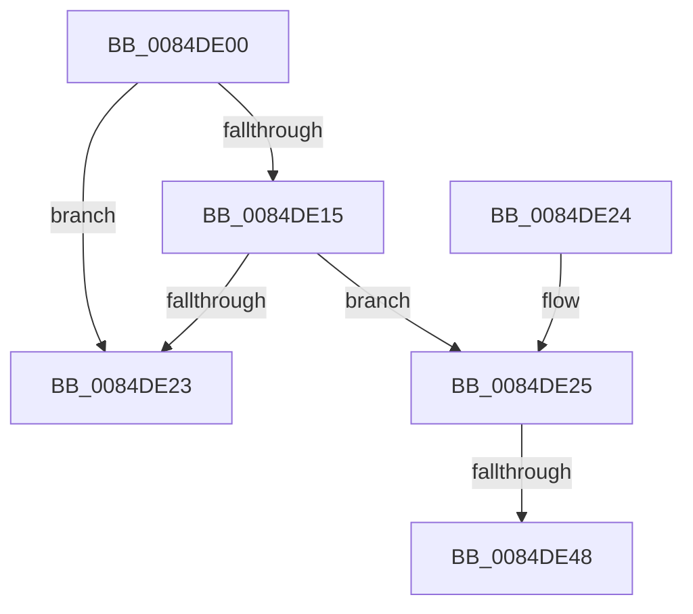

# CmpUpdateGlobalQuotaAllowed

- RVA: `0x0084DE00`–`0x0084DE5C` (길이 `92` bytes)
- VA: `0x000000014084DE00`
- 실행 섹션: `PAGE`
- PDB 이름 있음: `예`; PDB Function 태그: `예`
- unwind 정보 RVA: `0x000DB714`
- 디코드: `21`개 명령, `92/92` bytes 표시
- 미해석 바이트: `0` (있으면 어셈블리에 `.byte`로 보존)

> 이 문서는 커널 이미지의 기계어와 PDB 기호를 분석해 생성했습니다. 4번과 5번은 함수 원형과 자료형을 바이너리 사용 방식에서 추정한 C 해석이며 원본 소스 복구 결과는 아닙니다.

## 1. Dependencies

- 직접 호출 지점: **0**; 고유 호출 대상: **0**
- 직접 호출자로 확인된 함수: **2**
- RIP 상대 이미지 참조: **3**

### Outgoing calls
- 직접 디코드된 call 명령이 없습니다.

### Direct callers
- [CmpClaimGlobalQuota](CmpClaimGlobalQuota_function_0084DDAC.md) at `0x0084DDB3`
- [CmQueryRegistryQuotaInformation](../AA/CmQueryRegistryQuotaInformation_function_00AA02B8.md) at `0x00AA02BF`

### Static image references
- `0x0084DE00` → RVA `0x00FD9A65` (`PAGEDATA`; read)
- `0x0084DE07` → RVA `0x00FC6F18` (`ALMOSTRO`; read)
- `0x0084DE1A` → RVA `0x00FD9C78` (`PAGEDATA`; read)

## 2. Other-region calls and transfers

- 다른 실행 섹션으로 향하는 call: **0**
- call이 아닌 외부 분기/꼬리 이동: **2**
  - `0x0084DE42` → `0x00B16946` (`tail-transfer`)
  - `0x0084DE57` → `0x00B16946` (`tail-transfer`)

## 3. Assembly (complete function range)

```asm
0084DE00  80 3D 5E BC 78 00 00            cmp byte ptr [rip + 0x78bc5e], 0
0084DE07  48 8B 05 0A 91 77 00            mov rax, qword ptr [rip + 0x77910a]
0084DE0E  48 89 44 24 08                  mov qword ptr [rsp + 8], rax
0084DE13  75 0E                           jne 0x14084de23
0084DE15  48 8B 44 24 08                  mov rax, qword ptr [rsp + 8]
0084DE1A  48 3B 05 57 BE 78 00            cmp rax, qword ptr [rip + 0x78be57]
0084DE21  75 02                           jne 0x14084de25
0084DE23  C3                              ret
0084DE24  CC                              int3
0084DE25  48 8B 4C 24 08                  mov rcx, qword ptr [rsp + 8]
0084DE2A  48 B8 AB AA AA AA AA AA AA AA   movabs rax, 0xaaaaaaaaaaaaaaab
0084DE34  48 F7 E1                        mul rcx
0084DE37  B9 FF FF FF FF                  mov ecx, 0xffffffff
0084DE3C  48 D1 EA                        shr rdx, 1
0084DE3F  48 3B D1                        cmp rdx, rcx
0084DE42  0F 87 FE 8A 2C 00               ja 0x140b16946
0084DE48  B8 00 00 00 01                  mov eax, 0x1000000
0084DE4D  48 8B CA                        mov rcx, rdx
0084DE50  48 3B D0                        cmp rdx, rax
0084DE53  48 0F 42 C8                     cmovb rcx, rax
0084DE57  E9 EA 8A 2C 00                  jmp 0x140b16946
```

## 4. C-style interpretation (structured pseudocode)

```c
__int64 __fastcall CmpUpdateGlobalQuotaAllowed(__int64 a1, __int64 a2)
{
    unsigned __int64 v_stack_p8;

    v_stack_p8 = *(unsigned __int64 *)(v_rip + 7835914);
    if ((*(unsigned __int8 *)(v_rip + 7912542)) != 0) goto loc_0084DE23;
    if (v_stack_p8 != (*(unsigned __int64 *)(v_rip + 7913047))) goto loc_0084DE25;
loc_0084DE23:
    return v_stack_p8;
loc_0084DE25:
    a2 = (a2) >> (1);
    if (a2 < ((unsigned int)(0x1000000ULL))) { a2 = (unsigned int)(0x1000000ULL); }
}
```

## 5. (Beta) C Style

```c
int64_t CmpUpdateGlobalQuotaAllowed(int64_t Arg1, int64_t Arg2)
{
    uint64_t v_stack_p8;

    v_stack_p8 = *(uint64_t *)(v_rip + 0x77910A);
    if ((*(uint8_t *)(v_rip + 0x78BC5E)) != 0) goto loc_0084DE23;
    if (v_stack_p8 != (*(uint64_t *)(v_rip + 0x78BE57))) goto loc_0084DE25;
loc_0084DE23:
    return v_stack_p8;
loc_0084DE25:
    Arg2 = (Arg2) >> (1);
    if (Arg2 < ((uint32_t)(0x1000000ULL))) { Arg2 = (uint32_t)(0x1000000ULL); }
}
```

## 6. Execution-region graph

[열기: 2D/3D 그래프와 함수 탐색 컨트롤 패널](../../../control-panel.html?section=page&rva=0x0084DE00&view=graph)

- 2D 그래프는 위에서 아래로 흐르고, 3D 그래프는 빈 공간을 드래그해 회전합니다. Shift+드래그는 이동, 휠은 확대·축소, 함수 노드 선택은 대상 보고서 이동입니다.

### Static fallback


