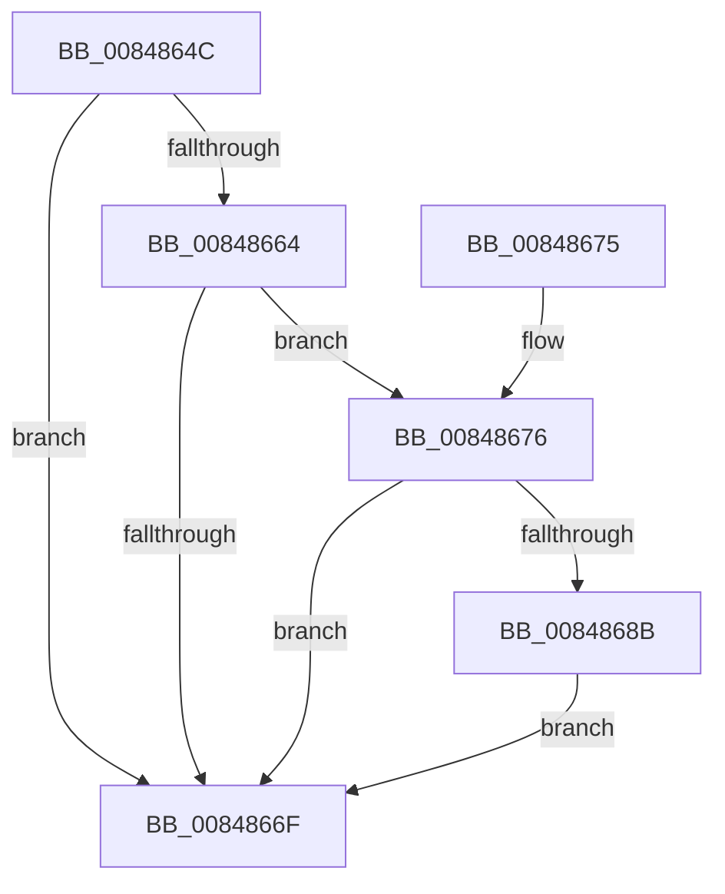

# CmpUpdateKeyNodeAccessBits

- RVA: `0x0084864C`–`0x00848696` (길이 `74` bytes)
- VA: `0x000000014084864C`
- 실행 섹션: `PAGE`
- PDB 이름 있음: `예`; PDB Function 태그: `아니요`
- unwind 정보 RVA: `0x00069370`
- 디코드: `22`개 명령, `74/74` bytes 표시
- 미해석 바이트: `0` (있으면 어셈블리에 `.byte`로 보존)

> 이 문서는 커널 이미지의 기계어와 PDB 기호를 분석해 생성했습니다. 4번과 5번은 함수 원형과 자료형을 바이너리 사용 방식에서 추정한 C 해석이며 원본 소스 복구 결과는 아닙니다.

## 1. Dependencies

- 직접 호출 지점: **1**; 고유 호출 대상: **1**
- 직접 호출자로 확인된 함수: **7**
- RIP 상대 이미지 참조: **2**

### Outgoing calls
- `0x00848682` → [HvpMarkCellDirty](../85/HvpMarkCellDirty_function_00858080.md) (function, `0x00858080`)

### Direct callers
- [CmpCreateTombstone](../../text/66/CmpCreateTombstone_function_0066AF50.md) at `0x0066B170`
- [CmSetValueKey](CmSetValueKey_function_008457C0.md) at `0x00845D32`
- [CmQueryMultipleValueKey](CmQueryMultipleValueKey_function_00846EC0.md) at `0x00847014`
- [CmDeleteValueKey](CmDeleteValueKey_function_008476E8.md) at `0x00847A5C`
- [CmpCreateChild](../94/CmpCreateChild_function_0094817C.md) at `0x0094871D`
- [CmpGetSecurityDescriptorNodeEx](../94/CmpGetSecurityDescriptorNodeEx_function_00949268.md) at `0x009492CB`
- [CmpSetSecurityDescriptorInfo](../94/CmpSetSecurityDescriptorInfo_function_00949688.md) at `0x00949742`

### Static image references
- `0x00848667` → RVA `0x00E0EC94` (`.data`; reference)
- `0x0084868B` → RVA `0x00E0EC94` (`.data`; read)

## 2. Other-region calls and transfers

- 다른 실행 섹션으로 향하는 call: **0**
- 별도 외부 분기/꼬리 이동을 확인하지 못했습니다.

## 3. Assembly (complete function range)

```asm
0084864C  40 53                           push rbx
0084864E  48 83 EC 20                     sub rsp, 0x20
00848652  F7 81 A0 00 00 00 01 80 00 00   test dword ptr [rcx + 0xa0], 0x8001
0084865C  45 8B D0                        mov r10d, r8d
0084865F  48 8B DA                        mov rbx, rdx
00848662  75 0B                           jne 0x14084866f
00848664  8A 42 0C                        mov al, byte ptr [rdx + 0xc]
00848667  84 05 27 66 5C 00               test byte ptr [rip + 0x5c6627], al
0084866D  74 07                           je 0x140848676
0084866F  48 83 C4 20                     add rsp, 0x20
00848673  5B                              pop rbx
00848674  C3                              ret
00848675  CC                              int3
00848676  41 B9 01 00 00 00               mov r9d, 1
0084867C  45 33 C0                        xor r8d, r8d
0084867F  41 8B D2                        mov edx, r10d
00848682  E8 F9 F9 00 00                  call 0x140858080
00848687  85 C0                           test eax, eax
00848689  78 E4                           js 0x14084866f
0084868B  8A 05 03 66 5C 00               mov al, byte ptr [rip + 0x5c6603]
00848691  08 43 0C                        or byte ptr [rbx + 0xc], al
00848694  EB D9                           jmp 0x14084866f
```

## 4. C-style interpretation (structured pseudocode)

```c
__int64 __fastcall CmpUpdateKeyNodeAccessBits(__int64 a1, __int64 a2, int a3)
{
    __int64 result;
    __int64 v_rsp;

    v_rsp = (v_rsp) - (32);
    if (((*(unsigned int *)(a1 + 160)) & (0x8001ULL)) != 0) goto loc_0084866F;
    if (((*(unsigned __int8 *)(v_rip + 6055463)) & ((unsigned __int8)(*(unsigned __int8 *)(a2 + 12)))) == 0) goto loc_00848676;
loc_0084866F:
    v_rsp = (v_rsp) + (32);
    return *(unsigned __int8 *)(a2 + 12);
loc_00848676:
    a3 = 0;
    result = HvpMarkCellDirty(a1, (unsigned int)((unsigned int)((unsigned int)(a3))), a3, 1);
    if (sign_flag) goto loc_0084866F;
    goto loc_0084866F;
}
```

## 5. (Beta) C Style

```c
int64_t CmpUpdateKeyNodeAccessBits(void *Arg1, void *Arg2, int32_t Arg3)
{
    uint8_t *arg1 = (uint8_t *)Arg1;
    uint8_t *arg2 = (uint8_t *)Arg2;

    int64_t result;
    int64_t local_rsp;

    local_rsp = (local_rsp) - (32);
    if (((*(uint32_t *)(arg1 + 0xA0)) & (0x8001ULL)) != 0) goto loc_0084866F;
    if (((*(uint8_t *)(v_rip + 0x5C6627)) & ((uint8_t)(*(uint8_t *)(arg2 + 0xC)))) == 0) goto loc_00848676;
loc_0084866F:
    local_rsp = (local_rsp) + (32);
    return *(uint8_t *)(arg2 + 0xC);
loc_00848676:
    Arg3 = 0;
    result = HvpMarkCellDirty(Arg1, (uint32_t)((uint32_t)((uint32_t)(Arg3))), Arg3, 1);
    if (sign_flag) goto loc_0084866F;
    goto loc_0084866F;
}
```

### 관측된 메모리 오프셋

구조체 형식이 확인되지 않은 접근은 인자 기준의 오프셋으로만 기록했습니다.

| 기준 인자 | 오프셋 표현 | 폭 (bit) | 접근 |
|---|---:|---:|---|
| `Arg1` | `+ 0xA0` | `32` | `R` |
| `Arg2` | `+ 0xC` | `8` | `R` |
| `Arg2` | `+ 0xC` | `8` | `R/W` |

## 6. Execution-region graph

[열기: 2D/3D 그래프와 함수 탐색 컨트롤 패널](../../../control-panel.html?section=page&rva=0x0084864C&view=graph)

- 2D 그래프는 위에서 아래로 흐르고, 3D 그래프는 빈 공간을 드래그해 회전합니다. Shift+드래그는 이동, 휠은 확대·축소, 함수 노드 선택은 대상 보고서 이동입니다.

### Static fallback


