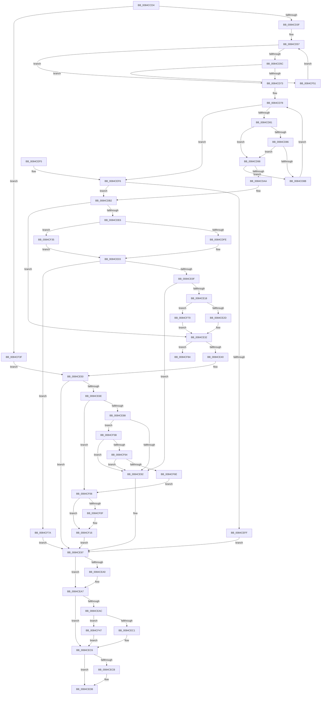

# CmpVEExecuteRealStoreParseLogic

- RVA: `0x0084CCD4`–`0x0084CF8B` (길이 `695` bytes)
- VA: `0x000000014084CCD4`
- 실행 섹션: `PAGE`
- PDB 이름 있음: `예`; PDB Function 태그: `예`
- unwind 정보 RVA: `0x00069838`
- 디코드: `188`개 명령, `695/695` bytes 표시
- 미해석 바이트: `0` (있으면 어셈블리에 `.byte`로 보존)

> 이 문서는 커널 이미지의 기계어와 PDB 기호를 분석해 생성했습니다. 4번과 5번은 함수 원형과 자료형을 바이너리 사용 방식에서 추정한 C 해석이며 원본 소스 복구 결과는 아닙니다.

## 1. Dependencies

- 직접 호출 지점: **26**; 고유 호출 대상: **18**
- 직접 호출자로 확인된 함수: **1**
- RIP 상대 이미지 참조: **1**

### Outgoing calls
- `0x0084CD1D` → [HvpGetCellContextInitialize](../85/HvpGetCellContextInitialize_function_00855F10.md) (function, `0x00855F10`)
- `0x0084CD28` → [RtlInitUnicodeString](../../text/42/RtlInitUnicodeString_function_0042A780.md) (function, `0x0042A780`)
- `0x0084CD32` → [CmpIsKeyDeleted](CmpIsKeyDeleted_function_0084BDB0.md) (function, `0x0084BDB0`)
- `0x0084CD44` → [CmpLockHiveListShared](CmpLockHiveListShared_function_0084E3C8.md) (function, `0x0084E3C8`)
- `0x0084CD66` → [CmpReferenceHive](CmpReferenceHive_function_0084FCF0.md) (function, `0x0084FCF0`)
- `0x0084CD73` → [CmpUnlockHiveList](CmpUnlockHiveList_function_0084E424.md) (function, `0x0084E424`)
- `0x0084CD8E` → [CmpGetNextHive](CmpGetNextHive_function_0084E330.md) (function, `0x0084E330`)
- `0x0084CD9B` → [CmpReferenceHive](CmpReferenceHive_function_0084FCF0.md) (function, `0x0084FCF0`)
- `0x0084CDA0` → [HvLockHiveFlusherExclusive](../../pagecmrc/BC/HvLockHiveFlusherExclusive_function_00BC9C50.md) (function, `0x00BC9C50`)
- `0x0084CDAD` → [CmpDereferenceHive](../86/CmpDereferenceHive_function_008632B0.md) (function, `0x008632B0`)
- `0x0084CDD6` → [CmpFindPathByNameEx](CmpFindPathByNameEx_function_0084BAAC.md) (function, `0x0084BAAC`)
- `0x0084CDFE` → [HvpGetCellFlat](../85/HvpGetCellFlat_function_00854C60.md) (function, `0x00854C60`)
- `0x0084CE2D` → [HvpReleaseCellPaged](../85/HvpReleaseCellPaged_function_00855F40.md) (function, `0x00855F40`)
- `0x0084CE43` → [HvUnlockHiveFlusherExclusive](../../pagecmrc/BC/HvUnlockHiveFlusherExclusive_function_00BC9C34.md) (function, `0x00BC9C34`)
- `0x0084CE4B` → [CmpDereferenceHive](../86/CmpDereferenceHive_function_008632B0.md) (function, `0x008632B0`)
- `0x0084CE5F` → [CmRealKCBToVirtualPath](../99/CmRealKCBToVirtualPath_function_00990130.md) (function, `0x00990130`)
- `0x0084CE7F` → [CmpVirtualBranchIsReplicated](CmpVirtualBranchIsReplicated_function_0084A3E0.md) (function, `0x0084A3E0`)
- `0x0084CEA2` → [ExFreePoolWithTag](../../poolcode/B8/ExFreePoolWithTag_function_00B82870.md) (function, `0x00B82870`)
- `0x0084CEC1` → [HvpReleaseCellPaged](../85/HvpReleaseCellPaged_function_00855F40.md) (function, `0x00855F40`)
- `0x0084CECE` → [HvUnlockHiveFlusherExclusive](../../pagecmrc/BC/HvUnlockHiveFlusherExclusive_function_00BC9C34.md) (function, `0x00BC9C34`)
- `0x0084CED6` → [CmpDereferenceHive](../86/CmpDereferenceHive_function_008632B0.md) (function, `0x008632B0`)
- `0x0084CF11` → [ExFreePoolWithTag](../../poolcode/B8/ExFreePoolWithTag_function_00B82870.md) (function, `0x00B82870`)
- `0x0084CF26` → [RtlInitUnicodeString](../../text/42/RtlInitUnicodeString_function_0042A780.md) (function, `0x0042A780`)
- `0x0084CF35` → [HvpGetCellPaged](../85/HvpGetCellPaged_function_00854CB0.md) (function, `0x00854CB0`)
- `0x0084CF47` → [HvpReleaseCellFlat](../85/HvpReleaseCellFlat_function_0085CC20.md) (function, `0x0085CC20`)
- `0x0084CF70` → [HvpReleaseCellFlat](../85/HvpReleaseCellFlat_function_0085CC20.md) (function, `0x0085CC20`)

### Direct callers
- [CmpDoParseKey](../85/CmpDoParseKey_function_0085F750.md) at `0x00860E44`

### Static image references
- `0x0084CD49` → RVA `0x00FD9D18` (`PAGEDATA`; read)

## 2. Other-region calls and transfers

- 다른 실행 섹션으로 향하는 call: **7**
  - `0x0084CD28` → [RtlInitUnicodeString](../../text/42/RtlInitUnicodeString_function_0042A780.md) (`PAGE` → `.text`)
  - `0x0084CDA0` → [HvLockHiveFlusherExclusive](../../pagecmrc/BC/HvLockHiveFlusherExclusive_function_00BC9C50.md) (`PAGE` → `PAGECMRC`)
  - `0x0084CE43` → [HvUnlockHiveFlusherExclusive](../../pagecmrc/BC/HvUnlockHiveFlusherExclusive_function_00BC9C34.md) (`PAGE` → `PAGECMRC`)
  - `0x0084CEA2` → [ExFreePoolWithTag](../../poolcode/B8/ExFreePoolWithTag_function_00B82870.md) (`PAGE` → `POOLCODE`)
  - `0x0084CECE` → [HvUnlockHiveFlusherExclusive](../../pagecmrc/BC/HvUnlockHiveFlusherExclusive_function_00BC9C34.md) (`PAGE` → `PAGECMRC`)
  - `0x0084CF11` → [ExFreePoolWithTag](../../poolcode/B8/ExFreePoolWithTag_function_00B82870.md) (`PAGE` → `POOLCODE`)
  - `0x0084CF26` → [RtlInitUnicodeString](../../text/42/RtlInitUnicodeString_function_0042A780.md) (`PAGE` → `.text`)
- call이 아닌 외부 분기/꼬리 이동: **1**
  - `0x0084CF86` → [sub_00B168BC](../B1/Unknown_function_00B168BC.md) (`tail-transfer`)

## 3. Assembly (complete function range)

```asm
0084CCD4  48 89 5C 24 08                  mov qword ptr [rsp + 8], rbx
0084CCD9  4C 89 44 24 18                  mov qword ptr [rsp + 0x18], r8
0084CCDE  48 89 54 24 10                  mov qword ptr [rsp + 0x10], rdx
0084CCE3  55                              push rbp
0084CCE4  56                              push rsi
0084CCE5  57                              push rdi
0084CCE6  41 54                           push r12
0084CCE8  41 55                           push r13
0084CCEA  41 56                           push r14
0084CCEC  41 57                           push r15
0084CCEE  48 8B EC                        mov rbp, rsp
0084CCF1  48 83 EC 60                     sub rsp, 0x60
0084CCF5  33 DB                           xor ebx, ebx
0084CCF7  4C 8B E1                        mov r12, rcx
0084CCFA  0F 57 C0                        xorps xmm0, xmm0
0084CCFD  89 5D D4                        mov dword ptr [rbp - 0x2c], ebx
0084CD00  48 8D 4D D8                     lea rcx, [rbp - 0x28]
0084CD04  48 89 5D D8                     mov qword ptr [rbp - 0x28], rbx
0084CD08  0F 11 45 E8                     movups xmmword ptr [rbp - 0x18], xmm0
0084CD0C  88 5D D0                        mov byte ptr [rbp - 0x30], bl
0084CD0F  8B F3                           mov esi, ebx
0084CD11  8B FB                           mov edi, ebx
0084CD13  48 89 5D E0                     mov qword ptr [rbp - 0x20], rbx
0084CD17  44 8B F3                        mov r14d, ebx
0084CD1A  4D 8B E9                        mov r13, r9
0084CD1D  E8 EE 91 00 00                  call 0x140855f10
0084CD22  48 8D 4D E8                     lea rcx, [rbp - 0x18]
0084CD26  33 D2                           xor edx, edx
0084CD28  E8 53 DA BD FF                  call 0x14042a780
0084CD2D  33 D2                           xor edx, edx
0084CD2F  49 8B CC                        mov rcx, r12
0084CD32  E8 79 F0 FF FF                  call 0x14084bdb0
0084CD37  84 C0                           test al, al
0084CD39  0F 85 00 02 00 00               jne 0x14084cf3f
0084CD3F  4D 8B 7C 24 20                  mov r15, qword ptr [r12 + 0x20]
0084CD44  E8 7F 16 00 00                  call 0x14084e3c8
0084CD49  4C 8B 05 C8 CF 78 00            mov r8, qword ptr [rip + 0x78cfc8]
0084CD50  4C 8D 0D C1 CF 78 00            lea r9, [rip + 0x78cfc1]
0084CD57  4D 3B C1                        cmp r8, r9
0084CD5A  74 17                           je 0x14084cd73
0084CD5C  49 8D 98 B8 F9 FF FF            lea rbx, [r8 - 0x648]
0084CD63  48 8B CB                        mov rcx, rbx
0084CD66  E8 85 2F 00 00                  call 0x14084fcf0
0084CD6B  84 C0                           test al, al
0084CD6D  0F 84 DE 01 00 00               je 0x14084cf51
0084CD73  E8 AC 16 00 00                  call 0x14084e424
0084CD78  48 85 DB                        test rbx, rbx
0084CD7B  0F 84 75 01 00 00               je 0x14084cef6
0084CD81  4C 3B FB                        cmp r15, rbx
0084CD84  74 12                           je 0x14084cd98
0084CD86  4D 85 FF                        test r15, r15
0084CD89  74 0D                           je 0x14084cd98
0084CD8B  48 8B CB                        mov rcx, rbx
0084CD8E  E8 9D 15 00 00                  call 0x14084e330
0084CD93  48 8B D8                        mov rbx, rax
0084CD96  EB E0                           jmp 0x14084cd78
0084CD98  48 8B CB                        mov rcx, rbx
0084CD9B  E8 50 2F 00 00                  call 0x14084fcf0
0084CDA0  E8 AB CE 37 00                  call 0x140bc9c50
0084CDA5  4C 3B FB                        cmp r15, rbx
0084CDA8  75 E1                           jne 0x14084cd8b
0084CDAA  48 8B CB                        mov rcx, rbx
0084CDAD  E8 FE 64 01 00                  call 0x1408632b0
0084CDB2  48 8B 55 48                     mov rdx, qword ptr [rbp + 0x48]
0084CDB6  48 8D 45 E0                     lea rax, [rbp - 0x20]
0084CDBA  49 8B 74 24 20                  mov rsi, qword ptr [r12 + 0x20]
0084CDBF  45 33 C9                        xor r9d, r9d
0084CDC2  48 89 44 24 28                  mov qword ptr [rsp + 0x28], rax
0084CDC7  45 33 C0                        xor r8d, r8d
0084CDCA  48 8D 45 D4                     lea rax, [rbp - 0x2c]
0084CDCE  49 8B CC                        mov rcx, r12
0084CDD1  48 89 44 24 20                  mov qword ptr [rsp + 0x20], rax
0084CDD6  E8 D1 EC FF FF                  call 0x14084baac
0084CDDB  4C 8B 75 E0                     mov r14, qword ptr [rbp - 0x20]
0084CDDF  44 8A F8                        mov r15b, al
0084CDE2  84 C0                           test al, al
0084CDE4  74 4C                           je 0x14084ce32
0084CDE6  41 F6 86 8C 00 00 00 01         test byte ptr [r14 + 0x8c], 1
0084CDEE  4C 8D 45 D8                     lea r8, [rbp - 0x28]
0084CDF2  8B 55 D4                        mov edx, dword ptr [rbp - 0x2c]
0084CDF5  49 8B CE                        mov rcx, r14
0084CDF8  0F 84 37 01 00 00               je 0x14084cf35
0084CDFE  E8 5D 7E 00 00                  call 0x140854c60
0084CE03  48 8B F8                        mov rdi, rax
0084CE06  48 85 C0                        test rax, rax
0084CE09  0F 84 6B 01 00 00               je 0x14084cf7a
0084CE0F  F7 40 34 00 00 20 00            test dword ptr [rax + 0x34], 0x200000
0084CE16  75 7A                           jne 0x14084ce92
0084CE18  41 F6 86 8C 00 00 00 01         test byte ptr [r14 + 0x8c], 1
0084CE20  48 8D 55 D8                     lea rdx, [rbp - 0x28]
0084CE24  49 8B CE                        mov rcx, r14
0084CE27  0F 85 43 01 00 00               jne 0x14084cf70
0084CE2D  E8 0E 91 00 00                  call 0x140855f40
0084CE32  49 8B 5C 24 20                  mov rbx, qword ptr [r12 + 0x20]
0084CE37  48 85 DB                        test rbx, rbx
0084CE3A  0F 84 44 01 00 00               je 0x14084cf84
0084CE40  48 8B CB                        mov rcx, rbx
0084CE43  E8 EC CD 37 00                  call 0x140bc9c34
0084CE48  48 8B CB                        mov rcx, rbx
0084CE4B  E8 60 64 01 00                  call 0x1408632b0
0084CE50  4C 8B 45 60                     mov r8, qword ptr [rbp + 0x60]
0084CE54  4C 8D 4D E8                     lea r9, [rbp - 0x18]
0084CE58  48 8B 55 48                     mov rdx, qword ptr [rbp + 0x48]
0084CE5C  49 8B CC                        mov rcx, r12
0084CE5F  E8 CC 32 14 00                  call 0x140990130
0084CE64  33 F6                           xor esi, esi
0084CE66  33 FF                           xor edi, edi
0084CE68  8B D8                           mov ebx, eax
0084CE6A  85 C0                           test eax, eax
0084CE6C  78 29                           js 0x14084ce97
0084CE6E  48 8B 5D 50                     mov rbx, qword ptr [rbp + 0x50]
0084CE72  4C 8D 45 D0                     lea r8, [rbp - 0x30]
0084CE76  48 8D 55 E8                     lea rdx, [rbp - 0x18]
0084CE7A  33 C9                           xor ecx, ecx
0084CE7C  83 0B 08                        or dword ptr [rbx], 8
0084CE7F  E8 5C D5 FF FF                  call 0x14084a3e0
0084CE84  84 C0                           test al, al
0084CE86  75 7E                           jne 0x14084cf06
0084CE88  8B 03                           mov eax, dword ptr [rbx]
0084CE8A  A8 01                           test al, 1
0084CE8C  0F 85 C9 00 00 00               jne 0x14084cf5b
0084CE92  BB 71 02 00 C0                  mov ebx, 0xc0000271
0084CE97  48 8B 4D F0                     mov rcx, qword ptr [rbp - 0x10]
0084CE9B  48 85 C9                        test rcx, rcx
0084CE9E  74 07                           je 0x14084cea7
0084CEA0  33 D2                           xor edx, edx
0084CEA2  E8 C9 59 33 00                  call 0x140b82870
0084CEA7  48 85 FF                        test rdi, rdi
0084CEAA  74 1A                           je 0x14084cec6
0084CEAC  41 F6 86 8C 00 00 00 01         test byte ptr [r14 + 0x8c], 1
0084CEB4  48 8D 55 D8                     lea rdx, [rbp - 0x28]
0084CEB8  49 8B CE                        mov rcx, r14
0084CEBB  0F 85 86 00 00 00               jne 0x14084cf47
0084CEC1  E8 7A 90 00 00                  call 0x140855f40
0084CEC6  48 85 F6                        test rsi, rsi
0084CEC9  74 10                           je 0x14084cedb
0084CECB  48 8B CE                        mov rcx, rsi
0084CECE  E8 61 CD 37 00                  call 0x140bc9c34
0084CED3  48 8B CE                        mov rcx, rsi
0084CED6  E8 D5 63 01 00                  call 0x1408632b0
0084CEDB  8B C3                           mov eax, ebx
0084CEDD  48 8B 9C 24 A0 00 00 00         mov rbx, qword ptr [rsp + 0xa0]
0084CEE5  48 83 C4 60                     add rsp, 0x60
0084CEE9  41 5F                           pop r15
0084CEEB  41 5E                           pop r14
0084CEED  41 5D                           pop r13
0084CEEF  41 5C                           pop r12
0084CEF1  5F                              pop rdi
0084CEF2  5E                              pop rsi
0084CEF3  5D                              pop rbp
0084CEF4  C3                              ret
0084CEF5  CC                              int3
0084CEF6  4D 85 FF                        test r15, r15
0084CEF9  0F 84 B3 FE FF FF               je 0x14084cdb2
0084CEFF  BB 34 00 00 C0                  mov ebx, 0xc0000034
0084CF04  EB 91                           jmp 0x14084ce97
0084CF06  49 8B 4D 08                     mov rcx, qword ptr [r13 + 8]
0084CF0A  48 85 C9                        test rcx, rcx
0084CF0D  74 07                           je 0x14084cf16
0084CF0F  33 D2                           xor edx, edx
0084CF11  E8 5A 59 33 00                  call 0x140b82870
0084CF16  0F 10 45 E8                     movups xmm0, xmmword ptr [rbp - 0x18]
0084CF1A  33 D2                           xor edx, edx
0084CF1C  48 8D 4D E8                     lea rcx, [rbp - 0x18]
0084CF20  F3 41 0F 7F 45 00               movdqu xmmword ptr [r13], xmm0
0084CF26  E8 55 D8 BD FF                  call 0x14042a780
0084CF2B  BB 04 01 00 00                  mov ebx, 0x104
0084CF30  E9 62 FF FF FF                  jmp 0x14084ce97
0084CF35  E8 76 7D 00 00                  call 0x140854cb0
0084CF3A  E9 C4 FE FF FF                  jmp 0x14084ce03
0084CF3F  44 8A FB                        mov r15b, bl
0084CF42  E9 09 FF FF FF                  jmp 0x14084ce50
0084CF47  E8 D4 FC 00 00                  call 0x14085cc20
0084CF4C  E9 75 FF FF FF                  jmp 0x14084cec6
0084CF51  4D 8B 00                        mov r8, qword ptr [r8]
0084CF54  33 DB                           xor ebx, ebx
0084CF56  E9 FC FD FF FF                  jmp 0x14084cd57
0084CF5B  45 84 FF                        test r15b, r15b
0084CF5E  0F 85 2E FF FF FF               jne 0x14084ce92
0084CF64  40 38 75 D0                     cmp byte ptr [rbp - 0x30], sil
0084CF68  0F 84 24 FF FF FF               je 0x14084ce92
0084CF6E  EB 96                           jmp 0x14084cf06
0084CF70  E8 AB FC 00 00                  call 0x14085cc20
0084CF75  E9 B8 FE FF FF                  jmp 0x14084ce32
0084CF7A  BB 9A 00 00 C0                  mov ebx, 0xc000009a
0084CF7F  E9 13 FF FF FF                  jmp 0x14084ce97
0084CF84  33 C9                           xor ecx, ecx
0084CF86  E9 31 99 2C 00                  jmp 0x140b168bc
```

## 4. C-style interpretation (structured pseudocode)

```c
__int64 __fastcall CmpVEExecuteRealStoreParseLogic(__int64 a1, __int64 a2, __int64 a3, __int64 a4, __int64 a5)
{
    __int64 result;
    __int64 v_rbx;
    __int64 v_rdi;
    __int64 v_rsi;
    __int64 v_rsp;
    unsigned __int64 v_stack_m48;
    unsigned __int64 v_stack_m50;
    unsigned __int64 v_stack_m58;
    unsigned __int64 v_stack_m60;
    unsigned int v_stack_m64;
    unsigned __int8 v_stack_m68;
    unsigned __int64 v_stack_m70;
    unsigned __int64 v_stack_m78;
    unsigned __int64 v_stack_p10;
    unsigned __int64 v_stack_p18;
    unsigned __int64 v_stack_p8;

    v_stack_p8 = v_rbx;
    v_stack_p18 = a3;
    v_stack_p10 = a2;
    v_rsp = (v_rsp) - (96);
    v_rbx = 0;
    v_stack_m64 = 0;
    v_stack_m60 = 0;
    v_stack_m50 = v_xmm0;
    v_stack_m68 = 0;
    v_stack_m58 = 0;
    result = HvpGetCellContextInitialize(v_stack_m60, a2, a3, a4);
    a2 = 0;
    result = RtlInitUnicodeString(v_stack_m50, a2, a3, a4);
    a2 = 0;
    result = CmpIsKeyDeleted(a1, a2, a3, a4);
    if ((unsigned __int8)(result) != 0) goto loc_0084CF3F;
    result = CmpLockHiveListShared(a1, a2, a3, a4);
loc_0084CD57:
    if ((*(unsigned __int64 *)(v_rip + 7917512)) == (v_rip + 7917505)) goto loc_0084CD73;
    result = CmpReferenceHive(*(unsigned __int64 *)(v_rip + 7917512) - 1608, a2, *(unsigned __int64 *)(v_rip + 7917512), v_rip + 7917505);
    if ((unsigned __int8)(result) == 0) goto loc_0084CF51;
loc_0084CD73:
    result = CmpUnlockHiveList(*(unsigned __int64 *)(v_rip + 7917512) - 1608, a2, *(unsigned __int64 *)(v_rip + 7917512), v_rip + 7917505);
loc_0084CD78:
    if (*(unsigned __int64 *)(v_rip + 7917512) - 1608 == 0) goto loc_0084CEF6;
    if ((*(unsigned __int64 *)(a1 + 32)) == (*(unsigned __int64 *)(v_rip + 7917512) - 1608)) goto loc_0084CD98;
    if (*(unsigned __int64 *)(a1 + 32) == 0) goto loc_0084CD98;
loc_0084CD8B:
    result = CmpGetNextHive(*(unsigned __int64 *)(v_rip + 7917512) - 1608, a2, *(unsigned __int64 *)(v_rip + 7917512), v_rip + 7917505);
    goto loc_0084CD78;
loc_0084CD98:
    result = CmpReferenceHive(result, a2, *(unsigned __int64 *)(v_rip + 7917512), v_rip + 7917505);
    result = HvLockHiveFlusherExclusive(result, a2, *(unsigned __int64 *)(v_rip + 7917512), v_rip + 7917505);
    if ((*(unsigned __int64 *)(a1 + 32)) != result) goto loc_0084CD8B;
    result = CmpDereferenceHive(result, a2, *(unsigned __int64 *)(v_rip + 7917512), v_rip + 7917505);
loc_0084CDB2:
    a4 = 0;
    v_stack_m70 = v_stack_m58;
    a3 = 0;
    v_stack_m78 = v_stack_m64;
    result = CmpFindPathByNameEx(a1, v_stack_p10, a3, a4);
    if ((unsigned __int8)(result) == 0) goto loc_0084CE32;
    if (((*(unsigned __int8 *)(v_stack_m58 + 140)) & (1)) == 0) goto loc_0084CF35;
    result = HvpGetCellFlat(v_stack_m58, (unsigned int)(v_stack_m64), v_stack_m60, a4);
loc_0084CE03:
    if (result == 0) goto loc_0084CF7A;
    if (((*(unsigned int *)(result + 52)) & (0x200000ULL)) != 0) goto loc_0084CE92;
    if (((*(unsigned __int8 *)(v_stack_m58 + 140)) & (1)) != 0) goto loc_0084CF70;
    result = HvpReleaseCellPaged(v_stack_m58, v_stack_m60, v_stack_m60, a4);
loc_0084CE32:
    if (*(unsigned __int64 *)(a1 + 32) == 0) goto loc_0084CF84;
    result = HvUnlockHiveFlusherExclusive(*(unsigned __int64 *)(a1 + 32), v_stack_m60, v_stack_m60, a4);
    result = CmpDereferenceHive(*(unsigned __int64 *)(a1 + 32), v_stack_m60, v_stack_m60, a4);
loc_0084CE50:
    result = CmRealKCBToVirtualPath(a1, v_stack_p10, a5, v_stack_m50);
    v_rsi = 0;
    v_rdi = 0;
    if (sign_flag) goto loc_0084CE97;
    a1 = 0;
    result = CmpVirtualBranchIsReplicated(a1, v_stack_m50, v_stack_m68, v_stack_m50);
    if ((unsigned __int8)(result) != 0) goto loc_0084CF06;
    if ((((unsigned __int8)((unsigned int)(*(unsigned int *)(v_stack_p18)))) & (1)) != 0) goto loc_0084CF5B;
loc_0084CE92:
loc_0084CE97:
    result = (unsigned int)(*(unsigned int *)(v_stack_p18));
    if (v_stack_m48 != 0) {
        a2 = 0;
        result = ExFreePoolWithTag(v_stack_m48, a2, v_stack_m68, v_stack_m50);
    }
    if (0 == 0) goto loc_0084CEC6;
    if (((*(unsigned __int8 *)(v_stack_m58 + 140)) & (1)) != 0) goto loc_0084CF47;
    result = HvpReleaseCellPaged(v_stack_m58, v_stack_m60, v_stack_m68, v_stack_m50);
loc_0084CEC6:
    if (0 != 0) {
        a1 = 0;
        result = HvUnlockHiveFlusherExclusive(a1, v_stack_m60, v_stack_m68, v_stack_m50);
        a1 = 0;
        result = CmpDereferenceHive(a1, v_stack_m60, v_stack_m68, v_stack_m50);
    }
    v_rsp = (v_rsp) + (96);
    return (unsigned int)((unsigned int)((unsigned int)(0xC0000271ULL)));
loc_0084CEF6:
    if ((unsigned __int8)(result) == 0) goto loc_0084CDB2;
    goto loc_0084CE97;
loc_0084CF06:
    result = (unsigned int)((unsigned int)((unsigned int)(0xC0000271ULL)));
    if (*(unsigned __int64 *)(a4 + 8) != 0) {
        a2 = 0;
        result = ExFreePoolWithTag(*(unsigned __int64 *)(a4 + 8), a2, v_stack_m68, v_stack_m50);
    }
    a2 = 0;
    *(unsigned __int64 *)(a4) = v_xmm0;
    result = RtlInitUnicodeString(v_stack_m50, a2, v_stack_m68, v_stack_m50);
    goto loc_0084CE97;
loc_0084CF35:
    result = HvpGetCellPaged(v_stack_m50, a2, v_stack_m68, v_stack_m50);
    goto loc_0084CE03;
loc_0084CF3F:
    goto loc_0084CE50;
loc_0084CF47:
    result = HvpReleaseCellFlat(v_stack_m50, a2, v_stack_m68, v_stack_m50);
    goto loc_0084CEC6;
loc_0084CF51:
    v_rbx = 0;
    goto loc_0084CD57;
loc_0084CF5B:
    if (260 != 0) goto loc_0084CE92;
    if (v_stack_m68 == 0) goto loc_0084CE92;
    goto loc_0084CF06;
loc_0084CF70:
    result = HvpReleaseCellFlat(v_stack_m50, a2, *(unsigned __int64 *)(v_stack_m68), v_stack_m50);
    goto loc_0084CE32;
loc_0084CF7A:
    goto loc_0084CE97;
loc_0084CF84:
    a1 = 0;
}
```

## 5. (Beta) C Style

```c
int64_t CmpVEExecuteRealStoreParseLogic(void *Arg1, int64_t Arg2, int64_t Arg3, void *Arg4, int64_t Arg5)
{
    uint8_t *arg1 = (uint8_t *)Arg1;
    uint8_t *arg4 = (uint8_t *)Arg4;

    int64_t result;
    int64_t local_rbx;
    int64_t local_rdi;
    int64_t local_rsi;
    int64_t local_rsp;
    uint64_t v_stack_m48;
    uint64_t v_stack_m50;
    uint64_t v_stack_m58;
    uint64_t v_stack_m60;
    uint32_t v_stack_m64;
    uint8_t v_stack_m68;
    uint64_t v_stack_m70;
    uint64_t v_stack_m78;
    uint64_t v_stack_p10;
    uint64_t v_stack_p18;
    uint64_t v_stack_p8;

    v_stack_p8 = local_rbx;
    v_stack_p18 = Arg3;
    v_stack_p10 = Arg2;
    local_rsp = (local_rsp) - (96);
    local_rbx = 0;
    v_stack_m64 = 0;
    v_stack_m60 = 0;
    v_stack_m50 = v_xmm0;
    v_stack_m68 = 0;
    v_stack_m58 = 0;
    result = HvpGetCellContextInitialize(v_stack_m60, Arg2, Arg3, Arg4);
    Arg2 = 0;
    result = RtlInitUnicodeString(v_stack_m50, Arg2, Arg3, Arg4);
    Arg2 = 0;
    result = CmpIsKeyDeleted(Arg1, Arg2, Arg3, Arg4);
    if ((uint8_t)(result) != 0) goto loc_0084CF3F;
    result = CmpLockHiveListShared(Arg1, Arg2, Arg3, Arg4);
loc_0084CD57:
    if ((*(uint64_t *)(v_rip + 0x78CFC8)) == (v_rip + 7917505)) goto loc_0084CD73;
    result = CmpReferenceHive(*(uint64_t *)(v_rip + 0x78CFC8) - 1608, Arg2, *(uint64_t *)(v_rip + 0x78CFC8), v_rip + 7917505);
    if ((uint8_t)(result) == 0) goto loc_0084CF51;
loc_0084CD73:
    result = CmpUnlockHiveList(*(uint64_t *)(v_rip + 0x78CFC8) - 1608, Arg2, *(uint64_t *)(v_rip + 0x78CFC8), v_rip + 7917505);
loc_0084CD78:
    if (*(uint64_t *)(v_rip + 0x78CFC8) - 1608 == 0) goto loc_0084CEF6;
    if ((*(uint64_t *)(arg1 + 0x20)) == (*(uint64_t *)(v_rip + 0x78CFC8) - 1608)) goto loc_0084CD98;
    if (*(uint64_t *)(arg1 + 0x20) == 0) goto loc_0084CD98;
loc_0084CD8B:
    result = CmpGetNextHive(*(uint64_t *)(v_rip + 0x78CFC8) - 1608, Arg2, *(uint64_t *)(v_rip + 0x78CFC8), v_rip + 7917505);
    goto loc_0084CD78;
loc_0084CD98:
    result = CmpReferenceHive(result, Arg2, *(uint64_t *)(v_rip + 0x78CFC8), v_rip + 7917505);
    result = HvLockHiveFlusherExclusive(result, Arg2, *(uint64_t *)(v_rip + 0x78CFC8), v_rip + 7917505);
    if ((*(uint64_t *)(arg1 + 0x20)) != result) goto loc_0084CD8B;
    result = CmpDereferenceHive(result, Arg2, *(uint64_t *)(v_rip + 0x78CFC8), v_rip + 7917505);
loc_0084CDB2:
    Arg4 = 0;
    v_stack_m70 = v_stack_m58;
    Arg3 = 0;
    v_stack_m78 = v_stack_m64;
    result = CmpFindPathByNameEx(Arg1, v_stack_p10, Arg3, Arg4);
    if ((uint8_t)(result) == 0) goto loc_0084CE32;
    if (((*(uint8_t *)(v_stack_m58 + 0x8C)) & (1)) == 0) goto loc_0084CF35;
    result = HvpGetCellFlat(v_stack_m58, (uint32_t)(v_stack_m64), v_stack_m60, Arg4);
loc_0084CE03:
    if (result == 0) goto loc_0084CF7A;
    if (((*(uint32_t *)(result + 0x34)) & (0x200000ULL)) != 0) goto loc_0084CE92;
    if (((*(uint8_t *)(v_stack_m58 + 0x8C)) & (1)) != 0) goto loc_0084CF70;
    result = HvpReleaseCellPaged(v_stack_m58, v_stack_m60, v_stack_m60, Arg4);
loc_0084CE32:
    if (*(uint64_t *)(arg1 + 0x20) == 0) goto loc_0084CF84;
    result = HvUnlockHiveFlusherExclusive(*(uint64_t *)(arg1 + 0x20), v_stack_m60, v_stack_m60, Arg4);
    result = CmpDereferenceHive(*(uint64_t *)(arg1 + 0x20), v_stack_m60, v_stack_m60, Arg4);
loc_0084CE50:
    result = CmRealKCBToVirtualPath(Arg1, v_stack_p10, Arg5, v_stack_m50);
    local_rsi = 0;
    local_rdi = 0;
    if (sign_flag) goto loc_0084CE97;
    Arg1 = 0;
    result = CmpVirtualBranchIsReplicated(Arg1, v_stack_m50, v_stack_m68, v_stack_m50);
    if ((uint8_t)(result) != 0) goto loc_0084CF06;
    if ((((uint8_t)((uint32_t)(*(uint32_t *)(v_stack_p18)))) & (1)) != 0) goto loc_0084CF5B;
loc_0084CE92:
loc_0084CE97:
    result = (uint32_t)(*(uint32_t *)(v_stack_p18));
    if (v_stack_m48 != 0) {
        Arg2 = 0;
        result = ExFreePoolWithTag(v_stack_m48, Arg2, v_stack_m68, v_stack_m50);
    }
    if (0 == 0) goto loc_0084CEC6;
    if (((*(uint8_t *)(v_stack_m58 + 0x8C)) & (1)) != 0) goto loc_0084CF47;
    result = HvpReleaseCellPaged(v_stack_m58, v_stack_m60, v_stack_m68, v_stack_m50);
loc_0084CEC6:
    if (0 != 0) {
        Arg1 = 0;
        result = HvUnlockHiveFlusherExclusive(Arg1, v_stack_m60, v_stack_m68, v_stack_m50);
        Arg1 = 0;
        result = CmpDereferenceHive(Arg1, v_stack_m60, v_stack_m68, v_stack_m50);
    }
    local_rsp = (local_rsp) + (96);
    return (uint32_t)((uint32_t)((uint32_t)(0xC0000271ULL)));
loc_0084CEF6:
    if ((uint8_t)(result) == 0) goto loc_0084CDB2;
    goto loc_0084CE97;
loc_0084CF06:
    result = (uint32_t)((uint32_t)((uint32_t)(0xC0000271ULL)));
    if (*(uint64_t *)(arg4 + 0x8) != 0) {
        Arg2 = 0;
        result = ExFreePoolWithTag(*(uint64_t *)(arg4 + 0x8), Arg2, v_stack_m68, v_stack_m50);
    }
    Arg2 = 0;
    *(uint64_t *)(arg4) = v_xmm0;
    result = RtlInitUnicodeString(v_stack_m50, Arg2, v_stack_m68, v_stack_m50);
    goto loc_0084CE97;
loc_0084CF35:
    result = HvpGetCellPaged(v_stack_m50, Arg2, v_stack_m68, v_stack_m50);
    goto loc_0084CE03;
loc_0084CF3F:
    goto loc_0084CE50;
loc_0084CF47:
    result = HvpReleaseCellFlat(v_stack_m50, Arg2, v_stack_m68, v_stack_m50);
    goto loc_0084CEC6;
loc_0084CF51:
    local_rbx = 0;
    goto loc_0084CD57;
loc_0084CF5B:
    if (260 != 0) goto loc_0084CE92;
    if (v_stack_m68 == 0) goto loc_0084CE92;
    goto loc_0084CF06;
loc_0084CF70:
    result = HvpReleaseCellFlat(v_stack_m50, Arg2, *(uint64_t *)(v_stack_m68), v_stack_m50);
    goto loc_0084CE32;
loc_0084CF7A:
    goto loc_0084CE97;
loc_0084CF84:
    Arg1 = 0;
}
```

### 관측된 메모리 오프셋

구조체 형식이 확인되지 않은 접근은 인자 기준의 오프셋으로만 기록했습니다.

| 기준 인자 | 오프셋 표현 | 폭 (bit) | 접근 |
|---|---:|---:|---|
| `Arg1` | `+ 0x20` | `64` | `R` |
| `Arg4` | `+ 0x0` | `128` | `W` |
| `Arg4` | `+ 0x8` | `64` | `R` |

## 6. Execution-region graph

[열기: 2D/3D 그래프와 함수 탐색 컨트롤 패널](../../../control-panel.html?section=page&rva=0x0084CCD4&view=graph)

- 2D 그래프는 위에서 아래로 흐르고, 3D 그래프는 빈 공간을 드래그해 회전합니다. Shift+드래그는 이동, 휠은 확대·축소, 함수 노드 선택은 대상 보고서 이동입니다.

### Static fallback


