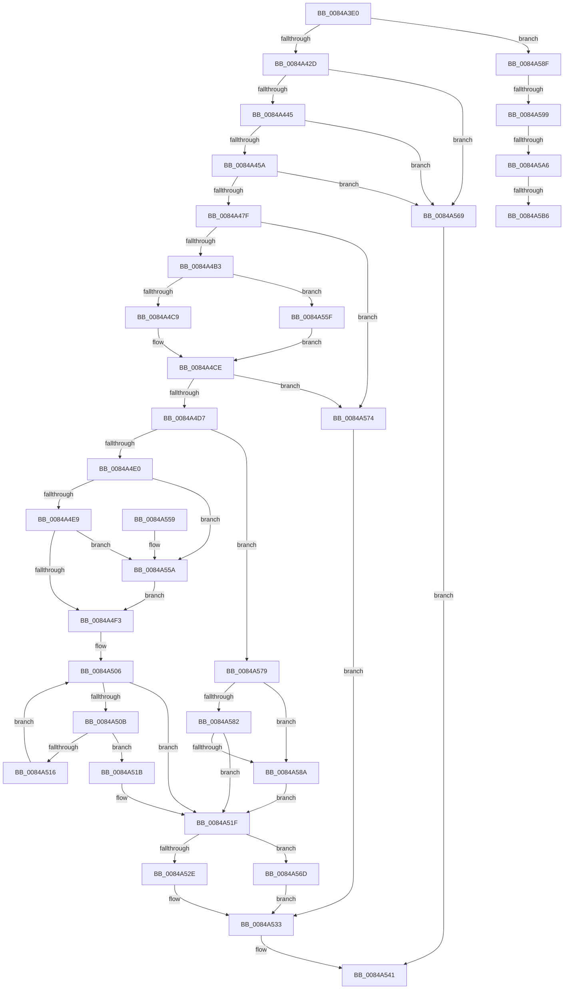

# CmpVirtualBranchIsReplicated

- RVA: `0x0084A3E0`–`0x0084A5BF` (길이 `479` bytes)
- VA: `0x000000014084A3E0`
- 실행 섹션: `PAGE`
- PDB 이름 있음: `예`; PDB Function 태그: `예`
- unwind 정보 RVA: `0x000694FC`
- 디코드: `130`개 명령, `479/479` bytes 표시
- 미해석 바이트: `0` (있으면 어셈블리에 `.byte`로 보존)

> 이 문서는 커널 이미지의 기계어와 PDB 기호를 분석해 생성했습니다. 4번과 5번은 함수 원형과 자료형을 바이너리 사용 방식에서 추정한 C 해석이며 원본 소스 복구 결과는 아닙니다.

## 1. Dependencies

- 직접 호출 지점: **9**; 고유 호출 대상: **9**
- 직접 호출자로 확인된 함수: **2**
- RIP 상대 이미지 참조: **2**

### Outgoing calls
- `0x0084A438` → [CmpGetVirtualizationIDFromFullVirtualPath](CmpGetVirtualizationIDFromFullVirtualPath_function_0084ACA8.md) (function, `0x0084ACA8`)
- `0x0084A44D` → [CmpGetMappingHiveForString](CmpGetMappingHiveForString_function_0084A5C8.md) (function, `0x0084A5C8`)
- `0x0084A472` → [CmpBlockTwoHiveWrites](CmpBlockTwoHiveWrites_function_0084DE64.md) (function, `0x0084DE64`)
- `0x0084A49E` → [CmpFindPathByNameEx](CmpFindPathByNameEx_function_0084BAAC.md) (function, `0x0084BAAC`)
- `0x0084A4C9` → [HvpGetCellFlat](../85/HvpGetCellFlat_function_00854C60.md) (function, `0x00854C60`)
- `0x0084A52E` → [HvpReleaseCellPaged](../85/HvpReleaseCellPaged_function_00855F40.md) (function, `0x00855F40`)
- `0x0084A539` → [CmpUnblockTwoHiveWrites](CmpUnblockTwoHiveWrites_function_0084A38C.md) (function, `0x0084A38C`)
- `0x0084A55F` → [HvpGetCellPaged](../85/HvpGetCellPaged_function_00854CB0.md) (function, `0x00854CB0`)
- `0x0084A56D` → [HvpReleaseCellFlat](../85/HvpReleaseCellFlat_function_0085CC20.md) (function, `0x0085CC20`)

### Direct callers
- [CmpVEExecuteRealStoreParseLogic](CmpVEExecuteRealStoreParseLogic_function_0084CCD4.md) at `0x0084CE7F`
- [CmpVEExecuteVirtualStoreParseLogic](../A7/CmpVEExecuteVirtualStoreParseLogic_function_00A76A20.md) at `0x00A76A8B`

### Static image references
- `0x0084A45A` → RVA `0x00FD9A90` (`PAGEDATA`; read)
- `0x0084A4E0` → RVA `0x00E0ECA0` (`.data`; read)

## 2. Other-region calls and transfers

- 다른 실행 섹션으로 향하는 call: **0**
- call이 아닌 외부 분기/꼬리 이동: **4**
  - `0x0084A593` → [sub_00B167B6 + 0xA](../B1/Unknown_function_00B167B6.md) (`tail-transfer`)
  - `0x0084A5A0` → [sub_00B167B6](../B1/Unknown_function_00B167B6.md) (`tail-transfer`)
  - `0x0084A5B0` → [sub_00B167B6](../B1/Unknown_function_00B167B6.md) (`tail-transfer`)
  - `0x0084A5BA` → [sub_00B167B6 + 0x3](../B1/Unknown_function_00B167B6.md) (`tail-transfer`)

## 3. Assembly (complete function range)

```asm
0084A3E0  48 89 5C 24 10                  mov qword ptr [rsp + 0x10], rbx
0084A3E5  55                              push rbp
0084A3E6  56                              push rsi
0084A3E7  57                              push rdi
0084A3E8  41 54                           push r12
0084A3EA  41 55                           push r13
0084A3EC  41 56                           push r14
0084A3EE  41 57                           push r15
0084A3F0  48 8B EC                        mov rbp, rsp
0084A3F3  48 83 EC 60                     sub rsp, 0x60
0084A3F7  83 4D 50 FF                     or dword ptr [rbp + 0x50], 0xffffffff
0084A3FB  45 33 ED                        xor r13d, r13d
0084A3FE  44 89 6D 54                     mov dword ptr [rbp + 0x54], r13d
0084A402  0F 57 C0                        xorps xmm0, xmm0
0084A405  44 89 6D 40                     mov dword ptr [rbp + 0x40], r13d
0084A409  4D 8B E0                        mov r12, r8
0084A40C  4C 89 6D D0                     mov qword ptr [rbp - 0x30], r13
0084A410  48 8B F2                        mov rsi, rdx
0084A413  4C 89 6D 58                     mov qword ptr [rbp + 0x58], r13
0084A417  48 8B F9                        mov rdi, rcx
0084A41A  45 88 28                        mov byte ptr [r8], r13b
0084A41D  45 8B FD                        mov r15d, r13d
0084A420  0F 11 45 D8                     movups xmmword ptr [rbp - 0x28], xmm0
0084A424  48 85 C9                        test rcx, rcx
0084A427  0F 85 62 01 00 00               jne 0x14084a58f
0084A42D  48 8D 55 E8                     lea rdx, [rbp - 0x18]
0084A431  48 8B CE                        mov rcx, rsi
0084A434  0F 11 45 E8                     movups xmmword ptr [rbp - 0x18], xmm0
0084A438  E8 6B 08 00 00                  call 0x14084aca8
0084A43D  85 C0                           test eax, eax
0084A43F  0F 88 24 01 00 00               js 0x14084a569
0084A445  48 8D 55 58                     lea rdx, [rbp + 0x58]
0084A449  48 8D 4D E8                     lea rcx, [rbp - 0x18]
0084A44D  E8 76 01 00 00                  call 0x14084a5c8
0084A452  85 C0                           test eax, eax
0084A454  0F 88 0F 01 00 00               js 0x14084a569
0084A45A  4C 8B 3D 2F F6 78 00            mov r15, qword ptr [rip + 0x78f62f]
0084A461  4C 8B 75 58                     mov r14, qword ptr [rbp + 0x58]
0084A465  66 BB 01 00                     mov bx, 1
0084A469  49 8B D6                        mov rdx, r14
0084A46C  44 8A C3                        mov r8b, bl
0084A46F  49 8B CF                        mov rcx, r15
0084A472  E8 ED 39 00 00                  call 0x14084de64
0084A477  85 C0                           test eax, eax
0084A479  0F 88 EA 00 00 00               js 0x14084a569
0084A47F  48 8D 45 D0                     lea rax, [rbp - 0x30]
0084A483  45 33 C9                        xor r9d, r9d
0084A486  48 89 44 24 28                  mov qword ptr [rsp + 0x28], rax
0084A48B  4C 8D 45 D8                     lea r8, [rbp - 0x28]
0084A48F  48 8D 45 40                     lea rax, [rbp + 0x40]
0084A493  48 8B D6                        mov rdx, rsi
0084A496  48 8B CF                        mov rcx, rdi
0084A499  48 89 44 24 20                  mov qword ptr [rsp + 0x20], rax
0084A49E  E8 09 16 00 00                  call 0x14084baac
0084A4A3  48 8B 7D D0                     mov rdi, qword ptr [rbp - 0x30]
0084A4A7  40 8A F0                        mov sil, al
0084A4AA  48 85 FF                        test rdi, rdi
0084A4AD  0F 84 C1 00 00 00               je 0x14084a574
0084A4B3  4C 8D 45 50                     lea r8, [rbp + 0x50]
0084A4B7  8B 55 40                        mov edx, dword ptr [rbp + 0x40]
0084A4BA  48 8B CF                        mov rcx, rdi
0084A4BD  84 9F 8C 00 00 00               test byte ptr [rdi + 0x8c], bl
0084A4C3  0F 84 96 00 00 00               je 0x14084a55f
0084A4C9  E8 92 A7 00 00                  call 0x140854c60
0084A4CE  48 85 C0                        test rax, rax
0084A4D1  0F 84 9D 00 00 00               je 0x14084a574
0084A4D7  40 84 F6                        test sil, sil
0084A4DA  0F 85 99 00 00 00               jne 0x14084a579
0084A4E0  44 38 2D B9 47 5C 00            cmp byte ptr [rip + 0x5c47b9], r13b
0084A4E7  74 71                           je 0x14084a55a
0084A4E9  66 0F BA 60 02 08               bt word ptr [rax + 2], 8
0084A4EF  8A C3                           mov al, bl
0084A4F1  73 67                           jae 0x14084a55a
0084A4F3  0F B7 55 D8                     movzx edx, word ptr [rbp - 0x28]
0084A4F7  41 0F B7 CD                     movzx ecx, r13w
0084A4FB  4C 8B 45 E0                     mov r8, qword ptr [rbp - 0x20]
0084A4FF  66 D1 EA                        shr dx, 1
0084A502  41 88 04 24                     mov byte ptr [r12], al
0084A506  66 3B CA                        cmp cx, dx
0084A509  73 14                           jae 0x14084a51f
0084A50B  0F B7 C1                        movzx eax, cx
0084A50E  66 41 83 3C 40 5C               cmp word ptr [r8 + rax*2], 0x5c
0084A514  74 05                           je 0x14084a51b
0084A516  66 03 CB                        add cx, bx
0084A519  EB EB                           jmp 0x14084a506
0084A51B  45 88 2C 24                     mov byte ptr [r12], r13b
0084A51F  48 8D 55 50                     lea rdx, [rbp + 0x50]
0084A523  48 8B CF                        mov rcx, rdi
0084A526  84 9F 8C 00 00 00               test byte ptr [rdi + 0x8c], bl
0084A52C  75 3F                           jne 0x14084a56d
0084A52E  E8 0D BA 00 00                  call 0x140855f40
0084A533  49 8B D6                        mov rdx, r14
0084A536  49 8B CF                        mov rcx, r15
0084A539  E8 4E FE FF FF                  call 0x14084a38c
0084A53E  40 8A C6                        mov al, sil
0084A541  48 8B 9C 24 A8 00 00 00         mov rbx, qword ptr [rsp + 0xa8]
0084A549  48 83 C4 60                     add rsp, 0x60
0084A54D  41 5F                           pop r15
0084A54F  41 5E                           pop r14
0084A551  41 5D                           pop r13
0084A553  41 5C                           pop r12
0084A555  5F                              pop rdi
0084A556  5E                              pop rsi
0084A557  5D                              pop rbp
0084A558  C3                              ret
0084A559  CC                              int3
0084A55A  41 8A C5                        mov al, r13b
0084A55D  EB 94                           jmp 0x14084a4f3
0084A55F  E8 4C A7 00 00                  call 0x140854cb0
0084A564  E9 65 FF FF FF                  jmp 0x14084a4ce
0084A569  32 C0                           xor al, al
0084A56B  EB D4                           jmp 0x14084a541
0084A56D  E8 AE 26 01 00                  call 0x14085cc20
0084A572  EB BF                           jmp 0x14084a533
0084A574  41 8A F5                        mov sil, r13b
0084A577  EB BA                           jmp 0x14084a533
0084A579  44 38 2D 20 47 5C 00            cmp byte ptr [rip + 0x5c4720], r13b
0084A580  74 08                           je 0x14084a58a
0084A582  66 0F BA 60 02 08               bt word ptr [rax + 2], 8
0084A588  72 95                           jb 0x14084a51f
0084A58A  41 8A F5                        mov sil, r13b
0084A58D  EB 90                           jmp 0x14084a51f
0084A58F  66 44 39 2A                     cmp word ptr [rdx], r13w
0084A593  0F 85 27 C2 2C 00               jne 0x140b167c0
0084A599  44 38 2D 00 47 5C 00            cmp byte ptr [rip + 0x5c4700], r13b
0084A5A0  0F 84 10 C2 2C 00               je 0x140b167b6
0084A5A6  F7 81 B8 00 00 00 00 00 00 01   test dword ptr [rcx + 0xb8], 0x1000000
0084A5B0  0F 84 00 C2 2C 00               je 0x140b167b6
0084A5B6  66 BB 01 00                     mov bx, 1
0084A5BA  E9 FA C1 2C 00                  jmp 0x140b167b9
```

## 4. C-style interpretation (structured pseudocode)

```c
__int64 __fastcall CmpVirtualBranchIsReplicated(__int64 a1, __int64 a2, __int64 a3, int a4)
{
    __int64 result;
    __int64 v_r13;
    __int64 v_rsp;
    unsigned __int64 v_stack_m50;
    unsigned __int64 v_stack_m58;
    unsigned __int64 v_stack_m60;
    unsigned __int64 v_stack_m68;
    unsigned __int64 v_stack_m70;
    unsigned __int64 v_stack_m78;
    unsigned __int64 v_stack_p10;
    unsigned int v_stack_p18;
    unsigned int v_stack_p1C;
    unsigned __int64 v_stack_p20;
    unsigned int v_stack_p8;

    v_stack_p10 = v_rbx;
    v_rsp = (v_rsp) - (96);
    v_r13 = 0;
    v_stack_p1C = 0;
    v_stack_p8 = 0;
    v_stack_m68 = 0;
    v_stack_p20 = 0;
    *(unsigned __int8 *)(a3) = 0;
    v_stack_m60 = v_xmm0;
    if (a1 != 0) goto loc_0084A58F;
    v_stack_m50 = v_xmm0;
    result = CmpGetVirtualizationIDFromFullVirtualPath(a2, v_stack_m50, a3, a4);
    if (sign_flag) goto loc_0084A569;
    result = CmpGetMappingHiveForString(v_stack_m50, v_stack_p20, a3, a4);
    if (sign_flag) goto loc_0084A569;
    result = CmpBlockTwoHiveWrites(*(unsigned __int64 *)(v_rip + 7927343), v_stack_p20, 1, a4);
    if (sign_flag) goto loc_0084A569;
    a4 = 0;
    v_stack_m70 = v_stack_m68;
    v_stack_m78 = v_stack_p8;
    result = CmpFindPathByNameEx(a1, a2, v_stack_m60, a4);
    if (v_stack_m68 == 0) goto loc_0084A574;
    if (((*(unsigned __int8 *)(v_stack_m68 + 140)) & (1)) == 0) goto loc_0084A55F;
    result = HvpGetCellFlat(v_stack_m68, (unsigned int)(v_stack_p8), v_stack_p18, a4);
loc_0084A4CE:
    if (result == 0) goto loc_0084A574;
    if ((unsigned __int8)((unsigned __int8)(result)) != 0) goto loc_0084A579;
    if ((*(unsigned __int8 *)(v_rip + 6047673)) == 0) goto loc_0084A55A;
    if ((*(unsigned __int8 *)(v_rip + 6047673)) >= 0) goto loc_0084A55A;
loc_0084A4F3:
    a2 = (unsigned __int16)((v_stack_m60) >> (1));
    *(unsigned __int8 *)(a3) = 1;
loc_0084A506:
    if (0 >= ((unsigned __int16)(a2))) goto loc_0084A51F;
    if ((*(unsigned __int16 *)(v_stack_m58 + 0 * 2)) == 92) goto loc_0084A51B;
    a1 = (unsigned __int16)((0) + (1));
    goto loc_0084A506;
loc_0084A51B:
    *(unsigned __int8 *)(a3) = 0;
loc_0084A51F:
    if (((*(unsigned __int8 *)(v_stack_m68 + 140)) & (1)) != 0) goto loc_0084A56D;
    result = HvpReleaseCellPaged(v_stack_m68, v_stack_p18, v_stack_m58, a4);
loc_0084A533:
    result = CmpUnblockTwoHiveWrites(*(unsigned __int64 *)(v_rip + 7927343), v_stack_p20, v_stack_m58, a4);
loc_0084A541:
    v_rsp = (v_rsp) + (96);
    return (unsigned __int8)((unsigned __int8)(result));
loc_0084A55A:
    goto loc_0084A4F3;
loc_0084A55F:
    result = HvpGetCellPaged(*(unsigned __int64 *)(v_rip + 7927343), v_stack_p20, v_stack_m58, a4);
    goto loc_0084A4CE;
loc_0084A569:
    result = 0;
    goto loc_0084A541;
loc_0084A56D:
    result = HvpReleaseCellFlat(*(unsigned __int64 *)(v_rip + 7927343), v_stack_p20, v_stack_m58, a4);
    goto loc_0084A533;
loc_0084A574:
    goto loc_0084A533;
loc_0084A579:
    if ((*(unsigned __int8 *)(v_rip + 6047520)) == 0) goto loc_0084A58A;
    if ((*(unsigned __int8 *)(v_rip + 6047520)) < 0) goto loc_0084A51F;
loc_0084A58A:
    goto loc_0084A51F;
loc_0084A58F:
}
```

## 5. (Beta) C Style

```c
int64_t CmpVirtualBranchIsReplicated(int64_t Arg1, void *Arg2, void *Arg3, int32_t Arg4)
{
    uint8_t *arg2 = (uint8_t *)Arg2;
    uint8_t *arg3 = (uint8_t *)Arg3;

    int64_t result;
    int64_t local_r13;
    int64_t local_rsp;
    uint64_t v_stack_m50;
    uint64_t v_stack_m58;
    uint64_t v_stack_m60;
    uint64_t v_stack_m68;
    uint64_t v_stack_m70;
    uint64_t v_stack_m78;
    uint64_t v_stack_p10;
    uint32_t v_stack_p18;
    uint32_t v_stack_p1C;
    uint64_t v_stack_p20;
    uint32_t v_stack_p8;

    v_stack_p10 = local_rbx;
    local_rsp = (local_rsp) - (96);
    local_r13 = 0;
    v_stack_p1C = 0;
    v_stack_p8 = 0;
    v_stack_m68 = 0;
    v_stack_p20 = 0;
    *(uint8_t *)(arg3) = 0;
    v_stack_m60 = v_xmm0;
    if (Arg1 != 0) goto loc_0084A58F;
    v_stack_m50 = v_xmm0;
    result = CmpGetVirtualizationIDFromFullVirtualPath(Arg2, v_stack_m50, Arg3, Arg4);
    if (sign_flag) goto loc_0084A569;
    result = CmpGetMappingHiveForString(v_stack_m50, v_stack_p20, Arg3, Arg4);
    if (sign_flag) goto loc_0084A569;
    result = CmpBlockTwoHiveWrites(*(uint64_t *)(v_rip + 0x78F62F), v_stack_p20, 1, Arg4);
    if (sign_flag) goto loc_0084A569;
    Arg4 = 0;
    v_stack_m70 = v_stack_m68;
    v_stack_m78 = v_stack_p8;
    result = CmpFindPathByNameEx(Arg1, Arg2, v_stack_m60, Arg4);
    if (v_stack_m68 == 0) goto loc_0084A574;
    if (((*(uint8_t *)(v_stack_m68 + 0x8C)) & (1)) == 0) goto loc_0084A55F;
    result = HvpGetCellFlat(v_stack_m68, (uint32_t)(v_stack_p8), v_stack_p18, Arg4);
loc_0084A4CE:
    if (result == 0) goto loc_0084A574;
    if ((uint8_t)((uint8_t)(result)) != 0) goto loc_0084A579;
    if ((*(uint8_t *)(v_rip + 0x5C47B9)) == 0) goto loc_0084A55A;
    if ((*(uint8_t *)(v_rip + 0x5C47B9)) >= 0) goto loc_0084A55A;
loc_0084A4F3:
    Arg2 = (uint16_t)((v_stack_m60) >> (1));
    *(uint8_t *)(arg3) = 1;
loc_0084A506:
    if (0 >= ((uint16_t)(Arg2))) goto loc_0084A51F;
    if ((*(uint16_t *)(v_stack_m58 + 0x0 * 2)) == 92) goto loc_0084A51B;
    Arg1 = (uint16_t)((0) + (1));
    goto loc_0084A506;
loc_0084A51B:
    *(uint8_t *)(arg3) = 0;
loc_0084A51F:
    if (((*(uint8_t *)(v_stack_m68 + 0x8C)) & (1)) != 0) goto loc_0084A56D;
    result = HvpReleaseCellPaged(v_stack_m68, v_stack_p18, v_stack_m58, Arg4);
loc_0084A533:
    result = CmpUnblockTwoHiveWrites(*(uint64_t *)(v_rip + 0x78F62F), v_stack_p20, v_stack_m58, Arg4);
loc_0084A541:
    local_rsp = (local_rsp) + (96);
    return (uint8_t)((uint8_t)(result));
loc_0084A55A:
    goto loc_0084A4F3;
loc_0084A55F:
    result = HvpGetCellPaged(*(uint64_t *)(v_rip + 0x78F62F), v_stack_p20, v_stack_m58, Arg4);
    goto loc_0084A4CE;
loc_0084A569:
    result = 0;
    goto loc_0084A541;
loc_0084A56D:
    result = HvpReleaseCellFlat(*(uint64_t *)(v_rip + 0x78F62F), v_stack_p20, v_stack_m58, Arg4);
    goto loc_0084A533;
loc_0084A574:
    goto loc_0084A533;
loc_0084A579:
    if ((*(uint8_t *)(v_rip + 0x5C4720)) == 0) goto loc_0084A58A;
    if ((*(uint8_t *)(v_rip + 0x5C4720)) < 0) goto loc_0084A51F;
loc_0084A58A:
    goto loc_0084A51F;
loc_0084A58F:
}
```

### 관측된 메모리 오프셋

구조체 형식이 확인되지 않은 접근은 인자 기준의 오프셋으로만 기록했습니다.

| 기준 인자 | 오프셋 표현 | 폭 (bit) | 접근 |
|---|---:|---:|---|
| `Arg2` | `+ 0x0` | `16` | `R` |
| `Arg3` | `+ 0x0` | `8` | `W` |

## 6. Execution-region graph

[열기: 2D/3D 그래프와 함수 탐색 컨트롤 패널](../../../control-panel.html?section=page&rva=0x0084A3E0&view=graph)

- 2D 그래프는 위에서 아래로 흐르고, 3D 그래프는 빈 공간을 드래그해 회전합니다. Shift+드래그는 이동, 휠은 확대·축소, 함수 노드 선택은 대상 보고서 이동입니다.

### Static fallback


