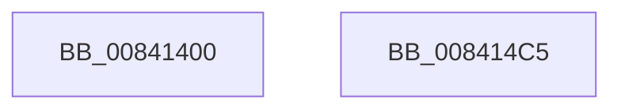

# EtwRegisterCounters

- RVA: `0x00841400`–`0x008414C6` (길이 `198` bytes)
- VA: `0x0000000140841400`
- 실행 섹션: `PAGE`
- PDB 이름 있음: `예`; PDB Function 태그: `아니요`
- unwind 정보 RVA: `0x000DB6B4`
- 디코드: `40`개 명령, `198/198` bytes 표시
- 미해석 바이트: `0` (있으면 어셈블리에 `.byte`로 보존)

> 이 문서는 커널 이미지의 기계어와 PDB 기호를 분석해 생성했습니다. 4번과 5번은 함수 원형과 자료형을 바이너리 사용 방식에서 추정한 C 해석이며 원본 소스 복구 결과는 아닙니다.

## 1. Dependencies

- 직접 호출 지점: **2**; 고유 호출 대상: **1**
- 직접 호출자로 확인된 함수: **1**
- RIP 상대 이미지 참조: **7**

### Outgoing calls
- `0x00841462` → [ExpRegisterCounterSet](../7D/ExpRegisterCounterSet_function_007D156C.md) (function, `0x007D156C`)
- `0x008414B5` → [ExpRegisterCounterSet](../7D/ExpRegisterCounterSet_function_007D156C.md) (function, `0x007D156C`)

### Direct callers
- [ExpPcwHostCallback](../7D/ExpPcwHostCallback_function_007D1290.md) at `0x007D1384`

### Static image references
- `0x00841411` → RVA `0x00009E68` (`.rdata`; read)
- `0x0084141C` → RVA `0x00A0E0C0` (`EtwpEventTracingCounterSetCallback`; read)
- `0x0084142F` → RVA `0x00E65E08` (`.data`; read)
- `0x00841436` → RVA `0x00026808` (`.rdata`; read)
- `0x0084146B` → RVA `0x00009E58` (`.rdata`; read)
- `0x0084147E` → RVA `0x00E65E10` (`.data`; read)
- `0x00841489` → RVA `0x00026690` (`.rdata`; read)

## 2. Other-region calls and transfers

- 다른 실행 섹션으로 향하는 call: **0**
- 별도 외부 분기/꼬리 이동을 확인하지 못했습니다.

## 3. Assembly (complete function range)

```asm
00841400  48 89 7C 24 08                  mov qword ptr [rsp + 8], rdi
00841405  55                              push rbp
00841406  48 8B EC                        mov rbp, rsp
00841409  48 83 EC 60                     sub rsp, 0x60
0084140D  83 65 C4 00                     and dword ptr [rbp - 0x3c], 0
00841411  48 8D 05 50 8A 7C FF            lea rax, [rip - 0x8375b0]
00841418  83 65 D4 00                     and dword ptr [rbp - 0x2c], 0
0084141C  48 8D 3D 9D CC 1C 00            lea rdi, [rip + 0x1ccc9d]
00841423  83 65 F4 00                     and dword ptr [rbp - 0xc], 0
00841427  48 8D 55 C0                     lea rdx, [rbp - 0x40]
0084142B  48 89 45 C8                     mov qword ptr [rbp - 0x38], rax
0084142F  48 8D 0D D2 49 62 00            lea rcx, [rip + 0x6249d2]
00841436  48 8D 05 CB 53 7E FF            lea rax, [rip - 0x81ac35]
0084143D  C7 45 D0 06 00 00 00            mov dword ptr [rbp - 0x30], 6
00841444  48 89 45 D8                     mov qword ptr [rbp - 0x28], rax
00841448  48 89 7D E0                     mov qword ptr [rbp - 0x20], rdi
0084144C  48 C7 45 E8 01 00 00 00         mov qword ptr [rbp - 0x18], 1
00841454  C7 45 C0 00 02 00 00            mov dword ptr [rbp - 0x40], 0x200
0084145B  C7 45 F0 01 00 00 00            mov dword ptr [rbp - 0x10], 1
00841462  E8 05 01 F9 FF                  call 0x1407d156c
00841467  83 65 C4 00                     and dword ptr [rbp - 0x3c], 0
0084146B  48 8D 05 E6 89 7C FF            lea rax, [rip - 0x83761a]
00841472  83 65 D4 00                     and dword ptr [rbp - 0x2c], 0
00841476  48 8D 55 C0                     lea rdx, [rbp - 0x40]
0084147A  83 65 F4 00                     and dword ptr [rbp - 0xc], 0
0084147E  48 8D 0D 8B 49 62 00            lea rcx, [rip + 0x62498b]
00841485  48 89 45 C8                     mov qword ptr [rbp - 0x38], rax
00841489  48 8D 05 00 52 7E FF            lea rax, [rip - 0x81ae00]
00841490  48 89 45 D8                     mov qword ptr [rbp - 0x28], rax
00841494  C7 45 D0 05 00 00 00            mov dword ptr [rbp - 0x30], 5
0084149B  48 89 7D E0                     mov qword ptr [rbp - 0x20], rdi
0084149F  48 C7 45 E8 02 00 00 00         mov qword ptr [rbp - 0x18], 2
008414A7  C7 45 C0 00 02 00 00            mov dword ptr [rbp - 0x40], 0x200
008414AE  C7 45 F0 01 00 00 00            mov dword ptr [rbp - 0x10], 1
008414B5  E8 B2 00 F9 FF                  call 0x1407d156c
008414BA  48 8B 7C 24 70                  mov rdi, qword ptr [rsp + 0x70]
008414BF  48 83 C4 60                     add rsp, 0x60
008414C3  5D                              pop rbp
008414C4  C3                              ret
008414C5  CC                              int3
```

## 4. C-style interpretation (structured pseudocode)

```c
__int64 __fastcall EtwRegisterCounters(void)
{
    __int64 result;
    __int64 v_rsp;
    unsigned int v_stack_m14;
    unsigned int v_stack_m18;
    unsigned __int64 v_stack_m20;
    unsigned __int64 v_stack_m28;
    unsigned __int64 v_stack_m30;
    unsigned int v_stack_m34;
    unsigned int v_stack_m38;
    unsigned __int64 v_stack_m40;
    unsigned int v_stack_m44;
    unsigned __int64 v_stack_m48;
    unsigned __int64 v_stack_p8;

    v_stack_p8 = v_rdi;
    v_rsp = (v_rsp) - (96);
    v_stack_m40 = v_rip - 8615344;
    v_stack_m38 = 6;
    v_stack_m30 = v_rip - 8498229;
    v_stack_m28 = v_rip + 1887389;
    v_stack_m20 = 1;
    v_stack_m48 = 512;
    v_stack_m18 = 1;
    result = ExpRegisterCounterSet(v_rip + 6441426, v_stack_m48, a3, a4);
    v_stack_m40 = v_rip - 8615450;
    v_stack_m30 = v_rip - 8498688;
    v_stack_m38 = 5;
    v_stack_m28 = v_rip + 1887389;
    v_stack_m20 = 2;
    v_stack_m48 = 512;
    v_stack_m18 = 1;
    result = ExpRegisterCounterSet(v_rip + 6441355, v_stack_m48, a3, a4);
    v_rsp = (v_rsp) + (96);
    return result;
}
```

## 5. (Beta) C Style

```c
void EtwRegisterCounters(void)
{
    int64_t result;
    int64_t local_rsp;
    uint32_t v_stack_m14;
    uint32_t v_stack_m18;
    uint64_t v_stack_m20;
    uint64_t v_stack_m28;
    uint64_t v_stack_m30;
    uint32_t v_stack_m34;
    uint32_t v_stack_m38;
    uint64_t v_stack_m40;
    uint32_t v_stack_m44;
    uint64_t v_stack_m48;
    uint64_t v_stack_p8;

    v_stack_p8 = local_rdi;
    local_rsp = (local_rsp) - (96);
    v_stack_m40 = v_rip - 8615344;
    v_stack_m38 = 6;
    v_stack_m30 = v_rip - 8498229;
    v_stack_m28 = v_rip + 1887389;
    v_stack_m20 = 1;
    v_stack_m48 = 512;
    v_stack_m18 = 1;
    result = ExpRegisterCounterSet(v_rip + 6441426, v_stack_m48, a3, a4);
    v_stack_m40 = v_rip - 8615450;
    v_stack_m30 = v_rip - 8498688;
    v_stack_m38 = 5;
    v_stack_m28 = v_rip + 1887389;
    v_stack_m20 = 2;
    v_stack_m48 = 512;
    v_stack_m18 = 1;
    result = ExpRegisterCounterSet(v_rip + 6441355, v_stack_m48, a3, a4);
    local_rsp = (local_rsp) + (96);
    return result;
}
```

## 6. Execution-region graph

[열기: 2D/3D 그래프와 함수 탐색 컨트롤 패널](../../../control-panel.html?section=page&rva=0x00841400&view=graph)

- 2D 그래프는 위에서 아래로 흐르고, 3D 그래프는 빈 공간을 드래그해 회전합니다. Shift+드래그는 이동, 휠은 확대·축소, 함수 노드 선택은 대상 보고서 이동입니다.

### Static fallback


