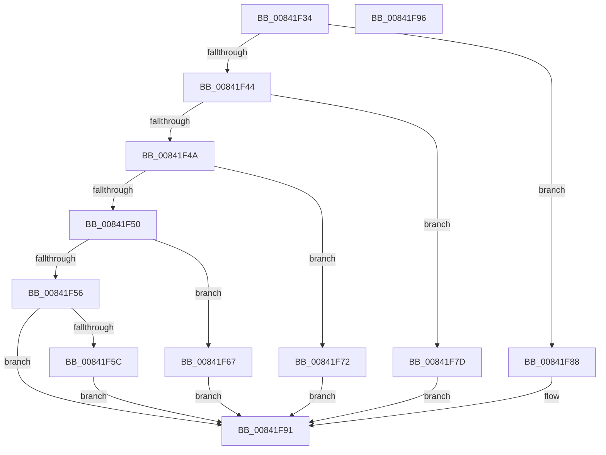

# HashpFinalizeHash

- RVA: `0x00841F34`–`0x00841F97` (길이 `99` bytes)
- VA: `0x0000000140841F34`
- 실행 섹션: `PAGE`
- PDB 이름 있음: `예`; PDB Function 태그: `아니요`
- unwind 정보 RVA: `0x0005C788`
- 디코드: `29`개 명령, `99/99` bytes 표시
- 미해석 바이트: `0` (있으면 어셈블리에 `.byte`로 보존)

> 이 문서는 커널 이미지의 기계어와 PDB 기호를 분석해 생성했습니다. 4번과 5번은 함수 원형과 자료형을 바이너리 사용 방식에서 추정한 C 해석이며 원본 소스 복구 결과는 아닙니다.

## 1. Dependencies

- 직접 호출 지점: **5**; 고유 호출 대상: **5**
- 직접 호출자로 확인된 함수: **1**
- RIP 상대 이미지 참조: **0**

### Outgoing calls
- `0x00841F60` → [SymCryptSha512Result](../../text/52/SymCryptSha512Result_function_00528B40.md) (function, `0x00528B40`)
- `0x00841F6B` → [SymCryptSha384Result](../../text/52/SymCryptSha384Result_function_005274B0.md) (function, `0x005274B0`)
- `0x00841F76` → [SymCryptSha256Result](../../text/51/SymCryptSha256Result_function_0051E2F0.md) (function, `0x0051E2F0`)
- `0x00841F81` → [SymCryptSha1Result](../../text/52/SymCryptSha1Result_function_00529EA0.md) (function, `0x00529EA0`)
- `0x00841F8C` → [SymCryptMd5Result](../../text/52/SymCryptMd5Result_function_0052A8B0.md) (function, `0x0052A8B0`)

### Direct callers
- [HashpHashMemory](HashpHashMemory_function_008419AC.md) at `0x00841A74`

### Static image references
- 디코드된 RIP-relative 메모리 참조가 없습니다.

## 2. Other-region calls and transfers

- 다른 실행 섹션으로 향하는 call: **5**
  - `0x00841F60` → [SymCryptSha512Result](../../text/52/SymCryptSha512Result_function_00528B40.md) (`PAGE` → `.text`)
  - `0x00841F6B` → [SymCryptSha384Result](../../text/52/SymCryptSha384Result_function_005274B0.md) (`PAGE` → `.text`)
  - `0x00841F76` → [SymCryptSha256Result](../../text/51/SymCryptSha256Result_function_0051E2F0.md) (`PAGE` → `.text`)
  - `0x00841F81` → [SymCryptSha1Result](../../text/52/SymCryptSha1Result_function_00529EA0.md) (`PAGE` → `.text`)
  - `0x00841F8C` → [SymCryptMd5Result](../../text/52/SymCryptMd5Result_function_0052A8B0.md) (`PAGE` → `.text`)
- 별도 외부 분기/꼬리 이동을 확인하지 못했습니다.

## 3. Assembly (complete function range)

```asm
00841F34  48 83 EC 28                     sub rsp, 0x28
00841F38  44 8B 01                        mov r8d, dword ptr [rcx]
00841F3B  41 81 E8 03 80 00 00            sub r8d, 0x8003
00841F42  74 44                           je 0x140841f88
00841F44  41 83 E8 01                     sub r8d, 1
00841F48  74 33                           je 0x140841f7d
00841F4A  41 83 E8 08                     sub r8d, 8
00841F4E  74 22                           je 0x140841f72
00841F50  41 83 E8 01                     sub r8d, 1
00841F54  74 11                           je 0x140841f67
00841F56  41 83 F8 01                     cmp r8d, 1
00841F5A  75 35                           jne 0x140841f91
00841F5C  48 83 C1 10                     add rcx, 0x10
00841F60  E8 DB 6B CE FF                  call 0x140528b40
00841F65  EB 2A                           jmp 0x140841f91
00841F67  48 83 C1 10                     add rcx, 0x10
00841F6B  E8 40 55 CE FF                  call 0x1405274b0
00841F70  EB 1F                           jmp 0x140841f91
00841F72  48 83 C1 10                     add rcx, 0x10
00841F76  E8 75 C3 CD FF                  call 0x14051e2f0
00841F7B  EB 14                           jmp 0x140841f91
00841F7D  48 83 C1 10                     add rcx, 0x10
00841F81  E8 1A 7F CE FF                  call 0x140529ea0
00841F86  EB 09                           jmp 0x140841f91
00841F88  48 83 C1 10                     add rcx, 0x10
00841F8C  E8 1F 89 CE FF                  call 0x14052a8b0
00841F91  48 83 C4 28                     add rsp, 0x28
00841F95  C3                              ret
00841F96  CC                              int3
```

## 4. C-style interpretation (structured pseudocode)

```c
__int64 __fastcall HashpFinalizeHash(__int64 a1)
{
    __int64 result;
    __int64 v_rsp;

    v_rsp = (v_rsp) - (40);
    a3 = (unsigned int)(((unsigned int)(*(unsigned int *)(a1))) - (0x8003ULL));
    if (condition_is_equal) goto loc_00841F88;
    a3 = (unsigned int)((a3) - (1));
    if (condition_is_equal) goto loc_00841F7D;
    a3 = (unsigned int)((a3) - (8));
    if (condition_is_equal) goto loc_00841F72;
    a3 = (unsigned int)((a3) - (1));
    if (condition_is_equal) goto loc_00841F67;
    if (((unsigned int)(a3)) != 1) goto loc_00841F91;
    a1 = (a1) + (16);
    result = SymCryptSha512Result(a1, a2, a3, a4);
    goto loc_00841F91;
loc_00841F67:
    a1 = (a1) + (16);
    result = SymCryptSha384Result(a1, a2, a3, a4);
    goto loc_00841F91;
loc_00841F72:
    a1 = (a1) + (16);
    result = SymCryptSha256Result(a1, a2, a3, a4);
    goto loc_00841F91;
loc_00841F7D:
    a1 = (a1) + (16);
    result = SymCryptSha1Result(a1, a2, a3, a4);
    goto loc_00841F91;
loc_00841F88:
    a1 = (a1) + (16);
    result = SymCryptMd5Result(a1, a2, a3, a4);
loc_00841F91:
    v_rsp = (v_rsp) + (40);
    return result;
}
```

## 5. (Beta) C Style

```c
int64_t HashpFinalizeHash(void *Arg1)
{
    uint8_t *arg1 = (uint8_t *)Arg1;

    int64_t result;
    int64_t local_rsp;

    local_rsp = (local_rsp) - (40);
    a3 = (uint32_t)(((uint32_t)(*(uint32_t *)(arg1))) - (0x8003ULL));
    if (condition_is_equal) goto loc_00841F88;
    a3 = (uint32_t)((a3) - (1));
    if (condition_is_equal) goto loc_00841F7D;
    a3 = (uint32_t)((a3) - (8));
    if (condition_is_equal) goto loc_00841F72;
    a3 = (uint32_t)((a3) - (1));
    if (condition_is_equal) goto loc_00841F67;
    if (((uint32_t)(a3)) != 1) goto loc_00841F91;
    Arg1 = (Arg1) + (16);
    result = SymCryptSha512Result(Arg1, a2, a3, a4);
    goto loc_00841F91;
loc_00841F67:
    Arg1 = (Arg1) + (16);
    result = SymCryptSha384Result(Arg1, a2, a3, a4);
    goto loc_00841F91;
loc_00841F72:
    Arg1 = (Arg1) + (16);
    result = SymCryptSha256Result(Arg1, a2, a3, a4);
    goto loc_00841F91;
loc_00841F7D:
    Arg1 = (Arg1) + (16);
    result = SymCryptSha1Result(Arg1, a2, a3, a4);
    goto loc_00841F91;
loc_00841F88:
    Arg1 = (Arg1) + (16);
    result = SymCryptMd5Result(Arg1, a2, a3, a4);
loc_00841F91:
    local_rsp = (local_rsp) + (40);
    return result;
}
```

### 관측된 메모리 오프셋

구조체 형식이 확인되지 않은 접근은 인자 기준의 오프셋으로만 기록했습니다.

| 기준 인자 | 오프셋 표현 | 폭 (bit) | 접근 |
|---|---:|---:|---|
| `Arg1` | `+ 0x0` | `32` | `R` |

## 6. Execution-region graph

[열기: 2D/3D 그래프와 함수 탐색 컨트롤 패널](../../../control-panel.html?section=page&rva=0x00841F34&view=graph)

- 2D 그래프는 위에서 아래로 흐르고, 3D 그래프는 빈 공간을 드래그해 회전합니다. Shift+드래그는 이동, 휠은 확대·축소, 함수 노드 선택은 대상 보고서 이동입니다.

### Static fallback


