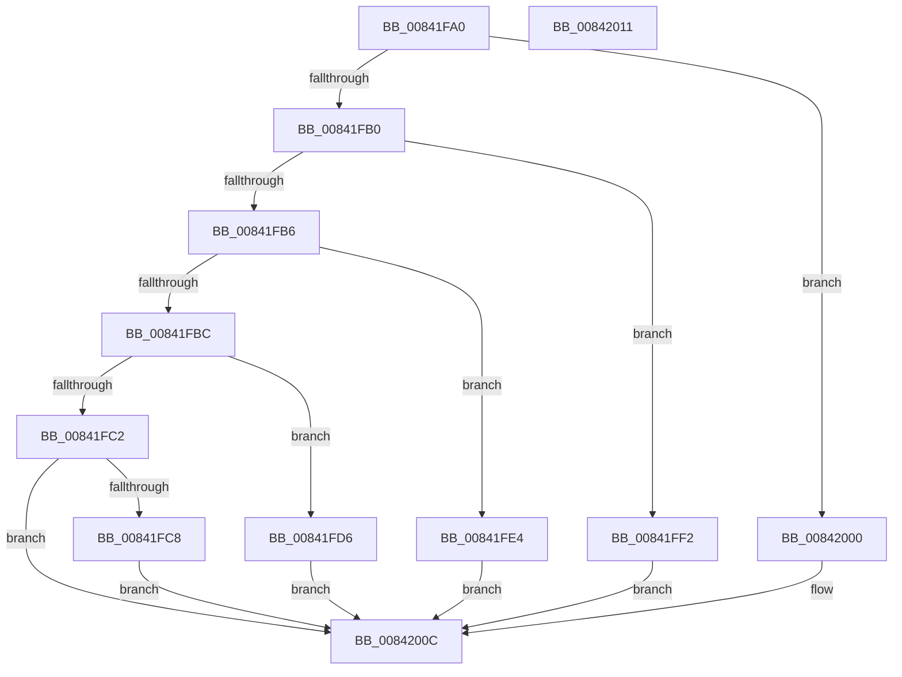

# HashpHashBytes

- RVA: `0x00841FA0`–`0x00842012` (길이 `114` bytes)
- VA: `0x0000000140841FA0`
- 실행 섹션: `PAGE`
- PDB 이름 있음: `예`; PDB Function 태그: `아니요`
- unwind 정보 RVA: `0x0005C788`
- 디코드: `34`개 명령, `114/114` bytes 표시
- 미해석 바이트: `0` (있으면 어셈블리에 `.byte`로 보존)

> 이 문서는 커널 이미지의 기계어와 PDB 기호를 분석해 생성했습니다. 4번과 5번은 함수 원형과 자료형을 바이너리 사용 방식에서 추정한 C 해석이며 원본 소스 복구 결과는 아닙니다.

## 1. Dependencies

- 직접 호출 지점: **5**; 고유 호출 대상: **5**
- 직접 호출자로 확인된 함수: **1**
- RIP 상대 이미지 참조: **0**

### Outgoing calls
- `0x00841FCF` → [SymCryptSha512Append](../../text/52/SymCryptSha512Append_function_00527548.md) (function, `0x00527548`)
- `0x00841FDD` → [SymCryptSha384Append](../../text/52/SymCryptSha384Append_function_0052744C.md) (function, `0x0052744C`)
- `0x00841FEB` → [SymCryptSha256Append](../../text/51/SymCryptSha256Append_function_0051CB20.md) (function, `0x0051CB20`)
- `0x00841FF9` → [SymCryptSha1Append](../../text/52/SymCryptSha1Append_function_00528C70.md) (function, `0x00528C70`)
- `0x00842007` → [SymCryptMd5Append](../../text/52/SymCryptMd5Append_function_00529F90.md) (function, `0x00529F90`)

### Direct callers
- [HashpHashMemory](HashpHashMemory_function_008419AC.md) at `0x00841A60`

### Static image references
- 디코드된 RIP-relative 메모리 참조가 없습니다.

## 2. Other-region calls and transfers

- 다른 실행 섹션으로 향하는 call: **5**
  - `0x00841FCF` → [SymCryptSha512Append](../../text/52/SymCryptSha512Append_function_00527548.md) (`PAGE` → `.text`)
  - `0x00841FDD` → [SymCryptSha384Append](../../text/52/SymCryptSha384Append_function_0052744C.md) (`PAGE` → `.text`)
  - `0x00841FEB` → [SymCryptSha256Append](../../text/51/SymCryptSha256Append_function_0051CB20.md) (`PAGE` → `.text`)
  - `0x00841FF9` → [SymCryptSha1Append](../../text/52/SymCryptSha1Append_function_00528C70.md) (`PAGE` → `.text`)
  - `0x00842007` → [SymCryptMd5Append](../../text/52/SymCryptMd5Append_function_00529F90.md) (`PAGE` → `.text`)
- 별도 외부 분기/꼬리 이동을 확인하지 못했습니다.

## 3. Assembly (complete function range)

```asm
00841FA0  48 83 EC 28                     sub rsp, 0x28
00841FA4  44 8B 09                        mov r9d, dword ptr [rcx]
00841FA7  41 81 E9 03 80 00 00            sub r9d, 0x8003
00841FAE  74 50                           je 0x140842000
00841FB0  41 83 E9 01                     sub r9d, 1
00841FB4  74 3C                           je 0x140841ff2
00841FB6  41 83 E9 08                     sub r9d, 8
00841FBA  74 28                           je 0x140841fe4
00841FBC  41 83 E9 01                     sub r9d, 1
00841FC0  74 14                           je 0x140841fd6
00841FC2  41 83 F9 01                     cmp r9d, 1
00841FC6  75 44                           jne 0x14084200c
00841FC8  45 8B C0                        mov r8d, r8d
00841FCB  48 83 C1 10                     add rcx, 0x10
00841FCF  E8 74 55 CE FF                  call 0x140527548
00841FD4  EB 36                           jmp 0x14084200c
00841FD6  45 8B C0                        mov r8d, r8d
00841FD9  48 83 C1 10                     add rcx, 0x10
00841FDD  E8 6A 54 CE FF                  call 0x14052744c
00841FE2  EB 28                           jmp 0x14084200c
00841FE4  45 8B C0                        mov r8d, r8d
00841FE7  48 83 C1 10                     add rcx, 0x10
00841FEB  E8 30 AB CD FF                  call 0x14051cb20
00841FF0  EB 1A                           jmp 0x14084200c
00841FF2  45 8B C0                        mov r8d, r8d
00841FF5  48 83 C1 10                     add rcx, 0x10
00841FF9  E8 72 6C CE FF                  call 0x140528c70
00841FFE  EB 0C                           jmp 0x14084200c
00842000  45 8B C0                        mov r8d, r8d
00842003  48 83 C1 10                     add rcx, 0x10
00842007  E8 84 7F CE FF                  call 0x140529f90
0084200C  48 83 C4 28                     add rsp, 0x28
00842010  C3                              ret
00842011  CC                              int3
```

## 4. C-style interpretation (structured pseudocode)

```c
__int64 __fastcall HashpHashBytes(__int64 a1, __int64 a2, int a3)
{
    __int64 result;
    __int64 v_rsp;

    v_rsp = (v_rsp) - (40);
    a4 = (unsigned int)(((unsigned int)(*(unsigned int *)(a1))) - (0x8003ULL));
    if (condition_is_equal) goto loc_00842000;
    a4 = (unsigned int)((a4) - (1));
    if (condition_is_equal) goto loc_00841FF2;
    a4 = (unsigned int)((a4) - (8));
    if (condition_is_equal) goto loc_00841FE4;
    a4 = (unsigned int)((a4) - (1));
    if (condition_is_equal) goto loc_00841FD6;
    if (((unsigned int)(a4)) != 1) goto loc_0084200C;
    a1 = (a1) + (16);
    result = SymCryptSha512Append(a1, a2, (unsigned int)(a3), a4);
    goto loc_0084200C;
loc_00841FD6:
    a1 = (a1) + (16);
    result = SymCryptSha384Append(a1, a2, (unsigned int)((unsigned int)((unsigned int)(a3))), a4);
    goto loc_0084200C;
loc_00841FE4:
    a1 = (a1) + (16);
    result = SymCryptSha256Append(a1, a2, (unsigned int)((unsigned int)((unsigned int)((unsigned int)((unsigned int)(a3))))), a4);
    goto loc_0084200C;
loc_00841FF2:
    a1 = (a1) + (16);
    result = SymCryptSha1Append(a1, a2, (unsigned int)((unsigned int)((unsigned int)((unsigned int)((unsigned int)((unsigned int)((unsigned int)(a3))))))), a4);
    goto loc_0084200C;
loc_00842000:
    a1 = (a1) + (16);
    result = SymCryptMd5Append(a1, a2, (unsigned int)((unsigned int)((unsigned int)((unsigned int)((unsigned int)((unsigned int)((unsigned int)((unsigned int)((unsigned int)(a3))))))))), a4);
loc_0084200C:
    v_rsp = (v_rsp) + (40);
    return result;
}
```

## 5. (Beta) C Style

```c
int64_t HashpHashBytes(void *Arg1, int64_t Arg2, int32_t Arg3)
{
    uint8_t *arg1 = (uint8_t *)Arg1;

    int64_t result;
    int64_t local_rsp;

    local_rsp = (local_rsp) - (40);
    a4 = (uint32_t)(((uint32_t)(*(uint32_t *)(arg1))) - (0x8003ULL));
    if (condition_is_equal) goto loc_00842000;
    a4 = (uint32_t)((a4) - (1));
    if (condition_is_equal) goto loc_00841FF2;
    a4 = (uint32_t)((a4) - (8));
    if (condition_is_equal) goto loc_00841FE4;
    a4 = (uint32_t)((a4) - (1));
    if (condition_is_equal) goto loc_00841FD6;
    if (((uint32_t)(a4)) != 1) goto loc_0084200C;
    Arg1 = (Arg1) + (16);
    result = SymCryptSha512Append(Arg1, Arg2, (uint32_t)(Arg3), a4);
    goto loc_0084200C;
loc_00841FD6:
    Arg1 = (Arg1) + (16);
    result = SymCryptSha384Append(Arg1, Arg2, (uint32_t)((uint32_t)((uint32_t)(Arg3))), a4);
    goto loc_0084200C;
loc_00841FE4:
    Arg1 = (Arg1) + (16);
    result = SymCryptSha256Append(Arg1, Arg2, (uint32_t)((uint32_t)((uint32_t)((uint32_t)((uint32_t)(Arg3))))), a4);
    goto loc_0084200C;
loc_00841FF2:
    Arg1 = (Arg1) + (16);
    result = SymCryptSha1Append(Arg1, Arg2, (uint32_t)((uint32_t)((uint32_t)((uint32_t)((uint32_t)((uint32_t)((uint32_t)(Arg3))))))), a4);
    goto loc_0084200C;
loc_00842000:
    Arg1 = (Arg1) + (16);
    result = SymCryptMd5Append(Arg1, Arg2, (uint32_t)((uint32_t)((uint32_t)((uint32_t)((uint32_t)((uint32_t)((uint32_t)((uint32_t)((uint32_t)(Arg3))))))))), a4);
loc_0084200C:
    local_rsp = (local_rsp) + (40);
    return result;
}
```

### 관측된 메모리 오프셋

구조체 형식이 확인되지 않은 접근은 인자 기준의 오프셋으로만 기록했습니다.

| 기준 인자 | 오프셋 표현 | 폭 (bit) | 접근 |
|---|---:|---:|---|
| `Arg1` | `+ 0x0` | `32` | `R` |

## 6. Execution-region graph

[열기: 2D/3D 그래프와 함수 탐색 컨트롤 패널](../../../control-panel.html?section=page&rva=0x00841FA0&view=graph)

- 2D 그래프는 위에서 아래로 흐르고, 3D 그래프는 빈 공간을 드래그해 회전합니다. Shift+드래그는 이동, 휠은 확대·축소, 함수 노드 선택은 대상 보고서 이동입니다.

### Static fallback


